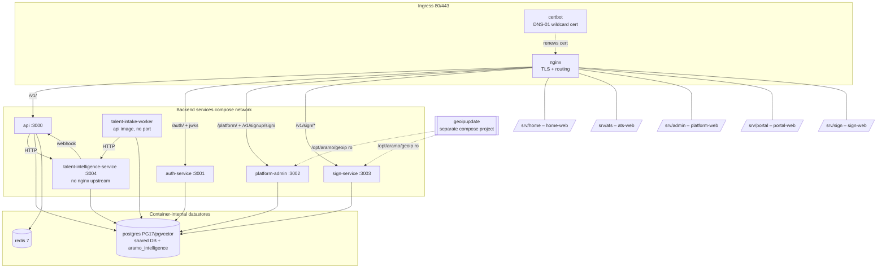
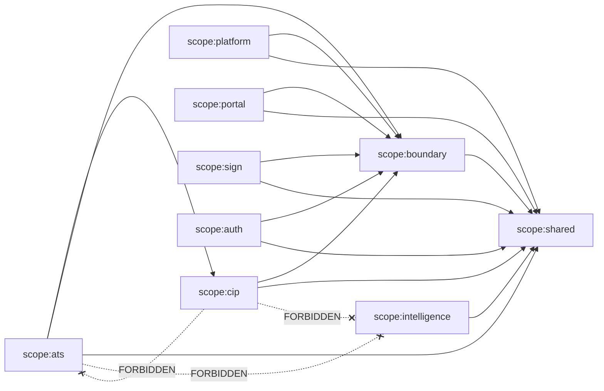

# D01 — System Context, Topology & Monorepo Map (AS-BUILT)
> Baseline SHA 680907fc06620845944794e0a529918c980f5124 · category AS-BUILT
> Refreshed from baseline 12330b0f (2026-10-09) to 680907fc (2026-10-24): the workspace grew to 10 apps and 80 libs (new `talent-intelligence-service` with its own database and `scope:intelligence` wall, new `home-web` App Home at the tenant host root with ATS moved under `/ats/`, `esign-service` renamed `sign-service`, the sign host widened to the one Aramo Sign application) and the legacy trust libs (`talent-trust`, `identity-index`, `platform-trust`, `talent-reconcile`, `talent-reconcile-signal`) were retired.

## Summary

Aramo is an Nx monorepo (`package.json:2` name `aramo-core`; `nx.json:51`
`"defaultBase": "main"`) comprising **10 applications** under `apps/` and **80
libraries** under `libs/`, plus 3 boundary-probe projects under
`tools/intelligence-boundary-probes/` (test fixtures for the Talent Intelligence
wall). The 10 apps split into two kinds:

- **5 backend NestJS services** — each has its own `Dockerfile` and a
  `NestFactory` bootstrap with a default `PORT`: `api` (3000), `auth-service`
  (3001), `platform-admin` (3002), `sign-service` (3003),
  `talent-intelligence-service` (3004).
- **5 Vite/React SPA frontends** — `ats-web` (dev 4201, Vite base `/ats/`),
  `platform-web` (dev 4202), `portal-web` (dev 4203), `home-web` (dev 4205),
  `sign-web` (dev 4206). The SPAs have no Dockerfile of their own; they are
  built and baked into the nginx image. Two shared FE libs
  (`libs/org-admin-web`, `libs/document-templates-web`, both `scope:shared`) are
  composed into `home-web` (`/org/*`) and `ats-web`.

The 80 libs are partitioned by **nx boundary tags** enforced via
`@nx/enforce-module-boundaries` (`eslint.config.mjs:164`), with the
`SCOPE_DEP_CONSTRAINTS` table (`eslint.config.mjs:79`) encoding the
Pipeline⊥ATS wall, the new ATS⊥Talent-Intelligence wall, and the
platform/portal/sign/auth cluster walls. A second, apps-scoped override
(`eslint.config.mjs:174`–`191`) forbids every untagged composition root
(api, auth-service, sign-service, ats-web, home-web) from importing
`scope:intelligence`.

Two runtime topologies co-exist in the tree: a **single-box prod stack**
(`docker-compose.prod.yml`, project name `aramo-singlebox`, 10 services) fronted
by nginx, and a **full AWS ECS/ALB/VPC environment set**
(`infrastructure/environments/{prod,staging,dev}`). A separate
`infrastructure-lightsail/` track describes the Lightsail box. A separate compose
project (`deploy/geoip/docker-compose.geoip.yml`, project `aramo-geoip`) keeps
the GeoLite2 files current on the box. Local dev uses `docker-compose.yml`
(Postgres + Redis + LocalStack with `events,sqs,secretsmanager`).

## Modules & Services

| name | role | evidence path:line + symbol |
|------|------|------------------------------|
| api | Core ATS backend (NestJS), default port 3000 | `apps/api/src/main.ts:34` `const port = process.env['PORT'] ?? 3000` |
| talent-intake-worker | Same api image, different command: the single-box outbox drain + in-process résumé extraction + ATS talent outbox drain; no HTTP port | `docker-compose.prod.yml:314` service; `:318` `command: ["node", "dist/apps/api/src/talent-intake-worker.main.js"]` |
| auth-service | Identity / JWT / OAuth backend, port 3001 | `apps/auth-service/src/main.ts:11` `?? 3001` |
| platform-admin | Platform Console backend (`scope:platform`), port 3002 | `apps/platform-admin/src/main.ts:17` `?? 3002`; `apps/platform-admin/project.json:6` |
| sign-service | Aramo Sign backend, port 3003 | `apps/sign-service/src/main.ts:10` `?? 3003` |
| talent-intelligence-service | Talent Intelligence (ADR-0036), own database `aramo_intelligence`, port 3004, `scope:intelligence` | `apps/talent-intelligence-service/src/main.ts:15` `const DEFAULT_PORT = 3004`; `apps/talent-intelligence-service/project.json:6` |
| ats-web | Recruiter ATS SPA (React/Vite), dev 4201, served under `/ats/` | `apps/ats-web/vite.config.ts:58` `port: 4201`; `:38` `base: '/ats/'` |
| home-web | App Home (`/`) + Organization Administration (`/org/*`) SPA, dev 4205, untagged | `apps/home-web/vite.config.ts:33` `port: 4205`; `apps/home-web/project.json:6` `"tags": []` |
| platform-web | Platform Console SPA (`scope:platform`), dev 4202 → served at `/srv/admin` | `apps/platform-web/vite.config.ts:34` `port: 4202` |
| portal-web | Talent-facing Portal SPA (`scope:portal`), dev 4203 | `apps/portal-web/vite.config.ts:28` `port: 4203` |
| sign-web | The one Aramo Sign SPA (guest signing + workspace, `scope:sign`), dev 4206 | `apps/sign-web/vite.config.ts:32` `port: 4206` |
| nginx | Single ingress on 80/443; TLS + static + path routing | `docker-compose.prod.yml:63` service `nginx`; `deploy/nginx/Dockerfile` |
| certbot | DNS-01 `*.aramo.ai` wildcard-cert sidecar | `docker-compose.prod.yml:133` service `certbot` |
| postgres | PG17 (pgvector image) — one server holding the shared Aramo DB and the separate `aramo_intelligence` DB | `docker-compose.prod.yml:676` (image `:681`); `docker-compose.yml:20` `image: pgvector/pgvector:pg17` (service header `:18`) |
| redis | BullMQ backing store | `docker-compose.prod.yml:697` (image `:698`); `docker-compose.yml:37` `image: redis:7` (service header `:36`) |
| geoipupdate | MaxMind updater in its own compose project; feeds `/opt/aramo/geoip` read-only to platform-admin + sign-service | `deploy/geoip/docker-compose.geoip.yml:15` service; `:16` `image: ghcr.io/maxmind/geoipupdate:v7.1.0` |
| localstack | Local AWS (EventBridge + SQS + Secrets Manager) | `docker-compose.yml:56` `image: localstack/localstack:3` (service header `:55`); `:61` `SERVICES: events,sqs,secretsmanager` |

**Scope-tag partition (nx scope tags, re-derived — see coverage fragment):**
lib-only counts: `scope:ats` (41), `scope:cip` (8), `scope:shared` (20),
`scope:boundary` (9), `scope:auth` (1), `scope:intelligence` (1) = **80 libs**
(every lib is tagged). App-only counts: `scope:platform` (2: platform-admin,
platform-web), `scope:portal` (1), `scope:sign` (1: sign-web),
`scope:intelligence` (1: talent-intelligence-service); 5 apps are untagged
(api, auth-service, sign-service, ats-web, home-web). The three boundary probes
carry `scope:ats`, `scope:cip` and `scope:intelligence` one each
(`tools/intelligence-boundary-probes/*/project.json`).

The dependency rules (`eslint.config.mjs:79`–`110`): `scope:cip` may depend only
on `cip|boundary|shared` and never on `scope:intelligence` (`:80`); `scope:ats`
may additionally depend on `scope:cip` (`:83`, the one-directional ATS→Pipeline
allowance) and never on `scope:intelligence`; `scope:intelligence` may depend
only on `intelligence|shared` (`:89`); `scope:platform`, `scope:portal`,
`scope:sign`, `scope:auth` each depend only on themselves + `boundary` +
`shared` (`:90`, `:91`, `:97`, `:107`); a retained `scope:esign-sender` rule
walls any stray project carrying the retired sender-console tag (`:101`; 0
projects carry it); `scope:boundary` → `boundary|shared` (`:108`);
`scope:shared` → `shared` only (`:109`); trailing `*` → `*` (`:110`). The only
code shared between ATS and Talent Intelligence is
`libs/intelligence-contracts` (`scope:shared`, `libs/intelligence-contracts/src/index.ts:1`–`4`).

## Data Models

D01 is a topology domain; no new data models are defined here. Persistence is
Prisma-per-lib: **54 git-tracked `schema.prisma` files** (see coverage); the
single `prisma:generate` script (`package.json:25`) enumerates **49** of them
explicitly (`grep -o 'prisma generate'` on that line → 49) — the same five
git-tracked lib schemas (`libs/audit`, `libs/auth`, `libs/common`,
`libs/events`, `libs/matching`) are absent from the script.

Two databases now live on the one Postgres server:

- the **shared Aramo DB** (`DATABASE_URL`, per-lib/per-domain schemas,
  cross-schema references by UUID, no cross-schema FK — ADR-0029 I1/I15),
  migrated by `tools/db-sync-local.sh` with ledger `public._local_migrations`;
- the **Talent Intelligence DB** `aramo_intelligence` (role
  `aramo_intelligence`, `INTELLIGENCE_DATABASE_URL`,
  `docker-compose.prod.yml:547`), schema `intelligence`
  (`libs/intelligence-core/prisma/schema.prisma:19`, 26 models, 4 migrations),
  migrated by `tools/db-sync-intelligence.sh` with its own ledger; created
  idempotently by `tools/ensure-intelligence-db.sh` from
  `deploy/migrate-prod.sh` (`:36`–`40`, `migrate_intelligence()` at `:194`).
  The TI service refuses the shared DB (`docker-compose.prod.yml:544`–`545`
  comment).

## API Endpoints

D01 does not define HTTP endpoints; it records the **front-door routing topology**
(nginx reverse-proxy map, `deploy/nginx/templates/aramo.conf.template`):

| host class | route | upstream | evidence path:line |
|------------|-------|----------|--------------------|
| tenant | `= /v1/webhooks/indeed/apply` | `api:3000` | `:53`–`55` |
| tenant | `/v1/talent-intake-drafts/{id}/events` (SSE) | `api:3000` | `:66`–`67` |
| tenant | `/v1/` | `api:3000` | `:78`–`79` `proxy_pass http://api:3000` |
| tenant | `/auth/` | `auth-service:3001` | `:81`–`82` |
| tenant | `/ats/` (SPA, alias) | `alias /srv/ats/` | `:105`–`107`; `= /ats` → `301 /ats/` `:110`–`111` |
| tenant | `/` (App Home SPA) | `root /srv/home` | `:114`–`115` |
| admin | `/auth/` | `auth-service:3001` | `:134`–`135` |
| admin | `/platform/skills`, `/platform/skill-review-queue`, `/platform/skill-proposals` | `api:3000` | `:154`–`161` |
| admin | `/platform/document-templates`, `/platform/template-variables` | `api:3000` | `:168`–`172` |
| admin | `/platform/matching-policy` | `api:3000` | `:177`–`178` |
| admin | `/platform/` | `platform-admin:3002` | `:180`–`181` |
| admin | `/` (SPA) | `root /srv/admin` | `:195`–`196` |
| admin | (no `/v1` location — R14 negative control) | — | `:187`–`193` comment |
| portal | `/v1/portal/` | `api:3000` | `:218`–`219` |
| portal | `/auth/` | `auth-service:3001` | `:221`–`222` |
| portal | `/` (SPA) | `root /srv/portal` | `:236`–`237` |
| sign | `/v1/sign/signing/`, `/v1/sign/sender/`, `/v1/sign/billing/`, `/v1/sign/inbox`, `/v1/sign/legal/`, `/v1/sign/account/`, `/v1/sign/report` | `sign-service:3003` | `:298`–`339` |
| sign | `/v1/signup/sign/` (rate-limited, dark unless enabled) | `platform-admin:3002` | `:343`–`346` |
| sign | `/v1/tenant/domain-verification`, `/v1/domain-verification/delegate` (named exception) | `api:3000` | `:348`–`363` |
| sign | `/auth/` | `auth-service:3001` | `:365`–`366` |
| sign | `~ ^/(s|d)/` guest signing shell, `/` workspace SPA | `root /srv/sign` | `:375`–`376`, `:390`–`391` |
| tenant/admin/portal | `= /.well-known/jwks.json` | `auth-service:3001` | `:93`–`94`, `:183`–`184`, `:232`–`233` |
| port-80 | `= /healthz` → 200; `/` → 301 https | — | `:399`–`407` |

`talent-intelligence-service` has **no nginx upstream** by design: it is
reachable only on the compose network at `http://talent-intelligence-service:3004`
(`docker-compose.prod.yml:528`–`533` comment; `:172`, `:337`
`INTELLIGENCE_SERVICE_URL` default), and it calls back to
`http://api:3000/v1/integrations/intelligence/events` (`:557`).

## Screens & FE→BE Wiring (FE domains only)

The nginx image baked at build time compiles all five SPAs and places them on
disk (`deploy/nginx/Dockerfile:34`–`45` `nx build aramo-{home,ats,platform,portal,sign}-web`;
`:90`–`94` `COPY --from=web-builder … /srv/{home,ats,admin,portal,sign}`):

- `home-web` → `/srv/home`, served at the tenant host root; App Home at `/`,
  Organization Administration at `/org/*` (from `libs/org-admin-web`); calls
  `/v1/*` and `/auth/*`; dev proxy forwards `/ats` to the ats-web dev server
  (`apps/home-web/vite.config.ts:35`–`41`).
- `ats-web` → `/srv/ats`, served at the tenant host under `/ats/`; calls `/v1/*`
  (api) and `/auth/*` (auth-service).
- `platform-web` → `/srv/admin`, served at the admin host; calls `/platform/*`
  (platform-admin, or api for the edge-mapped prefixes) + `/auth/*`.
- `portal-web` → `/srv/portal`, served at the portal host; HTTP-only against
  `/v1/portal/*` (no backend-lib import — `scope:portal` wall).
- `sign-web` → `/srv/sign`, served at the sign host; HTTP-only against the
  `/v1/sign/*` surfaces, `/v1/signup/sign/*` and `/auth/*`
  (`apps/sign-web/vite.config.ts:37`–`46` dev proxy).

The dev-time Vite proxies live in each app's `vite.config.ts` (ports above).

## Key Flows

### Deployment / component topology (single-box prod stack)

Evidence: `docker-compose.prod.yml:63,133,151,314,357,419,527,590,676,697`;
`deploy/nginx/templates/aramo.conf.template:78,180,301,346`;
`deploy/geoip/docker-compose.geoip.yml:15`.

### nx scope-tag dependency wall (summarized)

Evidence: `eslint.config.mjs:79`–`110` `SCOPE_DEP_CONSTRAINTS`; enforced at
`eslint.config.mjs:164` `@nx/enforce-module-boundaries`; untagged-app override
`eslint.config.mjs:188`.

## Evidence Index (load-bearing path:line citations)

- `package.json:2` — workspace name `aramo-core`
- `package.json:25` — `prisma:generate` enumerating 49 lib schemas
- `nx.json:51` — `"defaultBase": "main"`
- `nx.json:38` — `plugins` (@nx/eslint, @nx/vite)
- `apps/api/src/main.ts:34` — api PORT 3000
- `apps/auth-service/src/main.ts:11` — auth-service PORT 3001
- `apps/platform-admin/src/main.ts:17` — platform-admin PORT 3002
- `apps/sign-service/src/main.ts:10` — sign-service PORT 3003
- `apps/talent-intelligence-service/src/main.ts:15` — TI `DEFAULT_PORT = 3004`
- `apps/ats-web/vite.config.ts:58` — ats-web dev port 4201; `:38` `base: '/ats/'`
- `apps/platform-web/vite.config.ts:34` — platform-web dev port 4202
- `apps/portal-web/vite.config.ts:28` — portal-web dev port 4203
- `apps/home-web/vite.config.ts:33` — home-web dev port 4205
- `apps/sign-web/vite.config.ts:32` — sign-web dev port 4206
- `apps/platform-admin/project.json:6` — tag `scope:platform`
- `apps/platform-web/project.json:6` — tag `scope:platform`
- `apps/portal-web/project.json:6` — tag `scope:portal`
- `apps/sign-web/project.json:6` — tag `scope:sign`
- `apps/talent-intelligence-service/project.json:6` — tag `scope:intelligence`
- `libs/intelligence-core/project.json:7` — tag `scope:intelligence`
- `libs/intelligence-contracts/src/index.ts:1` — the only ATS/TI shared code (`scope:shared`)
- `eslint.config.mjs:79` — `const SCOPE_DEP_CONSTRAINTS`
- `eslint.config.mjs:80` — `scope:cip` constraint (+ never `scope:intelligence`)
- `eslint.config.mjs:83` — `scope:ats` may depend on `scope:cip`, never `scope:intelligence`
- `eslint.config.mjs:89` — `scope:intelligence` → `intelligence|shared` only
- `eslint.config.mjs:164` — `@nx/enforce-module-boundaries` rule
- `eslint.config.mjs:188` — untagged-apps override forbidding `scope:intelligence`
- `docker-compose.yml:20` — local postgres `image: pgvector/pgvector:pg17` (service header `:18`)
- `docker-compose.yml:37` — local redis `image: redis:7` (service header `:36`)
- `docker-compose.yml:56` — local localstack `image: localstack/localstack:3` (service header `:55`)
- `docker-compose.prod.yml:55` — compose project `name: aramo-singlebox`
- `docker-compose.prod.yml:63` — nginx service
- `docker-compose.prod.yml:133` — certbot service
- `docker-compose.prod.yml:151` — api service
- `docker-compose.prod.yml:314` — talent-intake-worker service
- `docker-compose.prod.yml:357` — auth-service service
- `docker-compose.prod.yml:419` — sign-service service
- `docker-compose.prod.yml:527` — talent-intelligence-service service
- `docker-compose.prod.yml:590` — platform-admin service
- `docker-compose.prod.yml:676` — prod postgres service
- `docker-compose.prod.yml:697` — prod redis service
- `deploy/geoip/docker-compose.geoip.yml:15` — geoipupdate (separate project `aramo-geoip`, `:12`)
- `deploy/nginx/Dockerfile:34` — `nx build aramo-home-web`
- `deploy/nginx/Dockerfile:90` — `COPY --from=web-builder … /srv/home`
- `deploy/nginx/templates/aramo.conf.template:66` — SSE talent-intake-drafts events location
- `deploy/nginx/templates/aramo.conf.template:78` — `/v1/` → api
- `deploy/nginx/templates/aramo.conf.template:81` — `/auth/` → auth-service
- `deploy/nginx/templates/aramo.conf.template:105` — `/ats/` → `alias /srv/ats/`
- `deploy/nginx/templates/aramo.conf.template:115` — `root /srv/home`
- `deploy/nginx/templates/aramo.conf.template:180` — `/platform/` → platform-admin
- `deploy/nginx/templates/aramo.conf.template:196` — `root /srv/admin`
- `deploy/nginx/templates/aramo.conf.template:237` — `root /srv/portal`
- `deploy/nginx/templates/aramo.conf.template:298` — `/v1/sign/signing/` → sign-service
- `deploy/nginx/templates/aramo.conf.template:343` — `/v1/signup/sign/` → platform-admin
- `deploy/nginx/templates/aramo.conf.template:356` — `/v1/tenant/domain-verification` → api (sign host)
- `deploy/nginx/templates/aramo.conf.template:391` — `root /srv/sign`
- `deploy/migrate-prod.sh:194` — `migrate_intelligence()` (TI DB ensure + migrate + gate)
- `libs/intelligence-core/prisma/schema.prisma:19` — `schemas = ["intelligence"]`
- `doc/generated/repo-map.projects.json:2` — `aliasTotals.total: 84`
- `tsconfig.base.json:1` — 84 `@aramo/*` path mappings
- `infrastructure-lightsail/main.tf:1` — Lightsail single-box track
- `infrastructure/environments/prod/main.tf:1` — ECS/ALB/VPC prod environment
- `infrastructure/modules/talent-intake-events/main.tf:1` — EventBridge+SQS module (ADR-0033)

## NOT VERIFIED (explicit)

- **Running prod runtime vs repo desired-state.** This recon reads the frozen
  tree only; which compose/IaC track is actually live, whether the
  talent-intelligence-service container and `aramo_intelligence` database exist
  on the box, and whether the EventBridge/SQS IaC
  (`infrastructure/modules/talent-intake-events`) is applied, are runtime facts
  not derivable from code at this SHA — NOT VERIFIED.
- **`.env` / secret values.** Env-var *names* are enumerated in the compose files;
  their runtime values are out of tree — NOT VERIFIED.
- **Exact per-lib tag correctness vs ADR-0029 D5 / ADR-0036 intended partition**
  is beyond D01's topology scope; the tag *counts* are re-derived in the
  coverage fragment, but individual lib-to-cluster assignment correctness is NOT
  VERIFIED here (one known exception is recorded as gap D01-G5).
- **`tsconfig.base.json` path-count vs repo-map alias-count parity** — both equal
  84 by independent grep, but byte-level one-to-one correspondence of every entry
  is NOT individually walked.
- **TI service internals** (controllers, workers, token exchange) were inventoried
  by directory only (`apps/talent-intelligence-service/src/app/`); behaviour is
  owned by other domains — NOT VERIFIED here.
