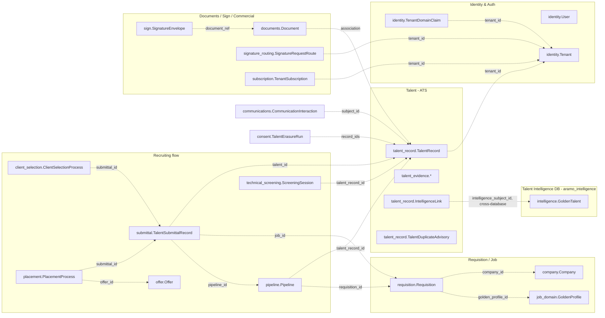
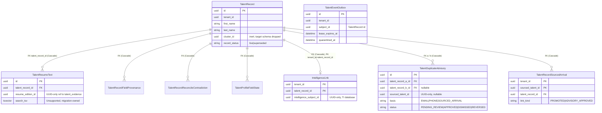
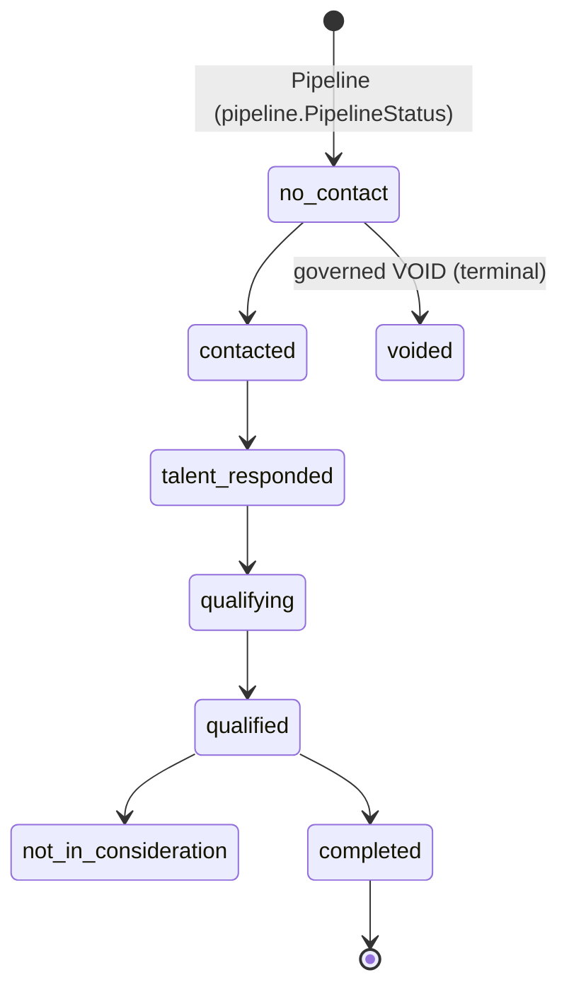
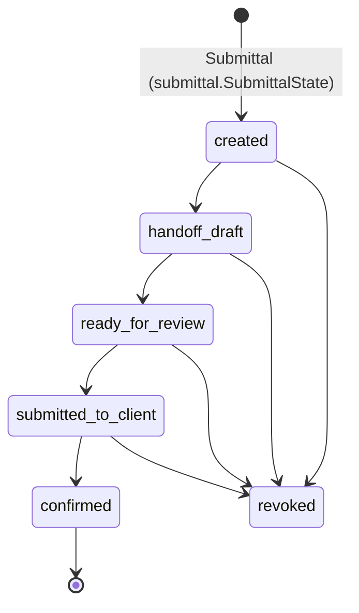
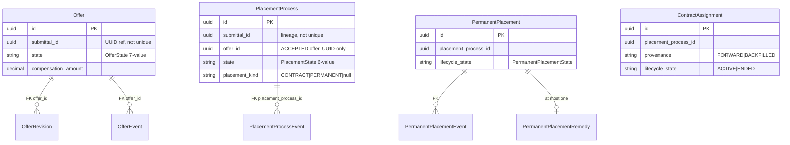
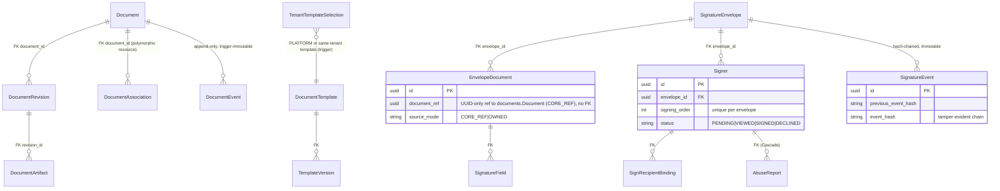
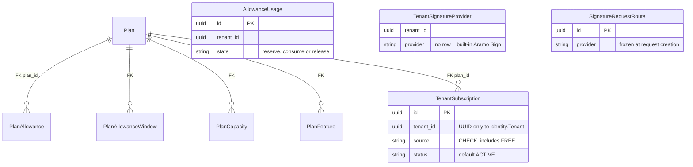
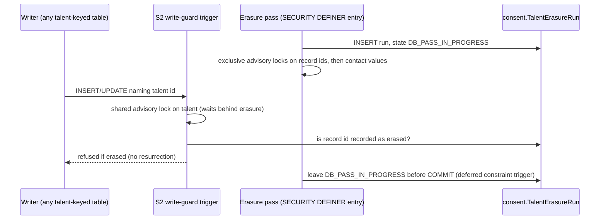

# D02 — Database & Domain Data Model (AS-BUILT)
> Refreshed from baseline 12330b0f (2026-10-09) to 680907fc (2026-10-24): the legacy trust / identity-index schemas were dropped (ATI-SEP-1), Talent Intelligence moved to its own database (`intelligence-core`), `esign` was renamed `sign`, and new `subscription`, `signature_routing` and `technical_screening` schemas plus large identity, documents, consent (S2 erasure) and talent-record additions landed.
> Baseline SHA 680907fc06620845944794e0a529918c980f5124 · category AS-BUILT

## Summary

Aramo persists its domain in PostgreSQL under a **schema-per-module** architecture: each `libs/*` module owns a dedicated Prisma schema file and a dedicated Postgres `@@schema` namespace. Prisma is the single ORM; every module declares `provider = "prisma-client-js"` with a per-module `output = "./generated/client"` and `datasource db { provider = "postgresql" }`.

At this SHA there are **two databases**. Every schema except one lives in the shared Aramo database (`DATABASE_URL`). `libs/intelligence-core` (namespace `intelligence`) lives in its own database `aramo_intelligence` with its own role and `INTELLIGENCE_DATABASE_URL` (`libs/intelligence-core/prisma/schema.prisma:3`), migrated by `tools/db-sync-intelligence.sh` and excluded from `tools/db-sync-local.sh` (`tools/db-sync-local.sh:53` `SEPARATE_DB_MIGRATION_LIBS="intelligence-core"`).

Re-derived counts at this SHA (every number reproduced by a command noted in the coverage fragment):

- **54** git-tracked `schema.prisma` files (`git ls-tree -r --name-only 680907fc | grep -E '/prisma/schema\.prisma$'`). Added: `intelligence-core`, `sign`, `signature-routing`, `subscription`, `technical-screening`. Removed: `esign` (renamed to `sign`), `identity-index`, `platform-trust`, `talent-trust`.
- **283** `model` declarations across those 54 files.
- **5** of the 54 schemas are scaffold-only (zero models): `libs/audit`, `libs/auth`, `libs/common`, `libs/events`, `libs/matching`. Each carries the comment "Zero models exist yet" (e.g. `libs/audit/prisma/schema.prisma:8`). **49** schemas are model-bearing.
- **51** distinct `@@schema("…")` namespace values; **382** `@@schema` annotation lines total.
- **98** `enum` declarations.
- **314** tracked `migration.sql` files (253 at the old baseline − 23 deleted with the retired libs + 84 added; 5 more were moved `libs/esign` → `libs/sign` unchanged). 4 of the 314 (`libs/intelligence-core`) apply to the separate Talent Intelligence database.

The data-architecture contract (cross-schema references are UUID-only with NO foreign-key constraint; intra-schema relations carry real FKs; every tenant-scoped table leads with `tenant_id`) is documented in `doc/05-conventions.md:122` and is observed structurally in every schema read for this audit. The cross-tenant `identity_index` / `PersonCluster` exception no longer exists: migration `libs/talent-record/prisma/migrations/20261024170000_ati_sep_1_drop_legacy_trust_schemas/migration.sql:31` runs `DROP SCHEMA IF EXISTS talent_trust CASCADE` and the next two lines drop `platform_trust` and `identity_index`. Tables without a `tenant_id` that remain are platform-global by design (e.g. `skills_taxonomy.Skill`, `documents.TemplateVariable` "Platform-maintained: NO tenant_id" at `libs/documents/prisma/schema.prisma:347`) or live in the Talent Intelligence database, where global subjects have no tenant (`IntelligenceOutbox.tenant_id String?`, `libs/intelligence-core/prisma/schema.prisma:376`).

Recurring structural idioms observed across modules: per-module transactional-outbox tables, append-only event-log tables with DB-level immutability triggers, optimistic-concurrency `version` integers, `Decimal(12,2)` in placement/requisition/offer (`talent_evidence.TalentRateExpectation.min_rate`/`target_rate` are `Float`, `libs/talent-evidence/prisma/schema.prisma:440-441`), String-plus-app-guard closed vocabularies (in preference to native Postgres enums; the `identity` schema and the new `sign`, `subscription`, `intelligence` and `technical_screening` schemas declare zero enums), pgvector / tsvector columns declared `Unsupported(...)` so the hand-authored migration owns their DDL, and (new) S2 erasure write-guard triggers that serialize every talent-keyed write against an erasure run.

## Modules & Services

Model-bearing schema modules (role = the bounded context the schema owns). Evidence cites the schema file + a representative model.

| name | role | evidence path:line+symbol |
|---|---|---|
| libs/talent-record | ATS talent system-of-record (person key) + talent event outbox + TI link + within-tenant duplicate advisory | `libs/talent-record/prisma/schema.prisma:47` model `TalentRecord`; `:229` `TalentEventOutbox`; `:536` `TalentDuplicateAdvisory` |
| libs/talent-evidence | Talent L1 evidence + resume editions + intake drafts + education retirement/audit | `libs/talent-evidence/prisma/schema.prisma:884` model `TalentIntakeOutboxEvent`; `:932` `EducationEntryRetirement` |
| libs/intelligence-core | Talent Intelligence golden model, assertions, verification, disputes, trust state (separate database) | `libs/intelligence-core/prisma/schema.prisma:49` model `GoldenTalent` |
| libs/talent-embedding | pgvector semantic index for Talent | `libs/talent-embedding/prisma/schema.prisma:41` `embedding Unsupported("vector(1536)")` |
| libs/identity | Users / tenants / sites / roles / scopes / teams + signup, domain claim, personal signup, risk state | `libs/identity/prisma/schema.prisma:21` model `User`; `:56` `Tenant`; `:473` `TenantDomainClaim` |
| libs/requisition | ATS job-order + assignment visibility + comp | `libs/requisition/prisma/schema.prisma:111` model `Requisition` |
| libs/job-domain | Job + GoldenProfile matching seam | (model inventory) `Job`, `GoldenProfile` |
| libs/pipeline | (talent × requisition) recruiting state machine | `libs/pipeline/prisma/schema.prisma:74` model `Pipeline` |
| libs/submittal | Submittal workflow entity + event log | `libs/submittal/prisma/schema.prisma:122` model `TalentSubmittalRecord` |
| libs/submittal-eligibility | Per-requisition submittal policy + consumption | (model inventory) `RequisitionSubmittalPolicy` |
| libs/client-selection | Client review/interview decision lifecycle | `libs/client-selection/prisma/schema.prisma:38` model `ClientSelectionProcess` |
| libs/selection | Talent selection aggregate + event log | (model inventory) `TalentSelection`, `TalentSelectionEvent` |
| libs/placement | Placement spine + offer + contract/perm assignment + commercial | `libs/placement/prisma/schema.prisma:90` model `PlacementProcess` |
| libs/placement-pipeline-bridge | Placement↔pipeline inbox bridge | (model inventory) `PlacementPipelineInbox` |
| libs/pre-start-requirement | Pre-start requirement sets/instances | (model inventory) `PreStartRequirementSet` |
| libs/documents | Canonical document identity + shared template library + packets | `libs/documents/prisma/schema.prisma:53` model `Document`; `:318` `TenantTemplateSelection` |
| libs/sign | Native e-signature envelopes, multi-signer, integrations/webhooks, abuse reports, tamper-evident event chain | `libs/sign/prisma/schema.prisma:23` model `SignatureEnvelope`; `:535` `AbuseReport` |
| libs/signature-routing | Tenant e-signature provider selection + per-request provider freeze | `libs/signature-routing/prisma/schema.prisma:20` model `TenantSignatureProvider` |
| libs/subscription | Plan catalog, allowances, tenant subscription, billing, capacity, legal acceptance | `libs/subscription/prisma/schema.prisma:30` model `Plan`; `:105` `TenantSubscription` |
| libs/technical-screening | Manual technical screening sessions, findings, publication intents | `libs/technical-screening/prisma/schema.prisma:33` model `ScreeningSession` |
| libs/company | Client/employer org + party-role + assignment axes | `libs/company/prisma/schema.prisma:41` model `Company` |
| libs/contact | ATS contact reference data | (model inventory) `Contact` |
| libs/communications | Provider-neutral calling/email system-of-record + meeting scheduling sidecar | `libs/communications/prisma/schema.prisma:183` model `CommunicationInteraction`; `:467` `MeetingSchedulingOperation` |
| libs/consent | Talent consent event ledger + per-module outbox + erasure run ledger | `libs/consent/prisma/schema.prisma:141` model `TalentErasureRun` |
| libs/examination | Talent↔job examination (evidence-only; R10) | `libs/examination/prisma/schema.prisma:82` model `TalentJobExamination` |
| libs/evidence | Immutable talent-job evidence package | (model inventory) `TalentJobEvidencePackage` |
| libs/integration | External connectors + lifecycle mappings + reconciliation | (model inventory) 13 models incl. `IntegrationConnection` |
| libs/skills-taxonomy | Platform-global skills taxonomy + governance + matching policy versions | `libs/skills-taxonomy/prisma/schema.prisma:242` model `MatchingPolicyVersion` |
| libs/canonicalization | Canonicalization outbox + raw-payload ref (+ ingestion ns) | `libs/canonicalization/prisma/schema.prisma` datasource `["canonicalization","ingestion"]` |
| libs/policy-store | Stored policy versions + decision records (ADR-0024) | (model inventory) `StoredPolicyVersion`, `PolicyDecisionRecord` |
| libs/portal-identity | Portal user + login token + notice delivery | (model inventory) `PortalUser` |
| libs/import | Import batch + failure provenance | (model inventory) `ImportBatch` |
| libs/activity | Recruiter activity + enterprise-note ledger | `libs/activity/prisma/schema.prisma:98` model `Activity` |
| libs/conversation-intelligence | CI runs / claims / citations / drafts (DARK) | (model inventory) 5 models |
| libs/auth-storage | Host auth profile + refresh tokens | (model inventory) `HostAuthProfile`, `RefreshToken` |
| (others) | attachment, calendar, client-talent-restriction, conversation-transcript, entitlement, ingestion, job-distribution, metering, saved-list, settings, sourced-talent, task, tenant-reset, ai-draft | per model inventory in Data Models |

The 5 scaffold-only (zero-model) schemas — `libs/audit`, `libs/auth`, `libs/common`, `libs/events`, `libs/matching` — declare generator + datasource only.

## Data Models

Full per-schema model inventory at this SHA (`grep -E '^model '` per tracked schema; 283 models total). Namespace in parentheses where it differs from or extends the lib name.

- **talent_record** (`talent_record`): TalentRecord, TalentEventOutbox, TalentResumeText, TalentRecordFieldProvenance, TalentRecordReconcileContradiction, TalentProfileFieldState, IntelligenceLink, TalentIntelligenceInboundEvent, TalentIntelligenceSyncPolicy, TalentDuplicateAdvisory, TalentRecordSourcedArrival
- **talent-evidence** (`talent_evidence`): TalentSkillEvidence, TalentWorkHistoryEntry, TalentEducationEntry, TalentCertificationEntry, TalentProjectExperience, TalentContactMethod, TalentRateExpectation, TalentWorkAuthorization, TalentDocument, TalentDerivedSnapshot, TalentResumeEdition, TalentResumeDefault, ResumeExtractionDraft, TalentIntakeDraft, TalentIntakeOutboxEvent, EducationEntryRetirement, EducationEntryAuditEvent
- **intelligence-core** (`intelligence`, separate database): ServiceInfo, GoldenTalent, SubjectIdentifier, ExternalTalentReference, Assertion, AssertionEvent, AssertionLink, EvidenceArtifact, DocumentTypePolicy, ArtifactSupport, ResolvedProfileFact, IdentityConflict, MergeSplitEvent, IntelligenceInbox, IntelligenceQuarantine, IntelligenceOutbox, ServiceClient, VerificationRequest, SubjectTrustState, EntitledTenant, IntelligenceReadAudit, IntelligenceWebhookDelivery, AssertionDispute, AssertionDisputeStatement, AssertionDisputeEvent, VerificationProposal
- **talent-embedding** (`talent_embedding`): TalentEmbedding
- **identity** (`identity`): User, Tenant, Site, UserTenantMembership, Role, Scope, RoleScope, UserTenantMembershipRole, ServiceAccount, AuthorizationVersion, ExternalIdentity, Invitation, SignupRequest, OrganizationAuthorityAttestation, TenantBillingRegionPolicy, TenantDomainClaim, TenantDomainException, DomainVerificationDelegation, TenantIdentityProviderPolicy, ExternalIdentityIdp, IdentityAuditEvent, ManagementEdge, Team, TeamMembership, PersonalSignupRequest, TenantRiskState, PersonalSignupInvite
- **requisition** (`requisition`): Requisition, RequisitionNumberSequence, RequisitionAssignment, UserRequisitionState, RequisitionLifecycleEvent, RequisitionSkillRequirement, RequisitionEmbedding
- **job-domain** (`job_domain`): Job, GoldenProfile
- **pipeline** (`pipeline`): Pipeline, PipelineStatusHistory, PipelineDisposition, PipelineEntryProvenance, OutboxEvent, TalentRequisitionResume
- **submittal** (`submittal`): TalentSubmittalRecord, OutboxEvent, TalentSubmittalEvent
- **submittal-eligibility** (`submittal_policy`): RequisitionSubmittalPolicy, SubmittalConsumption, SubmittalPolicyEvent
- **client-selection** (`client_selection`): ClientSelectionProcess, InterviewSession, ClientSelectionEvent, OutboxEvent
- **selection** (`selection`): TalentSelection, OutboxEvent, TalentSelectionEvent
- **placement** (`placement` + `offer`): PlacementProcess, PlacementProcessEvent, OutboxEvent, Offer, OfferRevision, OfferEvent, OfferOutboxEvent, ContractAssignment, AssignmentExtension, AssignmentRateVersion, CommercialRevisionProposal, CommercialRevisionProposalEvent, PermanentPlacement, PermanentPlacementEvent, PermanentPlacementRemedy, PermanentPlacementGuaranteeTermVersion, PermanentPlacementConversionLineage
- **placement-pipeline-bridge** (`placement_pipeline_bridge`): PlacementPipelineInbox
- **pre-start-requirement** (`pre_start_requirement`): PreStartRequirementSet, PreStartRequirementDefinition, PreStartRequirementInstance, PreStartMaterializationIntent, PreStartRequirementAudit, PreStartReadinessDecision
- **documents** (`documents`): DocumentType, Document, DocumentRevision, DocumentArtifact, DocumentAssociation, DocumentEvent, OutboxEvent, IdempotencyKey, DocumentTemplate, TemplateVersion, TenantTemplateSelection, TemplateVariable, TemplateFieldDefinition, TemplateAsset, DocumentRequirement, DocumentPacket, DocumentPacketItem
- **sign** (`sign`): SignatureEnvelope, EnvelopeDocument, Signer, SignatureField, SigningSession, SignerDisclosureAcceptance, SignatureEvent, NotificationDelivery, IdempotencyKey, OutboxEvent, ExecutedDocument, ExecutionCertificate, ExecutedAccessGrant, SignApplication, SignInstallation, SignCredential, SignRoleMapping, SignAccessToken, SignWebhookSubscription, SignWebhookDelivery, SignRecipientBinding, AbuseReport
- **signature-routing** (`signature_routing`): TenantSignatureProvider, SignatureProviderSelectionEvent, SignatureRequestRoute, ProviderOAuthState
- **subscription** (`subscription`): Plan, PlanAllowance, PlanAllowanceWindow, TenantSubscription, AllowanceUsage, CheckoutIntent, BillingEvent, TenantBillingAccount, BillingReconciliationFlag, PlanCapacity, PlanFeature, CapacityUsage, LegalAcceptance, LegalAcceptanceOrigin
- **technical-screening** (`technical_screening`): ScreeningSession, ScreeningFinding, ScreeningFindingCitation, ScreeningAiGeneration, ScreeningQuestion, ScreeningNote, ScreeningAssistSuggestion, ScreeningTranscriptLink, ScreeningEvidencePublication, ScreeningEvent
- **company** (`company`): Company, CompanyDepartment, UserClientAssignment, TeamClientOwnership, CompanyRelationship, CompanyEmbedding
- **contact** (`contact`): Contact
- **communications** (`communications` + `audit`): CommunicationInteraction, CommunicationAssociation, CommunicationDisposition, CommunicationProviderEvent, CommunicationProviderIdentity, EmailTemplate, MeetingSchedulingOperation, MeetingSchedulingAuditEvent
- **consent** (`consent` + `audit`): TalentConsentEvent, IdempotencyKey, OutboxEvent, ConsentAuditEvent, TalentErasureRun, TalentErasureArtifact
- **examination** (`examination`): TalentJobExamination, ExaminationOverride, CanonicalMatchShadowObservation
- **evidence** (`evidence`): TalentJobEvidencePackage
- **integration** (`integration`): IntegrationConnection, RequisitionLifecycleMapping, RequisitionLifecycleMappingSet, PipelineProviderDispositionMappingSet, PipelineProviderDispositionMapping, ExternalPipelineEpisodeIdentity, PipelineExternalReconciliation, PipelineExternalTransitionProvenance, RequisitionExternalReconciliation, RequisitionExternalTransitionProvenance, ConnectorDelivery, LifecycleObservationLedger, ExternalRequisitionIdentity
- **skills-taxonomy** (`skills_taxonomy`): Skill, SkillAuditEvent, SkillAlias, SkillVersion, SkillRelationship, SkillGovernanceProposal, SkillCorrectionTask, MatchingPolicyVersion, MatchingPolicyAuditEvent
- **canonicalization** (`canonicalization` + `ingestion`): OutboxEvent, RawPayloadReference
- **policy-store** (`policy_store`): StoredPolicyVersion, PolicyDecisionRecord
- **portal-identity** (`portal_identity`): PortalUser, PortalLoginToken, NoticeDelivery
- **import** (`import`): ImportBatch, ImportFailure
- **activity** (`activity`): Activity, ActivityNote, ActivityNoteEvent
- **conversation-intelligence** (`conversation_intelligence`): RequisitionAnalysisContextSnapshot, ConversationIntelligenceRun, ConversationIntelligenceClaim, ConversationIntelligenceCitation, ConversationIntelligenceDraft
- **auth-storage** (`auth_storage`): HostAuthProfile, RefreshToken
- Single-model schemas: attachment(`Attachment`), calendar(`CalendarEvent`), client-talent-restriction(`ClientTalentRestriction`), conversation-transcript(`ConversationTranscript`), entitlement(`TenantEntitlement`), ingestion(`RawPayloadReference`), metering(`UsageEvent`), settings(`TenantSetting`), sourced-talent(`SourcedTalent`), task(`Task`), tenant-reset(`ResetBatch`), ai-draft(`AiDraftEvent`)
- Two-model schemas: job-distribution(`ChannelPostingState`, `TenantChannelConfig`), saved-list(`SavedList`, `SavedListEntry`)
- Zero-model (scaffold) schemas: audit, auth, common, events, matching

### Namespace notes
- **4** schema files declare a multi-namespace datasource array: `libs/canonicalization` (`["canonicalization","ingestion"]`), `libs/communications` (`["communications","audit"]`, `libs/communications/prisma/schema.prisma:37`; `MeetingSchedulingAuditEvent` carries `@@schema("audit")` at `:528`), `libs/consent` (`["consent","audit"]`, `libs/consent/prisma/schema.prisma:20`), `libs/placement` (`["placement","offer"]`, `libs/placement/prisma/schema.prisma:42`). The `audit` Postgres namespace is therefore written by two modules.
- `libs/submittal-eligibility` declares a single-namespace datasource `schemas = ["submittal_policy"]` (`libs/submittal-eligibility/prisma/schema.prisma:31`) and all three models carry `@@schema("submittal_policy")`; `libs/placement` straddles `placement` + `offer`.
- `libs/sign` declares `schemas = ["sign"]` (`libs/sign/prisma/schema.prisma:19`). The rename from `esign` is done in data by `libs/sign/prisma/migrations/20261020130400_sign_naming_schema/migration.sql`, which refuses a partial state when both namespaces exist and otherwise runs `ALTER SCHEMA "esign" RENAME TO "sign"`.
- The `identity_index`, `talent_trust` and `platform_trust` namespaces are dropped (`libs/talent-record/prisma/migrations/20261024170000_ati_sep_1_drop_legacy_trust_schemas/migration.sql:31`). The migration header records that no data is migrated and that the soft references `TalentRecord.cluster_id`, `RawPayloadReference.resolved_subject_id` / `resolved_cluster_id`, `PortalUser.cluster_id` and `consent."TalentErasureRun".subject_ids` stay as inert columns (ADD-not-rename). The column `cluster_id` is still declared at `libs/talent-record/prisma/schema.prisma:151`.
- `intelligence` is the only namespace in the separate Talent Intelligence database (`libs/intelligence-core/prisma/schema.prisma:19`). The ATS side references a TI subject by UUID only (`IntelligenceLink.intelligence_subject_id`, `libs/talent-record/prisma/schema.prisma:476`).

### Cross-cutting substrate idioms
- **Per-module transactional outbox**: **13** outbox-style models. `OutboxEvent` exists in `canonicalization`, `client-selection`, `consent`, `documents`, `sign`, `pipeline`, `placement`, `selection`, `submittal`; `placement` additionally has `OfferOutboxEvent` (`@@map("OutboxEvent")`, `libs/placement/prisma/schema.prisma:356`); `talent-evidence` has `TalentIntakeOutboxEvent` (`libs/talent-evidence/prisma/schema.prisma:884`); `talent-record` has `TalentEventOutbox` (`libs/talent-record/prisma/schema.prisma:229`); `intelligence-core` has `IntelligenceOutbox` (`libs/intelligence-core/prisma/schema.prisma:370`). The shared drain `libs/outbox-publisher` still injects exactly **7** repositories (consent, selection, submittal, canonicalization, placement, pipeline, client-selection) — `libs/outbox-publisher/src/lib/outbox-publisher.processor.ts:104` onward. Self-drained outboxes observed: `TalentIntakeOutboxEvent` (lease `updateMany` at `libs/talent-evidence/src/lib/talent-evidence.repository.ts:2817`), `TalentEventOutbox` (`libs/talent-record/src/lib/talent-events/talent-event-outbox.ts:165`), `IntelligenceOutbox` (`libs/intelligence-core/src/lib/repositories/prisma-repositories.ts:345`), `sign.OutboxEvent` (`libs/sign/src/lib/outbox-delivery.service.ts:48`). `OfferOutboxEvent` is only written (`libs/placement/src/lib/offer.repository.ts:237`); no reader was found.
- **Append-only / immutable ledgers**: PipelineStatusHistory, PlacementProcessEvent, OfferEvent, DocumentEvent, SignatureEvent, ClientSelectionEvent, TalentSubmittalEvent, ActivityNoteEvent, IdentityAuditEvent, ScreeningEvent, AssertionEvent, MergeSplitEvent, IntelligenceReadAudit, EducationEntryAuditEvent, SignatureProviderSelectionEvent, MatchingPolicyAuditEvent, etc. Immutability is enforced by DB triggers in the migrations, not in the Prisma DSL — **56** tracked migrations contain a `BEFORE UPDATE` / `BEFORE INSERT OR UPDATE` trigger (`grep -lE 'BEFORE UPDATE|BEFORE INSERT OR UPDATE'` over the 314 files = 56).
- **S2 erasure write guards (new)**: `libs/consent/prisma/migrations/20261016190000_s2_erasure_write_serialization/migration.sql` makes every write of a talent-keyed column take a shared transaction advisory lock on that talent and refuses writes naming an erased record id; the erasure pass takes the exclusive lock. Triggers attach only to tables that exist (the header says so at lines 17–18). Per-table erasure exceptions are added by one migration per owning lib (`20261016180100`–`20261016180500` in activity, documents, pipeline, client-selection, client-talent-restriction). The run ledger is `consent.TalentErasureRun` (`libs/consent/prisma/schema.prisma:141`), created only in state `DB_PASS_IN_PROGRESS` per the schema comment at `:139`.
- **Optimistic concurrency**: `version Int @default(0)` on Pipeline (`libs/pipeline/prisma/schema.prisma:99`), Requisition (`libs/requisition/prisma/schema.prisma:335`), ClientSelectionProcess (`libs/client-selection/prisma/schema.prisma:58`), InterviewSession (`:122`).
- **Unsupported DDL-owned columns**: pgvector `vector(1536)` in `requisition` (`libs/requisition/prisma/schema.prisma:599`), `company` (`libs/company/prisma/schema.prisma:348`), `talent-embedding` (`libs/talent-embedding/prisma/schema.prisma:41`); tsvector in `talent-record` (`libs/talent-record/prisma/schema.prisma:328`). **4** schema files declare `Unsupported(...)`.
- **Money**: `Decimal @db.Decimal(12,2)` in placement (rate/comp/exposure), requisition (pay/bill/salary), offer. `talent_evidence.TalentRateExpectation.min_rate`/`target_rate` are `Float` (`libs/talent-evidence/prisma/schema.prisma:440-441`). (`sign.AbuseReport` carries `Float` weighting columns, `libs/sign/prisma/schema.prisma:547`; these are not money.)

### Talent Intelligence database (`intelligence`, ATI-SEP-1)
- Header: own database `aramo_intelligence`, own role, `INTELLIGENCE_DATABASE_URL`; migrations applied by `tools/db-sync-intelligence.sh` with ledger `public._intelligence_migrations`; "No cross-database reference of any kind" (`libs/intelligence-core/prisma/schema.prisma:1`–`8`). 4 migrations (`20261023120000` … `20261023150000`).
- Closed vocabularies are String columns; intra-schema relations carry FKs; ATS ids are external text references (`:34`–`37`). Immutability comment block (`:39`–`45`): `Assertion` content is immutable except `current_status` (and a MERGE/SPLIT re-point under a transaction-local setting); `AssertionEvent`, `AssertionLink`, `MergeSplitEvent` are append-only; none of the evidence tables allow DELETE.
- `EntitledTenant` (`:483`) is the TI-side copy of which source tenants hold the `intelligence` capability (the ATS side adds the capability in `libs/entitlement/prisma/migrations/20261024150000_add_intelligence_capability/migration.sql`).

### ATS-side talent identity after ATI-SEP-1 (`talent_record`)
- `IntelligenceLink` (`libs/talent-record/prisma/schema.prisma:473`): one row per (tenant, record), UUID-only `intelligence_subject_id`, Cascade FK to `TalentRecord`.
- `TalentIntelligenceInboundEvent` (`:491`) is the inbox for the signed TI webhook; `TalentIntelligenceSyncPolicy` (`:514`) is per-tenant field sync mode (`AUTO_APPLY | REVIEW | IGNORE`, DB CHECK).
- `TalentDuplicateAdvisory` (`:536`) is the within-tenant duplicate advisory (EMAIL | PHONE | SOURCED_ARRIVAL; exactly one of `talent_record_b_id` / `sourced_talent_id`, DB CHECK); `TalentRecordSourcedArrival` (`:576`) links a sourced arrival to a record and replaces the retired trust-subject reference.
- `TalentEventOutbox` (`:229`) carries the ADR-0033 envelope + claim/lease + quarantine columns and is drained in-process by the ATS talent-events dispatcher.

### Identity additions (IC, ROLES-1, Sign signup, Domain-Enforcement P3, Personal Free)
- `Tenant.kind String @default("BUSINESS")` (`libs/identity/prisma/schema.prisma:68`), BUSINESS | PERSONAL, enforced in app code; also `allowed_domain`, `slug @unique`, `identity_provider` on `Tenant` (`:78`, `:94`, `:110`).
- Sign self-service signup: `SignupRequest` (`:412`), `OrganizationAuthorityAttestation` (`:442`, append-only), `TenantBillingRegionPolicy` (`:461`, V1 'US').
- Domain-Enforcement P3: `TenantDomainClaim` (`:473`), `TenantDomainException` (`:488`), `DomainVerificationDelegation` (`:505`). Migration `libs/identity/prisma/migrations/20261022110000_domain_enforcement_p3/migration.sql:18` holds the claim "in its own table so no existing identity table changes shape" with a partial unique holder index.
- `TenantIdentityProviderPolicy` (`:520`), `ExternalIdentityIdp` (`:531`, CHECK google | microsoft).
- Personal Free: `PersonalSignupRequest` (`:661`), `TenantRiskState` (`:716`), `PersonalSignupInvite` (`:740`).
- 19 of the 31 identity migrations are new since the old baseline, including IC-1 cardinality (`20261015000000` … `20261016000001`), `20261015000002_ic4_tenant_kind` and ROLES-1 (`20261021120100_roles1_last_owner_invariant`, `20261021130000_roles1_role_model`).

### Sign, provider routing and subscription
- `sign` adds multi-signer (`SignatureEnvelope` signing mode CHECK PARALLEL | SEQUENTIAL in the comment at `libs/sign/prisma/schema.prisma:29`; `Signer @@unique([envelope_id, signing_order])` at `:114`), platform integrations (`SignApplication` `:339` … `SignRecipientBinding` `:508`), `ExecutedAccessGrant` (`:317`) and `AbuseReport` (`:535`).
- `signature_routing` (`libs/signature-routing/prisma/schema.prisma:1`–`7`): which provider a tenant uses, the append-only audit of changes, and the provider frozen on each signature request; separate from `subscription` and `sign`.
- `subscription` (`libs/subscription/prisma/schema.prisma:1`–`18`): plan catalog and allowance rows as data, `TenantSubscription` with lifecycle status and billing-provider linkage, `CheckoutIntent`, `BillingEvent` (processed at most once), `AllowanceUsage` reserve → consume | release; A1 adds `TenantBillingAccount`, `BillingReconciliationFlag`, `PlanCapacity`, `PlanFeature`, `CapacityUsage`, `LegalAcceptance`; Personal Free adds `PlanAllowanceWindow` and `LegalAcceptanceOrigin` and widens the `TenantSubscription_source_check` (`libs/subscription/prisma/migrations/20261023100000_sign_personal_free/migration.sql:7`).

### Technical screening (`technical_screening`)
- Header (`libs/technical-screening/prisma/schema.prisma:1`–`18`): cross-schema references UUID-only; `ScreeningEvent` rejects every UPDATE; `ScreeningFinding` rejects UPDATE unless its session is DRAFT; no DELETE trigger. `ScreeningSession` has no `requisition_id` (`:31`–`32`).
- `ScreeningEvidencePublication` (`:200`) records publication intents. The ATS binding `apps/api/src/technical-screening/screening-local-publisher.adapter.ts:16` marks them published with no trust-ledger write (the pinned `evidence_record_id` is an inert soft reference). The schema header at `:7` still names Talent Trust as the evidence authority.

## API Endpoints

D02 is the persistence/data-model domain. The database is reached exclusively through per-module NestJS repositories/services (the Prisma clients generated per schema), not by any DB-direct HTTP route. HTTP surfaces that read/write these models are owned by the per-domain API domains (talent, requisition, pipeline, submittal, placement, documents, sign, identity, talent intelligence) and are inventoried in their respective recon domains. No endpoint-to-table mapping is asserted here. NOT VERIFIED within D02 scope.

## Screens & FE→BE Wiring

FE applications (ats-web, home-web, platform-admin, platform-web, portal-web, sign-web) consume these models only through the API domains' typed clients; no front-end code holds a Prisma schema or a direct DB connection. FE→BE wiring is owned by the per-feature recon domains, not D02. NOT VERIFIED within D02 scope.

## Key Flows

### Bounded-context map (schema-per-module, UUID-only cross-schema edges)

All dotted edges are UUID-only logical references with NO database FK, per `doc/05-conventions.md:136`. The `IntelligenceLink` → `GoldenTalent` edge additionally crosses databases. `IntelligenceLink` and `TalentDuplicateAdvisory` have real same-schema FKs to `TalentRecord`.

### Talent context ER (intra-schema FKs are solid; the identity-index link is UUID-only)

At this SHA the identity-index schema is dropped; `TalentRecord.cluster_id` is an inert UUID column with no target, and the Talent Intelligence link (`IntelligenceLink.intelligence_subject_id`) is the UUID-only reference out of the schema.

### Recruiting-flow state aggregates (status enums per schema)

### Placement / offer context ER (placement + offer namespaces in one schema file)

### Documents / e-sign (same-schema FKs; e-sign references documents by opaque UUID only)

### Sign commercial layer ER (`subscription` + `signature_routing`; UUID-only to `sign` and `identity`)

The `AllowanceUsage`, `TenantSignatureProvider` and `SignatureRequestRoute` attribute lists above are summarized from the schema header comments (`libs/subscription/prisma/schema.prisma:7`–`16`, `libs/signature-routing/prisma/schema.prisma:20`, `:45`); their exact column names were not read line by line (NOT VERIFIED).

### Erasure write serialization (S2)

Sources: `libs/consent/prisma/migrations/20261016190000_s2_erasure_write_serialization/migration.sql` header comment; `libs/consent/prisma/schema.prisma:136`–`140`.

## Evidence Index

- `doc/05-conventions.md:122` — "Database Conventions (Prisma)" section header
- `doc/05-conventions.md:124` — Schema-per-Module convention
- `doc/05-conventions.md:136` — cross-schema references use UUID without FK
- `doc/05-conventions.md:149` — tenant_id required on every tenant-scoped table
- `doc/05-conventions.md:163` — Talent core table is the only tenant-agnostic exception
- `libs/audit/prisma/schema.prisma:8` — "Zero models exist yet" (scaffold schema)
- `libs/activity/prisma/schema.prisma:33` — datasource `schemas = ["activity"]`
- `libs/activity/prisma/schema.prisma:98` — model `Activity`
- `libs/talent-record/prisma/schema.prisma:47` — model `TalentRecord`
- `libs/talent-record/prisma/schema.prisma:151` — `cluster_id` (inert soft reference; target schema dropped)
- `libs/talent-record/prisma/schema.prisma:229` — model `TalentEventOutbox`
- `libs/talent-record/prisma/schema.prisma:288` — model `TalentResumeText`
- `libs/talent-record/prisma/schema.prisma:328` — `search_tsv Unsupported("tsvector")`
- `libs/talent-record/prisma/schema.prisma:473` — model `IntelligenceLink`
- `libs/talent-record/prisma/schema.prisma:536` — model `TalentDuplicateAdvisory`
- `libs/talent-record/prisma/schema.prisma:576` — model `TalentRecordSourcedArrival`
- `libs/talent-record/prisma/migrations/20261024170000_ati_sep_1_drop_legacy_trust_schemas/migration.sql:31` — `DROP SCHEMA IF EXISTS talent_trust CASCADE` (then `platform_trust`, `identity_index`)
- `libs/talent-embedding/prisma/schema.prisma:41` — `embedding Unsupported("vector(1536)")`
- `libs/talent-evidence/prisma/schema.prisma:884` — model `TalentIntakeOutboxEvent`
- `libs/talent-evidence/prisma/schema.prisma:932` — model `EducationEntryRetirement`
- `libs/intelligence-core/prisma/schema.prisma:3` — own database `aramo_intelligence` header
- `libs/intelligence-core/prisma/schema.prisma:19` — datasource `schemas = ["intelligence"]`
- `libs/intelligence-core/prisma/schema.prisma:49` — model `GoldenTalent`
- `libs/intelligence-core/prisma/schema.prisma:370` — model `IntelligenceOutbox`
- `libs/intelligence-core/prisma/schema.prisma:483` — model `EntitledTenant`
- `tools/db-sync-local.sh:53` — `SEPARATE_DB_MIGRATION_LIBS="intelligence-core"`
- `libs/pipeline/prisma/schema.prisma:56` — enum `PipelineStatus` (8-value incl. voided)
- `libs/pipeline/prisma/schema.prisma:74` — model `Pipeline`
- `libs/pipeline/prisma/schema.prisma:99` — `version Int` optimistic CAS token
- `libs/pipeline/prisma/schema.prisma:144` — model `PipelineStatusHistory` (append-only)
- `libs/pipeline/prisma/schema.prisma:281` — model `OutboxEvent`
- `libs/requisition/prisma/schema.prisma:111` — model `Requisition`
- `libs/requisition/prisma/schema.prisma:335` — `version Int` optimistic CAS token
- `libs/requisition/prisma/schema.prisma:386` — model `RequisitionAssignment` (visibility join)
- `libs/requisition/prisma/schema.prisma:594` — model `RequisitionEmbedding`
- `libs/requisition/prisma/schema.prisma:599` — `embedding Unsupported("vector(1536)")`
- `libs/placement/prisma/schema.prisma:42` — datasource `schemas = ["placement", "offer"]`
- `libs/placement/prisma/schema.prisma:90` — model `PlacementProcess`
- `libs/placement/prisma/schema.prisma:247` — model `Offer`
- `libs/placement/prisma/schema.prisma:356` — model `OfferOutboxEvent` (`@@map("OutboxEvent")`)
- `libs/placement/prisma/schema.prisma:433` — model `ContractAssignment`
- `libs/placement/prisma/schema.prisma:834` — model `PermanentPlacement`
- `libs/placement/src/lib/offer.repository.ts:237` — `tx.offerOutboxEvent.create` (write only)
- `libs/submittal/prisma/schema.prisma:47` — datasource `schemas = ["submittal"]`
- `libs/submittal/prisma/schema.prisma:76` — enum `SubmittalState` (5-state + revoked)
- `libs/submittal/prisma/schema.prisma:122` — model `TalentSubmittalRecord`
- `libs/submittal/prisma/schema.prisma:285` — model `TalentSubmittalEvent`
- `libs/client-selection/prisma/schema.prisma:38` — model `ClientSelectionProcess`
- `libs/client-selection/prisma/schema.prisma:87` — model `InterviewSession`
- `libs/identity/prisma/schema.prisma:21` — model `User`
- `libs/identity/prisma/schema.prisma:56` — model `Tenant`
- `libs/identity/prisma/schema.prisma:68` — `kind String @default("BUSINESS")`
- `libs/identity/prisma/schema.prisma:206` — model `Site`
- `libs/identity/prisma/schema.prisma:226` — model `UserTenantMembership`
- `libs/identity/prisma/schema.prisma:341` — model `AuthorizationVersion`
- `libs/identity/prisma/schema.prisma:412` — model `SignupRequest`
- `libs/identity/prisma/schema.prisma:473` — model `TenantDomainClaim`
- `libs/identity/prisma/schema.prisma:577` — model `ManagementEdge`
- `libs/identity/prisma/schema.prisma:609` — model `Team`
- `libs/identity/prisma/schema.prisma:661` — model `PersonalSignupRequest`
- `libs/identity/prisma/schema.prisma:716` — model `TenantRiskState`
- `libs/identity/prisma/migrations/20261022110000_domain_enforcement_p3/migration.sql:18` — domain claim held in its own table
- `libs/documents/prisma/schema.prisma:53` — model `Document`
- `libs/documents/prisma/schema.prisma:142` — model `DocumentAssociation` (polymorphic)
- `libs/documents/prisma/schema.prisma:162` — model `DocumentEvent` (append-only)
- `libs/documents/prisma/schema.prisma:318` — model `TenantTemplateSelection`
- `libs/documents/prisma/schema.prisma:347` — model `TemplateVariable` (platform-maintained, no tenant_id)
- `libs/sign/prisma/schema.prisma:19` — datasource `schemas = ["sign"]`
- `libs/sign/prisma/schema.prisma:23` — model `SignatureEnvelope`
- `libs/sign/prisma/schema.prisma:65` — model `EnvelopeDocument` (CORE_REF UUID-only)
- `libs/sign/prisma/schema.prisma:93` — model `Signer`
- `libs/sign/prisma/schema.prisma:196` — model `SignatureEvent` (tamper-evident chain)
- `libs/sign/prisma/schema.prisma:535` — model `AbuseReport`
- `libs/sign/prisma/migrations/20261020130400_sign_naming_schema/migration.sql` — `ALTER SCHEMA "esign" RENAME TO "sign"`
- `libs/sign/src/lib/outbox-delivery.service.ts:48` — sign outbox self-drain
- `libs/signature-routing/prisma/schema.prisma:20` — model `TenantSignatureProvider`
- `libs/subscription/prisma/schema.prisma:30` — model `Plan`
- `libs/subscription/prisma/schema.prisma:105` — model `TenantSubscription`
- `libs/subscription/prisma/schema.prisma:284` — model `LegalAcceptance`
- `libs/technical-screening/prisma/schema.prisma:33` — model `ScreeningSession`
- `libs/technical-screening/prisma/schema.prisma:200` — model `ScreeningEvidencePublication`
- `apps/api/src/technical-screening/screening-local-publisher.adapter.ts:16` — ATS-local publisher, no trust-ledger write
- `libs/company/prisma/schema.prisma:41` — model `Company`
- `libs/company/prisma/schema.prisma:300` — model `CompanyRelationship` (party/role, ADR-0032)
- `libs/company/prisma/schema.prisma:343` — model `CompanyEmbedding`
- `libs/communications/prisma/schema.prisma:37` — datasource `schemas = ["communications", "audit"]`
- `libs/communications/prisma/schema.prisma:183` — model `CommunicationInteraction`
- `libs/communications/prisma/schema.prisma:301` — model `CommunicationAssociation`
- `libs/communications/prisma/schema.prisma:467` — model `MeetingSchedulingOperation`
- `libs/consent/prisma/schema.prisma:130` — `ConsentAuditEvent @@schema("audit")`
- `libs/consent/prisma/schema.prisma:141` — model `TalentErasureRun`
- `libs/consent/prisma/migrations/20261016190000_s2_erasure_write_serialization/migration.sql` — S2 write-guard triggers
- `libs/examination/prisma/schema.prisma:82` — model `TalentJobExamination`
- `libs/skills-taxonomy/prisma/schema.prisma:242` — model `MatchingPolicyVersion`
- `libs/outbox-publisher/src/lib/outbox-publisher.processor.ts:104` — first of 7 `drainSchema` calls
- `libs/placement/src/lib/placement-outbox.repository.ts:32` — drains `prisma.outboxEvent` (placement ns only)
- `ci/integration-roots.json` — canonical integration-root registry (roots list)

## NOT VERIFIED (explicit)

- **Endpoint↔table mapping**: not inventoried in D02 (owned by the per-domain API recon). Stated as out-of-scope above.
- **FE↔table wiring**: not inventoried in D02 (owned by per-feature FE recon).
- **Runtime DB state / applied migrations on any environment**: this is a static, read-only schema audit at the frozen SHA; whether all 314 migrations are applied on prod/staging is NOT verified here. In particular, whether the destructive drop migration `20261024170000_ati_sep_1_drop_legacy_trust_schemas` or the separate-database `intelligence-core` migrations have been applied anywhere is not verified (the drop migration's header says PROD application needs separate PO authorization).
- **Actual row-level FK absence in the live DB**: asserted from schema DSL + conventions (no `@relation` across `@@schema` boundaries); not confirmed against a live `information_schema`.
- **Whether every `BEFORE UPDATE` trigger match is an immutability trigger**: the count (56 migrations containing such a trigger) is a grep over `migration.sql`; a per-trigger classification was not performed. The S2 write-guard triggers are a different class (serialization guards) and are counted in the same grep where they match.
- **S2 holder coverage**: the migration says a holder-coverage proof asserts every talent-keyed table has a guard; that proof was not run or read for this audit.
- **Drain coverage of all outbox-style tables**: `libs/outbox-publisher` injects 7 repositories; `talent-evidence`, `talent-record`, `intelligence-core` and `sign` drain their own outboxes (writer/lease sites cited above). `documents.OutboxEvent` (schema comment says the drain is deferred, `libs/documents/prisma/schema.prisma:185`) and `offer.OfferOutboxEvent` have no reader found by grep — see the gap fragment.
- **Column-level detail of `subscription` / `signature_routing` / `intelligence-core` tables** beyond the lines cited: inventoried by model name and header comments; not read column by column.
- **101-schema figure** in the original recon scoping note: not reproduced; the tracked main-tree count is exactly 54.
