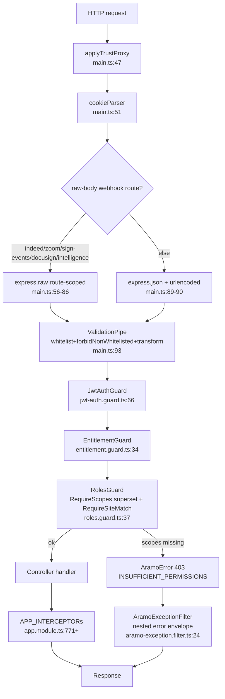
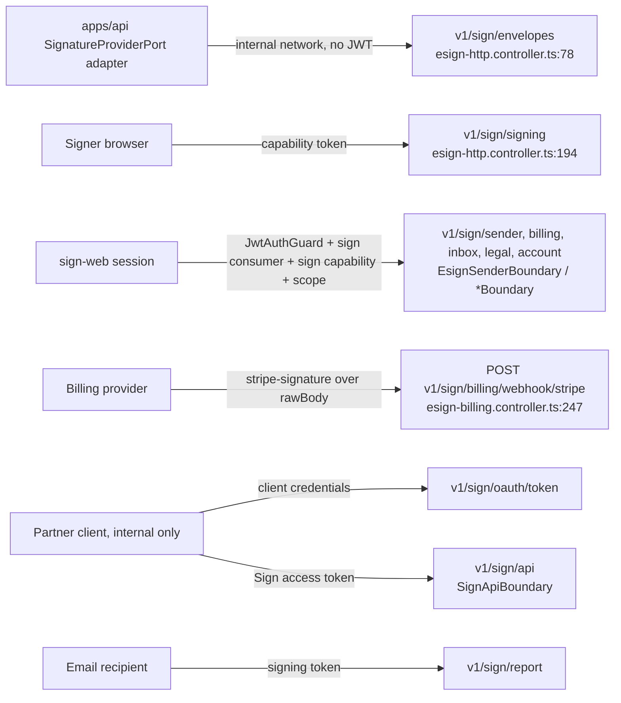
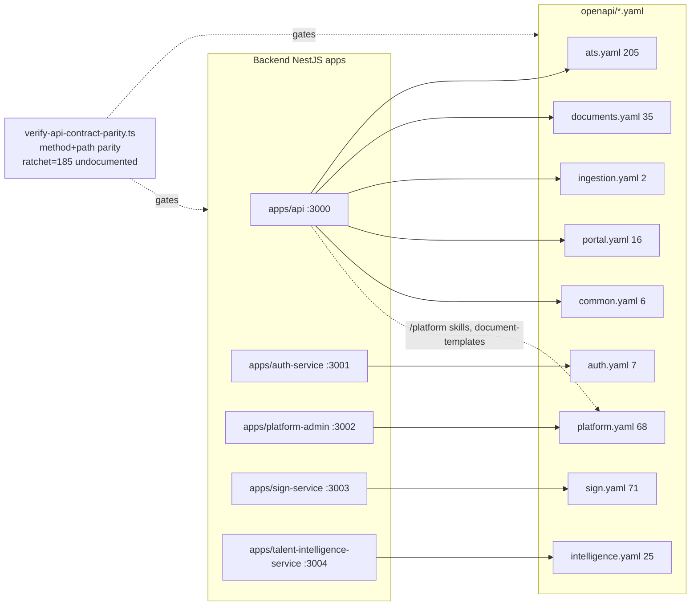

# D03 — Backend API Surface (REST + OpenAPI) (AS-BUILT)
> Refreshed from baseline 12330b0f (2026-10-09) to 680907fc (2026-10-24): the e-signature app is now `apps/sign-service` (route prefix `v1/sign/*`, 10 controller files incl. sender/billing/inbox/legal/account/report/partner-API), a fifth backend app `apps/talent-intelligence-service` (port 3004) was added, platform-admin gained signup and Sign/Personal admin controllers, and the surface grew to 131 controller files / 667 handlers / 9 OpenAPI specs (435 path-items) with the parity ratchet at 185.
> Baseline SHA 680907fc06620845944794e0a529918c980f5124 · category AS-BUILT

## Summary

The platform exposes its HTTP surface through **five separately-deployed NestJS
applications**: `apps/api` (tenant ATS core, port 3000), `apps/auth-service`
(session/auth, port 3001), `apps/platform-admin` (platform-tier administration and the
public Sign signup entry, port 3002), `apps/sign-service` (Aramo Sign, port 3003), and
`apps/talent-intelligence-service` (Talent Intelligence, port 3004, container-internal —
apps/talent-intelligence-service/src/main.ts:8-10 "Container-internal only: no nginx
upstream … Ports: api=3000, auth=3001, platform-admin=3002, sign-service=3003, TI=3004").
Controllers are physically authored either in domain **libs** (composed into an app's
module graph) or in an app's own `src`. `apps/auth-service` carries **zero controller
classes in its own `src`** — its routes come entirely from `@aramo/auth-core`
(apps/auth-service/src/app/auth/auth.module.ts:64). `apps/sign-service` authors its 10
controller files in its own `src`, registered at apps/sign-service/src/app/app.module.ts:155;
`apps/talent-intelligence-service` authors 9, registered at
apps/talent-intelligence-service/src/app/app.module.ts:23; `apps/platform-admin` authors 5
(apps/platform-admin/src/app/platform/platform.module.ts:62;
apps/platform-admin/src/app/signup/signup.module.ts:19).

Counts re-derived at this SHA (commands in the coverage fragment):
- **131 controller files** carrying **137 `@Controller(...)` decorators** (some files
  declare multiple route prefixes).
- **667 HTTP handler decorators** across those files: 281 `@Get`, 310 `@Post`, 16 `@Put`,
  31 `@Patch`, 29 `@Delete` (plus 1 `@Sse`, libs/talent-record/src/lib/talent-intake/talent-intake.controller.ts:190).
  Per host app: apps/api 239 handlers in 64 app-local files plus 273 handlers in 40
  lib-authored files; sign-service 79 in 10; platform-admin 38 in 5; talent-intelligence-service
  28 in 9; auth-service 10 in 3 (`libs/auth-core`).
- **533 `@RequireScopes(` text matches** (496 of them are live decorator lines beginning
  `@RequireScopes(`; the rest are comments), **188 `@RequireSiteMatch` text matches** (143
  decorator lines), and **120 distinct scope keys** applied by live `@RequireScopes`
  decorator lines. A further 2 keys appear only in comments (`requisition:edit` at
  libs/requisition/src/lib/requisition.repository.ts:1284; `sign:envelope:send` at
  apps/sign-service/src/app/esign-http.controller.ts:45 — the latter is applied at runtime
  through the `ESIGN_SEND_SCOPE` constant, apps/sign-service/src/app/sender/sender-context.service.ts:27).
  Composite route boundaries apply scopes without a literal `@RequireScopes` line:
  `EsignSenderBoundary` (libs/identity/src/lib/authorization/esign-sender-boundary.ts:114,
  37 production applications: esign-sender 22 + templates 3 + integration-admin 12; 2 more are in test files) and the sign-service-local `BillingBoundary`, `LegalBoundary`,
  `AccountBoundary`, `RecipientInboxBoundary`, `SignApiBoundary` (22 applications in total; 59 non-test composite-boundary applications overall).
- **9 OpenAPI specs** under `openapi/` declaring **435 path-items** total
  (ats 205, sign 71, platform 68, documents 35, intelligence 25, portal 16, auth 7,
  common 6, ingestion 2).

Request validation is enforced globally per app by a Nest `ValidationPipe` configured
`whitelist + forbidNonWhitelisted + transform` (apps/api/src/main.ts:93;
apps/sign-service/src/main.ts:21; apps/talent-intelligence-service/src/main.ts:23;
apps/auth-service/src/main.ts:19; apps/platform-admin/src/main.ts:25) — the runtime
enforcement of each DTO's `additionalProperties:false` contract. There is **no global
`APP_GUARD`** in any app: authentication/authorization are applied **per controller or
per route** via `@UseGuards(JwtAuthGuard, EntitlementGuard, RolesGuard)` (141 `@UseGuards(`
text matches, 106 decorator lines) or a composite boundary decorator built with
`applyDecorators(UseGuards(...))`, so a guardless controller is genuinely anonymous
(apps/api/src/controllers/version.controller.ts:9). 29 of the 131 controller files carry no
`@UseGuards` decorator line; 8 of those are sign-service files whose routes mount a
composite boundary (`esign-http.controller.ts` — internal + token zone — and
`personal/sign-report.controller.ts` — public, token-only — are sign-service files with 0), and the remainder are the deliberately session-less webhook, public,
token-exchange, health and auth surfaces listed in the API Endpoints section. Errors are
normalized to a single nested envelope by `AramoExceptionFilter`
(libs/common/src/lib/errors/aramo-exception.filter.ts:24), which sign-service applies per
controller via `@UseFilters(AramoExceptionFilter)` (e.g.
apps/sign-service/src/app/sender/esign-sender.controller.ts:42).

Code-vs-OpenAPI alignment is governed by the **GLH-1-C contract-parity wall**
(ci/scripts/verify-api-contract-parity.ts:1), which compares live routes (AST-derived from
`git ls-files apps libs`, ci/scripts/verify-api-contract-parity.ts:161) to OpenAPI at
**method + normalized-path granularity only** (no schema/scope/security parity,
ci/scripts/verify-api-contract-parity.ts:11). It currently tolerates a **ratchet of 185
`transitionalUndocumented` governed routes** that have no OpenAPI operation
(ci/config/api-surface-manifest.json). The separately-named `openapi:drift-check` script only
validates intra-spec `$ref` integrity, not code parity (ci/scripts/compare-spec-to-openapi.ts:3).

## Modules & Services

| name | role | evidence path:line + symbol |
|---|---|---|
| `apps/api` | Tenant ATS core HTTP app; port 3000; disables default bodyParser to control raw-webhook parse order; its single `AppModule` `imports:` array (apps/api/src/app.module.ts:184) lists 114 top-level entries and its `controllers:` array (apps/api/src/app.module.ts:678) registers 11 app-local controllers (other app-local controllers are registered by feature modules) | apps/api/src/main.ts:41 `NestFactory.create`; apps/api/src/app.module.ts:881 `AppModule` |
| `apps/auth-service` | Session/auth HTTP app; port 3001; controllers imported from `@aramo/auth-core` | apps/auth-service/src/app/auth/auth.module.ts:64 `controllers: [AuthController, JwksController, PortalAuthController]` |
| `apps/sign-service` | Aramo Sign HTTP app; port 3003; `rawBody: true` for billing-webhook signature verification; 36 MB JSON limit for base64 uploads; cookie-parser for the `sign` session; 12 `@Controller` classes over 11 distinct route prefixes under `v1/sign/*` (`v1/sign/sender` is shared by `esign-sender.controller.ts:41` and `esign-sender-templates.controller.ts:23`) | apps/sign-service/src/main.ts:13 `NestFactory.create(AppModule, { rawBody: true })`; :16 `useBodyParser('json', { limit: '36mb' })`; apps/sign-service/src/app/app.module.ts:155 `controllers: [...]` |
| `apps/platform-admin` | Platform-tier admin HTTP app; port 3002; also hosts the session-less public Sign signup (`v1/signup/sign`, `v1/signup/sign/personal`) | apps/platform-admin/src/main.ts:18 `NestFactory.create`; apps/platform-admin/src/app/platform/platform.controller.ts:67 `@Controller('platform')`; apps/platform-admin/src/app/signup/sign-signup.controller.ts:15 `@Controller('v1/signup/sign')` |
| `apps/talent-intelligence-service` | Talent Intelligence HTTP app; port 3004; container-internal (no nginx upstream); `ServiceTokenGuard` on service routes; own OAuth client-credentials token endpoint | apps/talent-intelligence-service/src/main.ts:15 `DEFAULT_PORT = 3004`; :19 `NestFactory.create`; apps/talent-intelligence-service/src/app/auth/service-token.guard.ts:21 `class ServiceTokenGuard` |
| `ValidationPipe` (global pipe, per app) | DTO allow-list + transform at the controller boundary | apps/api/src/main.ts:93 `app.useGlobalPipes`; :96 `forbidNonWhitelisted: true` |
| `JwtAuthGuard` | Authentication guard (reads Authorization header or the access cookie) | libs/auth/src/lib/jwt-auth.guard.ts:66 `export class JwtAuthGuard` |
| `EntitlementGuard` | Entitlement / product-capability check, runs after JwtAuthGuard | libs/entitlement/src/lib/entitlement.guard.ts:34 `export class EntitlementGuard` |
| `RolesGuard` | Scope superset + site-match authorization; 403 `INSUFFICIENT_PERMISSIONS` | libs/authorization/src/lib/roles.guard.ts:37 `export class RolesGuard`; :72 `INSUFFICIENT_PERMISSIONS` |
| `RequireScopes` decorator | Attaches closed scope list (all-or-nothing superset) to handler/class | libs/authorization/src/lib/require-scopes.decorator.ts:16 `export const RequireScopes` |
| `EsignSenderBoundary` (composite) | `UseGuards(JwtAuthGuard, EsignSenderConsumerGuard, EntitlementGuard, RolesGuard)` + `RequireCapability('sign')` + `RequireScopes(scope)`; consumer must be `sign` | libs/identity/src/lib/authorization/esign-sender-boundary.ts:114 `export function EsignSenderBoundary`; :116 `UseGuards(...)` |
| `SignApiBoundary` (composite) | Partner-API boundary: `UseGuards(SignApiGuard, RolesGuard)` + `RequireScopes(scope)` over a Sign access token | apps/sign-service/src/app/integrations/sign-api.guard.ts:90 `applyDecorators(UseGuards(SignApiGuard, RolesGuard), RequireScopes(scope))` |
| `AramoExceptionFilter` | Converts `AramoError`/`HttpException` to nested `error{...}` envelope | libs/common/src/lib/errors/aramo-exception.filter.ts:24 `export class AramoExceptionFilter` |
| `apiClient` (FE) | Thin `fetch` wrapper, `credentials:'include'` (HttpOnly cookies), default baseUrl `''` | libs/fe-foundation/src/api/client.ts:117 `fetch`; :121 `credentials: 'include'` |

## Data Models

No persistence models are owned at the API-surface layer; DTOs are request/response
transfer objects validated by the global pipe (apps/api/src/main.ts:93). The error
envelope DTO shape is `error{ code, message, display_message?, log_message?, request_id,
details }` (libs/common/src/lib/errors/aramo-exception.filter.ts:7 `interface ErrorEnvelope`),
backed by the error-code registry in libs/common/src/lib/errors/error-codes.ts (1054 lines
total; `grep -cE '=|:'` matches 199 registry/mapping lines — the coverage-fragment figure,
not the file length). sign-service maps its domain errors onto that envelope in `toHttp`
(apps/sign-service/src/app/esign-http.controller.ts:51).

## API Endpoints

Full inventory is 667 handler decorators across 131 controller files (coverage fragment
has the command). Representative route groups with their host and classification
(classification from ci/config/api-surface-manifest.json; AP = first-party application,
PZ = public session-less, SS = session/auth, XP = external partner, AD = adapter/ingestion,
IZ = infra/health):

| method/group | route prefix | class | evidence path:line + symbol |
|---|---|---|---|
| ATS talent | `v1/talent-records` | AP | libs/talent-record/src/lib/talent-record.controller.ts:165 `@Controller('v1/talent-records')` |
| ATS requisitions | `v1/requisitions` | AP | libs/requisition/src/lib/requisition.controller.ts:83 `@Controller('v1/requisitions')` |
| ATS pipelines | `v1/pipelines` | AP | libs/pipeline/src/lib/pipeline.controller.ts:81 `@Controller('v1/pipelines')` |
| ATS submittals | `v1/submittals` | AP | libs/submittal/src/lib/submittal.controller.ts:78 `@Controller('v1/submittals')` |
| ATS selections | `v1/selections` | AP | libs/selection/src/lib/selection.controller.ts:160 `@Controller('v1/selections')` |
| ATS companies | `v1/companies` | AP | libs/company/src/lib/company.controller.ts:63 `@Controller('v1/companies')` |
| ATS placements | `v1/placements` | AP | apps/api/src/placement/placement.controller.ts:62 `@Controller('v1/placements')` |
| ATS offers | `v1/offers` | AP | apps/api/src/offer/offer.controller.ts:44 `@Controller('v1/offers')` |
| Technical screening | `v1/talent-records/:talentId/screening-sessions`, `v1/screening-sessions` | AP | apps/api/src/technical-screening/technical-screening.controller.ts (2 prefixes, 20 handlers) |
| Shared document-template library | `v1/document-templates` | AP | libs/documents/src/lib/template-library.controller.ts (5 handlers) |
| Platform document templates / matching policy (served by apps/api under `/platform`) | `platform` | AP | apps/api/src/document-templates-platform/platform-document-templates.controller.ts (16 handlers); apps/api/src/matching-policy/matching-policy.controller.ts (3 handlers) |
| External e-signature integration admin | `v1/integrations/esignature` | AP | apps/api/src/document-signing/esignature-integration.controller.ts (5 handlers) |
| Tenant LLM key admin | `v1/integrations/llm` | AP | apps/api/src/tenant-llm/tenant-llm.controller.ts:35 `@Controller('v1/integrations/llm')` |
| Microsoft delegated auth + scheduling | `v1/integrations/microsoft` | AP | apps/api/src/microsoft/microsoft-authorization.controller.ts:59 `@Controller('v1/integrations/microsoft')`; callback apps/api/src/microsoft/microsoft-callback.controller.ts:11 |
| Me / profile | `v1/me` | AP | apps/api/src/controllers/me.controller.ts:41 `@Controller('v1/me')` |
| Tenant admin | `v1/tenant/users` | AP | libs/identity/src/lib/tenant-user/tenant-user-management.controller.ts:61 `@Controller('v1/tenant/users')` |
| Public invitation | `v1/invitations` | PZ | apps/api/src/controllers/public-invitation.controller.ts:32 `@Controller('v1/invitations')` |
| Public verification | `v1/email-verifications` | PZ | apps/api/src/controllers/public-verification.controller.ts:65 `@Controller('v1/email-verifications')` |
| Domain-verification delegate link | `v1/domain-verification/delegate` | PZ | libs/identity/src/lib/domain-verification/domain-verification-delegate.controller.ts:28 |
| Portal | `v1/portal` | AP | libs/portal/src/lib/portal.controller.ts:60 `@Controller('v1/portal')` |
| Portal notice (session-less) | `v1/portal/notice` | PZ | apps/api/src/talent-identity/portal-notice.controller.ts:17 |
| Health/version | `version` | IZ | apps/api/src/controllers/version.controller.ts:14 `@Controller('version')` |
| Zoom webhook (raw body) | `v1/webhooks/communications` | XP | apps/api/src/communications/zoom-webhook.controller.ts:29 `@Controller('v1/webhooks/communications')` |
| Indeed apply webhook (raw body) | `v1/webhooks/indeed` | XP | apps/api/src/webhooks/indeed-apply.controller.ts:32 `@Controller('v1/webhooks/indeed')` |
| DocuSign / Adobe Sign webhooks | `v1/webhooks/esignature` | XP | apps/api/src/esignature-providers/docusign/docusign-webhook.controller.ts:27; apps/api/src/esignature-providers/adobe-sign/adobe-sign-webhook.controller.ts:29 |
| Sign lifecycle-events webhook (raw body) | `v1/integrations/sign` | SS | apps/api/src/integrations/sign/esign-events.controller.ts:37 `@Controller('v1/integrations/sign')` |
| Talent Intelligence events webhook (raw body) | `v1/integrations/intelligence` | SS | apps/api/src/integrations/intelligence/intelligence-events.controller.ts:21 |
| Ingestion (adapter) | `v1/ingestion` | AD | libs/ingestion/src/lib/ingestion.controller.ts:37 `@Controller('v1/ingestion')` |
| Auth (Cognito) | `auth/:consumer` | SS | libs/auth-core/src/lib/auth.controller.ts:180 `@Controller('auth/:consumer')` |
| Portal passwordless auth | `auth/portal` | SS | libs/auth-core/src/lib/portal-auth.controller.ts:86 `@Controller('auth/portal')` |
| Sign envelopes (internal service-to-service, no JWT) | `v1/sign/envelopes` | SS | apps/sign-service/src/app/esign-http.controller.ts:78 `@Controller('v1/sign/envelopes')` |
| Sign signing (capability token) | `v1/sign/signing` | PZ (10 routeOverrides: 9 PZ `/v1/sign/signing/*` + 1 XP `POST /v1/sign/billing/webhook/stripe`) | apps/sign-service/src/app/esign-http.controller.ts:194 `@Controller('v1/sign/signing')` |
| Sign sender workspace | `v1/sign/sender` (+ `/integrations`) | AP | apps/sign-service/src/app/sender/esign-sender.controller.ts:41 (22 handlers); apps/sign-service/src/app/sender/esign-sender-templates.controller.ts:23 (3); apps/sign-service/src/app/integrations/integration-admin.controller.ts:14 (12) |
| Sign billing (+ Stripe webhook) | `v1/sign/billing` | AP; `POST /v1/sign/billing/webhook/stripe` XP (routeOverride) | apps/sign-service/src/app/billing/esign-billing.controller.ts:142; webhook :247 |
| Sign recipient inbox / legal / account | `v1/sign/inbox`, `v1/sign/legal`, `v1/sign/account` | AP | apps/sign-service/src/app/inbox/recipient-inbox.controller.ts:18; apps/sign-service/src/app/legal/sign-legal.controller.ts:29; apps/sign-service/src/app/account/sign-account.controller.ts:24 |
| Sign report-this-email (session-less) | `v1/sign/report` | PZ | apps/sign-service/src/app/personal/sign-report.controller.ts:12 |
| Sign partner API + token endpoint | `v1/sign/api`, `v1/sign/oauth` | XP | apps/sign-service/src/app/integrations/sign-api.controller.ts:43 `@Controller('v1/sign/api')`; :31 `@Controller('v1/sign/oauth')` |
| Platform admin | `platform` | AP | apps/platform-admin/src/app/platform/platform.controller.ts:67 (17 handlers); apps/platform-admin/src/app/platform/platform-sign.controller.ts:17; apps/platform-admin/src/app/platform/platform-personal.controller.ts:30 |
| Public Sign signup (org + Personal) | `v1/signup/sign`, `v1/signup/sign/personal` | PZ | apps/platform-admin/src/app/signup/sign-signup.controller.ts:15 (5 handlers); apps/platform-admin/src/app/signup/personal-signup.controller.ts:14 (7 handlers) |
| Talent Intelligence service routes | `v1/ingest/talent`, `v1/verifications`, `v1/references/...`, `v1/entitlements`, `v1/disputes`, `v1/proposals`, `v1/tenants/:source_tenant_id`, `v1/oauth`, `health` | SS / IZ (`health`) | apps/talent-intelligence-service/src/app/ingest/ingest.controller.ts:49; apps/talent-intelligence-service/src/app/auth/oauth-token.controller.ts:26; apps/talent-intelligence-service/src/app/health.controller.ts:8 |

Scope enforcement example: `@RequireScopes(...)` applied by 496 decorator lines, read by
`RolesGuard` as an all-or-nothing superset check
(libs/authorization/src/lib/require-scopes.decorator.ts:16; libs/authorization/src/lib/roles.guard.ts:37).
The site dimension rides `AuthContext.site_id` via `@RequireSiteMatch` (143 decorator lines),
not the scope key.

Host exposure (deploy/nginx/templates/aramo.conf.template): the tenant host proxies `/v1/`
to `api:3000` (:78-79) and `/auth/` to `auth-service:3001` (:81-82); the admin host proxies
6 `/platform/*` sub-prefixes (skills, skill-review-queue, skill-proposals, document-templates,
template-variables, matching-policy) to `api:3000` (:154-178) and the rest of `/platform/` to
`platform-admin:3002` (:180-181) with deliberately no `/v1` location (:187); the Sign host
proxies exactly `/v1/sign/signing/`, `/v1/sign/sender/`, `/v1/sign/billing/`,
`/v1/sign/inbox`, `/v1/sign/legal/`, `/v1/sign/account/`, `/v1/sign/report` to
`sign-service:3003` (:297-340), `/v1/signup/sign/` to `platform-admin:3002` (:343-346), and
two named `apps/api` domain-verification prefixes (:356-363). `/v1/sign/envelopes`,
`/v1/sign/api` and `/v1/sign/oauth` have no nginx location on any host — the partner API is
served "on the internal network; public third-party exposure is a separate activation"
(apps/sign-service/src/app/integrations/sign-api.controller.ts:12-14). The Talent
Intelligence service has no nginx upstream (apps/talent-intelligence-service/src/main.ts:8-9).

## Screens & FE->BE Wiring (FE domains only)

The `ats-web` frontend calls the backend through **63 per-domain `*-api.ts` modules**
(e.g. apps/ats-web/src/talent/talent-api.ts:1 `import { ApiError, apiClient } from '@aramo/fe-foundation'`).
All of them funnel through the shared `apiClient` thin `fetch` wrapper
(libs/fe-foundation/src/api/client.ts:72 `this.baseUrl = options.baseUrl ?? ''`), which
always sends session cookies (`credentials: 'include'`, libs/fe-foundation/src/api/client.ts:121)
and transparently retries once through the auth refresh path
(libs/fe-foundation/src/api/client.ts:177 refresh `fetch`). FE auth/scope helpers live in
libs/fe-foundation/src/auth/scopes.ts and libs/fe-foundation/src/auth/consumer.ts. Default
empty baseUrl means each FE targets its own origin (nginx proxies `/v1/*` and `/auth/*` to
the backend apps per host). Other FE packages carry their own API modules: apps/sign-web
4, apps/platform-web 4, apps/portal-web 1, libs/org-admin-web 8,
libs/document-templates-web 1 (`*-api.ts` / `api.ts` file counts).

## Key Flows

### Request guard + validation + envelope pipeline (apps/api)

### Sign-service auth zones

### Four backend apps and their OpenAPI specs

The heading keeps its original wording; the diagram shows all five backend apps at this SHA.

## Evidence Index (load-bearing path:line citations)

- apps/api/src/main.ts:41 `NestFactory.create` (bodyParser:false at :42)
- apps/api/src/main.ts:47 `applyTrustProxy`
- apps/api/src/main.ts:51 `cookieParser()`
- apps/api/src/main.ts:56-86 route-scoped `express.raw` for Indeed, Zoom, Sign events, DocuSign, Intelligence
- apps/api/src/main.ts:93 `app.useGlobalPipes(new ValidationPipe({...}))`
- apps/api/src/main.ts:96 `forbidNonWhitelisted: true`
- apps/api/src/main.ts:104 `registerBackgroundJobSchedules(app)`
- apps/api/src/main.ts:109 `resolveReleaseRevision()` (fail-closed release stamp)
- apps/api/src/app.module.ts:184 `imports: [`
- apps/api/src/app.module.ts:678 `controllers: [`
- apps/api/src/app.module.ts:771 `provide: APP_INTERCEPTOR`
- apps/api/src/controllers/version.controller.ts:9 "APP_GUARD in this app, so a guardless controller is genuinely anonymous"
- libs/authorization/src/lib/require-scopes.decorator.ts:16 `export const RequireScopes`
- libs/authorization/src/lib/roles.guard.ts:37 `export class RolesGuard`
- libs/authorization/src/lib/roles.guard.ts:72 `'INSUFFICIENT_PERMISSIONS'`
- libs/auth/src/lib/jwt-auth.guard.ts:66 `export class JwtAuthGuard`
- libs/entitlement/src/lib/entitlement.guard.ts:34 `export class EntitlementGuard`
- libs/identity/src/lib/authorization/esign-sender-boundary.ts:114 `export function EsignSenderBoundary`
- libs/common/src/lib/errors/aramo-exception.filter.ts:7 `interface ErrorEnvelope`
- libs/common/src/lib/errors/aramo-exception.filter.ts:24 `export class AramoExceptionFilter`
- apps/auth-service/src/app/auth/auth.module.ts:64 `controllers: [AuthController, JwksController, PortalAuthController]`
- apps/auth-service/src/main.ts:11 `const port = process.env['PORT'] ?? 3001`
- apps/sign-service/src/main.ts:10 `const port = process.env['PORT'] ?? 3003`
- apps/sign-service/src/main.ts:13 `NestFactory.create(AppModule, { rawBody: true })`
- apps/sign-service/src/app/app.module.ts:155 `controllers: [EsignProviderController, EsignSignerController, EsignSenderController, ...]`
- apps/sign-service/src/app/esign-http.controller.ts:38-49 three auth zones comment
- apps/sign-service/src/app/esign-http.controller.ts:78 `@Controller('v1/sign/envelopes')`
- apps/sign-service/src/app/esign-http.controller.ts:194 `@Controller('v1/sign/signing')`
- apps/sign-service/src/app/sender/esign-sender.controller.ts:41 `@Controller('v1/sign/sender')`
- apps/sign-service/src/app/billing/esign-billing.controller.ts:142 `@Controller('v1/sign/billing')`
- apps/sign-service/src/app/billing/esign-billing.controller.ts:247 `@Post('webhook/stripe')`
- apps/sign-service/src/app/integrations/sign-api.controller.ts:12-14 "First-party exposure first … internal network"
- apps/sign-service/src/app/integrations/sign-api.controller.ts:31 `@Controller('v1/sign/oauth')`
- apps/sign-service/src/app/integrations/sign-api.controller.ts:43 `@Controller('v1/sign/api')`
- apps/sign-service/src/app/integrations/sign-api.guard.ts:90 `SignApiBoundary` composition
- apps/sign-service/src/app/personal/sign-report.controller.ts:12 `@Controller('v1/sign/report')`
- apps/platform-admin/src/main.ts:18 `NestFactory.create` (port 3002; `const port … ?? 3002` is on :17)
- apps/platform-admin/src/app/platform/platform.controller.ts:67 `@Controller('platform')`; :68 `@UseGuards(JwtAuthGuard, RolesGuard)`
- apps/platform-admin/src/app/signup/sign-signup.controller.ts:10-11 "No guard by design … While SIGN_PUBLIC_SIGNUP_ENABLED is not 1 every route answers 404"
- apps/platform-admin/src/app/signup/sign-signup.controller.ts:15 `@Controller('v1/signup/sign')`
- apps/platform-admin/src/app/signup/personal-signup.controller.ts:14 `@Controller('v1/signup/sign/personal')`
- apps/talent-intelligence-service/src/main.ts:8-10 container-internal, port list
- apps/talent-intelligence-service/src/app/app.module.ts:23 `controllers: [`
- apps/talent-intelligence-service/src/app/auth/service-token.guard.ts:21 `class ServiceTokenGuard`
- libs/talent-record/src/lib/talent-record.controller.ts:165 `@Controller('v1/talent-records')`
- libs/requisition/src/lib/requisition.controller.ts:83 `@Controller('v1/requisitions')`
- libs/pipeline/src/lib/pipeline.controller.ts:81 `@Controller('v1/pipelines')`
- libs/submittal/src/lib/submittal.controller.ts:78 `@Controller('v1/submittals')`
- libs/selection/src/lib/selection.controller.ts:160 `@Controller('v1/selections')`
- libs/company/src/lib/company.controller.ts:63 `@Controller('v1/companies')`
- libs/talent-record/src/lib/talent-intake/talent-intake.controller.ts:190 `@Sse(':id/events')`
- apps/api/src/placement/placement.controller.ts:62 `@Controller('v1/placements')`
- apps/api/src/offer/offer.controller.ts:44 `@Controller('v1/offers')`
- apps/api/src/controllers/me.controller.ts:41 `@Controller('v1/me')`
- libs/identity/src/lib/tenant-user/tenant-user-management.controller.ts:61 `@Controller('v1/tenant/users')`
- apps/api/src/controllers/public-invitation.controller.ts:32 `@Controller('v1/invitations')`
- apps/api/src/controllers/public-verification.controller.ts:65 `@Controller('v1/email-verifications')`
- libs/portal/src/lib/portal.controller.ts:60 `@Controller('v1/portal')`
- apps/api/src/controllers/version.controller.ts:14 `@Controller('version')`
- apps/api/src/communications/zoom-webhook.controller.ts:29 `@Controller('v1/webhooks/communications')`
- apps/api/src/webhooks/indeed-apply.controller.ts:32 `@Controller('v1/webhooks/indeed')`
- apps/api/src/esignature-providers/docusign/docusign-webhook.controller.ts:27 `@Controller('v1/webhooks/esignature')`
- apps/api/src/integrations/sign/esign-events.controller.ts:37 `@Controller('v1/integrations/sign')`
- apps/api/src/integrations/intelligence/intelligence-events.controller.ts:21 `@Controller('v1/integrations/intelligence')`
- libs/ingestion/src/lib/ingestion.controller.ts:37 `@Controller('v1/ingestion')`
- libs/auth-core/src/lib/auth.controller.ts:180 `@Controller('auth/:consumer')`
- libs/auth-core/src/lib/portal-auth.controller.ts:86 `@Controller('auth/portal')`
- libs/fe-foundation/src/api/client.ts:72 `this.baseUrl = options.baseUrl ?? ''`
- libs/fe-foundation/src/api/client.ts:117 `fetch(\`${this.baseUrl}${path}\`...)`
- libs/fe-foundation/src/api/client.ts:121 `credentials: 'include'`
- libs/fe-foundation/src/api/client.ts:177 refresh-path `fetch`
- apps/ats-web/src/talent/talent-api.ts:1 `import { ApiError, apiClient } from '@aramo/fe-foundation'`
- ci/scripts/verify-api-contract-parity.ts:1 GLH-1-C governed contract-parity wall header
- ci/scripts/verify-api-contract-parity.ts:11 "GA scope = method + normalized path ONLY"
- ci/scripts/verify-api-contract-parity.ts:15 transitionalUndocumented RATCHET
- ci/scripts/verify-api-contract-parity.ts:161 route inventory from `git ls-files apps libs`
- ci/config/api-surface-manifest.json:3 governed classes XP/AP/SS/AD/PZ, exempt IZ
- ci/scripts/compare-spec-to-openapi.ts:3 "$ref" integrity (not code parity)
- package.json:42 `openapi:validate` (9 specs)
- package.json:43 `openapi:lint` (redocly, 9 specs)
- package.json:44 `openapi:drift-check`
- package.json:68 `contract-parity:check`
- .github/workflows/ci.yml:528 `name: contract-parity:check`
- deploy/nginx/templates/aramo.conf.template:78 tenant-host `location /v1/` → `api:3000`
- deploy/nginx/templates/aramo.conf.template:180 admin-host `location /platform/` → `platform-admin:3002`
- deploy/nginx/templates/aramo.conf.template:298 Sign-host `location /v1/sign/signing/` → `sign-service:3003`
- deploy/nginx/templates/aramo.conf.template:343 Sign-host `location /v1/signup/sign/` → `platform-admin:3002`

## NOT VERIFIED (explicit)

- **Exact total of distinct scope keys in the seeded catalog** — NOT VERIFIED as a single
  number. The seed grows the catalog across many additive blocks in a 5316-line file
  (libs/identity/prisma/seed.ts:26 "47-tenant-scope catalog" is the oldest block); 257
  distinct colon-separated quoted literals appear in the file but that text count is not the
  catalog cardinality. The 120 figure above is distinct scope keys *applied by live
  `@RequireScopes` decorator lines*, not the catalog cardinality, and excludes scopes passed
  to composite boundaries through constants.
- **Per-endpoint scope-to-OpenAPI-security alignment** — NOT VERIFIED. The parity wall
  checks method+path only (ci/scripts/verify-api-contract-parity.ts:11); scope/security
  parity between code and OpenAPI is out of its scope and was not independently cross-walked
  here.
- **Which exact OpenAPI spec each of the 667 handlers maps to** — NOT VERIFIED per-route;
  spec-to-app association is stated at app granularity, and `platform.yaml` is known to mix
  platform-admin routes with apps/api-served `/platform/*` routes. `ats.yaml`,
  `documents.yaml`, `ingestion.yaml`, `intelligence.yaml`, `portal.yaml`, `sign.yaml` carry
  no `servers:` block at this SHA (only `auth.yaml`, `common.yaml`, and `platform.yaml`
  declare `servers:`).
- **Which app composes each of the 40 lib-authored controller files** — NOT VERIFIED per
  file; `libs/auth-core` is composed by auth-service and the rest are presumed composed by
  apps/api (nginx routes their prefixes to `api:3000`), but module imports were not traced
  for every file.
- **Runtime behavior** — all findings are static reads at the frozen SHA; no app was booted.
