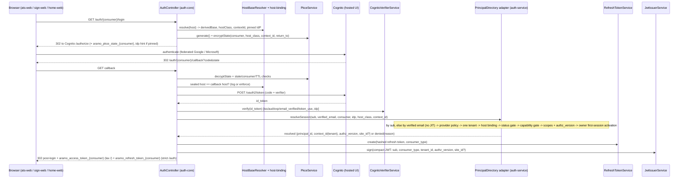
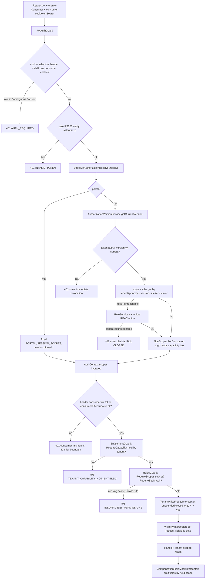
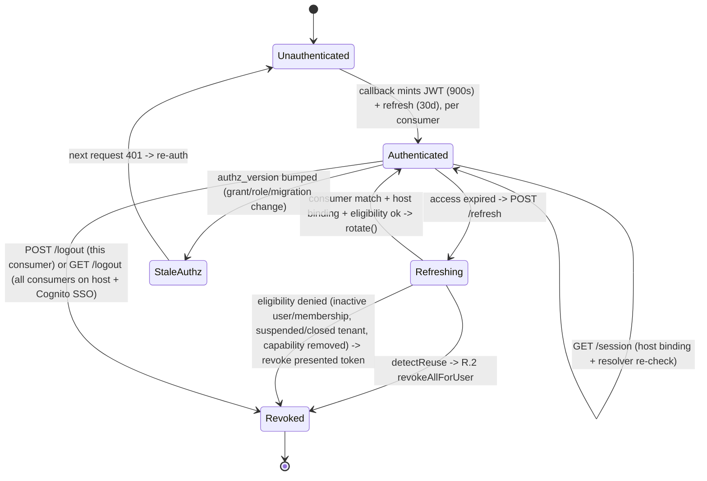
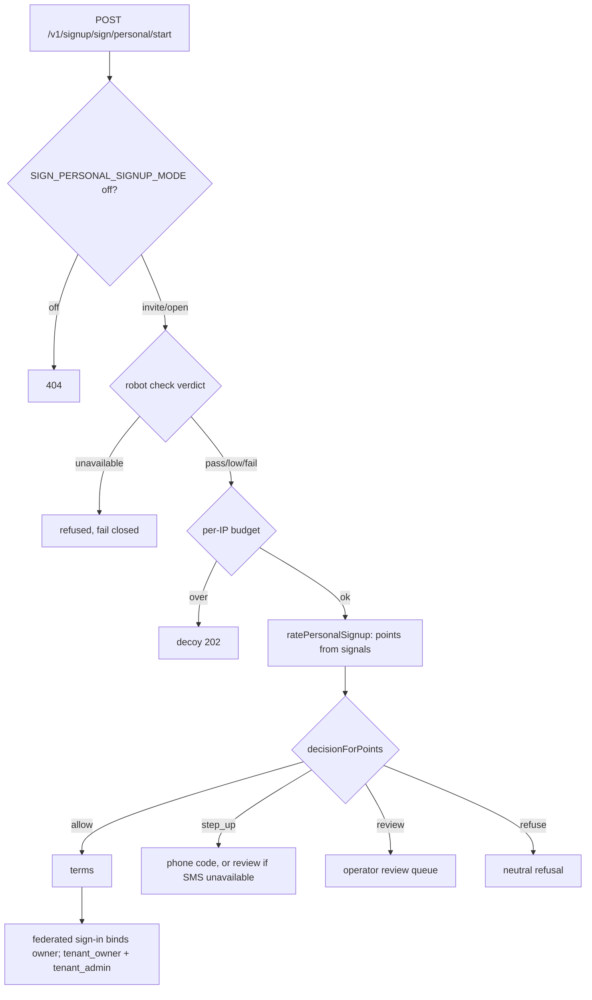

# D04 — Security: Identity, AuthN/AuthZ, Tenant Isolation & Policy (AS-BUILT)
> Refreshed from baseline 12330b0f (2026-10-09) to 680907fc (2026-10-24): identity cardinality (one User, one tenant; Tenant.kind BUSINESS|PERSONAL), six consumer-isolated sessions with host binding, refresh eligibility and per-consumer capability/scope gates, the `org` consumer, federated sign-in with provider pinning (no JIT), the ROLES-1 role model with a DB last-owner trigger, Domain-Enforcement P3 claims, Sign sender authorization, Personal Free signup risk controls, S2 transaction-bound erasure triggers, and retirement of the `identity_index` schema and its cluster purge.
> Baseline SHA 680907fc06620845944794e0a529918c980f5124 · category AS-BUILT

## Summary

Aramo's security domain is a **three-tier, port-decoupled identity spine**:

1. **AuthN at the edge (`apps/auth-service`)** — an OAuth2/PKCE broker against AWS
   Cognito. It exchanges a Cognito code for an ID token, verifies it, resolves the
   verified identity to an Aramo session via a port, mints a **compact RS256 JWT**
   (`libs/auth-core`), and sets httpOnly cookies. The JWT carries identity + an
   authorization **revision number** — never a scope list. There are now **six**
   consumers (`recruiter`, `portal`, `ingestion`, `platform`, `sign`, `org`), each
   with its **own cookie triple** (`aramo_access_token_<consumer>` etc.), so sessions
   for two products on one host never overwrite each other. Login seals
   `host_class`/`context_id` into the PKCE state
   (`libs/auth-core/src/lib/auth.controller.ts:252-259`); callback
   (`libs/auth-core/src/lib/session-orchestrator.service.ts:172`), refresh
   (`libs/auth-core/src/lib/refresh-orchestrator.service.ts:107`), POST logout
   (`auth.controller.ts:636-653`, log-only, always revokes) and `/session`
   (`:837-846`) evaluate the **host/tenant binding**; GET logout (`:707-731`) does
   not (`AUTH_HOST_TENANT_BINDING` = `log` by default, `enforce` opt-in).

2. **AuthZ at every protected route (`apps/api`, `apps/platform-admin`,
   `apps/sign-service`)** — `JwtAuthGuard` (`libs/auth`) verifies the JWT
   signature, refuses a mismatched `X-Aramo-Consumer` header, applies a generic
   **tier tripwire** (platform tokens only on `/platform/…` routes and vice versa),
   then calls a server-side **EffectiveAuthorizationResolver** (`libs/identity`)
   that version-matches `authz_version` against Postgres (immediate revocation),
   resolves effective scopes from RBAC (cached in Redis under an immutable
   version+site+consumer key), and **filters them to the consumer's namespace**
   (ATS session → no `sign:`/`platform:` scopes; Sign session → `sign:*` plus the
   organization subset, only while the tenant holds `sign`; `org` session → the
   organization subset). `EntitlementGuard` (`libs/entitlement`) enforces
   `@RequireCapability`, and `RolesGuard` (`libs/authorization`) enforces
   `@RequireScopes` / `@RequireSiteMatch`.

3. **Data-plane isolation** — every tenant principal carries `tenant_id` in the
   JWT; a User is owned by exactly one tenant (`User.tenant_id` NOT NULL, a
   UNIQUE membership per user, a composite FK and a no-re-point trigger). Reads
   are tenant-scoped. A `VisibilityInterceptor` + resolver (`libs/visibility`)
   computes per-request visible-id sets; `CompensationFieldMaskInterceptor` +
   `libs/field-masking` omits financial fields by held scope;
   `TenantWriteFreezeInterceptor` refuses writes to suspended/closed tenants.

Cross-cutting: a **stateless Business Policy Engine** (`libs/policy-engine`/
`libs/policy-store`, ADR-0024); **consent** (`libs/consent`) as an append-only
ledger; the **S2 erasure** path whose append-only exceptions are admitted only by
DB triggers bound to a run row the same transaction created; a DB-level
**last-owner** invariant on `tenant_owner`; **domain claims** (one domain-holding
BUSINESS tenant per email domain); and **Personal (Free) signup** risk controls
(robot check, email/phone one-time codes, risk points, operator review). The
cross-tenant `identity_index` schema, `libs/identity-index` and its cluster purge
no longer exist at this SHA (dropped by ATI-SEP-1 T10, commit `8812b3cf`); the
Talent Portal eligibility port now answers "no eligibility" for every address.

AuthN/AuthZ enforcement is **per-controller** (`@UseGuards`), not a single global
`APP_GUARD`: 101 non-test source files decorate `@UseGuards(JwtAuthGuard …)`, 92
decorate `@RequireScopes(...)` and 86 decorate `@RequireCapability(...)`
(commands in the coverage fragment).

## Modules & Services

| name | role | evidence path:line + symbol |
| --- | --- | --- |
| `libs/auth` `JwtAuthGuard` | Request-time JWT verify (jose RS256) + consumer-header check + tier tripwire + server-side scope hydration; fail-closed | `libs/auth/src/lib/jwt-auth.guard.ts:66` `JwtAuthGuard`; `:392` `assertTierTripwire` |
| `libs/auth` AuthContext types | Closed `CONSUMER_TYPES` (6), `ACTOR_KINDS`, platform sentinel, `AuthContext` shape | `libs/auth/src/lib/auth-context.types.ts:21` `CONSUMER_TYPES`; `:39` `AuthContext` |
| `libs/auth` session cookie names | Single naming authority for per-consumer cookie triples; legacy fallback; header-less selection | `libs/auth/src/lib/session-cookie-names.ts:31` `accessCookieName`; `:65` `selectAccessCookie` |
| `libs/auth` `AuthModule` | Provides `JwtAuthGuard` as a singleton (resolver injected `@Optional`) | `libs/auth/src/lib/auth.module.ts:6` `providers:[JwtAuthGuard]` |
| `libs/authorization` `RolesGuard` | AuthZ checkpoint after JwtAuthGuard: scope-subset + site-match → 403 | `libs/authorization/src/lib/roles.guard.ts:37` `RolesGuard` |
| `libs/authorization` decorators | `@RequireScopes` / `@RequireSiteMatch` metadata | `libs/authorization/src/lib/require-scopes.decorator.ts:16` `RequireScopes` |
| `libs/entitlement` `EntitlementGuard` | Tenant-capability checkpoint for `@RequireCapability` (403 `TENANT_CAPABILITY_NOT_ENTITLED`) | `libs/entitlement/src/lib/entitlement.guard.ts:34` `EntitlementGuard`; capabilities `libs/entitlement/src/lib/capability.ts:1` `CAPABILITY_VALUES` |
| `libs/auth-core` `JwtIssuerService` | Mints compact RS256 JWT (`issuer "Aramo Core Auth"`, 900s TTL, kid=SPKI sha256) | `libs/auth-core/src/lib/jwt-issuer.service.ts:46` `sign`; `:17` `ACCESS_TOKEN_TTL_SECONDS=900` |
| `libs/auth-core` `AuthController` | `/auth/{consumer}/login\|login-options\|callback\|refresh\|logout\|session`; per-consumer cookie setters; global sign-out | `libs/auth-core/src/lib/auth.controller.ts:180` `@Controller('auth/:consumer')` |
| `libs/auth-core` host binding | Host-class/tenant agreement rules + `log`/`enforce` mode parse; denial reason sets | `libs/auth-core/src/lib/host-binding.ts:46` `readHostBindingMode`; `:72` `evaluateHostBinding`; `:109` `evaluateSessionHostBinding` |
| `libs/auth-core` `SessionOrchestratorService` | PKCE-state verify → host-agreement check → Cognito exchange+verify → `resolveSession` port → mint+persist | `libs/auth-core/src/lib/session-orchestrator.service.ts:123` `handleCallback` |
| `libs/auth-core` `CognitoVerifierService` | Cognito ID-token verify; fail-closed `email_verified`; extracts the authenticating IdP | `libs/auth-core/src/lib/cognito-verifier.service.ts:78` `verify`; `:136` `isEmailVerified` |
| `libs/auth-core` `RefreshOrchestratorService` | Refresh rotation, consumer match, reuse-detection cascade (R.2), host binding, eligibility re-proof | `libs/auth-core/src/lib/refresh-orchestrator.service.ts:60` `handleRefresh`; `:87` revoke-all cascade |
| `libs/auth-core` `JwksController` | `GET /.well-known/jwks.json` public key publish | `libs/auth-core/src/lib/jwks.controller.ts:12` `@Get('.well-known/jwks.json')` |
| `libs/auth-core` `PkceService` / `PortalLoginService` / `PortalAuthController` | PKCE state cipher (now seals host class/context + return-to); passwordless portal login | `libs/auth-core/src/lib/pkce.service.ts:50`; `libs/auth-core/src/lib/portal-login.service.ts:1`; `libs/auth-core/src/lib/portal-auth.controller.ts:86` |
| `libs/auth-storage` `RefreshTokenService` | Refresh-token persist/rotate/revoke/reuse-detect (hashed) | `libs/auth-storage/src/lib/refresh-token.service.ts:1` |
| `apps/auth-service` `IdentityPrincipalDirectoryAdapter` | Reconcile-by-sub / verified-email (no JIT) → provider policy → single-tenant selection → host binding → status gate → capability gate → scopes; owner first-session activation | `apps/auth-service/src/app/auth/identity-principal-directory.adapter.ts:102` `resolveSession`; `:83` `assertConsumerEntitled`; `:310` `resolveScopes` |
| `apps/auth-service` `PortalDeferredEligibilityAdapter` | Portal eligibility port answers `null` for every address (identity index retired) | `apps/auth-service/src/app/auth/portal-deferred-eligibility.adapter.ts:1`; bound at `apps/auth-service/src/app/auth/auth.module.ts:82` |
| `libs/identity` `IdentityEffectiveAuthorizationResolver` | Authority-order resolver: version-match → cache → canonical RBAC → per-consumer filter; fail-closed | `libs/identity/src/lib/authorization/identity-effective-authorization-resolver.ts:48`; `:58` `resolve`; `:120` `forConsumer` |
| `libs/identity` consumer scope policy | Consumer → required capability; per-consumer scope namespace filter | `libs/identity/src/lib/authorization/consumer-scope-policy.ts:66` `requiredCapabilityForConsumer`; `:91` `filterScopesForConsumer` |
| `libs/identity` `ProductAvailabilityService` | Backend-authoritative `subscribed/authorized/available` per product for `GET /v1/me/products` | `libs/identity/src/lib/authorization/product-availability.service.ts:99`; `:109` `forPrincipal` |
| `libs/identity` Sign sender boundary | `EsignSenderBoundary` = JwtAuthGuard + `sign`-consumer guard + `@RequireCapability('sign')` + `sign:envelope:send` | `libs/identity/src/lib/authorization/esign-sender-boundary.ts:114` `EsignSenderBoundary`; `:87` `EsignSenderConsumerGuard` |
| `libs/identity` `AuthorizationVersionService` | Monotonic per-principal authz revision (Postgres authority; baseline 1) | `libs/identity/src/lib/authorization-version.service.ts:26` `getCurrentVersion` |
| `libs/identity` `AuthorizationResolverModule` | `@Global` composition-root binding; Redis-vs-in-memory cache selection | `libs/identity/src/lib/authorization/authorization-resolver.module.ts:32` `forRoot` |
| `libs/identity` `RedisScopeCache` / `InMemoryScopeCache` | Versioned scope-snapshot cache (never expands privilege) | `libs/identity/src/lib/authorization/redis-scope-cache.ts:22` `RedisScopeCache` |
| `libs/identity` `RoleService` | Site-aware effective scope union from RBAC rows | `libs/identity/src/lib/role.service.ts:45` `getScopesByUserTenantAndSite` |
| `libs/identity` role catalog constants | Role partitions (org / platform / ATS / Sign), retired keys, sender scope | `libs/identity/src/lib/dto/role.dto.ts:53` `SEED_ROLE_KEYS`; `:102` `ORG_ROLE_KEYS`; `:115` `ORG_ADMIN_SCOPE_KEYS`; `:159` `ESIGN_SENDER_SCOPE_KEY` |
| `libs/identity` role assignment rules | Platform/ATS/Sign partition refusals + owner-only grant rule | `libs/identity/src/lib/identity.service.ts:531` `assertRoleKeysAssignable`; `:651` `owner_role_requires_owner` |
| `libs/identity` `IdentityProviderPolicyService` | AUTH-SIGNIN-1 provider policy: enforced-pin cohort, no cross-provider merge | `libs/identity/src/lib/identity-provider-policy.service.ts:41`; `:111` `evaluate` |
| `libs/identity` `DomainClaimService` | Domain-Enforcement P3 claims (PROVISIONAL/AUTHORITATIVE/LAPSED/RELEASED), held-domain check | `libs/identity/src/lib/domain-claim/domain-claim.service.ts:99`; `:124` `isDomainHeld`; `:150` `claimForNewTenant` |
| `libs/identity` domain verification delegation | Session-less, token-authorized IT-admin delegate surface | `libs/identity/src/lib/domain-verification/domain-verification-delegate.controller.ts:28` |
| `libs/identity` Personal risk controls | Risk points → `allow/step_up/review/refuse`; tenant risk state + send gate; robot-check, SMS, GeoIP ports; one-time codes | `libs/identity/src/lib/personal/personal-risk-rating.ts:160` `ratePersonalSignup`; `libs/identity/src/lib/personal/personal-risk.service.ts:96` `evaluatePersonalSend`; `libs/identity/src/lib/personal/robot-check.port.ts:33` `TurnstileRobotCheckAdapter`; `libs/identity/src/lib/personal/personal-otp.ts:37` `checkPersonalOtp` |
| `libs/identity` tenant kind / last owner utils | `TENANT_KINDS`, `PERSONAL_TENANT_CAPABILITIES`, activating owner role; last-owner error mapping | `libs/identity/src/lib/util/tenant-kind.ts:19`; `:34`; `:43`; `libs/identity/src/lib/util/tenant-last-owner.ts:39` `rethrowTenantLastOwner` |
| `libs/identity` audit | Identity audit event write/read (`IdentityAuditEvent`) | `libs/identity/src/lib/audit/audit.controller.ts:1` |
| `libs/portal-identity` | Portal principal store + login-token | `libs/portal-identity/src/lib/portal-identity.repository.ts:1` |
| `libs/visibility` `VisibilityInterceptor`/`VisibilityResolverService` | Per-request visible-id sets; tenant-scoped; fail-CLOSED (under-restriction) | `libs/visibility/src/lib/visibility-resolver.service.ts:57` `resolveForActor`; `:228` `safeRead` |
| `libs/field-masking` | Field-omission-by-scope (compensation/commercial/financials) | `libs/field-masking/src/lib/omit-by-scope.ts:21` `omitFieldsByScopeMap` |
| `libs/policy-engine` | Stateless pure `(resource,action,context)→decision`; no global default | `libs/policy-engine/src/lib/evaluate.ts:65` `evaluate` |
| `libs/policy-store` | Versioned policy packages + decision records (Postgres) | `libs/policy-store/prisma/schema.prisma:47` `StoredPolicyVersion` |
| `libs/consent` `ConsentService`/`ConsentController` | Append-only consent ledger; grant/revoke/capture/check/state/history/decision-log | `libs/consent/src/lib/consent.controller.ts:56` `@Controller('v1/consent')` |
| `apps/api` `TalentErasureService` | S2 erase-talent pass: durable run, subject-bound DELETE/redact/tombstone, storage purge, blockers | `apps/api/src/talent-identity/talent-erasure.service.ts:507` `TalentErasureService` |
| `apps/auth-service` | AuthN edge app: binds `libs/auth-core` ports to identity/mailer/portal adapters | `apps/auth-service/src/app/auth/auth.module.ts:1` |
| `apps/platform-admin` signup | Public session-less Sign Business signup and Personal (Free) signup, env-gated (404 when off) | `apps/platform-admin/src/app/signup/sign-signup.controller.ts:15`; `apps/platform-admin/src/app/signup/personal-signup.controller.ts:14` |
| `apps/platform-admin` Personal operator controls | Review queue, invites, clear/restrict/reinstate/close, abuse-report decisions | `apps/platform-admin/src/app/platform/platform-personal.controller.ts:30` |
| `apps/talent-intelligence-service` service auth | Client-credentials token exchange + bearer service-token guard (separate auth surface) | `apps/talent-intelligence-service/src/app/auth/oauth-token.controller.ts:26`; `apps/talent-intelligence-service/src/app/auth/service-token.guard.ts:21` |
| `apps/api` composition | Global interceptor stack: write-freeze → visibility → comp-mask → enrichment | `apps/api/src/app.module.ts:771` `TenantWriteFreezeInterceptor` |

## Data Models

| model | schema | role | evidence path:line |
| --- | --- | --- | --- |
| `User` | `identity` | Principal (user); `tenant_id` NOT NULL owning tenant, `@@unique([id, tenant_id])` | `libs/identity/prisma/schema.prisma:21` `model User`; `:34` `tenant_id` |
| `Tenant` | `identity` | Tenant org (isolation root); `kind` BUSINESS\|PERSONAL (string, default BUSINESS) | `libs/identity/prisma/schema.prisma:56` `model Tenant`; `:68` `kind` |
| `Site` | `identity` | Intra-tenant site axis | `libs/identity/prisma/schema.prisma:206` `model Site` |
| `UserTenantMembership` | `identity` | User↔tenant membership (+ site); `user_id @unique`; composite FK `(user_id, tenant_id)` → User | `libs/identity/prisma/schema.prisma:226`; `:233` `user_id @unique` |
| `Role` / `Scope` / `RoleScope` | `identity` | RBAC catalog + grants | `libs/identity/prisma/schema.prisma:267`,`:282`,`:293` |
| `UserTenantMembershipRole` | `identity` | Membership→role grant (last-owner trigger target) | `libs/identity/prisma/schema.prisma:306` |
| `AuthorizationVersion` | `identity` | Monotonic per-principal revision (revocation lever) | `libs/identity/prisma/schema.prisma:341` `model AuthorizationVersion` |
| `ExternalIdentity` / `ExternalIdentityIdp` | `identity` | IdP subject link (reconcile-by-sub) + the provider recorded at link | `libs/identity/prisma/schema.prisma:356`; `:531` |
| `TenantIdentityProviderPolicy` | `identity` | Enforced-pin cohort marker (AUTH-SIGNIN-1) | `libs/identity/prisma/schema.prisma:520` |
| `SignupRequest` / `OrganizationAuthorityAttestation` / `TenantBillingRegionPolicy` | `identity` | Sign Business self-service signup + owner attestation + billing region | `libs/identity/prisma/schema.prisma:412`,`:442`,`:461` |
| `TenantDomainClaim` / `TenantDomainException` / `DomainVerificationDelegation` | `identity` | Domain-Enforcement P3 claim, audited operator exception, IT-admin delegation | `libs/identity/prisma/schema.prisma:473`,`:488`,`:505` |
| `PersonalSignupRequest` / `TenantRiskState` / `PersonalSignupInvite` | `identity` | Personal (Free) signup attempt, per-tenant risk state, pilot invites | `libs/identity/prisma/schema.prisma:661`,`:716`,`:740` |
| `IdentityAuditEvent` | `identity` | Identity-rail audit stream | `libs/identity/prisma/schema.prisma:542` |
| `ManagementEdge` / `Team` / `TeamMembership` | `identity` | Visibility graph inputs | `libs/identity/prisma/schema.prisma:577`,`:609`,`:634` |
| `HostAuthProfile` | `auth_storage` | Per-host IdP/base resolution (HRD) | `libs/auth-storage/prisma/schema.prisma:35` |
| `RefreshToken` | `auth_storage` | Hashed refresh token (rotation/reuse), `consumer_type` per row | `libs/auth-storage/prisma/schema.prisma:61` |
| `PortalUser` / `PortalLoginToken` / `NoticeDelivery` | `portal_identity` | Portal principal + passwordless login (`cluster_id` now inert) | `libs/portal-identity/prisma/schema.prisma:32`,`:63`,`:104` |
| `StoredPolicyVersion` / `PolicyDecisionRecord` | `policy_store` | Policy packages + decision audit | `libs/policy-store/prisma/schema.prisma:47`,`:102` |
| `TalentConsentEvent` / `IdempotencyKey` / `OutboxEvent` | `consent` | Append-only consent ledger | `libs/consent/prisma/schema.prisma:29`,`:75`,`:92` |
| `ConsentAuditEvent` | `audit` | Consent decision/erasure audit marker | `libs/consent/prisma/schema.prisma:107` |
| `TalentErasureRun` / `TalentErasureArtifact` | `consent` | S2 durable erasure run (authorizing row for the triggers) + pending object-storage purges | `libs/consent/prisma/schema.prisma:141`,`:163` |

DB-level controls added since the old baseline (migrations under `libs/identity/prisma/migrations/`, 19 new directories):
- `20261016000000_ic1_user_tenant_cardinality` — `User.tenant_id` NOT NULL, UNIQUE `UserTenantMembership(user_id)`, composite FK to `User(id, tenant_id)`.
- `20261016000001_ic1_user_tenant_immutable` — trigger `user_tenant_no_repoint` (BEFORE UPDATE OF `tenant_id`).
- `20261021120100_roles1_last_owner_invariant` — functions `roles1_assert_tenant_keeps_owner` / `roles1_guard_*` on role delete/update, membership delete/update and `User.is_active`, `ENABLE ALWAYS` (`:58-60`).
- `20261021130000_roles1_role_model` — role key renames (`tenant_admin`→`ats_admin`, `org_admin`→`tenant_admin`), `sign_owner` deactivated; `20261020130100_sign_naming_role_scope_keys` — `esign_*`/`esign:` → `sign_*`/`sign:`.
- Scope-grant migrations (`doclib_t4`, `doclib_t5`, `org_ux_1`, `ats_qa_1`) bump `AuthorizationVersion` for every affected principal in the same transaction.
- `libs/auth-storage/prisma/migrations/20261020130200_sign_naming_consumer/migration.sql` — revokes live refresh tokens of the old `esign` consumer.
- `libs/consent/prisma/migrations/20261016180000_s2_erasure_run_authorization/migration.sql` and `libs/consent/prisma/migrations/20261016190000_s2_erasure_write_serialization/migration.sql` — transaction-bound erasure authorization (the SECURITY DEFINER erasure-run entry point in the `consent` schema; its name is confined by `apps/api/src/tests/s2-erasure-authorization-confinement.spec.ts`) and advisory-lock serialization of talent-keyed writes.

## API Endpoints

| method | route | scopes / guard | evidence path:line |
| --- | --- | --- | --- |
| GET | `/auth/{consumer}/login` | public; 302 to Cognito + per-consumer PKCE cookie (seals host class/context) | `libs/auth-core/src/lib/auth.controller.ts:200` `login` |
| GET | `/auth/{consumer}/login-options` | public; host-derived provider list (no PII) | `libs/auth-core/src/lib/auth.controller.ts:296` |
| GET | `/auth/{consumer}/callback` | public; exchanges code, sets per-consumer session cookies | `libs/auth-core/src/lib/auth.controller.ts:310` `callback` |
| POST | `/auth/{consumer}/refresh` | refresh cookie; host binding + eligibility re-proof; rotates (200) | `libs/auth-core/src/lib/auth.controller.ts:563` `refresh` |
| POST | `/auth/{consumer}/logout` | per-consumer clear + revoke (204) | `libs/auth-core/src/lib/auth.controller.ts:616` `logout` |
| GET | `/auth/{consumer}/logout` | revokes + clears EVERY consumer session on the host, then 302 to Cognito /logout | `libs/auth-core/src/lib/auth.controller.ts:707`; `:756` `revokeAllConsumerSessions` |
| GET | `/auth/{consumer}/session` | access cookie; host binding (403 `TENANT_ACCESS_DENIED` under enforce); server-side scope resolve | `libs/auth-core/src/lib/auth.controller.ts:797` `session` |
| GET | `/.well-known/jwks.json` | public key set | `libs/auth-core/src/lib/jwks.controller.ts:12` |
| POST/GET | `/auth/portal/request-link`, `/auth/portal/consume` | public passwordless portal login | `libs/auth-core/src/lib/portal-auth.controller.ts:92`,`:110` |
| GET | `/v1/me/products` | `JwtAuthGuard,EntitlementGuard,RolesGuard` + `@RequireCapability('core')` | `apps/api/src/controllers/me.controller.ts:41`,`:75` |
| POST | `/v1/consent/grant` | `JwtAuthGuard`; Idempotency-Key required | `libs/consent/src/lib/consent.controller.ts:61` |
| POST | `/v1/consent/revoke` | `JwtAuthGuard` | `libs/consent/src/lib/consent.controller.ts:78` |
| POST | `/v1/consent/capture` | `JwtAuthGuard`; multi-scope server-rendered text | `libs/consent/src/lib/consent.controller.ts:101` |
| GET | `/v1/consent/capture-texts` | `JwtAuthGuard` | `libs/consent/src/lib/consent.controller.ts:124` |
| POST | `/v1/consent/check` | `JwtAuthGuard`; decision in body (200) | `libs/consent/src/lib/consent.controller.ts:137` |
| GET | `/v1/consent/state/{id}` | `JwtAuthGuard` | `libs/consent/src/lib/consent.controller.ts:158` |
| GET | `/v1/consent/history/{id}` | `JwtAuthGuard` | `libs/consent/src/lib/consent.controller.ts:174` |
| GET | `/v1/consent/decision-log/{id}` | `@RequireScopes('consent:decision-log:read')` (403 w/o) | `libs/consent/src/lib/consent.controller.ts:210` |
| POST | `/v1/portal/rights/erase` | `JwtAuthGuard,EntitlementGuard,RolesGuard` + `@RequireCapability('portal')`; self-keyed RTBF | `apps/api/src/talent-identity/portal-rights.controller.ts:56`,`:64` |
| GET/POST | `/v1/signup/sign/{terms,start,preview,complete,address/suggest}` | none (public); 404 unless `SIGN_PUBLIC_SIGNUP_ENABLED=1`; per-IP in-process budget | `apps/platform-admin/src/app/signup/sign-signup.controller.ts:15`; `apps/platform-admin/src/app/signup/sign-signup.service.ts:88` |
| GET/POST | `/v1/signup/sign/personal/{terms,start,resend-email,verify-email,phone/send,phone/verify,complete}` | none (public); 404 while `SIGN_PERSONAL_SIGNUP_MODE=off` | `apps/platform-admin/src/app/signup/personal-signup.controller.ts:14`; `libs/identity/src/lib/util/personal-eligibility.ts:48` |
| GET/POST | `/platform/personal-review`, `/platform/personal-invites`, `/platform/tenants/:id/personal/{clear-review,restrict,reinstate,close,reports}`, `/platform/personal-reports/:id/decide` | `JwtAuthGuard,RolesGuard` + `platform:tenant:lifecycle:manage` | `apps/platform-admin/src/app/platform/platform-personal.controller.ts:30`-`:124` |
| POST | `/v1/domain-verification/delegate`, `/delegate/check` | none (token in body is the only authority; uniform 404) | `libs/identity/src/lib/domain-verification/domain-verification-delegate.controller.ts:28`,`:32`,`:42` |

## Screens & FE->BE Wiring (FE domains only)

- **Session bootstrap** (`libs/fe-foundation/src/auth/session.ts:95` `fetchSession`):
  on boot calls `GET /auth/{consumer}/session`; 401 → `unauthenticated`; a 403
  `TENANT_ACCESS_DENIED` routes to `/login?error=TENANT_ACCESS_DENIED` (`:41`,
  `:187`). `useSession` (`:170`) drives app auth state; `redirectToLogin` (`:130`);
  `logout` (`:160`) POST-clears then navigates to the GET logout (global sign-out).
- **Consumer header**: the shared API client stamps `X-Aramo-Consumer` with the
  configured consumer on every call (`libs/fe-foundation/src/api/client.ts:116`;
  `libs/fe-foundation/src/auth/consumer.ts:25` `configureAuthConsumer`).
- **Branded sign-in page** (`libs/fe-foundation/src/auth/SignInPage.tsx:260`
  `SignInPage`): reads `login-options` (`:85`) to show only the host's providers;
  `safeReturnTo` (`:66`) and `allowedConsumer` (`:59`) constrain the return path and
  consumer. ats-web uses it at `apps/ats-web/src/routes/LoginPage.tsx:5`.
- **ats-web authorization gating** (`apps/ats-web/src/admin/AdminGate.tsx:21`
  `AdminGate`): FE scope guard over `/admin/*` keyed on the `tenant:admin:*` scope
  family (ForbiddenState). `RouteGuard` (`libs/fe-foundation/src/auth/RouteGuard.tsx:30`)
  adds an optional scope axis.
- **User-menu display** (`apps/ats-web/src/shell/me-api.ts:20` `ME_PATH`): `GET /v1/me`.
- **App Home / Org admin** (`apps/home-web/src/home/AppHomeView.tsx:123`,
  `libs/org-admin-web/src/access.ts:20` `useOrgAccess`): product cards and org
  access tiers mirror the backend `GET /v1/me/products`; the FE grants nothing.
- **Sign signup / Personal signup** (`apps/sign-web/src/workspace/routes/SignupPage.tsx`,
  `PersonalSignupPage.tsx`; Turnstile widget `apps/sign-web/src/workspace/routes/Turnstile.tsx:44`);
  **operator review** (`apps/platform-web/src/personal/PersonalReviewView.tsx:109`).
- **Portal / platform login**: `apps/portal-web/src/LoginPage.tsx:1`,
  `apps/platform-web/src/App.tsx:1` ride the same pipelines with a different consumer.

## Key Flows

### Authentication (login → session mint)

### Authorization decision (protected `apps/api` request)

### Session / token lifecycle

### Personal (Free) signup gate

Evidence: `apps/platform-admin/src/app/signup/personal-signup.service.ts:212` `start`,
`:272` robot verify, `:280` budget, `:317` rating; thresholds
`libs/identity/src/lib/personal/personal-risk-rating.ts:136` `decisionForPoints`;
send-time gate `libs/identity/src/lib/personal/personal-risk.service.ts:96`.

## Evidence Index

- `libs/auth/src/lib/jwt-auth.guard.ts:66` `JwtAuthGuard` (jose RS256 verify)
- `libs/auth/src/lib/jwt-auth.guard.ts:104` declared `X-Aramo-Consumer` ≠ token consumer → 401 `consumer_header_mismatch`
- `libs/auth/src/lib/jwt-auth.guard.ts:189` `extractToken` (Bearer-first / per-consumer cookie fallback via `selectAccessCookie` at `:224`)
- `libs/auth/src/lib/jwt-auth.guard.ts:308` resolver-unbound → fail closed (401)
- `libs/auth/src/lib/jwt-auth.guard.ts:328` resolution `stale` → 401 (immediate revocation)
- `libs/auth/src/lib/jwt-auth.guard.ts:338` resolution `unresolvable` → fail closed
- `libs/auth/src/lib/jwt-auth.guard.ts:366` `rawAccessToken` (server-side delegation helper)
- `libs/auth/src/lib/jwt-auth.guard.ts:392` `assertTierTripwire` (platform/tenant route partition, sentinel only for platform/portal)
- `libs/auth/src/lib/session-cookie-names.ts:25` legacy names; `:29` `CONSUMER_HEADER='x-aramo-consumer'`; `:65` `selectAccessCookie`
- `libs/auth/src/lib/auth-context.types.ts:21` `CONSUMER_TYPES` closed enum (6)
- `libs/auth/src/lib/auth-context.types.ts:30` `PLATFORM_TENANT_SENTINEL_ID`
- `libs/auth/src/lib/auth-context.types.ts:36` `ACTOR_KINDS` closed enum (3)
- `libs/auth/src/lib/auth-context.types.ts:39` `AuthContext` 7+1-field shape (7 required: `sub`, `consumer_type`, `actor_kind`, `tenant_id`, `scopes`, `iat`, `exp`; +1 optional `site_id?`)
- `libs/auth/src/lib/auth.module.ts:6` `AuthModule` providers `[JwtAuthGuard]`
- `libs/authorization/src/lib/roles.guard.ts:37` `RolesGuard`
- `libs/authorization/src/lib/roles.guard.ts:53` no decorator → no-op
- `libs/authorization/src/lib/roles.guard.ts:79` scope-subset enforcement → 403
- `libs/authorization/src/lib/roles.guard.ts:98` `@RequireSiteMatch` branch
- `libs/authorization/src/lib/roles.guard.ts:105` absent/null site claim = tenant-wide (admit any site)
- `libs/authorization/src/lib/roles.guard.ts:133` `resolveRequestedSite` (param/query only)
- `libs/authorization/src/lib/require-scopes.decorator.ts:16` `RequireScopes` all-or-nothing
- `libs/authorization/src/lib/authorization.metadata.ts:5` `REQUIRED_SCOPES_KEY`
- `libs/entitlement/src/lib/entitlement.guard.ts:34` `EntitlementGuard`
- `libs/auth-core/src/lib/jwt-issuer.service.ts:15` `ISSUER = 'Aramo Core Auth'`
- `libs/auth-core/src/lib/jwt-issuer.service.ts:17` `ACCESS_TOKEN_TTL_SECONDS = 900`
- `libs/auth-core/src/lib/jwt-issuer.service.ts:46` `sign` (RS256, `authz_version`, no scopes)
- `libs/auth-core/src/lib/jwt-issuer.service.ts:93` `computeKid` (SPKI DER sha256 base64url)
- `libs/auth-core/src/lib/auth.controller.ts:87` `setAccessCookie(res, consumer, …)` httpOnly/secure/sameSite lax path `/`
- `libs/auth-core/src/lib/auth.controller.ts:97` `setRefreshCookie` sameSite strict path `/auth`
- `libs/auth-core/src/lib/auth.controller.ts:180` `@Controller('auth/:consumer')`
- `libs/auth-core/src/lib/auth.controller.ts:756` `revokeAllConsumerSessions` (global sign-out)
- `libs/auth-core/src/lib/auth.controller.ts:837` `/session` host binding, 403 `TENANT_ACCESS_DENIED` under enforce
- `libs/auth-core/src/lib/host-binding.ts:46` `readHostBindingMode` (only literal `enforce` enforces; default `log`)
- `libs/auth-core/src/lib/host-binding.ts:72` `evaluateHostBinding` (TENANT / PLATFORM / PORTAL / PRODUCT)
- `libs/auth-core/src/lib/host-binding.ts:95` PORTAL and PRODUCT host classes refused (`host_class_consumer_mismatch`)
- `libs/auth-core/src/lib/host-binding.ts:127` `TENANT_ACCESS_DENIED_REASONS`; `:143` `REFRESH_ELIGIBILITY_REASONS`
- `libs/auth-core/src/lib/session-orchestrator.service.ts:40` `PORTAL_SESSION_SCOPES`
- `libs/auth-core/src/lib/session-orchestrator.service.ts:123` `handleCallback`
- `libs/auth-core/src/lib/session-orchestrator.service.ts:172` callback-agreement host check
- `libs/auth-core/src/lib/session-orchestrator.service.ts:231` `principals.resolveSession` (decoupled per ADR-0021)
- `libs/auth-core/src/lib/session-orchestrator.service.ts:366` `establishPortalSession` (platform sentinel tenant, version 1)
- `libs/auth-core/src/lib/cognito-verifier.service.ts:78` `verify`
- `libs/auth-core/src/lib/cognito-verifier.service.ts:102` `email_not_verified` gate
- `libs/auth-core/src/lib/cognito-verifier.service.ts:136` `isEmailVerified` (trusted-federation normalization, fail-closed)
- `libs/auth-core/src/lib/refresh-orchestrator.service.ts:60` `handleRefresh`
- `libs/auth-core/src/lib/refresh-orchestrator.service.ts:75` refresh-token consumer ≠ path consumer → invalid
- `libs/auth-core/src/lib/refresh-orchestrator.service.ts:80` `detectReuse`
- `libs/auth-core/src/lib/refresh-orchestrator.service.ts:87` R.2 `revokeAllForUser` cascade + audit
- `libs/auth-core/src/lib/refresh-orchestrator.service.ts:107` refresh host binding
- `libs/auth-core/src/lib/refresh-orchestrator.service.ts:146` `resolveScopes` eligibility re-proof (denial revokes the presented token)
- `libs/auth-core/src/lib/refresh-orchestrator.service.ts:179` `rotate`
- `libs/auth-core/src/lib/jwks.controller.ts:12` `GET /.well-known/jwks.json`
- `apps/auth-service/src/app/auth/identity-principal-directory.adapter.ts:44` invariant (4) NO open JIT
- `apps/auth-service/src/app/auth/identity-principal-directory.adapter.ts:117` `user_not_provisioned`
- `apps/auth-service/src/app/auth/identity-principal-directory.adapter.ts:125` provider policy before link
- `apps/auth-service/src/app/auth/identity-principal-directory.adapter.ts:189` `tenant_resolution_ambiguous` fail-closed guard
- `apps/auth-service/src/app/auth/identity-principal-directory.adapter.ts:206` host binding after tenant selection
- `apps/auth-service/src/app/auth/identity-principal-directory.adapter.ts:250` capability gate at mint
- `apps/auth-service/src/app/auth/identity-principal-directory.adapter.ts:289` `activateOnOwnerFirstSession`
- `apps/auth-service/src/app/auth/portal-deferred-eligibility.adapter.ts:1` portal eligibility returns null
- `libs/identity/src/lib/authorization/identity-effective-authorization-resolver.ts:48` resolver class
- `libs/identity/src/lib/authorization/identity-effective-authorization-resolver.ts:61` portal fixed-set, version 1
- `libs/identity/src/lib/authorization/identity-effective-authorization-resolver.ts:78` version mismatch → `stale`
- `libs/identity/src/lib/authorization/identity-effective-authorization-resolver.ts:102` canonical unreachable → `unresolvable`
- `libs/identity/src/lib/authorization/identity-effective-authorization-resolver.ts:120` `forConsumer` (live `sign` capability read, fail closed)
- `libs/identity/src/lib/authorization/identity-effective-authorization-resolver.ts:153` `cacheKey` (tenant:principal:version:site:consumer)
- `libs/identity/src/lib/authorization/consumer-scope-policy.ts:66` `requiredCapabilityForConsumer` (recruiter/ingestion→ats, sign→sign, org→core, platform exempt)
- `libs/identity/src/lib/authorization/consumer-scope-policy.ts:91` `filterScopesForConsumer`
- `libs/identity/src/lib/authorization/esign-sender-boundary.ts:114` `EsignSenderBoundary`
- `libs/identity/src/lib/authorization/product-availability.service.ts:109` `forPrincipal`
- `libs/identity/src/lib/authorization-version.service.ts:26` `getCurrentVersion` (absent row = baseline 1)
- `libs/identity/src/lib/authorization/authorization-resolver.module.ts:32` `forRoot` (`@Global` at `:29`; Redis-vs-in-memory)
- `libs/identity/src/lib/authorization/redis-scope-cache.ts:22` `RedisScopeCache` (unreachable throws → resolver falls through)
- `libs/identity/src/lib/role.service.ts:45` `getScopesByUserTenantAndSite`
- `libs/identity/src/lib/identity.service.ts:531` `assertRoleKeysAssignable` (platform `:571`, ATS `:597`, Sign `:610` refusals)
- `libs/identity/src/lib/identity.service.ts:651` `owner_role_requires_owner`
- `libs/identity/src/lib/identity-provider-policy.service.ts:111` `evaluate` (`idp_identity_conflict`, `idp_not_permitted_for_tenant`)
- `libs/identity/src/lib/domain-claim/domain-claim.service.ts:124` `isDomainHeld`; `libs/identity/src/lib/tenant.service.ts:327` claim at provision
- `libs/identity/src/lib/util/tenant-kind.ts:34` `PERSONAL_TENANT_CAPABILITIES = ['core','sign']`
- `libs/identity/src/lib/util/tenant-kind.ts:43` `TENANT_ACTIVATING_OWNER_ROLE_KEYS = ['tenant_owner']`
- `libs/identity/src/lib/personal/personal-risk-rating.ts:136` `decisionForPoints`
- `libs/identity/src/lib/personal/robot-check.port.ts:71` `robotCheckAdapterFromEnv`
- `libs/identity/src/lib/personal/personal-otp.ts:11` `PERSONAL_OTP_MAX_ATTEMPTS = 5`
- `apps/api/src/app.module.ts:191` `AuthorizationResolverModule.forRoot({portalScopes: PORTAL_SESSION_SCOPES})`
- `apps/api/src/app.module.ts:771` `TenantWriteFreezeInterceptor` (first global interceptor)
- `apps/api/src/app.module.ts:780` `VisibilityInterceptor`
- `apps/api/src/app.module.ts:792` `CompensationFieldMaskInterceptor`
- `libs/visibility/src/lib/visibility.interceptor.ts:36` `VisibilityInterceptor`
- `libs/visibility/src/lib/visibility-resolver.service.ts:57` `resolveForActor` (tenant-scoped union)
- `libs/visibility/src/lib/visibility-resolver.service.ts:228` `safeRead` fail-CLOSED (under-restriction)
- `libs/field-masking/src/lib/omit-by-scope.ts:21` `omitFieldsByScopeMap` (field-omission by DELETE)
- `libs/field-masking/src/lib/compensation-scope.ts:22` `COMPENSATION_VIEW_PAY` (6-scope family, non-invertible bundle)
- `libs/policy-engine/src/lib/evaluate.ts:65` `evaluate` (stateless, pure, no global default)
- `libs/policy-engine/src/lib/evaluate.ts:69` unregistered resource → `PolicyEngineError`
- `libs/consent/src/lib/consent.controller.ts:56` `@Controller('v1/consent')` `@UseGuards(JwtAuthGuard, RolesGuard)` (`:57`)
- `libs/consent/src/lib/consent.controller.ts:212` decision-log `@RequireScopes('consent:decision-log:read')`
- `libs/consent/src/lib/consent.service.ts:532` `deriveActorId` (actor from JWT, not body)
- `libs/consent/prisma/schema.prisma:141` `TalentErasureRun`
- `apps/api/src/talent-identity/talent-erasure.service.ts:507` `TalentErasureService`
- `apps/api/src/talent-identity/portal-rights.controller.ts:56` `@Controller('v1/portal/rights')`
- `apps/api/src/talent-identity/portal-rtbf.service.ts:43` `eraseSelf` (delete portal_identity rows → revoke sessions)
- `libs/identity/src/lib/dto/scope.dto.ts:27` `SEED_SCOPE_KEYS` (190 keys)
- `libs/identity/src/lib/dto/role.dto.ts:53` `SEED_ROLE_KEYS` (18 roles); `:95` `RETIRED_ROLE_KEYS=['sign_owner']`
- `libs/identity/prisma/schema.prisma:341` `model AuthorizationVersion`
- `libs/identity/prisma/migrations/20261021120100_roles1_last_owner_invariant/migration.sql:58` `ENABLE ALWAYS` (no session skip)
- `libs/auth-storage/prisma/schema.prisma:61` `model RefreshToken`
- `libs/fe-foundation/src/auth/session.ts:95` `fetchSession` (401 → unauthenticated)
- `libs/fe-foundation/src/auth/session.ts:160` `logout` (global sign-out)
- `libs/fe-foundation/src/api/client.ts:116` `X-Aramo-Consumer` stamped on every call
- `apps/ats-web/src/admin/AdminGate.tsx:21` `AdminGate` (FE `tenant:admin:*` scope gate)
- `apps/ats-web/src/shell/me-api.ts:20` `ME_PATH='/v1/me'`
- `apps/platform-admin/src/app/signup/sign-signup.service.ts:71` `SignupBudget` (in-process, per-IP window)
- `infrastructure/cognito-triggers/README.md:18` deployed PreSignUp behaviour (version-controlled copy)
- `scripts/verify-vocabulary.sh:500` `TIER2_TERMS_REGEX` (vocab CI wall)
- Vocabulary exemption inventory (`scripts/verify-vocabulary.sh`, 653 lines at 680907fc; banned-term list itself not restated):

  | Array | Lines | Quoted entries |
  |---|---|---|
  | `R7_ALLOWLIST` | `:36-55` | 18 |
  | `R7_ALLOWLIST_GLOB` | `:59-65` | 5 |
  | `FRONTDOOR_LEGACY_ALLOWLIST` | `:77-86` | 8 |
  | `TIER2_EXCLUDES` | `:94-493` | 133 (2 point at absent files: see D13-G10) |

  `TIER2_TERMS_REGEX` is at `:500`.

## NOT VERIFIED (explicit)

- **Real Cognito user-pool routing per consumer.** `SessionOrchestratorService`
  comments state platform login uses a separate pool and proofs mint platform JWTs
  directly with mocked Cognito; a live two-pool routing by `consumer` was NOT
  verified in code at this SHA
  (`libs/auth-core/src/lib/session-orchestrator.service.ts:51-56`).
- **Production host-binding mode.** The code default is `log`
  (`libs/auth-core/src/lib/host-binding.ts:46`); the value of
  `AUTH_HOST_TENANT_BINDING` in any deployed environment was not read.
- **Which Cognito PreSignUp trigger is attached to the live pool.** The repo holds
  the deployed copy and a v2 replacement under `infrastructure/cognito-triggers/`;
  the cutover state was not verified (no production contact).
- **Runtime behavior of the Redis scope cache against a live Redis** — only the
  code path was read, not executed.
- **Platform-admin app auth surface** — `apps/platform-admin` has 0 tsx files (it
  is a Nest app); its FE (`apps/platform-web`) auth wiring was not separately
  inspected beyond the shared `libs/fe-foundation` session bootstrap.
- **Exact enforcement coverage per route** — the 101 `@UseGuards(JwtAuthGuard)`,
  92 `@RequireScopes` and 86 `@RequireCapability` counts are source-file
  occurrences (grep), not a per-route audit; routes may rely on
  `consumer_type`/`JwtAuthGuard`-only gating (RolesGuard is a no-op without
  `@RequireScopes` — `libs/authorization/src/lib/roles.guard.ts:53`).
- **`apps/sign-service` guard stack** beyond the `EsignSenderBoundary` usage
  (3 user files plus the definition) and **`apps/talent-intelligence-service` token issuance/verification
  internals** were not deeply read (owned by D10 / D11).
- **S2 trigger bodies per table** (the per-lib `s2_erasure_permits` call sites)
  were read only in the two `libs/consent` migrations named above.
- **Personal signup `complete` / phone / review paths** were read only at the
  symbols cited; the SMS adapter in use is selected from env
  (`libs/identity/src/lib/personal/sms-verification.port.ts:42`) and its deployed
  value was not read.
