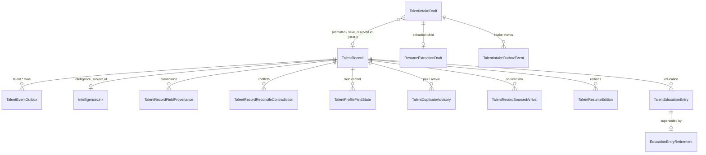
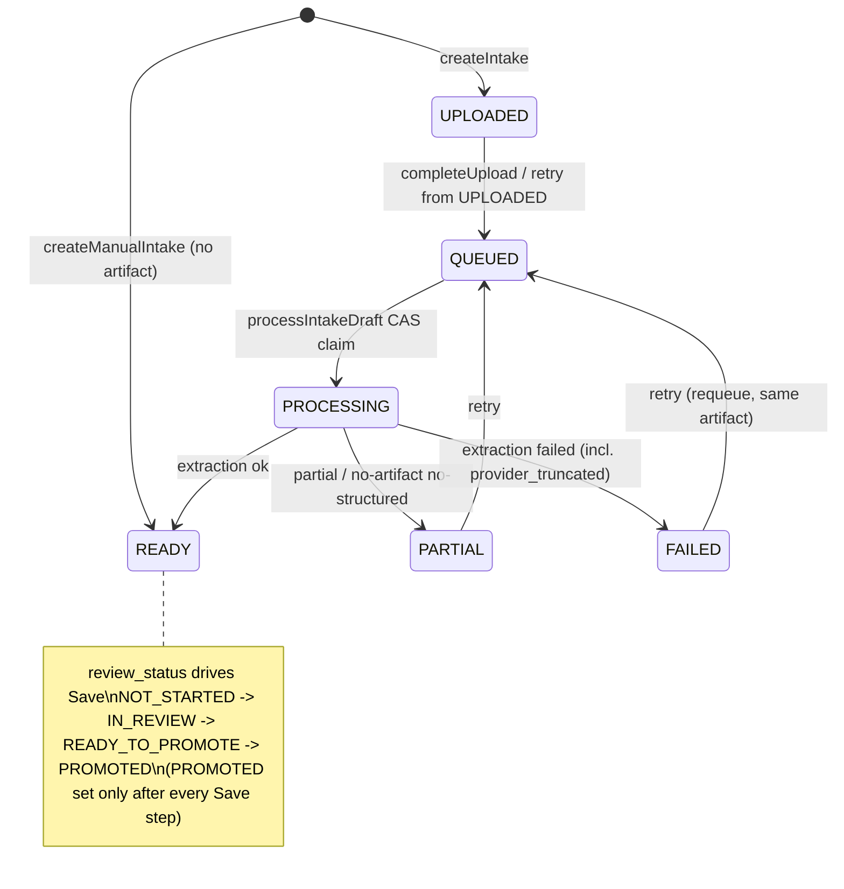
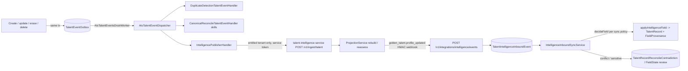

# D05 — Talent Domain (Record, Evidence, Intake, Trust) (AS-BUILT)
> Baseline SHA 680907fc06620845944794e0a529918c980f5124 · category AS-BUILT
> Refreshed from baseline 12330b0f (2026-10-09) to 680907fc (2026-10-24): ATI-SEP-1 (PR #1006) deleted the in-process trust ledger and reconcile libs, made recruiter Add Talent an ATS-local Draft → Review → Save with a `talent.*` outbox, and moved evidence/trust into the separate `apps/talent-intelligence-service`; S2 erasure, the singlebox intake transport, technical screening and Talent 360 education edit also landed.

## Summary

The Talent domain at this SHA has two sides separated by an nx wall
(`scope:ats` must not depend on `scope:intelligence`; `eslint.config.mjs:83`,
`:89`):

**ATS side (`scope:ats`)**
- **`talent-record`** — the recruiter-facing ATS heart: the `TalentRecord`
  entity, the HTTP surface (`TalentRecordController`, `TalentIntakeController`),
  the durable async résumé-first intake with the resumable **Save** (promote),
  manual-entry drafts, résumé editions, the ATS talent event outbox
  (`talent.created` / `talent.profile_updated` / `talent.erased` /
  `talent.deleted`), ATS-local duplicate advisories, and the ATS-side store for
  Talent Intelligence links, inbound events and field sync policy.
- **`talent-evidence`** — the typed ATS evidence of record (work history,
  skills, education with edit lineage, certifications, contacts, documents,
  résumé editions) plus the durable intake tables (`TalentIntakeDraft`,
  `ResumeExtractionDraft`, `TalentIntakeOutboxEvent`).
- **`talent-extraction`** — the governed-LLM extraction service and the facade
  for the evidence read/write and intake-Save primitives. It writes no trust
  ledger.
- **`talent-intelligence`** — read ports only (dossier head, authorized talent
  retrieval, requisition context).
- **`intelligence-integration`** — the ATS HTTP client to Talent Intelligence,
  the post-commit publisher, the HMAC webhook receiver, inbound sync and the
  backfill service.
- **`talent-embedding`** (`scope:cip`) — the semantic-search embedding
  substrate (ports + `TalentEmbedding` row). Enterprise Search GS-2A.
- **`technical-screening`** — talent-scoped manual technical screening with
  ATS-local publication state.

**Talent Intelligence side (`scope:intelligence`)**
- **`apps/talent-intelligence-service`** + **`libs/intelligence-core`** — an
  independent NestJS service with its own database (`intelligence` schema) that
  owns Golden identity, global assertions (evidence), trust derivation,
  verification, disputes, proposals and contradiction resolution. Shared DTOs
  live only in `libs/intelligence-contracts` (`scope:shared`).

`libs/talent-trust`, `libs/talent-reconcile`, `libs/talent-reconcile-signal`,
`libs/platform-trust` and `libs/identity-index` do not exist at this SHA
(`git ls-tree -d 680907fc libs/` → absent), and migration
`libs/talent-record/prisma/migrations/20261024170000_ati_sep_1_drop_legacy_trust_schemas/migration.sql:31`
drops their schemas.

`TalentRecord` has **multiple creation paths** (enumerated in Key Flows): the
manual `POST /v1/talent-records`, the intake **Save** (`POST
/v1/talent-intake-drafts/:id/promote`, for upload or manual drafts), the
sourcing promotion (`PromotionService.promoteArrival`), and import
(`createForImport`). No single path is the sole authority. Every create path
commits the `TalentRecord` and its `talent.created` outbox row in one
`talent_record` transaction
(`libs/talent-record/src/lib/talent-record.controller.ts:1117`).

Both talent HTTP controllers are registered in production via
`TalentRecordModule` (`libs/talent-record/src/lib/talent-record.module.ts:61`),
imported by `apps/api/src/app.module.ts:283`. Intake transport is selected by
`TALENT_INTAKE_TRANSPORT` ∈ {`eventbridge` (default), `structured-log`,
`singlebox`} (`apps/api/src/talent-intake-consumer/talent-intake-events.config.ts:18`,
`:39`); the singlebox worker (`apps/api/src/talent-intake-worker.main.ts:17`)
delivers envelopes in-process and also drains the ATS talent event outbox.

## Modules & Services

| name | role | evidence path:line + symbol |
| --- | --- | --- |
| TalentRecordController | ATS talent HTTP surface (18 ops): list/search, CRUD, résumé-editions, field-state, hydration, work-auth, resume-upload-url | `libs/talent-record/src/lib/talent-record.controller.ts:168` `TalentRecordController` |
| TalentIntakeController | Durable async intake HTTP surface (11 ops, incl. `manual`) | `libs/talent-record/src/lib/talent-intake/talent-intake.controller.ts:43` `TalentIntakeController` |
| TalentIntakeService | Intake lifecycle: create / createManual / complete-upload / list / get / patch-review / retry (from UPLOADED) / discard / replace / SSE + source-agnostic admission | `libs/talent-record/src/lib/talent-intake/talent-intake.service.ts:40` `TalentIntakeService` |
| TalentIntakePromotionService | The Save — validate + dedupe, reserve id (CAS), materialize evidence once, create TalentRecord + `talent.created`, consent default + work-auth, mark PROMOTED last | `libs/talent-record/src/lib/talent-intake/talent-intake-promotion.service.ts:64` `TalentIntakePromotionService` |
| TalentCreateFromDraftService | Synchronous create-with-draft composition used by manual create only (intake Save no longer routes here) | `libs/talent-record/src/lib/talent-create-from-draft.service.ts:38` `TalentCreateFromDraftService` |
| TalentIntakeExtractionService | Runtime-neutral CAS-claimed extraction behind `TALENT_INTAKE_PROCESSING_PORT` (bounded 3 claim attempts) | `libs/talent-record/src/lib/talent-intake/talent-intake-extraction.service.ts:24` `TalentIntakeExtractionService` |
| TalentIntakeMessageHandler | Runtime-neutral message handler (envelope → authoritative re-validate → port) | `libs/talent-record/src/lib/talent-intake/talent-intake-message.handler.ts:37` `TalentIntakeMessageHandler` |
| TalentEventOutboxRepository | ATS talent event outbox (lease claim / publish / release / quarantine) + `writeTalentEvent` | `libs/talent-record/src/lib/talent-events/talent-event-outbox.ts:125`; `writeTalentEvent` `:92` |
| TalentDuplicateAdvisoryRepository | ATS-local within-tenant duplicate advisories (EMAIL / PHONE / SOURCED_ARRIVAL) + sourced-arrival link store | `libs/talent-record/src/lib/duplicate-advisory/talent-duplicate-advisory.repository.ts:101` |
| TalentIntelligenceRepository | ATS-side TI store: admissible-column reads, `intelligence_link`, inbound inbox, sync policy, field apply | `libs/talent-record/src/lib/talent-intelligence/talent-intelligence.repository.ts:119`; `applyIntelligenceField` `:316` |
| TalentExtractionService | Governed extraction + evidence / intake-Save primitives (no ledger write) | `libs/talent-extraction/src/lib/talent-extraction.service.ts:352` `TalentExtractionService` |
| AtsTalentEventDispatcher | Outbox dispatcher fanning `talent.*` events to handlers (duplicate detection, skill canonical reconcile, TI publisher) | `apps/api/src/ats-talent-events/ats-talent-event-dispatcher.ts:38`; known events `:21` |
| DuplicateDetectionService | ATS-local exact email/phone duplicate detector driven by talent events | `apps/api/src/talent-identity/duplicate-detection.service.ts:33` |
| RecordReconcileOrchestrator | Record re-home for an APPROVED within-tenant duplicate advisory (no trust subject) | `apps/api/src/talent-identity/record-reconcile.orchestrator.ts:68` |
| TalentErasureService | S2 subject-bound, transaction-bound talent erasure (CLI-driven) | `apps/api/src/talent-identity/talent-erasure.service.ts:507` `TalentErasureService` |
| IntelligencePublisherHandler | Post-commit ATS → TI publisher (entitlement-gated) | `libs/intelligence-integration/src/lib/intelligence-publisher.handler.ts:58` |
| IntelligenceInboundSyncService | TI → ATS inbound apply under the per-tenant field sync policy | `libs/intelligence-integration/src/lib/intelligence-inbound-sync.service.ts:58`; `decideField` `libs/intelligence-integration/src/lib/sync-policy.ts:140` |
| IntelligenceAccess | ATS gate for TI-backed trust surfaces (reads never throw; actions map refusals) | `apps/api/src/talent-identity/intelligence-access.ts:83`; `gate` `:90` |
| TalentIngestService (TI) | Admission-gated ingest, identity resolution, assertion events, erase | `libs/intelligence-core/src/lib/ingest/talent-ingest.service.ts:103` `ingest`; `:234` `erase` |
| ProjectionService (TI) | Profile/trust projection rebuild, subjects-changed recompute, periodic reassess | `libs/intelligence-core/src/lib/projection/projection.service.ts:123` `rebuild`; `:167`; `:181` |
| TalentEmbeddingRepository | Semantic-search embedding substrate (ports exported; GS-2A) | `libs/talent-embedding/src/index.ts:4` `TalentEmbeddingRepository` |
| TalentIntakeConsumerModule | apps/api Lambda consumer composition — binds port → extraction service, provides handler | `apps/api/src/talent-intake-consumer/talent-intake-consumer.module.ts:26` |
| SingleBoxTalentIntakePublisher | In-process delivery of intake envelopes to the handler (singlebox transport) | `apps/api/src/talent-intake-consumer/singlebox-talent-intake-publisher.ts:29`; handler call `:42` |

`@Injectable` source files (excluding `/tests/`), per lib, re-derived with
`grep -rl '@Injectable' libs/<lib>/src --include='*.ts' | grep -v /tests/ | wc -l`:
talent-record 16, talent-evidence 6, talent-extraction 1, talent-embedding 2,
talent-intelligence 0. TI side: intelligence-core 17 `@Injectable` classes.

## Data Models

`talent-record` schema (`libs/talent-record/prisma/schema.prisma`, 11 models, 0 enums):

| model | evidence |
| --- | --- |
| TalentRecord | `:47` — identity + contact + CRM + stated categorical fields; `phone_cell_normalized` added for dedupe (migration `20261024130000_ati_sep_1_talent_event_outbox_phone_normalized`); `cluster_id` inert |
| TalentEventOutbox | `:229` — ATS talent event outbox (ADR-0033 envelope + lease) |
| TalentResumeText | `:288` — persisted redacted résumé text (per-edition) |
| TalentRecordFieldProvenance | `:356` — provenance-by-reference; `source_kind` added (default `TRUST_EVIDENCE`; `INTELLIGENCE` for TI-applied values) |
| TalentRecordReconcileContradiction | `:390` — append-only occupied+differing contradiction log (now fed by TI inbound sync) |
| TalentProfileFieldState | `:431` — per-field control state (SET / EXPLICITLY_CLEARED, projection_policy AUTO/HOLD) |
| IntelligenceLink | `:473` — columns `tenant_id`, `talent_record_id`, `intelligence_subject_id` (`:474-476`), `@@id([tenant_id, talent_record_id])` (`:482`) |
| TalentIntelligenceInboundEvent | `:491` — HMAC webhook inbox (claimable) |
| TalentIntelligenceSyncPolicy | `:514` — per-tenant field mode AUTO_APPLY / REVIEW / IGNORE |
| TalentDuplicateAdvisory | `:536` — within-tenant advisory (pair or arrival), status + `merge_state` |
| TalentRecordSourcedArrival | `:576` — sourced arrival ↔ record link (PROMOTED / ADVISORY_APPROVED) |

`talent-evidence` schema (`libs/talent-evidence/prisma/schema.prisma`, 17 models, 19 enums):

| model/enum | evidence |
| --- | --- |
| TalentSkillEvidence | `:185` |
| TalentWorkHistoryEntry | `:261` — `assertions JSONB` added (migration `20261024110000_ati_sep_1_work_history_assertions`) |
| TalentEducationEntry / TalentCertificationEntry / TalentProjectExperience | `:323` / `:354` / `:387` |
| TalentContactMethod / TalentRateExpectation | `:413` / `:434` |
| TalentWorkAuthorization | `:456` — governed RIGHT_TO_WORK assertion rows (append-only history) |
| TalentDocument | `:491` — résumé evidence document identity |
| TalentDerivedSnapshot | `:510` |
| TalentResumeEdition / TalentResumeDefault | `:573` / `:630` — multi-edition résumé model; `is_default` is authoritative for display, not latest |
| ResumeExtractionDraft | `:674` — governed extraction result/evidence child; enums `ResumeExtractionDraftSourceKind` `:657`, `ResumeExtractionDraftStatus` `:664` |
| TalentIntakeDraft | `:769` — the pre-Talent durable workflow authority; `processing_status` + `review_status`; `storage_key` nullable; `promoted_talent_record_id`; resumable-Save columns `save_reserved_talent_record_id`, `save_started_at`, `save_evidence_materialized_at`, `save_evidence_payload_hash` (migrations `20261024120000_ati_sep_1_intake_resumable_save`, `20261024130000_ati_sep_1_intake_save_payload_hash`); `version` CAS |
| TalentIntakeOutboxEvent | `:884` — transactional intake outbox with ADR-0033 envelope columns + lease |
| EducationEntryRetirement / EducationEntryAuditEvent | `:932` / `:947` — education edit lineage (migration `20261022160000_ats_qa_1_education_edit_lineage`) |

Talent Intelligence schema (`libs/intelligence-core/prisma/schema.prisma`,
`schemas = ["intelligence"]`, 26 models, 0 enums): key models `GoldenTalent`
`:49`, `ExternalTalentReference` `:120`, `Assertion` `:150` (provenance
`source_tenant_id`, no `tenant_id` column), `SubjectTrustState` `:458`, plus
inbox / outbox / disputes / proposals / verification models. Migrations live in
`libs/intelligence-core/prisma/migrations` (4 at this SHA).

`talent-embedding` schema: `TalentEmbedding` (`libs/talent-embedding/prisma/schema.prisma:33`),
enum `TalentEmbeddingStatus` (`:24`).

`technical-screening` schema (`libs/technical-screening/prisma/schema.prisma`,
10 models): `ScreeningSession` `:33` (soft `talent_record_id`),
`ScreeningFinding` `:67`, `ScreeningEvidencePublication` `:200`, `ScreeningEvent`
`:222`, and six supporting models.



## API Endpoints

`TalentIntakeController` — base `v1/talent-intake-drafts`
(`libs/talent-record/src/lib/talent-intake/talent-intake.controller.ts:40`).
Class guards: `JwtAuthGuard, EntitlementGuard, RolesGuard` (`:41`) +
`@RequireCapability('ats')` (`:42`). 11 operations.

| method | route | scope | evidence |
| --- | --- | --- | --- |
| POST | / | talent:create + site-match | `:50` `create` |
| POST | manual (201) | talent:create + site-match | `:65` `createManual` |
| POST | :id/complete-upload (202) | talent:create + site-match | `:78` `completeUpload` |
| GET | / | talent:read + site-match | `:92` `list` |
| GET | :id | talent:read + site-match | `:103` `get` |
| PATCH | :id | talent:edit + site-match | `:116` `patchReview` |
| POST | :id/retry | talent:edit + site-match | `:131` `retry` |
| POST | :id/replace-resume | talent:edit + site-match | `:145` `replaceResume` |
| DELETE | :id (204) | talent:edit + site-match | `:160` `discard` |
| POST | :id/promote (201) — the Save | talent:create + site-match | `:173` `promote` |
| SSE | :id/events | talent:read + site-match | `:190` `events` |

`TalentRecordController` — base `v1/talent-records`
(`libs/talent-record/src/lib/talent-record.controller.ts:165`). Class guards
(`:166`) + `@RequireCapability('ats')` (`:167`). 18 operations re-derived with
`grep -cE '^  @(Get|Post|Patch|Put|Delete|Sse)\('`.

| method | route | scope | evidence |
| --- | --- | --- | --- |
| GET | / (list/search; ?q / ?resume_q additionally require talent:search) | talent:read (+talent:search when searching) | `:231` `list` |
| GET | duplicate-check (tenant-wide, no site-match) | talent:read | `:353` `duplicateCheck` |
| GET | :id/work-history | talent:read + site-match | `:384` `workHistory` |
| GET | :id/field-state | talent:read + site-match | `:406` `getFieldState` |
| GET | :id/profile-hydration | talent:read + site-match | `:453` `getProfileHydration` |
| GET | :id/work-authorization | talent:read + site-match | `:482` `getWorkAuthorizationState` |
| GET | :id/resume-editions | talent:read + site-match | `:513` `listResumeEditions` |
| GET | :id/resume-editions/:editionId/text | talent:read + site-match | `:543` `getResumeEditionText` |
| POST | :id/resume-editions (201) | talent:edit + site-match | `:595` `createResumeEdition` |
| PUT | :id/resume-editions/default | talent:edit + site-match | `:790` `setDefaultResumeEdition` |
| POST | :id/resume-editions/:editionId/archive | talent:edit + site-match | `:839` `archiveResumeEdition` |
| POST | :id/resume-editions/:editionId/confirm | talent:edit + site-match | `:883` `confirmResumeEdition` |
| POST | :id/resume-editions/:editionId/reject | talent:edit + site-match | `:930` `rejectResumeEdition` |
| GET | :id | talent:read + site-match | `:1028` `get` |
| POST | / (201) | talent:create + site-match | `:1052` `create` |
| PATCH | :id (contact anchors need talent:edit:contact) | talent:edit + site-match | `:1377` `update` |
| DELETE | :id (204) | talent:delete + site-match | `:1567` `delete` |
| POST | resume-upload-url | attachment:create + site-match | `:1611` `createResumeUploadUrl` |

The cluster-link routes (`GET`/`POST`/`DELETE :id/link`) are removed with the
identity-index link (comment `:1583`); the synchronous
`POST /v1/talent-records/draft-from-resume` remains retired (comment `:1653`).

Talent-scoped surfaces in `apps/api` (ATS JWT + capability guards):

| controller | base | routes | evidence |
| --- | --- | --- | --- |
| TalentEducationController | `v1/talent-records/:recordId/education` | POST, PUT `:entryId`, DELETE `:entryId` (talent:edit) | `apps/api/src/talent-360/talent-education.controller.ts:33` |
| Talent360Controller | `v1/talent-360` | GET `:talentId`, communications, document content | `apps/api/src/talent-360/talent-360.controller.ts:47` |
| DossierController (TI-backed read) | `v1/talent-records/:id/dossier` | GET, GET `evidence` (talent:read) | `apps/api/src/talent-identity/dossier.controller.ts:20` |
| EmailVerificationController (TI-backed) | `v1/talent-records/:recordId/email-verifications` | POST (talent:edit), GET (talent:read) | `apps/api/src/talent-identity/email-verification.controller.ts:31` |
| AdvisoryResolutionController (ATS-local) | `v1/talent/identity/advisories` | GET, approve, dismiss, reverse (identity:resolve) | `apps/api/src/talent-identity/advisory-resolution.controller.ts:119` |
| VerificationProposal / ContradictionResolution / PortalDisputeDisposition (TI-backed) | `v1/talent/identity/{proposals,contradictions,portal-disputes}` | 3 + 1 + 7 routes | `apps/api/src/talent-identity/verification-proposal.controller.ts:103`; `contradiction-resolution.controller.ts:33`; `portal-dispute-disposition.controller.ts:64` |
| TalentScreeningSessionsController / ScreeningSessionController | `v1/talent-records/:talentId/screening-sessions`, `v1/screening-sessions` | 2 + 18 routes (`screening:*`) | `apps/api/src/technical-screening/technical-screening.controller.ts:363`, `:434` |
| IntelligenceEventsController (unguarded, HMAC) | `v1/integrations/intelligence` | POST `events` | `apps/api/src/integrations/intelligence/intelligence-events.controller.ts:21`, `:25` |

Talent Intelligence service HTTP surface (service-token auth, no user JWT):
9 controllers, 28 handlers, registered in
`apps/talent-intelligence-service/src/app/app.module.ts:22`–`:36`; ingest is
`POST /v1/ingest/talent` and `POST /v1/ingest/talent/erased`
(`apps/talent-intelligence-service/src/app/ingest/ingest.controller.ts:49`,
`:54`, `:64`).

`TalentIntakeService.createSourceIntake` (source-agnostic non-upload admission,
ADR-0033 Decision 5) exists at
`libs/talent-record/src/lib/talent-intake/talent-intake.service.ts:217` but has
**no HTTP route or consumer caller** — the only reference outside tests is its
own definition.

## Screens & FE→BE Wiring (FE domains only)

ATS-web talent domain (`apps/ats-web/src/talent/`, 26 `.tsx` + 20 `.ts` at
depth 1, specs included): intake (`IntakeForm.tsx`, `ResumeDropzone.tsx`,
`ParseProgress.tsx`, `ResumePreview.tsx`, `InProgressTable.tsx`,
`DraftsLegacyRedirect.tsx`), create/edit/list (`TalentCreateView.tsx`,
`TalentEditView.tsx`, `TalentListView.tsx`, `WorkHistoryPanel.tsx`), and
helpers (`profile-hydration.ts`, `draft-recovery.ts`, `talent-workspace.ts`,
new `talent-education-api.ts`, `evidence-vocab.ts`, `stated-fields.ts`). The
legacy `components/TrustPanel.tsx` and `components/TalentTriageDrawer.tsx` are
deleted.

Intake wiring: `apps/ats-web/src/talent/talent-intake-api.ts:102` sets
`BASE = '/v1/talent-intake-drafts'`; calls `manual` (`:115`), `complete-upload`
(`:123`), `promote` (`:150`), and opens the SSE `events` stream via
`EventSource` (`:178`, `withCredentials: true`).

## Key Flows

### Intake → async extraction → promotion

```mermaid
sequenceDiagram
  actor Recruiter
  participant FE as ats-web talent-intake-api
  participant IC as TalentIntakeController
  participant IS as TalentIntakeService
  participant S3 as ObjectStorage
  participant OB as TalentIntakeOutboxEvent
  participant Pub as drain + publisher (eventbridge / singlebox)
  participant H as TalentIntakeMessageHandler
  participant EX as TalentIntakeExtractionService
  participant Orch as ResumeExtractionOrchestrator (governed LLM)
  participant PS as TalentIntakePromotionService
  participant TO as TalentEventOutbox

  alt résumé upload
    Recruiter->>FE: upload résumé
    FE->>IC: POST /v1/talent-intake-drafts
    IC->>IS: createIntake (presign + persist UPLOADED draft)
    FE->>S3: PUT bytes
    FE->>IC: POST :id/complete-upload
    IC->>IS: completeUpload (headObject, mark committed)
    IS->>OB: atomic QUEUE + outbox write (same tx) -> 202
    Pub->>H: deliver AramoEventEnvelope (at-least-once)
    H->>EX: processIntakeDraft (CAS claim, max 3 attempts)
    EX->>Orch: extractResume (ONE governed call)
    EX->>EX: child READY_FOR_REVIEW / FAILED; parent READY/PARTIAL/FAILED
  else manual entry
    FE->>IC: POST /v1/talent-intake-drafts/manual
    IC->>IS: createManualIntake (no artifact, settled READY, no outbox)
  end
  Recruiter->>FE: review / edit (PATCH, CAS on version)
  FE->>IC: POST :id/promote (Save)
  IC->>PS: promote
  PS->>PS: admission 422 + duplicate 409 (nothing written)
  PS->>PS: reserve id (CAS) + materialize evidence once (hash-stamped)
  PS->>TO: TalentRecord + talent.created in one tx
  PS->>PS: consent default + work-auth evidence (idempotent)
  PS-->>Recruiter: draft PROMOTED last (failure leaves it re-savable)
```

Admission is the only creation prerequisite: first/last name + `email1` +
`phone_cell` (422 at
`libs/talent-record/src/lib/talent-intake/talent-intake-promotion.service.ts:97`);
extraction state is never a gate. A hard active duplicate blocks Save with 409
before anything is written (`:116`, `:127`). Exactly-one `TalentRecord` comes
from the reserved-id CAS (`:131`;
`libs/talent-evidence/src/lib/talent-evidence.repository.ts:2383`
`reserveTalentIntakeDraftSave`), evidence materialization (`:163`), record
create on the reserved id (`:190`), follow-ups (`:213`) and PROMOTED last
(`:232`). A truncated extraction (`provider_truncated`) is a failure status
that keeps the draft editable
(`libs/talent-record/src/lib/talent-intake/talent-intake-review.ts:263`).

### TalentIntakeDraft processing lifecycle



Enum values: `TalentIntakeProcessingStatus`
(`libs/talent-evidence/prisma/schema.prisma:745`) and
`TalentIntakeReviewStatus` (`:759`). The non-artifact source branch transitions
straight to READY (structured payload present) or PARTIAL, with no extraction
child (`libs/talent-record/src/lib/talent-intake/talent-intake-extraction.service.ts:92`).
Retry from UPLOADED re-runs complete-upload or settles a manual draft
(`libs/talent-record/src/lib/talent-intake/talent-intake.service.ts:459`).

### Trust ledger → reconcile → flat TalentRecord

At this SHA the in-process ledger and reconcile projection are gone; the
equivalent flow is ATS outbox → Talent Intelligence → inbound sync.



The drain runs only when `ATS_TALENT_EVENTS_DRAIN_ENABLED === '1'`
(`apps/api/src/ats-talent-events/ats-talent-events-drain.worker.ts:34`); the
worker entrypoint defaults it on (`apps/api/src/talent-intake-worker.main.ts:16`).
The publisher is gated on the tenant's `intelligence` capability
(`libs/intelligence-integration/src/lib/intelligence-publisher.handler.ts:87` `entitlements.getCapabilities`; `INTELLIGENCE_CAPABILITY` at `:55`);
TI read isolation is enforced at read time by `assertionVisibleTo`
(`libs/intelligence-core/src/lib/access/tenant-view.ts:29`) with
`TI_CROSS_TENANT_READ_ENABLED` (`:13`). The G1 recompute-repair and TR-5 sweep
schedules are removed (`apps/api/src/jobs/registration.ts:137`); TI recompute
is `ProjectionService.subjectsChanged` / `reassess`
(`libs/intelligence-core/src/lib/projection/projection.service.ts:167`, `:181`).

### Talent erasure (S2) and record delete

`TalentErasureService.execute`
(`apps/api/src/talent-identity/talent-erasure.service.ts:678`) runs one
transaction: exclusive identity advisory lock (`:705`), a transaction-bound
erasure run via the confined `consent` SECURITY DEFINER entry point (`:717`; name confined by the S2 confinement spec), redactions,
per-requisition tombstones (`:752`), a `talent.erased` outbox row (`:768`), then
`COMMIT` (`:794`) and post-commit storage purge. It has no HTTP route (CLI
`apps/api/src/talent-anchor/erase-talent.command.ts`). `DELETE
/v1/talent-records/:id` is separate: a hard `TalentRecord` row delete plus a
`talent.deleted` event in one transaction
(`libs/talent-record/src/lib/talent-record.repository.ts:1443`, `:1461`, `:1463`).

## Evidence Index (load-bearing)

- `libs/talent-record/src/lib/talent-intake/talent-intake.controller.ts:40,43,50,65,78,173,190` — intake controller + ops
- `libs/talent-record/src/lib/talent-record.controller.ts:165,168,1052,1084,1102,1107,1117,1130,1148,1261,1377,1567,1583,1611,1653` — record controller, create flow, swallowed evidence catch, update, delete, removed link routes, upload-url, retired-route note
- `libs/talent-record/src/lib/talent-intake/talent-intake.service.ts:40,112,169,217,284,459,660` — createIntake, createManualIntake, createSourceIntake (unwired), completeUpload, retry, streamIntakeEvents
- `libs/talent-record/src/lib/talent-intake/talent-intake-promotion.service.ts:64,77,97,116,127,131,163,190,213,232` — Save authority and steps
- `libs/talent-evidence/src/lib/talent-evidence.repository.ts:2254,2383` — intake claim CAS, Save reservation CAS
- `libs/talent-record/src/lib/talent-create-from-draft.service.ts:38,51` — sync create-with-draft composition
- `libs/talent-record/src/lib/talent-intake/talent-intake-extraction.service.ts:24,35,63,82,92` — port impl, CAS claim loop, runIntakeExtraction, non-artifact branch
- `libs/talent-record/src/lib/talent-intake/talent-intake-message.handler.ts:37,46` — handler, handle
- `libs/talent-record/src/lib/talent-intake/talent-intake-processing.port.ts:12` — TALENT_INTAKE_PROCESSING_PORT
- `libs/talent-record/src/lib/talent-events/talent-event-outbox.ts:92,125` — writeTalentEvent, outbox repository
- `libs/talent-record/src/lib/talent-record.repository.ts:1443,1461,1463` — hard delete + talent.deleted
- `apps/api/src/ats-talent-events/ats-talent-event-dispatcher.ts:21,38`; `ats-talent-events-drain.worker.ts:23,34` — talent event fan-out + drain gate
- `apps/api/src/talent-intake-consumer/talent-intake-events.config.ts:18,39,50`; `singlebox-talent-intake-publisher.ts:29,42`; `talent-intake-worker.module.ts:20`; `apps/api/src/talent-intake-worker.main.ts:16,17` — transport selection + singlebox worker
- `apps/api/src/talent-identity/talent-erasure.service.ts:507,678,705,717,752,768,794` — S2 erasure
- `libs/intelligence-integration/src/lib/intelligence-publisher.handler.ts:58,70`; `intelligence-inbound-sync.service.ts:58`; `sync-policy.ts:43,140` — ATS ↔ TI integration
- `apps/api/src/integrations/intelligence/intelligence-events.controller.ts:21,25` — HMAC webhook receiver
- `libs/intelligence-core/src/lib/ingest/talent-ingest.service.ts:103,126,234`; `projection/projection.service.ts:123,167,181`; `access/tenant-view.ts:13,29` — TI ingest, projection, tenant view
- `libs/talent-record/prisma/schema.prisma:47,229,288,356,390,431,473,491,514,536,576` — TalentRecord + ATS projection / outbox / TI / advisory tables
- `libs/talent-evidence/prisma/schema.prisma:185,261,456,491,573,674,769,884,932,947` — evidence + intake + outbox + education lineage models
- `libs/intelligence-core/prisma/schema.prisma:49,120,150,458` — TI Golden / reference / assertion / trust models
- `libs/talent-embedding/prisma/schema.prisma:24,33` — embedding status + row
- `libs/talent-record/src/lib/talent-record.module.ts:61` — both controllers registered
- `apps/api/src/app.module.ts:240,246,283` — AtsTalentEventsModule, IntelligenceTrustSurfacesModule, TalentRecordModule imported
- `apps/talent-intelligence-service/src/app/app.module.ts:22,36`; `ingest/ingest.controller.ts:49,54,64` — TI service composition + ingest routes
- `apps/ats-web/src/talent/talent-intake-api.ts:102,115,123,150,178` — FE intake wiring

## NOT VERIFIED (explicit)

- Which intake transport (`TALENT_INTAKE_TRANSPORT`) and whether the
  ATS talent event drain / Talent Intelligence service are enabled in any
  environment is NOT established from code alone; `docker-compose.prod.yml`
  declares a `talent-intelligence-service` service, but deployment state is
  NOT VERIFIED.
- The ADR-0033 EventBridge→SQS→Lambda path (`apps/api/src/talent-intake-consumer/sqs-lambda.adapter.ts`,
  `talent-intake-consumer.handler.ts`) was not exercised; only file/class
  locations were read.
- Talent Intelligence internals (`libs/intelligence-core`, 34 src files) were
  inventoried by class / method signature, not line-by-line; trust-derivation
  thresholds and identity-resolution rules are NOT VERIFIED beyond ADR-0036.
- `talent-embedding` runtime enablement (semantic DARK) is governed by env
  outside these libs; not asserted from the lib code here.
- `talent-extraction.service.ts` (3142 lines) internal method bodies were not
  read in full (public methods invoked by the controllers / promotion were
  traced).
- The 18 `ScreeningSessionController` routes were enumerated by decorator line;
  their handler bodies were not read.
