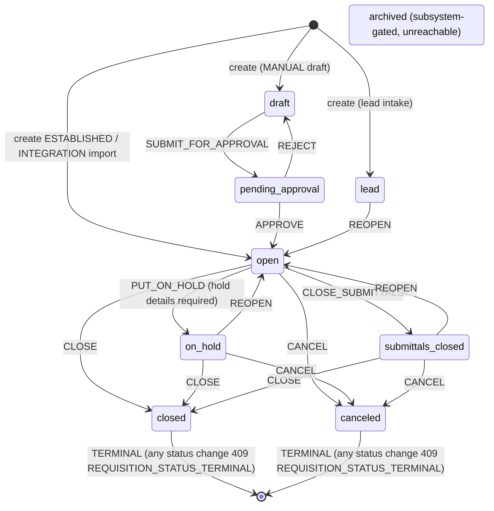
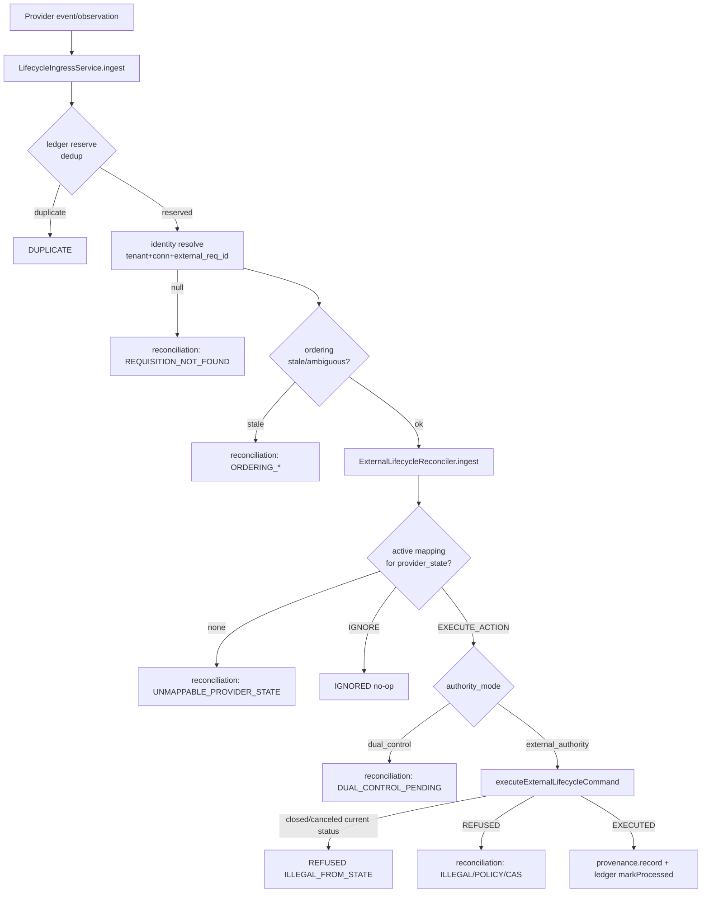

# D06 — Requisition, Job & VMS (AS-BUILT)
> Refreshed from baseline 12330b0f (2026-10-09) to 680907fc (2026-10-24): closed/canceled became terminal (lifecycle package v8.0.0 + a code-level 409), PUT_ON_HOLD now carries recorded hold details on the lifecycle event, status writers lock the row FOR UPDATE inside bounded transactions, the list route gained an opt-in paged picker mode, and new visibility-scoped reads serve the submittal create gate and the Talent Intelligence read seam.
> Baseline SHA 680907fc06620845944794e0a529918c980f5124 · category AS-BUILT

## Summary

D06 covers the ATS job-order aggregate (`Requisition`) and the surfaces around
it: the declared recruiting lifecycle (a governed status machine), the
Job/GoldenProfile capture spine, outbound job distribution (channel posting),
pre-start onboarding requirements, and the VMS/external-lifecycle integration
seam (ADR-0030) with its tenant-authored provider-state → action mapping.

The `Requisition` entity lives in `libs/requisition` (schema-per-module
`requisition`). Its declared status is `RecruitingStatus` (a stored enum, nine
values). Lifecycle changes are not free status writes: a status-changing PATCH
is routed through a GOVERNED transition action (`CLOSE`, `REOPEN`,
`PUT_ON_HOLD`, `CANCEL`, `SUBMIT_FOR_APPROVAL`, `APPROVE`, `REJECT`,
`CLOSE_SUBMITTALS`), gated by the ADR-0024 policy engine against the declared
FROM status, applied via an optimistic-concurrency compare-and-swap, and audited
by an append-only `RequisitionLifecycleEvent`. The SAME gate → CAS → event
pipeline is reused by an integration-origin seam
(`executeExternalLifecycleCommand`) so an authoritative external (VMS/client)
event can issue a mapped action — never a direct status write (ADR-0030
R-INVARIANT).

`closed` and `canceled` are TERMINAL for every status change:
the PATCH path refuses any status change from them with 409
`REQUISITION_STATUS_TERMINAL` (requisition.repository.ts:1517-1524), the external
seam refuses with `ILLEGAL_FROM_STATE` (requisition.repository.ts:1690-1692), and
the seeded policy package v8.0.0 sets `REOPEN` from `closed` to DENY
(apps/api/src/policy/requisition-lifecycle.package.ts:162-170, :238). A
`PUT_ON_HOLD` must carry hold details (reason + source `client|internal` on the
manual PATCH; source `vms` with a NULL reason on the external seam) which are
written to the lifecycle event row, never to the requisition row. Both status
writers open a bounded transaction (`LOCK_TIMEOUT_SQL` + `LOCKED_TX_OPTIONS`),
re-read the row `FOR UPDATE`, and refuse if the status changed since the
decision; the client-submit path reads the requisition `FOR SHARE`, so a hold and
a submit serialize (see D08).

Two creation authorities exist for `Requisition`: the human/system path
(`RequisitionRepository.create`, behind `POST /v1/requisitions`) and the import
path (`createForImport`, driven by the requisition-import engine). Job and
GoldenProfile are a separate, narrow create/read spine in `libs/job-domain`.
Outbound distribution (`libs/job-distribution`) is a per-channel posting-state
projection with a pure CREATE/UPDATE/NOOP transition planner. Pre-start
requirements (`libs/pre-start-requirement`) model placement-scoped onboarding
readiness and expose assessment only (never transition a placement).

## Modules & Services

| name | role | evidence path:line + symbol |
| --- | --- | --- |
| RequisitionModule | ATS requisition DI root; exports RequisitionRepository, RequisitionAssignmentRepository, RequisitionEmbeddingRepository, RequisitionSkillRequirementRepository | libs/requisition/src/lib/requisition.module.ts:88-93 `exports` |
| RequisitionController | HTTP CRUD + lifecycle + profile + assignment surface (`v1/requisitions`) | libs/requisition/src/lib/requisition.controller.ts:83 `@Controller('v1/requisitions')` |
| RequisitionRepository | write/read floor; create, update (transition executor), external-lifecycle seam, CAS, visibility, paged picker read, visibility-only reads | libs/requisition/src/lib/requisition.repository.ts:609 `RequisitionRepository` |
| RequisitionTransitionPolicyService | governed-transition policy evaluator (ADR-0024); fail-closed on no package | libs/requisition/src/lib/policy/requisition-transition-policy.service.ts:67 `RequisitionTransitionPolicyService` |
| SetPriorityPolicyService | `is_hot` SET_PRIORITY policy gate (sibling) | libs/requisition/src/lib/policy/set-priority-policy.service.ts (exported) index.ts:47 |
| RequisitionLifecycleEventStore | append-only lifecycle history write API; carries optional hold details | libs/requisition/src/lib/requisition-lifecycle-event.store.ts:96 `RequisitionLifecycleEventStore` |
| resolveManualHoldDetails | pure validator for the PATCH `hold` control payload (required on PUT_ON_HOLD, refused on any other edge, `vms` source refused) | libs/requisition/src/lib/hold-details.ts:27 `resolveManualHoldDetails` |
| RequisitionAssignmentRepository | recruiter assignment join (visibility driver) | libs/requisition/src/lib/requisition-assignment.repository.ts (exported) index.ts:13 |
| RequisitionSkillRequirementRepository | SKILL-TAX-1D requirement rows; new requisition-keyed read `listByRequisitionId` for the TI read seam | libs/requisition/src/lib/requisition-skill-requirement.repository.ts:99 `listByRequisitionId` |
| RequisitionIntakeService | pre-creation AI intake draft (ADR-0015 v1.2) | libs/requisition/src/lib/requisition-intake.service.ts (ctor dep) controller.ts:91 |
| RequisitionProfileService | JD + GoldenProfile draft/confirm/read | libs/requisition/src/lib/requisition-profile.service.ts (ctor dep) controller.ts:90 |
| RequisitionContextReadAdapter | apps/api adapter of the TIP-E2E INC-2 requisition-context read port; composes `filterVisibleRequisitionIds` + `listByRequisitionId` | apps/api/src/talent-intelligence/requisition-context-read.adapter.ts:18 `RequisitionContextReadAdapter` |
| assertRequisitionPermitsContactSend | apps/api pre-send gate: requisition-scoped email / call / RTR send refused on closed/canceled (`REQUISITION_NOT_ADVANCEABLE`) | apps/api/src/requisition-lifecycle/requisition-contact.gate.ts:19 |
| JobDomainRepository | Job + GoldenProfile create/read spine | libs/job-domain/src/lib/job-domain.repository.ts:73 `JobDomainRepository` |
| job-distribution (posting) | pure posting-action planner + per-channel state repo | libs/job-distribution/src/lib/posting-transition.ts:36 `planPublishableAction` |
| pre-start-requirement | onboarding requirement sets/instances/readiness; assessment only | libs/pre-start-requirement/src/lib/pre-start-requirement.types.ts:179 `BlockingAssessment` |
| PreStartRequirementController | pre-start HTTP surface (`v1/pre-start-requirement`) | apps/api/src/pre-start-requirement/pre-start-requirement.controller.ts:38 `@Controller('v1/pre-start-requirement')` |
| ExternalLifecycleReconciler | ADR-0030 orchestration seam: normalize → mapping → authority mode → command | apps/api/src/requisition-integration/external-lifecycle-reconciler.ts:59 `ExternalLifecycleReconciler` |
| LifecycleIngressService | provider-neutral ingress: ledger dedup → identity resolve → ordering → reconciler | apps/api/src/requisition-integration/lifecycle-ingress.service.ts:55 `LifecycleIngressService` |
| ReconciliationDrainProcessor | BullMQ worker draining pending reconciliation rows (ADR-0018 manualRegistration) | apps/api/src/requisition-integration/reconciliation-drain.processor.ts:21 `ReconciliationDrainProcessor` |
| RequisitionLifecycleMappingAdminController | VMS lifecycle-mapping administration (`v1/integrations/:connectionId/requisition-lifecycle-mappings`) | libs/integration/src/lib/lifecycle/mapping-admin/requisition-lifecycle-mapping-admin.controller.ts:49 `RequisitionLifecycleMappingAdminController` |
| REQUISITION_LIFECYCLE_PACKAGE | the seeded ADR-0024 policy DATA (matrix → engine rules), version 8.0.0 | apps/api/src/policy/requisition-lifecycle.package.ts:229 `REQUISITION_LIFECYCLE_PACKAGE` |

## Data Models

Schema `requisition` (libs/requisition/prisma/schema.prisma):
- `Requisition` (model, schema.prisma:111) — the job-order entity. Declared
  `status RecruitingStatus @default(open)` (schema.prisma:134); immutable
  per-tenant `requisition_number` (schema.prisma:125); optimistic-concurrency
  `version Int @default(0)` (schema.prisma:335); structured compensation,
  enterprise, gated financial-planning, publish (`advertised_*`), and VMS
  provenance (`source_system`/`external_req_id`/`imported_at`,
  schema.prisma:244-246) field groups; `golden_profile_id` seam
  (schema.prisma:305). `openings_available` column was RETIRED — availability is
  derived from placement (schema.prisma:185-191).
- `RecruitingStatus` enum — nine values `lead, draft, pending_approval, open,
  on_hold, submittals_closed, canceled, closed, archived` (schema.prisma:66).
- `RequisitionNumberSequence` (schema.prisma:371) — per-tenant monotonic
  allocator, seeds at 1000.
- `RequisitionAssignment` (schema.prisma:386) — join driving the recruiter
  visibility predicate; intra-schema FK with `onDelete: Cascade`.
- `UserRequisitionState` (schema.prisma:435) — personal per-user bookmark state.
- `RequisitionLifecycleEvent` (schema.prisma:486) — append-only lifecycle
  history; `previous_status`/`next_status` nullable (schema.prisma:504-505);
  `policy_decision_id` UUID-only cross-schema ref; `origin` enum
  `ui|agent|integration` (schema.prisma:465, :509). Four ADD-only hold columns
  `hold_reason`, `hold_source`, `hold_effective_at`, `hold_instructions`
  (schema.prisma:522-526), added by migration
  `20261021090000_s3_requisition_hold_details` with CHECKs: source in
  `client|vms|internal`, non-empty reason, hold columns only on an `on_hold`
  event, and (NOT VALID, so legacy rows pass) a new `on_hold` transition event
  must carry a source and a reason unless the source is `vms`
  (libs/requisition/prisma/migrations/20261021090000_s3_requisition_hold_details/migration.sql:5-35).
- `RequisitionSkillRequirement` (schema.prisma:554) — SKILL-TAX-1D canonical seam.
- `RequisitionEmbedding` + `RequisitionEmbeddingStatus` (schema.prisma:594,586) —
  GS-2B pgvector semantic index (DARK).

The `requisition` schema has 24 migration directories, the newest being
`20261021090000_s3_requisition_hold_details`.

Schema `job_domain` (libs/job-domain/prisma/schema.prisma): `Job` (:55),
`GoldenProfile` (:76).

Schema `job_distribution` (libs/job-distribution/prisma/schema.prisma):
`ChannelPostingState` (:25), `TenantChannelConfig` (:55).

Schema `pre_start_requirement` (libs/pre-start-requirement/prisma/schema.prisma):
`PreStartRequirementSet` (:49), `PreStartRequirementDefinition` (:78),
`PreStartRequirementInstance` (:123), `PreStartMaterializationIntent` (:184),
`PreStartRequirementAudit` (:217), `PreStartReadinessDecision` (:253).

Schema `integration` (libs/integration/prisma/schema.prisma) — VMS lifecycle
seam: `RequisitionLifecycleAuthorityMode` enum `external_authority|dual_control`
(:167), `RequisitionLifecycleMapping` (:181), `RequisitionLifecycleMappingSet`
(:243, exactly-one-active via partial unique index),
`RequisitionExternalReconciliation` (:457),
`RequisitionExternalTransitionProvenance` (:519), `LifecycleObservationLedger`
(:617), `ExternalRequisitionIdentity` (:687). The hold read joins
`RequisitionExternalTransitionProvenance.lifecycle_event_id` by raw SQL to show
the raw provider status of a VMS hold (fail-soft; no FK, no nx edge)
(requisition.repository.ts:837-886 `latestHoldDetails`).

## API Endpoints

`RequisitionController` (libs/requisition/src/lib/requisition.controller.ts),
class-level `@UseGuards(JwtAuthGuard, EntitlementGuard, RolesGuard)` +
`@RequireCapability('ats')`:

| method | route | scopes | evidence |
| --- | --- | --- | --- |
| GET | /v1/requisitions | requisition:read (+ requisition:search when `?q=`); opt-in `?paged=true&status=&cursor=&page_size=` keyset picker mode returning `{items,next_cursor}`, 400 `status_filter_invalid` on an unknown status | controller.ts:115 `list`; search gate controller.ts:137; paged branch controller.ts:146-169 |
| GET | /v1/requisitions/:id | requisition:read | controller.ts:181 `get` |
| POST | /v1/requisitions | requisition:create | controller.ts:225 `create` |
| POST | /v1/requisitions/intake | requisition:create | controller.ts:292 `intake` |
| PATCH | /v1/requisitions/:id | (in-service: requisition:edit OR requisition:edit:status); body may carry the `hold` control payload on a PUT_ON_HOLD | controller.ts:320 `update` |
| DELETE | /v1/requisitions/:id | requisition:delete | controller.ts:349 `delete` |
| PUT | /v1/requisitions/:id/bookmark | requisition:read | controller.ts:392 `setBookmark` |
| GET | /v1/requisitions/:id/profile | requisition:read | controller.ts:448 `getProfile` |
| POST | /v1/requisitions/:id/profile/draft | requisition:profile:generate | controller.ts:467 `draftProfile` |
| POST | /v1/requisitions/:id/profile/confirm | requisition:profile:generate | controller.ts:489 `confirmProfile` |
| GET | /v1/requisitions/:id/assignments | requisition:assign | controller.ts:516 `listAssignments` |
| POST | /v1/requisitions/:id/assignments | requisition:assign | controller.ts:531 `assign` |
| DELETE | /v1/requisitions/:id/assignments/:user_id | requisition:assign | controller.ts:550 `unassign` |

The status-only editor subset admits `hold` alongside `status` and `version`
(libs/requisition/src/lib/status-edit-gate.ts:47 `STATUS_ONLY_ALLOWED_FIELDS`).
The detail read enriches `RequisitionView.hold` (a `RequisitionHoldView`:
`recorded`, `reason`, `reason_provided`, `source`, `effective_at`,
`instructions`, `provider_status`) only while the requisition is `on_hold`
(libs/requisition/src/lib/dto/requisition.view.ts:165-182;
requisition.repository.ts:2274-2276).

VMS mapping administration
(libs/integration/src/lib/lifecycle/mapping-admin/requisition-lifecycle-mapping-admin.controller.ts),
`@Controller('v1/integrations/:connectionId/requisition-lifecycle-mappings')`:

| method | route | scopes | evidence |
| --- | --- | --- | --- |
| GET | (list sets) | integration:read | controller.ts:55 `list` |
| GET | /active | integration:read | controller.ts:69 `active` |
| GET | /versions/:version | integration:read | controller.ts:82 `getVersion` |
| POST | /versions | integration:write | controller.ts:95 `createDraft` |
| PUT | /versions/:version | integration:write | controller.ts:110 `replaceDraft` |
| POST | /versions/:version/validate | integration:read | controller.ts:127 `validate` |
| POST | /versions/:version/activate | integration:write | controller.ts:143 `activate` |

Pre-start requirements
(apps/api/src/pre-start-requirement/pre-start-requirement.controller.ts),
`@Controller('v1/pre-start-requirement')`: `POST sets` (:57,
pre_start_requirement:configure), `PUT sets/:setId` (:115), `POST
sets/:setId/publish` (:141, :publish), `GET sets/applicable` (:152, :read), `GET
effective` (:166), `GET layers` (:184), `GET history` (:202), `GET
placements/:placementId/requirements` (:269), `POST
requirements/:instanceId/status` (:286, :act), `POST
requirements/:instanceId/reopen` (:319, :reopen), `POST
requirements/:instanceId/waive` (:349, :act), `POST
requirements/:instanceId/verify` (:371, :verify), `POST
placements/:placementId/ready` (:399, :act).

The external-lifecycle command seam has NO HTTP route (grep confirms zero
`*.controller.ts` callers): it has two in-app callers, both acting as the
connector service account — the reconciler
(external-lifecycle-reconciler.ts:144-163) and the drain path
(RequisitionReconciliationDrainService, reconciliation-drain.service.ts:336).

Repository reads added for other domains (no new route):
- `findVisibilityMetaById` — existence + `site_id` under the actor visibility
  predicate, used by the submittal create authorization gate
  (requisition.repository.ts:2296; caller
  apps/api/src/create-submittal/create-submittal.controller.ts:110).
- `filterVisibleRequisitionIds` — batch visibility filter for the TI read seam
  (requisition.repository.ts:2608; caller
  apps/api/src/talent-intelligence/requisition-context-read.adapter.ts:72).
- `findClosingInstant` — the newest event into `closed`/`canceled`, used to
  admit only historical responses on a terminal requisition
  (requisition.repository.ts:940; caller
  apps/api/src/communications/talent-response.service.ts:204).

## Screens & FE→BE Wiring (ats-web only)

`apps/ats-web/src/requisitions/` is the requisition FE domain. The API client
`requisitions-api.ts` wires: `listRequisitions` → GET /v1/requisitions
(requisitions-api.ts:29); `listRequisitionsForPicker` → GET
/v1/requisitions?paged=true&status=… (:61); `getRequisition` → GET
/v1/requisitions/:id (:76); `setRequisitionBookmark` → PUT …/bookmark (:84);
`createRequisition` → POST /v1/requisitions (:120);
`draftRequisitionFromIntake` → POST /v1/requisitions/intake (:133);
`updateRequisition` → PATCH /v1/requisitions/:id (:139);
`getRequisitionProfile` → GET …/profile (:154); `draftRequisitionProfile` /
`confirmRequisitionProfile` → POST …/profile/draft | confirm (:169,:182). Views
include `RequisitionsListView.tsx`, `RequisitionDetailView.tsx`,
`RequisitionCreateView.tsx`, `NewRequisitionView.tsx`, `RequisitionForm.tsx`,
`ProfileWorkbenchPanel.tsx`, `board-governed-move.ts`, `approval-affordance.ts`.
Lifecycle and board helpers: `PutOnHoldDialog.tsx` (collects the hold reason/source;
mounted at RequisitionDetailView.tsx:909), `hold-details.tsx` (`presentHold`,
`RequisitionHoldBanner`, hold-details.tsx:25,:50), `rtr-affordance.ts`
(board RTR affordance, rtr-affordance.ts:33), and the Talent × Requisition 360
page under `talent-requisition-360/` (route
`/requisitions/:requisitionId/talent/:talentId`,
talent-requisition-360/route.ts:5). There is no `TalentDetailPanel.tsx` or
`TalentJourneySection.tsx` in this folder. The `REQUISITION_STATUS_TERMINAL` code
has its own message (apps/ats-web/src/requisitions/error-messages.ts:102).
Requisition imports have a dedicated FE domain
`apps/ats-web/src/requisition-imports/`.

## Key Flows

### Requisition declared lifecycle (RecruitingStatus)



Edge/action resolution is `governingAction(from,to)`
(dto/requisition-transitions.ts:65); per-action from-status eligibility is the
`TRANSITION_MATRIX` in the seeded policy package
(apps/api/src/policy/requisition-lifecycle.package.ts:156), where `REOPEN` from
`closed` is DENY as of v8.0.0 (:166-170). The terminal refusal is enforced in
code before policy: `isTerminalRequisitionStatusLocal`
(requisition.repository.ts:2694) is checked on the PATCH path
(requisition.repository.ts:1517) and on the external seam
(requisition.repository.ts:1690). `archived` is unreachable by construction
(GATED_RECRUITING_STATUS_VALUES, dto/requisition-status.ts:36 → 422
REQUISITION_STATUS_GATED at requisition.repository.ts:1346; gate block opens at
requisition.repository.ts:1344).

### A governed PATCH transition (human, origin='ui')

```mermaid
sequenceDiagram
    participant FE as ats-web
    participant C as RequisitionController.update
    participant R as RequisitionRepository.update
    participant G as gateTransition
    participant P as RequisitionTransitionPolicyService
    participant DB as requisition schema (tx)
    FE->>C: PATCH /v1/requisitions/:id {status,version,hold?}
    C->>R: update({input,scopes,visibility})
    R->>R: assertStatusOnlyEditScope + comp/financial gates
    R->>R: visibility-scoped existence read (null → 404)
    R->>R: gated-status guard (422 if archived)
    R->>R: version required when status changes (400 if absent)
    R->>R: terminal guard (409 REQUISITION_STATUS_TERMINAL from closed/canceled)
    R->>R: resolveManualHoldDetails (PUT_ON_HOLD needs reason+source; else hold refused)
    R->>G: gateTransition(from,to,origin='ui')
    G->>G: governingAction(from,to) (null → ungoverned edit)
    G->>G: assertApprovalAuthorization (SoD on APPROVE)
    G->>P: decide(action, from_status)
    P-->>G: ALLOW | DENY (fail-closed NO_POLICY_PUBLISHED)
    alt DENY
        G-->>R: throw POLICY_DENIED (403); no mutation
    else ALLOW
        G-->>R: {provenance, decision_id}
        R->>DB: SET lock_timeout; SELECT status FOR UPDATE (must equal decided status, else 409)
        R->>DB: casUpdate (WHERE version=expected) → 409 on mismatch
        R->>DB: insert PolicyDecisionRecord (decision_id)
        R->>DB: record RequisitionLifecycleEvent (origin='ui', hold columns on on_hold)
        DB-->>R: committed atomically (LOCKED_TX_OPTIONS; lock/timeout aborts → 409 retryable)
    end
    R-->>FE: RequisitionView
```

Human path: requisition.repository.ts:1543 (`gateTransition` call) →
requisition.repository.ts:1576 (tx; FOR UPDATE re-read :1582-1593; hold details
on the event :1628). External path reuses the same gate/CAS/event via
`executeExternalLifecycleCommand` (requisition.repository.ts:1662), stamping
`origin='integration'` and running with EMPTY scopes
(requisition.repository.ts:1720); its transaction re-reads `FOR UPDATE`
and pins `expectedStatus` in the CAS WHERE (requisition.repository.ts:1742-1762),
writes a `vms` hold with NULL reason when the target is `on_hold`
(requisition.repository.ts:1779-1791), and maps a lock-wait / deadlock /
timeout abort to `REFUSED CAS_CONFLICT` (requisition.repository.ts:1805-1809).

### VMS external-lifecycle ingress (ADR-0030)



Evidence: lifecycle-ingress.service.ts:65-192; external-lifecycle-reconciler.ts:73-198;
executeExternalLifecycleCommand requisition.repository.ts:1662-1812.

## Evidence Index

- libs/requisition/src/lib/requisition.controller.ts:83 `@Controller('v1/requisitions')`
- libs/requisition/src/lib/requisition.controller.ts:115 `list`
- libs/requisition/src/lib/requisition.controller.ts:137 requisition:search gate
- libs/requisition/src/lib/requisition.controller.ts:146 `paged === 'true'` picker branch; :159 `listForActorPaged` call
- libs/requisition/src/lib/requisition.controller.ts:181 `get`
- libs/requisition/src/lib/requisition.controller.ts:225 `create`
- libs/requisition/src/lib/requisition.controller.ts:245 `companyClientCheck.isClientCompany` (ADR-0032)
- libs/requisition/src/lib/requisition.controller.ts:292 `intake`
- libs/requisition/src/lib/requisition.controller.ts:320 `update`
- libs/requisition/src/lib/requisition.controller.ts:349 `delete`
- libs/requisition/src/lib/requisition.controller.ts:392 `setBookmark`
- libs/requisition/src/lib/requisition.controller.ts:448 `getProfile`
- libs/requisition/src/lib/requisition.controller.ts:467 `draftProfile`
- libs/requisition/src/lib/requisition.controller.ts:489 `confirmProfile`
- libs/requisition/src/lib/requisition.controller.ts:531 `assign`
- libs/requisition/src/lib/requisition.controller.ts:550 `unassign`
- libs/requisition/src/lib/dto/requisition-status.ts:17 `RECRUITING_STATUS_VALUES`
- libs/requisition/src/lib/dto/requisition-status.ts:36 `GATED_RECRUITING_STATUS_VALUES`
- libs/requisition/src/lib/dto/requisition-transitions.ts:20 `TRANSITION_ACTIONS`
- libs/requisition/src/lib/dto/requisition-transitions.ts:43 `ACTION_TARGET_STATUS`
- libs/requisition/src/lib/dto/requisition-transitions.ts:65 `governingAction`
- libs/requisition/src/lib/dto/external-lifecycle-command.ts:35 `ExternalLifecycleTransitionCommand`
- libs/requisition/src/lib/dto/external-lifecycle-command.ts:91 `EXTERNAL_LIFECYCLE_ACTIONS`
- libs/requisition/src/lib/dto/requisition.view.ts:170 `hold: RequisitionHoldView | null`; :173 `RequisitionHoldView`
- libs/requisition/src/lib/dto/update-requisition-request.dto.ts:28 `hold?` control payload
- libs/requisition/src/lib/hold-details.ts:11 `MANUAL_HOLD_SOURCES`; :27 `resolveManualHoldDetails`
- libs/requisition/src/lib/status-edit-gate.ts:47 `STATUS_ONLY_ALLOWED_FIELDS` (`status`,`version`,`hold`)
- libs/requisition/src/lib/policy/requisition-transition-policy.service.ts:70 `decide`
- libs/requisition/src/lib/policy/requisition-transition-policy.service.ts:101 fail-closed `NO_POLICY_PUBLISHED`
- libs/requisition/src/lib/requisition.repository.ts:609 `RequisitionRepository`
- libs/requisition/src/lib/requisition.repository.ts:757 `gateTransition`
- libs/requisition/src/lib/requisition.repository.ts:837 `latestHoldDetails`
- libs/requisition/src/lib/requisition.repository.ts:940 `findClosingInstant`
- libs/requisition/src/lib/requisition.repository.ts:989 `create`
- libs/requisition/src/lib/requisition.repository.ts:1135 `createForImport`
- libs/requisition/src/lib/requisition.repository.ts:1266 `update`
- libs/requisition/src/lib/requisition.repository.ts:1346 `REQUISITION_STATUS_GATED` (422; gate block opens :1344)
- libs/requisition/src/lib/requisition.repository.ts:1519 `REQUISITION_STATUS_TERMINAL` (409)
- libs/requisition/src/lib/requisition.repository.ts:1528 `resolveManualHoldDetails` call
- libs/requisition/src/lib/requisition.repository.ts:1543 `gateTransition` call site
- libs/requisition/src/lib/requisition.repository.ts:1584 `lockRequisitionStatusForUpdate` (PATCH tx)
- libs/requisition/src/lib/requisition.repository.ts:1662 `executeExternalLifecycleCommand`
- libs/requisition/src/lib/requisition.repository.ts:1691 terminal → `ILLEGAL_FROM_STATE`
- libs/requisition/src/lib/requisition.repository.ts:1720 EMPTY scopes on integration seam
- libs/requisition/src/lib/requisition.repository.ts:1826 `casUpdate` (optional `expectedStatus` pin)
- libs/requisition/src/lib/requisition.repository.ts:2063 `listForActorPaged`
- libs/requisition/src/lib/requisition.repository.ts:2296 `findVisibilityMetaById`
- libs/requisition/src/lib/requisition.repository.ts:2608 `filterVisibleRequisitionIds`
- libs/requisition/src/lib/requisition.repository.ts:2694 `isTerminalRequisitionStatusLocal`; :2700 `lockRequisitionStatusForUpdate`
- libs/requisition/src/lib/requisition.repository.ts:2715 `RECRUITING_STATUS_VALUES` (picker copy); :2729 `parseRequisitionNumber`; :2741 `decodeRequisitionCursor`
- libs/requisition/src/lib/requisition-lifecycle-event.store.ts:57 `RequisitionHoldDetails`; :122 `record`; :183 `holdColumns`
- libs/requisition/src/lib/requisition-skill-requirement.repository.ts:99 `listByRequisitionId`
- libs/requisition/prisma/schema.prisma:66 `enum RecruitingStatus`
- libs/requisition/prisma/schema.prisma:111 `model Requisition`
- libs/requisition/prisma/schema.prisma:335 `version Int @default(0)`
- libs/requisition/prisma/schema.prisma:371 `RequisitionNumberSequence`
- libs/requisition/prisma/schema.prisma:386 `RequisitionAssignment`
- libs/requisition/prisma/schema.prisma:486 `RequisitionLifecycleEvent`; :523 `hold_reason`
- libs/requisition/prisma/migrations/20261021090000_s3_requisition_hold_details/migration.sql:5 ADD hold columns; :31 `RequisitionLifecycleEvent_hold_required_chk` (NOT VALID)
- libs/job-domain/src/lib/job-domain.repository.ts:73 `JobDomainRepository`
- libs/job-domain/src/lib/job-domain.repository.ts:78 `createJob`
- libs/job-domain/src/lib/job-domain.repository.ts:95 `createGoldenProfile`
- libs/job-distribution/src/lib/posting-transition.ts:36 `planPublishableAction`
- libs/job-distribution/prisma/schema.prisma:25 `ChannelPostingState`
- libs/pre-start-requirement/src/lib/pre-start-requirement.types.ts:179 `BlockingAssessment`
- apps/api/src/pre-start-requirement/pre-start-requirement.controller.ts:38 `@Controller('v1/pre-start-requirement')`
- apps/api/src/policy/requisition-lifecycle.package.ts:156 `TRANSITION_MATRIX`; :167 `closed: 'DENY'` under REOPEN
- apps/api/src/policy/requisition-lifecycle.package.ts:229 `REQUISITION_LIFECYCLE_PACKAGE`
- apps/api/src/policy/requisition-lifecycle.package.ts:238 `version: '8.0.0'`
- apps/api/src/requisition-integration/external-lifecycle-reconciler.ts:73 `ingest`
- apps/api/src/requisition-integration/lifecycle-ingress.service.ts:65 `ingest`
- apps/api/src/requisition-integration/reconciliation-drain.processor.ts:21 `ReconciliationDrainProcessor`
- apps/api/src/requisition-lifecycle/requisition-contact.gate.ts:19 `assertRequisitionPermitsContactSend`
- apps/api/src/talent-intelligence/requisition-context-read.adapter.ts:18 `RequisitionContextReadAdapter`
- libs/integration/src/lib/lifecycle/mapping-admin/requisition-lifecycle-mapping-admin.controller.ts:49 `RequisitionLifecycleMappingAdminController`
- libs/integration/prisma/schema.prisma:181 `RequisitionLifecycleMapping`
- libs/integration/prisma/schema.prisma:243 `RequisitionLifecycleMappingSet`
- apps/ats-web/src/requisitions/requisitions-api.ts:29 `listRequisitions`
- apps/ats-web/src/requisitions/requisitions-api.ts:61 `listRequisitionsForPicker`
- apps/ats-web/src/requisitions/requisitions-api.ts:120 `createRequisition`
- apps/ats-web/src/requisitions/requisitions-api.ts:139 `updateRequisition`
- apps/ats-web/src/requisitions/PutOnHoldDialog.tsx:31 `PutOnHoldDialog`
- openapi/ats.yaml:107 `/v1/requisitions` (GET :108 + POST :165 documented)

## NOT VERIFIED (explicit)

- Runtime behavior (tests, live transitions, the FOR UPDATE / FOR SHARE
  serialization proofs) was not executed; this is a static read at the frozen SHA.
- `ActivityNote` (named in the task substrate) lives in `libs/activity`
  (libs/activity/prisma/schema.prisma:156 `ActivityNote`; `Activity.subject_type`
  may be `'requisition'`, schema.prisma:108). The requisition-lifecycle policy
  governs a `REQUISITION_NOTE` resource column
  (apps/api/src/policy/requisition-lifecycle.package.ts:50) as ALLOW in every
  state, but the note entity itself is a separate domain and was not audited
  here beyond this linkage.
- The EventBridge/SQS/Lambda durable transport (ADR-0033) is referenced by the
  integration/import layer but is out of D06 scope and NOT VERIFIED here.
- `RequisitionReconciliationDrainService.drainBatch` internals and the
  `LifecyclePollProducer` schedule were not read line-by-line.
- Exact scope seeding (catalog/id-map) for the requisition scopes was not
  cross-checked against the seed layer.
- Whether `openings_available` is still surfaced in `RequisitionView` as a
  derived (not stored) field was confirmed in code comments but the placement
  projection math was not re-derived.
- Which production tenants still hold lifecycle package v7.0.0 (where REOPEN
  from `closed` remains ALLOW as data; the code-level terminal refusal applies
  regardless) is a production-data fact and was not inspected.
- The Talent × Requisition 360 page internals
  (`apps/ats-web/src/requisitions/talent-requisition-360/`) were inventoried by
  file list only; their FE→BE calls belong to D07/D13 and were not traced here.
