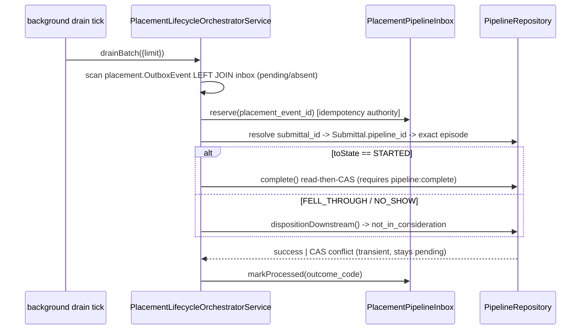

# D07 — Pipeline, Placement & Selection (AS-BUILT)
> Refreshed from baseline 12330b0f (2026-10-09) to 680907fc (2026-10-24): the Pipeline gained an in-transaction requisition-status gate (On hold recruits through Qualified, Closed/Canceled stop progression, Lead stops at Contacted), an RTR-gated and lock-ordered `qualified` transition, an evidence admissibility allowlist with in-transaction reference verification, fail-closed Add Talent (talent existence, requisition concealment, senior-only re-add), governed-only Not in consideration, note-backed backward corrections, voided episodes excluded from lists, and OpenAPI coverage for the live Pipeline routes; selection, client-selection and placement code is unchanged apart from S2 erasure-redaction trigger migrations.
> Baseline SHA 680907fc06620845944794e0a529918c980f5124 · category AS-BUILT

## Summary

Domain D07 spans the recruiting-funnel and post-qualification workflow substrate: five libs — `pipeline`, `selection`, `client-selection`, `placement`, `placement-pipeline-bridge` — plus four apps/api orchestration controllers. The division of ownership is explicit in code:

- **`libs/pipeline`** owns RECRUITING PROGRESS ONLY — a canonical 8-value `PipelineStatus` enum whose active funnel stops at `qualified` (`libs/pipeline/src/lib/pipeline-state.ts:38` `PIPELINE_STATUS_VALUES`). Everything past `qualified` is owned by downstream aggregates and is never a Pipeline status (`libs/pipeline/src/lib/pipeline-state.ts:6`).
- **`libs/selection`** owns the recruiter-side talent-engagement lifecycle (`TalentSelection`, an 11-state machine; `libs/selection/src/lib/selection-state.ts:17`).
- **`libs/client-selection`** owns the client's review/decision lifecycle over one submitted talent (`ClientSelectionProcess`, 5 states) plus `InterviewSession` (5 states) (`libs/client-selection/src/lib/client-selection-state.ts:5`, `libs/client-selection/src/lib/interview-session-state.ts:6`).
- **`libs/placement`** owns the post-acceptance spine: `PlacementProcess` (6 states), the dedicated `Offer` aggregate, `ContractAssignment`, `PermanentPlacement`, and commercial-revision governance (`libs/placement/prisma/schema.prisma:90`). It ships NO controller of its own; it is exposed via apps/api controllers.
- **`libs/placement-pipeline-bridge`** owns ONLY idempotent-consumer bookkeeping (a processed-event inbox) for the Placement→Pipeline lifecycle bridge; it carries no business rules (`libs/placement-pipeline-bridge/prisma/schema.prisma:1`).

All five schemas use UUID-only cross-schema references with no FK — this is the I1 / Architecture §7.3 schema-per-module convention applied across the ATS schemas (stated in every schema header, e.g. `libs/pipeline/prisma/schema.prisma:31`). It is NOT, by itself, the ADR-0029 I15 Pipeline⊥ATS wall: ADR-0029 D5 scopes "Pipeline" to the sourcing-intelligence libs (the `sourced_*`/`talent_trust`/`identity_index`/TR-* lib family named in the ADR), whereas `libs/pipeline` here is the ATS recruiting funnel (scope:ats) — the two share a word, not the wall. The orchestrator nonetheless keeps a clean seam: it drives Pipeline commands through an injected `PipelineRepository` and never imports `libs/placement` (`apps/api/src/placement-pipeline-orchestration/placement-lifecycle-orchestrator.service.ts:1`).

Facts owned by other domains reach `libs/pipeline` only through string-token ports whose adapters are bound `@Global` in `apps/api`: `RESUME_EDITION_READER` (including a batched `listResumeEditionsByIds`), `QUALIFIED_TRANSITION_GUARD` (RTR precondition for `qualified`), `EVIDENCE_REFERENCE_VERIFIER` (evidence reference check) and `TALENT_RECORD_EXISTENCE_READER` (Talent exists in tenant). The requisition-status rule is a pure code table in the lib (`requisitionPermits`, `requisitionGateForTransition`) evaluated against the requisition row read `FOR SHARE` inside the Pipeline transaction; `libs/pipeline` reads `requisition."Requisition"` itself (existing `@aramo/requisition` edge).

Cross-boundary movement is governed, not direct: Placement→Pipeline COMPLETE/disposition runs through the bridge inbox + apps/api orchestrator; client DECLINED/WITHDRAWN runs through a dedicated decision orchestrator (not the forward-transition route); the accidental-add VOID correction runs through a dedicated apps/api controller.

## Modules & Services

| name | role | evidence path:line+symbol |
| --- | --- | --- |
| PipelineController | HTTP surface for `v1/pipelines` (list/get/history/create/transition/actions + resume-edition read/set) | `libs/pipeline/src/lib/pipeline.controller.ts:81` `@Controller('v1/pipelines')` |
| PipelineRepository | Pipeline writes: create, transition (CAS), applyAction, evidence commands, reconcileForward, void, complete, dispositionDownstream | `libs/pipeline/src/lib/pipeline.repository.ts:431` `async create` |
| pipeline-state (state machine) | Canonical 8-value enum + `LEGAL_TRANSITIONS` matrix + recruiter-action map + VOID vocabulary | `libs/pipeline/src/lib/pipeline-state.ts:106` `LEGAL_TRANSITIONS` |
| requisition-activity-rule | Pure requisition-status → Pipeline-activity rule (`ADD`/`CONTACT_SEND`/`CONTACT_EVIDENCE`/`RESPONSE`/`QUALIFY_DECISION`) and the per-transition gate | `libs/pipeline/src/lib/requisition-activity-rule.ts:33` `requisitionPermits`; `:68` `requisitionGateForTransition` |
| evidence-admissibility | Per-stage evidence allowlist: `contacted` ← communication_interaction / recruiter_response_confirmation / provider_observation; `talent_responded` ← recruiter_response_confirmation only | `libs/pipeline/src/lib/evidence-admissibility.ts:16` `ADMISSIBLE_EVIDENCE_BY_STAGE` |
| QUALIFIED_TRANSITION_GUARD port + RtrQualifiedTransitionGuard | RTR precondition for `qualified`, run in the Pipeline tx (shared client-submittal-policy lock first, RTR check after the CAS) | `libs/pipeline/src/lib/qualified-transition-guard.port.ts:20`; adapter `apps/api/src/rtr/rtr-qualified-transition-guard.module.ts:29` |
| EVIDENCE_REFERENCE_VERIFIER port + CommunicationsEvidenceReferenceVerifier | Verifies the evidence id exists in tenant and binds THIS Talent × Requisition, in the Pipeline tx; provider observations refused (no durable receipt store) | `libs/pipeline/src/lib/evidence-reference-verifier.port.ts:13`; adapter `apps/api/src/pipeline-evidence/evidence-reference-verifier.module.ts:26` |
| TALENT_RECORD_EXISTENCE_READER port + adapter | Add Talent requires the Talent to exist in the caller's tenant | `libs/pipeline/src/lib/talent-record-existence.port.ts:11`; adapter `apps/api/src/pipeline-talent-existence/talent-record-existence-reader.module.ts:14` |
| AddTalentPolicyService + override-resolution | ADR-0024 policy gate on pipeline create (ALLOW/DENY/REQUIRES_OVERRIDE); unresolved requisition is DENY `REQUISITION_NOT_FOUND` before package retrieval; returns the decided requisition status | `libs/pipeline/src/lib/pipeline.controller.ts:402` `addTalentPolicy.decide`; `libs/pipeline/src/lib/policy/add-talent-policy.service.ts:41` `REQUISITION_NOT_FOUND_REASON` |
| SelectionController | HTTP surface for `v1/selections` (list/create/transitions/response/conversation/get/events + two engagement sub-routes) | `libs/selection/src/lib/selection.controller.ts:160` `@Controller('v1/selections')` |
| selection-state (state machine) | 11-value `TalentSelection` state tuple + `canTransition` (10 legal edges) | `libs/selection/src/lib/selection-state.ts:47` `canTransition` |
| ClientSelectionController | HTTP surface for `v1/client-selection` (get/transition/schedule-interview + interview-session read/transition/meeting/interviewers) | `libs/client-selection/src/lib/client-selection.controller.ts:58` `@Controller('v1/client-selection')` |
| client-selection-state + interview-session-state | 5-value process machine + 5-value interview-session machine | `libs/client-selection/src/lib/client-selection-state.ts:39` `LEGAL_TRANSITIONS` |
| placement lifecycle registries | `PlacementProcess` (6 states), `Offer`, commercial-approval, permanent — TS registries are the source of truth; migration SQL is generated | `libs/placement/src/lib/lifecycle/placement-lifecycle.ts:75` `TRANSITIONS` |
| PlacementPipelineInboxRepository | Idempotent-consumer inbox (reserve/markProcessed) for the Placement→Pipeline bridge | `libs/placement-pipeline-bridge/src/lib/placement-pipeline-inbox.repository.ts:43` `async reserve` |
| PlacementController (apps/api) | `v1/placements` read + lifecycle transition + assignment end/extend/convert + permanent + commercials | `apps/api/src/placement/placement.controller.ts:62` `@Controller('v1/placements')` |
| GuaranteeTermsController (apps/api) | `v1/permanent-placement-guarantee-terms` per-requisition write/read/effective/revise | `apps/api/src/placement/guarantee-terms.controller.ts:23` `@Controller(...)` |
| PipelineVoidController (apps/api) | `POST v1/pipelines/:id/void` — governed accidental-add correction (not a generic transition) | `apps/api/src/pipeline-void/pipeline-void.controller.ts:23` `@Post(':id/void')` |
| ClientDecisionController (apps/api) | `POST v1/client-selection/:id/decision` — governed DECLINED/WITHDRAWN that also dispositions the upstream Pipeline | `apps/api/src/client-decision-orchestration/client-decision.controller.ts:39` `@Post(':id/decision')` |
| PlacementLifecycleOrchestratorService (apps/api) | Consumes `placement.process.state_changed`, drives Pipeline COMPLETE / dispositionDownstream by stored lineage | `apps/api/src/placement-pipeline-orchestration/placement-lifecycle-orchestrator.service.ts:54` `async drainBatch` |
| TalentResponseService (apps/api, D09-owned) | Recruiter-confirmed response → `reconcileForward` to `talent_responded`; refuses when the requisition does not permit `RESPONSE`; on Closed/Canceled records only responses that occurred before the closing instant, without advancing | `apps/api/src/communications/talent-response.service.ts:45`; `reconcileForward` call `:258` |

## Data Models

| schema | model/enum | evidence path:line |
| --- | --- | --- |
| pipeline | `enum PipelineStatus` (8 values) | `libs/pipeline/prisma/schema.prisma:56` |
| pipeline | `model Pipeline` (status default `no_contact`, `version`, `ended_at`) | `libs/pipeline/prisma/schema.prisma:74` |
| pipeline | `model PipelineStatusHistory` (append-only, nullable `status_from`) | `libs/pipeline/prisma/schema.prisma:144` |
| pipeline | `model PipelineDisposition` (one-per-pipeline, 4 authority classes) | `libs/pipeline/prisma/schema.prisma:185` |
| pipeline | `model PipelineEntryProvenance` (immutable source-of-hire; 12 origin types) | `libs/pipeline/prisma/schema.prisma:233` |
| pipeline | `model OutboxEvent` + `model TalentRequisitionResume` (append-only working resume selection) | `libs/pipeline/prisma/schema.prisma:281`, `:305` |
| selection | `enum SelectionState` (11) + `model TalentSelection` + `model TalentSelectionEvent` + `OutboxEvent` | `libs/selection/prisma/schema.prisma:67`, `:100`, `:182`, `:144` |
| client-selection | `enum ClientSelectionState` (5) + `model ClientSelectionProcess` | `libs/client-selection/prisma/schema.prisma:28`, `:38` |
| client-selection | `enum InterviewSessionState` (5) + `model InterviewSession` + `model ClientSelectionEvent` | `libs/client-selection/prisma/schema.prisma:77`, `:87`, `:142` |
| placement | `enum PlacementState` (6) + `enum PlacementKind` (CONTRACT/PERMANENT) + `model PlacementProcess` | `libs/placement/prisma/schema.prisma:51`, `:82`, `:90` |
| placement | `model PlacementProcessEvent` (append-only; governed reason columns) | `libs/placement/prisma/schema.prisma:163` |
| placement | `enum OfferState` (7) + `model Offer` (+ `OfferRevision`, `OfferEvent`) | `libs/placement/prisma/schema.prisma:225`, `:247` |
| placement | `model ContractAssignment` (+ `AssignmentExtension`, `AssignmentRateVersion`) | `libs/placement/prisma/schema.prisma:433` |
| placement | `model PermanentPlacement` (+ remedy / guarantee-term-version / conversion-lineage) | `libs/placement/prisma/schema.prisma:834` |
| placement | `model CommercialRevisionProposal` (+ event) | `libs/placement/prisma/schema.prisma:672` |
| placement_pipeline_bridge | `model PlacementPipelineInbox` (unique `placement_event_id`; status pending/processed) | `libs/placement-pipeline-bridge/prisma/schema.prisma:26` |

Model/enum counts per schema (re-derived): pipeline 6 models, selection 3 models, client-selection 4 models, placement 17 models, placement_pipeline_bridge 1 model. Two trigger-only migrations add subject-bound erasure branches to the append-only tables: `libs/pipeline/prisma/migrations/20261016180300_s2_pipeline_history_erasure_redaction/migration.sql` (TalentRequisitionResume delete; PipelineStatusHistory / PipelineDisposition / PipelineEntryProvenance column redaction, `:1-12`) and `libs/client-selection/prisma/migrations/20261016180400_s2_client_selection_event_erasure_redaction/migration.sql` (ClientSelectionEvent payload redaction, `:8-30`).

## API Endpoints

| method | route | scopes | evidence |
| --- | --- | --- | --- |
| GET | /v1/pipelines (voided episodes excluded unless `include_voided=true`) | pipeline:read | `libs/pipeline/src/lib/pipeline.controller.ts:103`; `:115` `include_voided` |
| GET | /v1/pipelines/:id | pipeline:read | `libs/pipeline/src/lib/pipeline.controller.ts:130` |
| GET | /v1/pipelines/:id/resume-edition | pipeline:read | `libs/pipeline/src/lib/pipeline.controller.ts:162` |
| PUT | /v1/pipelines/:id/resume-edition | pipeline:resume:set | `libs/pipeline/src/lib/pipeline.controller.ts:195` |
| GET | /v1/pipelines/:id/history | pipeline:read | `libs/pipeline/src/lib/pipeline.controller.ts:301` |
| POST | /v1/pipelines | pipeline:add (+ `pipeline:re-add` when an ended episode exists) | `libs/pipeline/src/lib/pipeline.controller.ts:322`; re-add gate `:383-396` |
| POST | /v1/pipelines/:id/transition | pipeline:change-status (`completed` refused 403) | `libs/pipeline/src/lib/pipeline.controller.ts:518`; `:546` `PIPELINE_COMPLETE_SYSTEM_ONLY` |
| POST | /v1/pipelines/:id/actions | pipeline:change-status | `libs/pipeline/src/lib/pipeline.controller.ts:570` |
| POST | /v1/pipelines/:id/void | pipeline:change-status | `apps/api/src/pipeline-void/pipeline-void.controller.ts:25` |
| GET | /v1/selections | selection:read | `libs/selection/src/lib/selection.controller.ts:197` |
| POST | /v1/selections | selection:write | `libs/selection/src/lib/selection.controller.ts:247` |
| POST | /v1/selections/:id/transitions | selection:write | `libs/selection/src/lib/selection.controller.ts:331` |
| POST | /v1/selections/:id (engagement draft sub-route) | selection: engagement scope | `libs/selection/src/lib/selection.controller.ts:429` |
| POST | /v1/selections/:id (engagement send sub-route) | selection: engagement scope | `libs/selection/src/lib/selection.controller.ts:700` |
| POST | /v1/selections/:id/response | selection:write | `libs/selection/src/lib/selection.controller.ts:1011` |
| POST | /v1/selections/:id/conversation | selection:write | `libs/selection/src/lib/selection.controller.ts:1138` |
| GET | /v1/selections/:id | selection:read | `libs/selection/src/lib/selection.controller.ts:1232` |
| GET | /v1/selections/:id/events | selection:read | `libs/selection/src/lib/selection.controller.ts:1274` |
| GET | /v1/client-selection/:id | client-selection:read | `libs/client-selection/src/lib/client-selection.controller.ts:72` |
| POST | /v1/client-selection/:id/transition | client-selection:transition | `libs/client-selection/src/lib/client-selection.controller.ts:98` |
| POST | /v1/client-selection/:id/decision | client-selection:transition | `apps/api/src/client-decision-orchestration/client-decision.controller.ts:41` |
| POST | /v1/client-selection/:id/interviews | client-selection:interview:schedule | `libs/client-selection/src/lib/client-selection.controller.ts:143` |
| GET | /v1/client-selection/interview-sessions/:sessionId | client-selection:read | `libs/client-selection/src/lib/client-selection.controller.ts:226` |
| POST | /v1/client-selection/interview-sessions/:sessionId/transition | client-selection:interview:transition | `libs/client-selection/src/lib/client-selection.controller.ts:252` |
| POST | /v1/client-selection/interview-sessions/:sessionId/meeting | client-selection:interview:transition | `libs/client-selection/src/lib/client-selection.controller.ts:317` |
| PATCH | /v1/client-selection/interview-sessions/:sessionId/interviewers | client-selection:interview:transition | `libs/client-selection/src/lib/client-selection.controller.ts:356` |
| GET | /v1/placements | placement:read | `apps/api/src/placement/placement.controller.ts:78` |
| POST | /v1/placements | placement:create | `apps/api/src/placement/placement.controller.ts:113` |
| POST | /v1/placements/:id/transition | (edge-authority resolved in body) | `apps/api/src/placement/placement.controller.ts:155` |
| POST | /v1/placements/:id/assignment/end | assignment:end | `apps/api/src/placement/placement.controller.ts:261` |
| POST | /v1/placements/:id/assignment/extend | assignment:extend | `apps/api/src/placement/placement.controller.ts:291` |
| POST | /v1/placements/:id/assignment/convert-to-permanent | assignment:end + placement:permanent:transition | `apps/api/src/placement/placement.controller.ts:325` |
| GET | /v1/placements/:id, /:id/events, /:id/assignment, /:id/permanent | placement:read / assignment:read / placement:permanent:read | `apps/api/src/placement/placement.controller.ts:341`, `:374`, `:410`, `:444` |
| POST | /v1/placements/:id/permanent/transition, /falloff, /remedy/complete | placement:permanent:transition / placement:remedy:resolve | `apps/api/src/placement/placement.controller.ts:479`, `:505`, `:534` |
| GET/POST/PATCH | /v1/placements/:id/assignment/commercials(/revisions,/proposals,…) | assignment:commercials:read/write/approve | `apps/api/src/placement/placement.controller.ts:564`…`:812` |
| POST/GET | /v1/permanent-placement-guarantee-terms/requisitions/:requisitionId(/effective,/revise) | placement:permanent:terms:write / placement:permanent:read | `apps/api/src/placement/guarantee-terms.controller.ts:31`…`:90` |

Guard chains: PipelineController + ClientSelectionController + PlacementController + PipelineVoidController + ClientDecisionController all layer `JwtAuthGuard` + `RolesGuard` (+ `EntitlementGuard` / `@RequireCapability('ats')`) with route-level `@RequireScopes` / `@RequireSiteMatch` (`libs/pipeline/src/lib/pipeline.controller.ts:82`, `libs/client-selection/src/lib/client-selection.controller.ts:59`). SelectionController uses `JwtAuthGuard` + `RolesGuard` with no `@RequireCapability` (`libs/selection/src/lib/selection.controller.ts:161`).

`POST /v1/pipelines` refusal order: Idempotency-Key replay short-circuit → Talent not in tenant → 404 (`libs/pipeline/src/lib/pipeline.controller.ts:355-367`) → requisition not visible → 404 (`:371-377`) → ended earlier episode without `pipeline:re-add` → 403 `pipeline_re_add_requires_senior_role` (`:382-396`) → policy decision, where an unresolved requisition is recorded as DENY and returned as the same 404 (`:428-433`) → create with the decided status pinned (`expected_requisition_status`, `:480`). `pipeline:re-add` is a registered scope (`libs/identity/src/lib/dto/scope.dto.ts:515`) seeded to lead_recruiter, recruiting_manager, ats_admin and tenant_owner (`libs/identity/prisma/seed.ts:2537-2540`). The legacy `DELETE /v1/pipelines/:id` stays withdrawn (`libs/pipeline/src/lib/pipeline.controller.ts:623`).

OpenAPI: `openapi/ats.yaml` carries 8 `/v1/pipelines*` paths, including `/v1/pipelines/{id}/journey` (`openapi/ats.yaml:1679`, `:1773`, `:1798`, `:1829`, `:1891`, `:1948`, `:1975`, `:4323`).

## Screens & FE->BE Wiring

FE (ats-web only — other FE apps carry no D07 wiring):

| FE domain | BE route(s) called | evidence path:line |
| --- | --- | --- |
| `apps/ats-web/src/pipeline/` | POST /v1/pipelines, /:id/transition, /:id/actions (DISPOSITION), /:id/void, /:id/history, /:id/resume-edition, /:id/journey | `apps/ats-web/src/pipeline/pipeline-api.ts:54` (create), `:107` (actions), `:122` (void); `apps/ats-web/src/pipeline/talent-journey-api.ts:112` (journey) |
| `apps/ats-web/src/selection/` | /v1/selections list/get/events/transitions/response/conversation + engagement sub-routes | `apps/ats-web/src/selection/selection-api.ts:71` (response) |
| `apps/ats-web/src/submittal-workspace/` | POST /v1/client-selection/:id/transition and /:id/decision | `apps/ats-web/src/submittal-workspace/client-selection-api.ts:27`, `:44` |
| `apps/ats-web/src/interviews/` | /v1/client-selection/:id/interviews + interview-sessions transition/meeting/interviewers | `apps/ats-web/src/interviews/interviews-api.ts:109` (schedule) |
| `apps/ats-web/src/placement/` | /v1/placements read + assignment end/extend/convert + commercials + permanent | `apps/ats-web/src/placement/placement-api.ts:43` (list) |
| `apps/ats-web/src/requisitions/` | AddTalentDialog / KnownTalentDrawer → POST /v1/pipelines; Talent × Requisition 360 → journey read | `apps/ats-web/src/requisitions/AddTalentDialog.tsx:164`; `apps/ats-web/src/requisitions/talent-requisition-360/TalentRequisition360View.tsx:22` |

Pipeline FE components for the governed actions: `NotInConsiderationDialog.tsx` + `disposition-reasons.ts` (the recruiter DISPOSITION with a reason), `MoveBackDialog.tsx` (backward correction with a required note), `journey-vocab.ts` (display labels). the journey panel lives in `apps/ats-web/src/pipeline/TalentJourneyPanel.tsx`.

37 ats-web source files reference these `v1/` routes (re-derived — see coverage fragment).

## Key Flows

### Pipeline recruiting funnel (state machine)

Grounded in `LEGAL_TRANSITIONS` (`libs/pipeline/src/lib/pipeline-state.ts:106`) and the evidence-backed-stages / recruiter-action / VOID rules, plus the requisition gate (`libs/pipeline/src/lib/requisition-activity-rule.ts:68`).

```mermaid
stateDiagram-v2
  [*] --> no_contact: create() birth row (NULL -> no_contact); requisition must permit ADD
  no_contact --> contacted: recordContactEvidence (admissible + verified evidence)
  no_contact --> talent_responded: recordResponseEvidence (recruiter_response_confirmation only)
  no_contact --> not_in_consideration: DISPOSITION (reason required)
  contacted --> talent_responded: recordResponseEvidence
  contacted --> no_contact: backward correction (note required)
  contacted --> not_in_consideration: DISPOSITION (reason required)
  talent_responded --> qualifying: START_QUALIFICATION
  talent_responded --> contacted: backward correction (note; prior evidence in history)
  talent_responded --> not_in_consideration: DISPOSITION (reason required)
  qualifying --> qualified: QUALIFY (RTR guard in tx)
  qualifying --> talent_responded: backward correction (note; prior evidence in history)
  qualifying --> not_in_consideration: DISPOSITION (reason required)
  qualified --> qualifying: backward correction (note required)
  qualified --> not_in_consideration: DISPOSITION (reason required)
  qualified --> completed: COMPLETE (system-only; driven by Placement STARTED)
  no_contact --> voided: VOID (governed; apps/api only; not a generic edge)
  not_in_consideration --> [*]
  completed --> [*]
  voided --> [*]
```



Notes:
- `contacted` and `talent_responded` are EVIDENCE_BACKED_STAGES — reachable only via `recordContactEvidence` / `recordResponseEvidence` (or `reconcileForward`), never a naked stage click (`libs/pipeline/src/lib/pipeline-state.ts:90`). The evidence kind must be admissible for the stage (`libs/pipeline/src/lib/evidence-admissibility.ts:16`; refusal `PIPELINE_EVIDENCE_INADMISSIBLE` at `libs/pipeline/src/lib/pipeline.repository.ts:842`, `:853`) and its reference is verified on the transaction (`:997`, refusal `:1007`).
- A backward correction into an evidence-backed stage needs no new evidence when the episode's history already reached that stage, but a note is REQUIRED (`libs/pipeline/src/lib/pipeline.repository.ts:775-786`).
- `not_in_consideration` is reached only through a governed disposition; a bare `/transition` to it is refused `PIPELINE_DISPOSITION_REASON_INVALID` on every requisition status (`libs/pipeline/src/lib/pipeline.repository.ts:752-758`).
- `COMPLETE` is rejected on the recruiter /actions surface (`libs/pipeline/src/lib/pipeline.controller.ts:591`) and `to_status: completed` is refused on `/transition` (`:546`). `VOID` has no incoming edge in the matrix and is written by the dedicated `void()` repository command (`libs/pipeline/src/lib/pipeline-state.ts:146`).
- Requisition gate (inside the transaction, after the CAS, requisition read `FOR SHARE`; `libs/pipeline/src/lib/pipeline.repository.ts:969-990`): forward targets need `CONTACT_EVIDENCE` / `RESPONSE` / `QUALIFY_DECISION` permission (`open` and `on_hold` permit all; `lead` permits only up to `contacted`; `closed`/`canceled` permit none → 409 `REQUISITION_NOT_ADVANCEABLE`); a backward correction is refused on `closed`/`canceled`; system downstream commands (COMPLETE, DOWNSTREAM_OUTCOME disposition) are ungated (`libs/pipeline/src/lib/requisition-activity-rule.ts:33-40`, `:68-88`).

### Atomic `qualified` transition (lock order)

```mermaid
sequenceDiagram
  participant C as PipelineController /transition or /actions QUALIFY
  participant R as PipelineRepository.transitionInTx
  participant G as QUALIFIED_TRANSITION_GUARD (apps/api RTR adapter)
  participant DB as Postgres (one tx, LOCKED_TX_OPTIONS)
  C->>R: transition(to_status='qualified', expected_version)
  R->>R: CAS pre-check, no-op, legality, evidence rules
  R->>R: guard bound? (else 422 PIPELINE_QUALIFY_RTR_POLICY_UNRESOLVED)
  R->>DB: SET lock_timeout
  R->>G: beginQualifyInTx (shared client-submittal-policy advisory lock, first lock)
  R->>DB: CAS updateMany(version = current)
  R->>DB: requisition status FOR SHARE → requisitionGateForTransition
  R->>G: assertCanQualifyInTx (policy at t_L; executed RTR FOR SHARE)
  G-->>R: decision (REQUIRED/NOT_REQUIRED + source) or throw 422
  R->>DB: history + activity + metering + outbox (rtr_policy audit) [+ disposition]
  DB-->>C: commit (timeout/deadlock → 409 TRANSACTION_CONFLICT_RETRYABLE)
```

Evidence: guard bound check `libs/pipeline/src/lib/pipeline.repository.ts:862-871`; `beginQualifyInTx` `:919`; requisition gate `:975`; `assertCanQualifyInTx` `:1022`; RTR audit on the outbox `:1101`; port contract `libs/pipeline/src/lib/qualified-transition-guard.port.ts:41-56`.

### Placement lifecycle (state machine)

Grounded in `TRANSITIONS` (`libs/placement/src/lib/lifecycle/placement-lifecycle.ts:75`) — 8 edges, acyclicity by terminal/engaged positions.

```mermaid
stateDiagram-v2
  [*] --> PRE_START: created DOWNSTREAM of an ACCEPTED Offer
  PRE_START --> READY_TO_START
  PRE_START --> BLOCKED
  PRE_START --> FELL_THROUGH
  BLOCKED --> PRE_START
  BLOCKED --> FELL_THROUGH
  READY_TO_START --> STARTED
  READY_TO_START --> NO_SHOW
  READY_TO_START --> FELL_THROUGH
  STARTED --> [*]: ENGAGED (no outgoing edge; hands off to ContractAssignment / PermanentPlacement)
  NO_SHOW --> [*]: TERMINAL
  FELL_THROUGH --> [*]: TERMINAL
```



### Pipeline⊥ATS boundary + Placement→Pipeline bridge (component)

Grounded in ADR-0029 I15 (UUID-only, no hard import) and the orchestrator (`apps/api/src/placement-pipeline-orchestration/placement-lifecycle-orchestrator.service.ts:16`).

```mermaid
flowchart TB
  subgraph placement_schema[placement schema]
    PP[PlacementProcess state machine]
    POE[placement OutboxEvent\nplacement.process.state_changed]
    PP -->|in-tx emit| POE
  end
  subgraph bridge[placement_pipeline_bridge schema]
    INBOX[PlacementPipelineInbox\nunique placement_event_id]
  end
  subgraph apia[apps/api composition root]
    ORCH[PlacementLifecycleOrchestratorService\ndrainBatch]
    PORTS[@Global port adapters\nRTR guard / evidence verifier /\ntalent existence / resume editions]
  end
  subgraph pipeline_schema[pipeline schema]
    PR[PipelineRepository.complete / dispositionDownstream]
    PIPE[Pipeline episode]
    PR --> PIPE
  end
  POE -->|LEFT JOIN scan, not-yet-consumed| ORCH
  ORCH -->|reserve/markProcessed idempotency| INBOX
  ORCH -->|STARTED -> COMPLETE| PR
  ORCH -->|FELL_THROUGH / NO_SHOW -> dispositionDownstream| PR
  ORCH -. injected PipelineRepository, NO import of libs/placement .- PR
  PORTS -. string-token ports, no Pipeline to Documents/Communications edge .- PR
```

### Placement STARTED → Pipeline COMPLETE (sequence)



System downstream commands remain ungated by the requisition-status rule, so a COMPLETE still lands on a requisition that closed after placement (`libs/pipeline/src/lib/requisition-activity-rule.ts:75`).

## Evidence Index

- `libs/pipeline/src/lib/pipeline-state.ts:38` `PIPELINE_STATUS_VALUES` (8 values incl. `completed`, `voided`)
- `libs/pipeline/src/lib/pipeline-state.ts:90` `EVIDENCE_BACKED_STAGES` (`contacted`, `talent_responded`)
- `libs/pipeline/src/lib/pipeline-state.ts:106` `LEGAL_TRANSITIONS`
- `libs/pipeline/src/lib/pipeline-state.ts:156` `CANONICAL_TERMINAL_STATUSES`
- `libs/pipeline/src/lib/pipeline-state.ts:220` `RECRUITER_ACTION_TO_STATUS` (START_QUALIFICATION/QUALIFY/DISPOSITION)
- `libs/pipeline/src/lib/pipeline-state.ts:245` `VOID_ACTION`; `:250` `VOID_REASON_VALUES` (`ADDED_BY_MISTAKE`)
- `libs/pipeline/src/lib/requisition-activity-rule.ts:28` `isTerminalRequisitionStatus`; `:33` `requisitionPermits`; `:68` `requisitionGateForTransition`
- `libs/pipeline/src/lib/evidence-admissibility.ts:9` `PIPELINE_EVIDENCE_KINDS`; `:16` `ADMISSIBLE_EVIDENCE_BY_STAGE`
- `libs/pipeline/src/lib/qualified-transition-guard.port.ts:20` `QUALIFIED_TRANSITION_GUARD`
- `libs/pipeline/src/lib/evidence-reference-verifier.port.ts:13` `EVIDENCE_REFERENCE_VERIFIER`
- `libs/pipeline/src/lib/talent-record-existence.port.ts:11` `TALENT_RECORD_EXISTENCE_READER`
- `libs/pipeline/src/lib/policy/add-talent-policy.service.ts:41` `REQUISITION_NOT_FOUND_REASON`
- `libs/pipeline/src/lib/pipeline.controller.ts:56` `PIPELINE_RE_ADD_SCOPE`
- `libs/pipeline/src/lib/pipeline.controller.ts:81` `@Controller('v1/pipelines')`; `:82` guards
- `libs/pipeline/src/lib/pipeline.controller.ts:322` POST create (`pipeline:add`); `:357` `existsInTenant`; `:402` `addTalentPolicy.decide`
- `libs/pipeline/src/lib/pipeline.controller.ts:518` transition; `:546` `PIPELINE_COMPLETE_SYSTEM_ONLY`; `:570` applyAction; `:591` COMPLETE rejected
- `libs/pipeline/src/lib/pipeline.controller.ts:623` DELETE withdrawn (L2-B)
- `libs/pipeline/src/lib/pipeline.repository.ts:431` `create`; `:485` requisition `FOR SHARE` in create; `:504` `REQUISITION_NOT_ADVANCEABLE` on ADD
- `libs/pipeline/src/lib/pipeline.repository.ts:616` `transition`; `:656` `transitionInTx`
- `libs/pipeline/src/lib/pipeline.repository.ts:758` `PIPELINE_DISPOSITION_REASON_INVALID`; `:786` backward-correction note required
- `libs/pipeline/src/lib/pipeline.repository.ts:919` `beginQualifyInTx`; `:975` `requisitionGateForTransition`; `:997` `verifyInTx`; `:1022` `assertCanQualifyInTx`
- `libs/pipeline/src/lib/pipeline.repository.ts:1217` `recordContactEvidence`; `:1243` `recordResponseEvidence`; `:1275` `reconcileForward`
- `libs/pipeline/src/lib/pipeline.repository.ts:1364` `void`; `:1513` `complete`; `:1575` `dispositionDownstream`
- `libs/pipeline/src/lib/pipeline.repository.ts:1525` `complete` requires `pipeline:complete` scope
- `libs/pipeline/src/lib/pipeline.repository.ts:1657` `hasEndedEpisode`; `:1723` `exclude_voided`
- `libs/pipeline/src/lib/pipeline.repository.ts:2257` `lockRequisitionStatusInTx`
- `libs/pipeline/src/lib/pipeline-disposition.ts:10` 4 authority classes; `:36` reason taxonomy
- `libs/pipeline/prisma/schema.prisma:56` `enum PipelineStatus`; `:74` `model Pipeline`; `:99` `version`
- `libs/pipeline/prisma/schema.prisma:144` `PipelineStatusHistory`; `:185` `PipelineDisposition`; `:233` `PipelineEntryProvenance`
- `libs/pipeline/prisma/schema.prisma:281` `OutboxEvent`; `:305` `TalentRequisitionResume`
- `libs/selection/src/lib/selection-state.ts:17` `SELECTION_STATE_VALUES` (11); `:47` `canTransition`
- `libs/selection/src/lib/selection.controller.ts:160` `@Controller('v1/selections')`; `:1011` response; `:1138` conversation
- `libs/selection/prisma/schema.prisma:67` `SelectionState`; `:100` `TalentSelection`; `:182` `TalentSelectionEvent`
- `libs/client-selection/src/lib/client-selection-state.ts:5` 5 states; `:39` `LEGAL_TRANSITIONS`
- `libs/client-selection/src/lib/client-selection.controller.ts:116` DECLINED/WITHDRAWN rejected on /transition
- `libs/client-selection/src/lib/interview-session-state.ts:6` 5 interview states; `:40` transitions
- `libs/client-selection/prisma/schema.prisma:38` `ClientSelectionProcess`; `:87` `InterviewSession`
- `libs/placement/src/lib/lifecycle/placement-lifecycle.ts:28` `PLACEMENT_STATES`; `:57` `STATE_POSITION`; `:75` `TRANSITIONS`; `:139` `isPlacementGuardReleased`
- `libs/placement/src/lib/lifecycle/offer-lifecycle.ts:20` `OFFER_STATES`
- `libs/placement/prisma/schema.prisma:51` `PlacementState`; `:82` `PlacementKind`; `:90` `PlacementProcess`; `:163` `PlacementProcessEvent`; `:225` `OfferState`; `:247` `Offer`; `:433` `ContractAssignment`; `:834` `PermanentPlacement`
- `libs/placement-pipeline-bridge/prisma/schema.prisma:26` `PlacementPipelineInbox`
- `libs/placement-pipeline-bridge/src/lib/placement-pipeline-inbox.repository.ts:43` `reserve`; `:79` `markProcessed`
- `apps/api/src/placement/placement.controller.ts:62` `@Controller('v1/placements')`; `:155` transition; `:325` convert-to-permanent
- `apps/api/src/placement/guarantee-terms.controller.ts:23` `@Controller(...)`
- `apps/api/src/pipeline-void/pipeline-void.controller.ts:23` `@Post(':id/void')`; `:25` `pipeline:change-status`
- `apps/api/src/client-decision-orchestration/client-decision.controller.ts:39` `@Post(':id/decision')`; `:41` scope
- `apps/api/src/client-decision-orchestration/client-decision.orchestrator.ts:75` WITHDRAWN requires closed reason_code (422)
- `apps/api/src/placement-pipeline-orchestration/placement-lifecycle-orchestrator.service.ts:17` STARTED→COMPLETE mapping; `:28` `PIPELINE_LIFECYCLE_SYSTEM_ACTOR_ID`; `:54` `drainBatch`; `:125` STARTED branch; `:174` dispositionDownstream branch
- `apps/api/src/rtr/rtr-qualified-transition-guard.module.ts:29` `RtrQualifiedTransitionGuard`; `:90` token binding
- `apps/api/src/pipeline-evidence/evidence-reference-verifier.module.ts:26` `CommunicationsEvidenceReferenceVerifier`; `:79` token binding
- `apps/api/src/pipeline-talent-existence/talent-record-existence-reader.module.ts:14` adapter; `:30` token binding
- `apps/api/src/pipeline-integration/pipeline-provider-mapping-target.ts:36` `RETIRED_PROVIDER_EVIDENCE_TARGETS` (`RESPONSE_EVIDENCE`)
- `apps/api/src/communications/talent-response.service.ts:204` `findClosingInstant`; `:212` `requisitionPermits(…,'RESPONSE')`; `:258` `reconcileForward`
- `apps/ats-web/src/pipeline/pipeline-api.ts:54` POST /v1/pipelines; `:107` actions; `:122` void
- `apps/ats-web/src/selection/selection-api.ts:71` /v1/selections/:id/response
- `apps/ats-web/src/submittal-workspace/client-selection-api.ts:27` transition; `:44` decision
- `apps/ats-web/src/interviews/interviews-api.ts:109` schedule interview
- `apps/ats-web/src/placement/placement-api.ts:43` GET /v1/placements

## NOT VERIFIED (explicit)

- The `/v1/placements/:id/transition` route has NO class/route-level `@RequireScopes` literal in the controller head block grepped; authority is resolved per-edge via `edgeAuthorityClass(current.state, body.to)` (`apps/api/src/placement/placement.controller.ts:170`). The exact scope mapping per edge was not exhaustively traced — labeled NOT VERIFIED.
- RESPONSE_EVIDENCE trigger surface: the provider-mapping `RESPONSE_EVIDENCE` target is RETIRED (`apps/api/src/pipeline-integration/pipeline-provider-mapping-target.ts:28-36`), and `talent_responded` is reached from the recruiter confirmation route `POST /v1/communications/talent-responses` through `reconcileForward` (`apps/api/src/communications/talent-response.service.ts:258`). CONTACT_EVIDENCE callers are `apps/api/src/microsoft/microsoft-email.service.ts:278` and `apps/api/src/communications/communication-call.service.ts:303`. The Zoom webhook's removal of automatic advance (v1.2 §7.1) was not line-read.
- Exact migration-level enforcement of append-only triggers, the `Pipeline_live_episode_key` partial unique index, and placement immutability triggers live in raw migrations (referenced in schema headers) and were NOT opened line-by-line in this pass; only the header of the S2 erasure-redaction migration was read.
- `libs/placement` commercial/permanent sub-domains (CommercialRevisionProposal, remedy, guarantee-term-version) were inventoried at the model/route level only; their internal lifecycle guards were not deeply read.
- The full `selection` engagement sub-route internals (draft/send) were confirmed to exist at `libs/selection/src/lib/selection.controller.ts:429` / `:700` but not read in depth; route-path literals contain a Tier-2-guarded token and are therefore described obliquely per `scripts/verify-vocabulary.sh`.
- The internals of `RtrQualifiedTransitionGuard.assertCanQualifyInTx` (policy resolution at t_L and the executed-RTR `FOR SHARE` read) and of `CommunicationsEvidenceReferenceVerifier.verifyInTx` were read at header/contract level only; their SQL was not traced.
- The real-Postgres concurrency proofs the directive requires (FOR SHARE vs FOR UPDATE barrier tests) exist as specs but were not executed.
