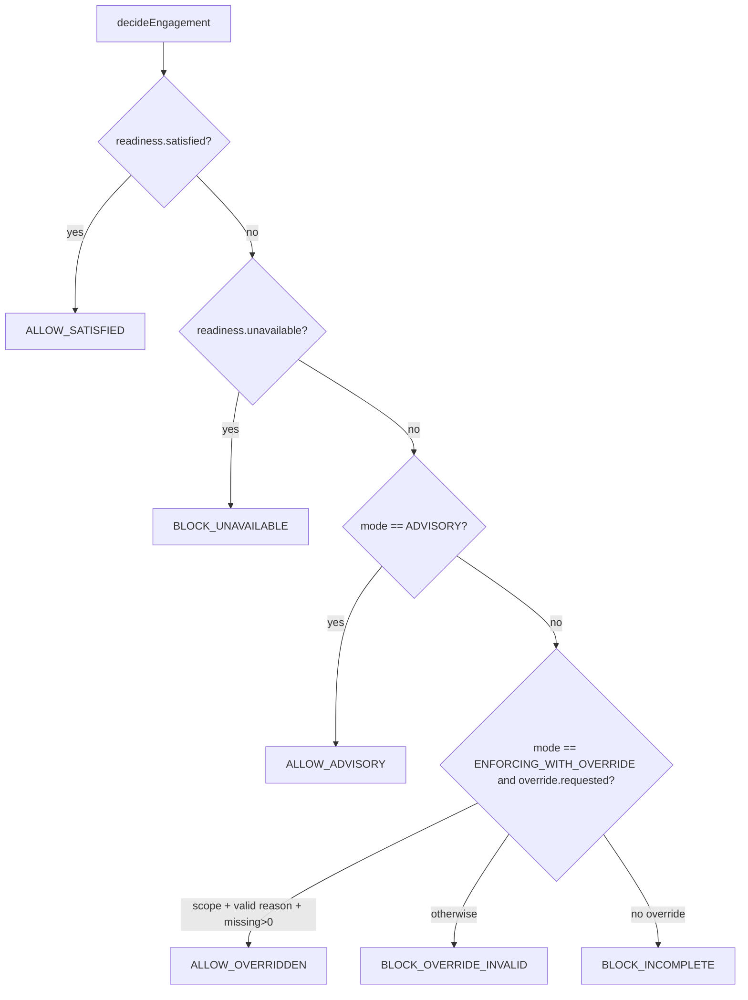

# D08 — Submittal, Engagement & Client Policy (AS-BUILT)
> Refreshed from baseline 12330b0f (2026-10-09) to 680907fc (2026-10-24): TIP-E2E INC-1 added entitlement guards and server-resolved site + requisition-visibility authorization on every submittal mutation, a mandatory `handoff_performed` attestation and required `delivery_channel` at send, a dark mandatory-RTR flag and a read-only journey-audit route; the `submit-to-ats` alias was retired; the send now runs in a bounded, lock-ordered transaction (shared client-submittal-policy advisory lock, requisition `FOR SHARE`, RTR resolved at the linearization instant with an UNRESOLVED refusal); client-submittal-policy publish became immediate-effect under an exclusive per-tenant lock and refuses a required RTR the tenant cannot send.
> Baseline SHA 680907fc06620845944794e0a529918c980f5124 · category AS-BUILT

## Summary

D08 is the workflow spine that carries a Talent from a draft submittal record to an authoritative "submitted to client" fact, gated by a layered policy stack. It spans six libs and six apps/api composition modules.

- **Submittal lifecycle** (`libs/submittal`) owns the `TalentSubmittalRecord` entity, a canonical 6-value state tuple with an 8-transition guard, an append-only `TalentSubmittalEvent` log, and a per-module `OutboxEvent`.
- **Two write authorities were RE-POINTED into `apps/api`**: create (`CreateSubmittalController`, deriving the pipeline link server-side) and send (`SubmitTalentController` → `SubmitTalentToClientService`, the single cross-schema atomic transaction). The in-lib `SubmittalController` retains confirm / mark-ready / confirm-ats / revoke / get / discovery handlers. `submit-to-client` is the only send route (no `submit-to-ats` route exists).
- **Every submittal controller** layers `JwtAuthGuard, EntitlementGuard, RolesGuard` + `@RequireCapability('ats')`, and every mutation resolves the authoritative site and requisition visibility server-side before it writes (create via the requisition visibility read; confirm / mark-ready / confirm-ats / revoke via the `PIPELINE_SITE_READER` port over the submittal → pipeline → requisition chain; send inside its transaction). A site-scoped actor on another site gets 403; an out-of-visibility requisition gets 404.
- **The send is an attested manual handoff**: `handoff_performed: true` is mandatory (422 `ATTESTATION_MISSING`) and `delivery_channel` is required (422 `SUBMITTAL_DELIVERY_CHANNEL_INVALID`), enforced at the HTTP boundary and again inside the transaction. The platform transmits nothing.
- **Submittal eligibility** (`libs/submittal-eligibility`) is a pure, connection-agnostic decision port (`evaluateEligibility`) plus the serialized slot consumer (`consumeSlot`) and the unified readiness authority (`evaluateSubmittalReadiness`) that the FE preflight and the submit mutation share by construction. It carries two RTR deny codes, `SUBMITTAL_RTR_NOT_EXECUTED` and `SUBMITTAL_RTR_POLICY_UNRESOLVED`.
- **Engagement** (`libs/engagement`) is a provider-neutral policy domain: a pure decision function (`decideEngagement`) over ADVISORY / ENFORCING / ENFORCING_WITH_OVERRIDE modes, a layered TENANT→CLIENT→REQUISITION merge, and a composition-root gate (`EngagementGateService`) that writes append-only decision provenance. A recruiter response confirmation's `response_confirmed` disposition counts as a qualifying two-way voice disposition (`apps/api/src/engagement/voice-evidence.adapter.ts:32`).
- **Client Submittal Policy** (`libs/client-submittal-policy`) is a second layered-policy domain built on the generic policy-engine/policy-store; its `mergeLayers` enforces a non-relaxable TENANT FLOOR and compiles to a generic `PolicyPackage` for the decision. It exposes `resolveRequirementSource` (one key's effective value with its source layer, distinguishing NO_LAYER and NO_KEY), resolves at a caller-supplied instant, and refuses a caller-supplied `effective_from`.
- **Client Talent Restriction** (`libs/client-talent-restriction`) records source-attributed bars via a URL-shape-enforced nested route; the submit transaction reads it as one of the eligibility gates.

The submit-to-client order is single-sourced: shared client-submittal-policy advisory lock + linearization instant → submittal `FOR UPDATE` + state machine → pipeline `FOR UPDATE` + link verdict → actor site / requisition visibility → handoff attestation + channel presence → requisition-open (`FOR SHARE`) → resume-selection → restriction → engagement → RTR (at t_L; UNRESOLVED refuses) → optional mandatory-RTR flag → eligibility → client-submittal policy (at t_L) → serialized slot consumption → delivery-channel validation → authoritative write. Any failure rolls back the whole transaction; lock-wait / deadlock / timeout aborts surface as 409 `TRANSACTION_CONFLICT_RETRYABLE`.

## Modules & Services

| name | role | evidence path:line + symbol |
|---|---|---|
| `SubmittalController` | In-lib confirm / mark-ready / confirm-ats / revoke / get / discovery handlers under `v1/submittals`; entitlement-guarded | `libs/submittal/src/lib/submittal.controller.ts:78` `@Controller('v1/submittals')` |
| `assertLifecycleMutationAuthorized` | INC-1b lifecycle-mutation authorization (fail-closed when the site reader is unbound; chain consistency; site; requisition visibility) | `libs/submittal/src/lib/submittal.controller.ts:121` |
| `PIPELINE_SITE_READER` port + `PipelineSiteReaderAdapter` | Tenant-scoped pipeline → site / requisition / talent context for the lifecycle authz (adapter bound in apps/api) | `libs/submittal/src/lib/ports/pipeline-site-reader.port.ts:26`, `:38`; `apps/api/src/pipeline-site-reader/pipeline-site-reader.module.ts:17` |
| `SubmittalRepository` | Write path for `TalentSubmittalRecord`; orchestrates evidence-package build; 4 in-lib state-changing methods (confirm, markReady, confirmAts, revoke) + create + board read + `findAuthContextById` | `libs/submittal/src/lib/submittal.repository.ts:172` `class SubmittalRepository` |
| `canTransition` | Application-layer 8-transition state guard (defense-in-depth atop DB trigger) | `libs/submittal/src/lib/submittal-state.ts:54` `function canTransition` |
| `TalentSubmittalEventRepository` | Append-only event log surface | `libs/submittal/src/lib/talent-submittal-event.repository.ts:1` |
| `CreateSubmittalController` | Re-pointed authoritative `POST /v1/submittals` (recruiter + idempotency + requisition visibility/site) | `apps/api/src/create-submittal/create-submittal.controller.ts:61` |
| `CreateSubmittalOrchestrator` | Derives the sole live pipeline episode server-side, then calls `createSubmittal` | `apps/api/src/create-submittal/create-submittal.service.ts:30` |
| `SubmitTalentController` | Re-pointed `submit-to-client` (attestation + channel presence at the boundary; mandatory-RTR flag read) | `apps/api/src/submit-talent/submit-talent.controller.ts:65` |
| `SubmitTalentToClientService` | The single cross-schema atomic submit transaction | `apps/api/src/submit-talent/submit-talent.service.ts:160` |
| `csp-linearization` | Per-tenant client-submittal-policy advisory lock (exclusive for publish, shared for Qualified/submit) + database-clock read | `apps/api/src/client-submittal-policy/csp-linearization.ts:24` `acquireCspPublishLock`; `:29` `acquireCspReadLock`; `:34` `readDatabaseClock` |
| `SubmittalWorkspaceController` | `GET /v1/submittals/{id}/workspace` composed read | `apps/api/src/submittal-workspace/submittal-workspace.controller.ts:30` |
| `TalentJourneyAuditController` / `TalentJourneyAuditService` | INC-1e read-only correlated journey audit over the immutable submittal events + durable IDs, visibility-concealed | `apps/api/src/talent-journey-audit/talent-journey-audit.controller.ts:21`; `apps/api/src/talent-journey-audit/talent-journey-audit.service.ts:20` |
| `evaluateEligibility` | Pure authoritative eligibility decision (window→restriction→engagement→RTR) | `libs/submittal-eligibility/src/lib/submittal-eligibility.port.ts:166` |
| `consumeSlot` | Serialized `FOR UPDATE` slot consumer (write-skew-proof) | `libs/submittal-eligibility/src/lib/submittal-consumption.ts:43` |
| `evaluateSubmittalReadiness` | Unified readiness authority shared by FE preflight + submit | `libs/submittal-eligibility/src/lib/submittal-readiness.ts:248` |
| `pipelineLinkVerdict` / `isRequisitionSubmittable` | Shared structural predicates the submit command re-uses | `libs/submittal-eligibility/src/lib/submittal-readiness.ts:190`, `:180` |
| `DocumentReadinessGate` (D10-owned) | RTR verdict for submit: `assessInTx` on the submit transaction at t_L; `assessMandatory` for the INC-1c flag | `apps/api/src/rtr/document-readiness.gate.ts:39`; `:111` `assessInTx`; `:156` `assessMandatory` |
| `decideEngagement` | Pure engagement decision over enforcement mode × readiness × override | `libs/engagement/src/lib/domain/engagement-decision.ts:70` |
| `EngagementPolicyService` | Publish + layered TENANT→CLIENT→REQUISITION merge + effective resolution | `libs/engagement/src/lib/engagement-policy.service.ts:143` |
| `EngagementGateService` | Composition-root gate: resolve + evidence + decide + append-only provenance | `apps/api/src/engagement/engagement-gate.service.ts:60` |
| `EngagementController` | Admin publish/read + recruiter readiness under `v1/engagement` | `apps/api/src/engagement/engagement.controller.ts:26` |
| `ClientSubmittalPolicyService` | Layered merge with FLOOR enforcement; compiles to generic `PolicyPackage`; per-key source resolution | `libs/client-submittal-policy/src/lib/client-submittal-policy.service.ts:144` |
| `ClientSubmittalPolicyGatewayAdapter` | Publish persistence: exclusive advisory lock first, `effective_from` stamped from the database clock | `apps/api/src/client-submittal-policy/client-submittal-policy-gateway.adapter.ts:57` `insertVersion` |
| `ClientSubmittalPolicyController` | Admin authoring/read under `v1/client-submittal-policy`; refuses a REQUIRED `rtr_present` when the tenant cannot send an RTR | `apps/api/src/client-submittal-policy/client-submittal-policy.controller.ts:26` |
| `ClientTalentRestrictionController` | Nested-route record/current/history/close | `libs/client-talent-restriction/src/lib/client-talent-restriction.controller.ts:50` |
| `ClientTalentRestrictionRepository` | Source-attributed restriction persistence + active-set reads | `libs/client-talent-restriction/src/lib/client-talent-restriction.repository.ts:119` |

## Data Models

| model | owner schema | evidence path:line |
|---|---|---|
| `TalentSubmittalRecord` | `submittal` | `libs/submittal/prisma/schema.prisma:122` |
| `SubmittalState` enum (`created`, `handoff_draft`, `ready_for_review`, `submitted_to_client`, `confirmed`, `revoked`) | `submittal` | `libs/submittal/prisma/schema.prisma:76` |
| `SubmittalDeliveryChannel` enum (manual_vms / manual_client_portal / manual_email / manual_other / aramo_connector) | `submittal` | `libs/submittal/prisma/schema.prisma:95` |
| `TalentSubmittalEvent` (append-only, intra-schema FK) | `submittal` | `libs/submittal/prisma/schema.prisma:285` |
| `OutboxEvent` | `submittal` | `libs/submittal/prisma/schema.prisma:245` |
| `ClientTalentRestriction` | `client_talent_restriction` | `libs/client-talent-restriction/prisma/schema.prisma` |

`pipeline_id` (nullable cross-schema ref) `:151` and the FROZEN `resume_edition_id` snapshot `:159` live on `TalentSubmittalRecord`. The SW-2 immutable submit provenance columns (`submitted_at`, `submitted_by_actor_id`, `delivery_channel`, `submitted_bill_rate`, `submitted_rate_currency`, `submitted_rate_period`, `external_reference`, `external_submitted_at`) are pinned once at the send transition `:188`. There is no `client_receipt_status` (or any receipt) column: `submitted_to_client` records an attested handoff, not a verified receipt. **Engagement and Client-Submittal-Policy own NO prisma schema** — both persist through `@aramo/policy-store` (`StoredPolicyVersion` + `PolicyDecisionRecord`). A trigger-only migration adds a subject-bound erasure branch to `ClientTalentRestriction` (`libs/client-talent-restriction/prisma/migrations/20261016180500_s2_client_talent_restriction_erasure_redaction/migration.sql:1-5`).

## API Endpoints

| method | route | scope / posture | evidence path:line |
|---|---|---|---|
| POST | `/v1/submittals` | `submittal:create` + recruiter + `@RequireSiteMatch()` + requisition visibility/site (404/403) | `apps/api/src/create-submittal/create-submittal.controller.ts:68` |
| GET | `/v1/submittals?talent_id=&job_id=` | `submittal:create` + recruiter | `libs/submittal/src/lib/submittal.controller.ts:418` |
| GET | `/v1/submittals/{id}` | recruiter | `libs/submittal/src/lib/submittal.controller.ts:454` |
| GET | `/v1/submittals/{id}/evidence-package` | recruiter | `libs/submittal/src/lib/submittal.controller.ts:500` |
| POST | `/v1/submittals/{id}/confirm` | `submittal:approve` + lifecycle authz | `libs/submittal/src/lib/submittal.controller.ts:290` |
| POST | `/v1/submittals/{id}/mark-ready` | `submittal:approve` + lifecycle authz | `libs/submittal/src/lib/submittal.controller.ts:729` |
| POST | `/v1/submittals/{id}/confirm-ats` | `submittal:approve` + lifecycle authz | `libs/submittal/src/lib/submittal.controller.ts:787` |
| POST | `/v1/submittals/{id}/revoke` | `submittal:approve` + lifecycle authz | `libs/submittal/src/lib/submittal.controller.ts:616` |
| POST | `/v1/submittals/{id}/submit-to-client` | `submittal:approve` + recruiter + `handoff_performed:true` + `delivery_channel` | `apps/api/src/submit-talent/submit-talent.controller.ts:76` |
| GET | `/v1/submittals/{id}/workspace` | composed read | `apps/api/src/submittal-workspace/submittal-workspace.controller.ts:36` |
| GET | `/v1/submittals/{id}/journey-audit` | recruiter; visibility-concealed (404); no new scope | `apps/api/src/talent-journey-audit/talent-journey-audit.controller.ts:27` |
| GET | `/v1/engagement/capabilities` | `engagement:policy:read` | `apps/api/src/engagement/engagement.controller.ts:38` |
| GET | `/v1/engagement/policy/effective` | `engagement:policy:read` | `apps/api/src/engagement/engagement.controller.ts:52` |
| GET | `/v1/engagement/policy/layers` | `engagement:policy:read` | `apps/api/src/engagement/engagement.controller.ts:77` |
| GET | `/v1/engagement/policy/history` | `engagement:policy:read` | `apps/api/src/engagement/engagement.controller.ts:95` |
| POST | `/v1/engagement/policy` | `engagement:policy:write` | `apps/api/src/engagement/engagement.controller.ts:152` |
| GET | `/v1/engagement/readiness` | `pipeline:read` | `apps/api/src/engagement/engagement.controller.ts:212` |
| GET | `/v1/client-submittal-policy/effective` | `client-submittal-policy:read` | `apps/api/src/client-submittal-policy/client-submittal-policy.controller.ts:38` |
| GET | `/v1/client-submittal-policy/layers` | `client-submittal-policy:read` | `apps/api/src/client-submittal-policy/client-submittal-policy.controller.ts:60` |
| GET | `/v1/client-submittal-policy/history` | `client-submittal-policy:read` | `apps/api/src/client-submittal-policy/client-submittal-policy.controller.ts:81` |
| POST | `/v1/client-submittal-policy` | `client-submittal-policy:write`; 422 `RTR_REQUIRES_SIGN` when `rtr_present` is REQUIRED and the tenant's signing state is NO_PROVIDER / NOT_SUBSCRIBED / PROVIDER_UNAVAILABLE | `apps/api/src/client-submittal-policy/client-submittal-policy.controller.ts:144`; `:182-189` |
| POST | `/v1/clients/{client_company_id}/talent/{talent_record_id}/restrictions` | recruiter | `libs/client-talent-restriction/src/lib/client-talent-restriction.controller.ts:60` |
| GET | `.../restrictions/current` | recruiter | `libs/client-talent-restriction/src/lib/client-talent-restriction.controller.ts:134` |
| GET | `.../restrictions/history` | recruiter | `libs/client-talent-restriction/src/lib/client-talent-restriction.controller.ts:157` |
| POST | `.../restrictions/{restriction_id}/close` | recruiter | `libs/client-talent-restriction/src/lib/client-talent-restriction.controller.ts:178` |

The engagement publish body is a `channel`-discriminated union mapped to concrete `VoiceRequirementDto` / `EmailRequirementDto` sub-DTOs via class-transformer `discriminator` (`apps/api/src/engagement/dto/engagement.dto.ts:49`) — the fix for the `@Type(() => Object)` + `forbidNonWhitelisted` 400 trap.

The mandatory-RTR disclosure control (INC-1c) is read per request from `process.env['ARAMO_TIP_E2E_RTR_DISCLOSURE_MANDATORY'] === '1'` and is OFF by default (`apps/api/src/submit-talent/submit-talent.controller.ts:179-180`); when ON, the send refuses without a valid executed RTR regardless of the client policy (`apps/api/src/submit-talent/submit-talent.service.ts:500-514`).

## Screens & FE→BE Wiring (ats-web)

| FE file | BE route(s) consumed |
|---|---|
| `apps/ats-web/src/submittals/SubmittalWizard.tsx` + `submittals-api.ts` | `POST /v1/submittals`, confirm, mark-ready, confirm-ats, revoke, GET by id; `submitToClient` sends `handoff_performed: true` (`apps/ats-web/src/submittals/submittals-api.ts:83`, `:89`, `:102`; `apps/ats-web/src/submittals/AdvanceStep.tsx:80`) |
| `apps/ats-web/src/submittal-workspace/SubmittalWorkspaceView.tsx` + `submittal-workspace-api.ts` | `GET /v1/submittals/{id}/workspace` (`apps/ats-web/src/submittal-workspace/submittal-workspace-api.ts:13`), `submit-to-client` |
| `apps/ats-web/src/submittal-workspace/RecordSubmittalDialog.tsx` | `POST .../submit-to-client` with `handoff_performed: true` + channel; the Record action stays disabled until the attestation is checked (`RecordSubmittalDialog.tsx:61`, `:84`) |
| `apps/ats-web/src/engagement/EngagementPolicyPanel.tsx` + `engagement-policy-api.ts` | `GET/POST /v1/engagement/policy*` |
| `apps/ats-web/src/engagement/EngagementReadinessSummary.tsx` + `engagement-api.ts` | `GET /v1/engagement/readiness` |
| `apps/ats-web/src/engagement/EngagementOverridePrompt.tsx` | override reason passed into `submit-to-client` body |
| `apps/ats-web/src/companies/policies-api.ts` | `GET /v1/client-submittal-policy/effective|layers|history`, `POST /v1/client-submittal-policy` (`policies-api.ts:173`, `:179`, `:185`, `:191`) |

No ats-web client calls the `client-talent-restriction` routes or `/v1/submittals/{id}/journey-audit` (grep of `apps/ats-web/src` for `/restrictions` and `journey-audit` returns no non-spec hits).

## Key Flows

### Submit-Talent-to-Client orchestration (submittal → engagement → policy)

```mermaid
sequenceDiagram
    participant FE as ats-web
    participant C as SubmitTalentController
    participant S as SubmitTalentToClientService (1 tx, LOCKED_TX_OPTIONS)
    participant SM as canTransition (@aramo/submittal)
    participant EL as evaluateEligibility
    participant EG as EngagementGateService
    participant DR as DocumentReadinessGate (RTR)
    participant CP as ClientSubmittalPolicyService
    participant DB as Postgres (cross-schema)

    FE->>C: POST /v1/submittals/{id}/submit-to-client (Idempotency-Key, handoff_performed, delivery_channel)
    C->>C: recruiter + Idempotency replay/conflict
    C->>C: handoff_performed===true (else 422 ATTESTATION_MISSING); channel present (else 422)
    C->>S: submitToClient(input + actor_site_id + visible_requisition_ids + rtr flag)
    S->>DB: SET lock_timeout; pg_advisory_xact_lock_shared(csp:tenant); t_L = clock_timestamp()
    S->>DB: SELECT ... FOR UPDATE submittal
    S->>SM: canTransitionSubmittal(state,'submitted_to_client')
    S->>DB: SELECT ... FOR UPDATE linked Pipeline
    S->>S: pipelineLinkVerdict (identity + live)
    S->>S: actor site (403) + requisition visibility (404); attestation + channel re-checked
    S->>DB: read requisition status + bill rate FOR SHARE (must be 'open')
    S->>DB: read current resume selection (must exist + ACTIVE)
    S->>EG: assess(...)  -->  writes PolicyDecisionRecord (own conn)
    S->>DR: assessInTx(tx, at t_L) — UNRESOLVED refuses; REQUIRED locks executed RTR FOR SHARE
    S->>DR: assessMandatory (only when the INC-1c flag is ON)
    S->>EL: evaluateEligibility(window→restriction→engagement→RTR)
    S->>CP: resolveEffective(at t_L) + decide (FLOOR; in-tx provenance incl. rtr_policy audit)
    S->>DB: consumeSlot (FOR UPDATE, ON CONFLICT DO NOTHING)
    S->>S: delivery-channel validation vs SubmittalAuthority (aramo_connector refused)
    S->>DB: UPDATE state='submitted_to_client' + provenance + event + outbox + usage
    S-->>C: {submittal, event}  (timeout/deadlock → 409 TRANSACTION_CONFLICT_RETRYABLE)
    C-->>FE: 200 {submittal, event}
```

Evidence: lock + clock `apps/api/src/submit-talent/submit-talent.service.ts:193-195`; submittal `FOR UPDATE` `:200`; state guard `:212`; pipeline `FOR UPDATE` `:230`; link verdict `:235`; site/visibility `:289-310`; attestation `:325`; channel `:333`; requisition `FOR SHARE` `:370`; open gate `:382`; engagement `:471`; RTR `:488`; mandatory RTR `:500-514`; eligibility `:515`; client policy `:534`; provenance `:571`; slot `:601`; channel validation `:624`; write `:653-655`; conflict mapping `:733-737`.

### TalentSubmittalRecord lifecycle

```mermaid
stateDiagram-v2
    [*] --> created
    created --> handoff_draft: confirm (3 attestations + pinned examination)
    handoff_draft --> ready_for_review: mark-ready
    ready_for_review --> submitted_to_client: submit-to-client (handoff attested + channel; confirmed_at + resume frozen)
    submitted_to_client --> confirmed: confirm-ats
    created --> revoked: revoke
    handoff_draft --> revoked: revoke
    ready_for_review --> revoked: revoke
    submitted_to_client --> revoked: revoke
    confirmed --> [*]
    revoked --> [*]
```



The confirm step still revalidates the pinned examination (missing or non-active → `EXAMINATION_PINNED_OUTDATED`) (`libs/submittal/src/lib/submittal.repository.ts:500-527`) and requires the three attestations (`libs/submittal/src/lib/submittal.controller.ts:321-328`).

### Engagement decision (pure)



### Client-submittal-policy linearization (publish vs readers)

```mermaid
sequenceDiagram
    participant P as Publish (gateway insertVersion)
    participant K as advisory lock csp:tenant
    participant R as Reader (submit-to-client / qualified)
    P->>K: pg_advisory_xact_lock (EXCLUSIVE, first statement)
    P->>P: effective_from = clock_timestamp(); close prior window; insert
    R->>K: pg_advisory_xact_lock_shared (first statement)
    R->>R: t_L = clock_timestamp(); resolve policy at t_L
    Note over P,R: a publish committed before R takes K applies; one started while R holds K waits
```

Evidence: `apps/api/src/client-submittal-policy/csp-linearization.ts:1-37`; gateway `apps/api/src/client-submittal-policy/client-submittal-policy-gateway.adapter.ts:59-64`; caller-supplied `effective_from` refused `libs/client-submittal-policy/src/lib/client-submittal-policy.service.ts:452-459`.

## Evidence Index

- `libs/submittal/src/lib/submittal-state.ts:26` — `SUBMITTAL_STATE_VALUES` 6-value tuple
- `libs/submittal/src/lib/submittal-state.ts:54` — `canTransition` 8-transition matrix
- `libs/submittal/src/lib/submittal.controller.ts:78` — `@Controller('v1/submittals')`; `:79` guards; `:80` `@RequireCapability('ats')`
- `libs/submittal/src/lib/submittal.controller.ts:121` — `assertLifecycleMutationAuthorized`
- `libs/submittal/src/lib/submittal.controller.ts:290` — `confirmSubmittal` (ATTESTATION_MISSING 422 manual check `:321`); lifecycle authz `:363`
- `libs/submittal/src/lib/submittal.controller.ts:418` — `findByTalentAndJob` discovery GET
- `libs/submittal/src/lib/submittal.controller.ts:454` — `getSubmittal`
- `libs/submittal/src/lib/submittal.controller.ts:500` — `getEvidencePackage`
- `libs/submittal/src/lib/submittal.controller.ts:616` — `revokeSubmittal`; lifecycle authz `:669`
- `libs/submittal/src/lib/submittal.controller.ts:729` — `markReady`; lifecycle authz `:757`
- `libs/submittal/src/lib/submittal.controller.ts:787` — `confirmAts`; lifecycle authz `:815`
- `libs/submittal/src/lib/ports/pipeline-site-reader.port.ts:26` — `PipelineSiteReader`; `:38` `PIPELINE_SITE_READER`
- `libs/submittal/src/lib/submittal.repository.ts:194` — `createSubmittal`
- `libs/submittal/src/lib/submittal.repository.ts:291` — `findAuthContextById`
- `libs/submittal/src/lib/submittal.repository.ts:373` — `repointTalentRecordRefs` (SET LOCAL app.reconcile `:389`)
- `libs/submittal/src/lib/submittal.repository.ts:425` — `confirmSubmittal` 8-step enforcement (pinned examination `:500-527`)
- `libs/submittal/src/lib/submittal.repository.ts:719` — `markReady`
- `libs/submittal/src/lib/submittal.repository.ts:824` — `confirmAts`
- `libs/submittal/src/lib/submittal.repository.ts:937` — `revokeSubmittal`
- `libs/submittal/src/lib/submittal.repository.ts:1061` — `listByRequisitionForBoard`
- `libs/submittal/prisma/schema.prisma:76` — `SubmittalState` enum
- `libs/submittal/prisma/schema.prisma:122` — `TalentSubmittalRecord`
- `libs/submittal/prisma/schema.prisma:151` — nullable `pipeline_id`
- `libs/submittal/prisma/schema.prisma:159` — frozen `resume_edition_id`
- `libs/submittal/prisma/schema.prisma:245` — `OutboxEvent`
- `libs/submittal/prisma/schema.prisma:285` — `TalentSubmittalEvent`
- `apps/api/src/create-submittal/create-submittal.controller.ts:61` — `CreateSubmittalController`
- `apps/api/src/create-submittal/create-submittal.controller.ts:68` — `@Post` create (201); `:71` `@RequireSiteMatch()`; `:110` `findVisibilityMetaById`
- `apps/api/src/create-submittal/create-submittal.service.ts:30` — `CreateSubmittalOrchestrator`
- `apps/api/src/create-submittal/create-submittal.service.ts:45` — `findLiveEpisode`
- `apps/api/src/create-submittal/create-submittal.service.ts:54` — `SUBMITTAL_NO_LIVE_PIPELINE_EPISODE` refusal
- `apps/api/src/submit-talent/submit-talent.controller.ts:65` — `SubmitTalentController`
- `apps/api/src/submit-talent/submit-talent.controller.ts:76` — `submit-to-client`; `:147` `ATTESTATION_MISSING`; `:155` `SUBMITTAL_DELIVERY_CHANNEL_INVALID`; `:180` mandatory-RTR env flag
- `apps/api/src/submit-talent/submit-talent.service.ts:160` — `SubmitTalentToClientService`
- `apps/api/src/submit-talent/submit-talent.service.ts:175` — `submitToClient` (one interactive tx)
- `apps/api/src/submit-talent/submit-talent.service.ts:194` — `acquireCspReadLock`; `:195` `readDatabaseClock`
- `apps/api/src/submit-talent/submit-talent.service.ts:235` — `pipelineLinkVerdict` call
- `apps/api/src/submit-talent/submit-talent.service.ts:325` — `handoff_performed !== true` → `ATTESTATION_MISSING`
- `apps/api/src/submit-talent/submit-talent.service.ts:370` — requisition read `FOR SHARE`
- `apps/api/src/submit-talent/submit-talent.service.ts:382` — `isRequisitionSubmittable` gate
- `apps/api/src/submit-talent/submit-talent.service.ts:471` — `engagementGate.assess`
- `apps/api/src/submit-talent/submit-talent.service.ts:488` — `documentReadiness.assessInTx`
- `apps/api/src/submit-talent/submit-talent.service.ts:515` — `evaluateEligibility`
- `apps/api/src/submit-talent/submit-talent.service.ts:534` — `clientSubmittalPolicy.resolveEffective` (at t_L)
- `apps/api/src/submit-talent/submit-talent.service.ts:571` — `insertPolicyDecisionRecordInTx`
- `apps/api/src/submit-talent/submit-talent.service.ts:601` — `consumeSlot`
- `apps/api/src/submit-talent/submit-talent.service.ts:654` — authoritative `UPDATE state='submitted_to_client'`
- `apps/api/src/submit-talent/submit-talent.service.ts:733` — `LOCKED_TX_OPTIONS`; `:737` `rethrowTransactionConflict`
- `apps/api/src/submit-talent/submit-talent.service.ts:777` — `isRestrictedAtClient` raw read
- `apps/api/src/submit-talent/submit-talent.service.ts:809` — `rtrPolicyAudit`
- `libs/submittal-eligibility/src/lib/submittal-eligibility.port.ts:25` — `EligibilityDenyCode` (incl. `SUBMITTAL_RTR_POLICY_UNRESOLVED`)
- `libs/submittal-eligibility/src/lib/submittal-eligibility.port.ts:134` — `deriveWindowStatus`
- `libs/submittal-eligibility/src/lib/submittal-eligibility.port.ts:166` — `evaluateEligibility`
- `libs/submittal-eligibility/src/lib/submittal-consumption.ts:43` — `consumeSlot`
- `libs/submittal-eligibility/src/lib/submittal-readiness.ts:63` — `deriveSubmittalReadiness`
- `libs/submittal-eligibility/src/lib/submittal-readiness.ts:180` — `isRequisitionSubmittable`
- `libs/submittal-eligibility/src/lib/submittal-readiness.ts:190` — `pipelineLinkVerdict`
- `libs/submittal-eligibility/src/lib/submittal-readiness.ts:248` — `evaluateSubmittalReadiness`
- `libs/engagement/src/lib/domain/engagement-decision.ts:15` — `EngagementDecisionOutcome`
- `libs/engagement/src/lib/domain/engagement-decision.ts:70` — `decideEngagement`
- `libs/engagement/src/lib/engagement-policy.service.ts:143` — `EngagementPolicyService`
- `libs/engagement/src/lib/engagement-policy.service.ts:149` — `publish` (validate + activation guard)
- `libs/engagement/src/lib/engagement-policy.service.ts:207` — `mergeLayers`
- `libs/engagement/src/lib/engagement-policy.service.ts:252` — `resolveEffective`
- `apps/api/src/engagement/engagement.controller.ts:26` — `EngagementController`
- `apps/api/src/engagement/engagement.controller.ts:38` — `capabilities`
- `apps/api/src/engagement/engagement.controller.ts:52` — `effective`
- `apps/api/src/engagement/engagement.controller.ts:77` — `layers`
- `apps/api/src/engagement/engagement.controller.ts:95` — `history`
- `apps/api/src/engagement/engagement.controller.ts:152` — `publish`
- `apps/api/src/engagement/engagement.controller.ts:212` — `readiness`
- `apps/api/src/engagement/engagement-gate.service.ts:60` — `EngagementGateService`
- `apps/api/src/engagement/engagement-gate.service.ts:73` — `assess`
- `apps/api/src/engagement/engagement-gate.service.ts:135` — `readReadiness`
- `apps/api/src/engagement/engagement-gate.service.ts:203` — `resolveApplicability`
- `apps/api/src/engagement/engagement-gate.service.ts:217` — `recordProvenance`
- `apps/api/src/engagement/dto/engagement.dto.ts:34` — `PublishEngagementPolicyRequestDto`
- `apps/api/src/engagement/dto/engagement.dto.ts:49` — `@Type(() => Object)` discriminator mapping
- `apps/api/src/engagement/voice-evidence.adapter.ts:32` — `response_confirmed` qualifying disposition
- `libs/client-submittal-policy/src/lib/client-submittal-policy.service.ts:144` — `ClientSubmittalPolicyService`
- `libs/client-submittal-policy/src/lib/client-submittal-policy.service.ts:177` — `mergeLayers` (FLOOR fail-closed)
- `libs/client-submittal-policy/src/lib/client-submittal-policy.service.ts:272` — `resolveEffective`
- `libs/client-submittal-policy/src/lib/client-submittal-policy.service.ts:312` — `resolveRequirementSource` (NO_LAYER / NO_KEY / RESOLVED)
- `libs/client-submittal-policy/src/lib/client-submittal-policy.service.ts:411` — `decide` (generic engine)
- `libs/client-submittal-policy/src/lib/client-submittal-policy.service.ts:440` — `publish` (`effective_from` refused `:452`; early FLOOR guard)
- `apps/api/src/client-submittal-policy/csp-linearization.ts:24` — `acquireCspPublishLock`; `:29` `acquireCspReadLock`; `:34` `readDatabaseClock`
- `apps/api/src/client-submittal-policy/client-submittal-policy-gateway.adapter.ts:57` — `insertVersion` (exclusive lock + database clock)
- `apps/api/src/client-submittal-policy/client-submittal-policy.controller.ts:26` — `ClientSubmittalPolicyController`
- `apps/api/src/client-submittal-policy/client-submittal-policy.controller.ts:38` — `effective`
- `apps/api/src/client-submittal-policy/client-submittal-policy.controller.ts:60` — `layers`
- `apps/api/src/client-submittal-policy/client-submittal-policy.controller.ts:81` — `history`
- `apps/api/src/client-submittal-policy/client-submittal-policy.controller.ts:144` — `publish`; `:187` `RTR_REQUIRES_SIGN`
- `libs/client-talent-restriction/src/lib/client-talent-restriction.controller.ts:48` — nested `@Controller` route (URL-as-enforcement)
- `libs/client-talent-restriction/src/lib/client-talent-restriction.controller.ts:60` — `record`
- `libs/client-talent-restriction/src/lib/client-talent-restriction.controller.ts:134` — `current`
- `libs/client-talent-restriction/src/lib/client-talent-restriction.controller.ts:157` — `history`
- `libs/client-talent-restriction/src/lib/client-talent-restriction.controller.ts:178` — `close`
- `libs/client-talent-restriction/src/lib/client-talent-restriction.repository.ts:119` — `recordRestriction`
- `libs/client-talent-restriction/src/lib/client-talent-restriction.repository.ts:192` — `closeRestriction`
- `libs/client-talent-restriction/src/lib/client-talent-restriction.repository.ts:282` — `findCurrentForClientTalent`
- `libs/client-talent-restriction/src/lib/client-talent-restriction.repository.ts:309` — `findActiveRestrictedTalentIds`
- `libs/client-talent-restriction/src/lib/client-talent-restriction.repository.ts:336` — `findHistoryForClientTalent`
- `apps/api/src/submittal-workspace/submittal-workspace.controller.ts:30` — workspace `@Controller('v1/submittals')`
- `apps/api/src/submittal-workspace/submittal-workspace.controller.ts:36` — `GET :submittal_id/workspace`
- `apps/api/src/submittal-workspace/submittal-workspace.service.ts:1` — SW-4 read composition (reuses `evaluateSubmittalReadiness`)
- `apps/api/src/talent-journey-audit/talent-journey-audit.controller.ts:21` — `@Controller('v1/submittals')`; `:27` `GET :submittal_id/journey-audit`
- `apps/api/src/talent-journey-audit/talent-journey-audit.service.ts:26` — `getAuditTrace`; `:36` visibility-scoped `findByIdForActor`
- `apps/api/src/pipeline-site-reader/pipeline-site-reader.module.ts:17` — `PipelineSiteReaderAdapter`; `:44` token binding
- `apps/api/src/rtr/document-readiness.gate.ts:111` — `assessInTx`; `:156` `assessMandatory`
- `libs/common/src/lib/errors/error-codes.ts:677` — engagement deny codes (POLICY_MISSING / INCOMPLETE / EVIDENCE_UNAVAILABLE)
- `libs/common/src/lib/errors/error-codes.ts:714` — `SUBMITTAL_PIPELINE_LINK_INVALID`
- `libs/common/src/lib/errors/error-codes.ts:721` — `SUBMITTAL_NO_LIVE_PIPELINE_EPISODE`
- `libs/common/src/lib/errors/error-codes.ts:1026` — `SUBMITTAL_RTR_POLICY_UNRESOLVED`; `:1029` `TRANSACTION_CONFLICT_RETRYABLE`
- `libs/identity/src/lib/dto/scope.dto.ts:38` — `submittal:create` / `submittal:approve`
- `libs/identity/src/lib/dto/scope.dto.ts:427` — `engagement:policy:*`
- `libs/identity/src/lib/dto/scope.dto.ts:438` — `client-submittal-policy:*`
- `openapi/ats.yaml:2179` — `/v1/submittals` path documented
- `openapi/ats.yaml:2748` — `/v1/submittals/{submittal_id}/journey-audit` documented
- `openapi/ats.yaml:6826` — `/v1/engagement/capabilities` path documented

## NOT VERIFIED (explicit)

- The client-submittal-policy authoring UI exists as API calls in `apps/ats-web/src/companies/policies-api.ts:173-197`; the view components that render them were not read. No ats-web client for the `client-talent-restriction` routes was found by grep; whether another app records restrictions is NOT VERIFIED.
- The `TalentSubmittalEventRepository` surface and the `client-talent-restriction` schema field set were enumerated by directory + signature scan, not line-by-line read.
- Runtime behaviour (actual transaction rollback, idempotency replay, FLOOR rejection, advisory-lock serialization, FOR SHARE vs FOR UPDATE blocking) was read from source only; no test or runtime execution was performed in this read-only audit.
- `DocumentReadinessGate.assessInTx` / `assessMandatory` internals (the executed-RTR predicate and its `FOR SHARE` read) belong to D10 and were read at signature level only.
- The `TalentJourneyAuditService` payload projection (which durable IDs and actor-provenance keys it surfaces) was read at header level only.
- Exact OpenAPI documentation status for `/v1/engagement/policy/layers`, `/v1/engagement/policy/history`, all `/v1/client-submittal-policy/*`, and all `.../restrictions` routes: see the gap fragment (grep-confirmed absent from `openapi/ats.yaml`).
