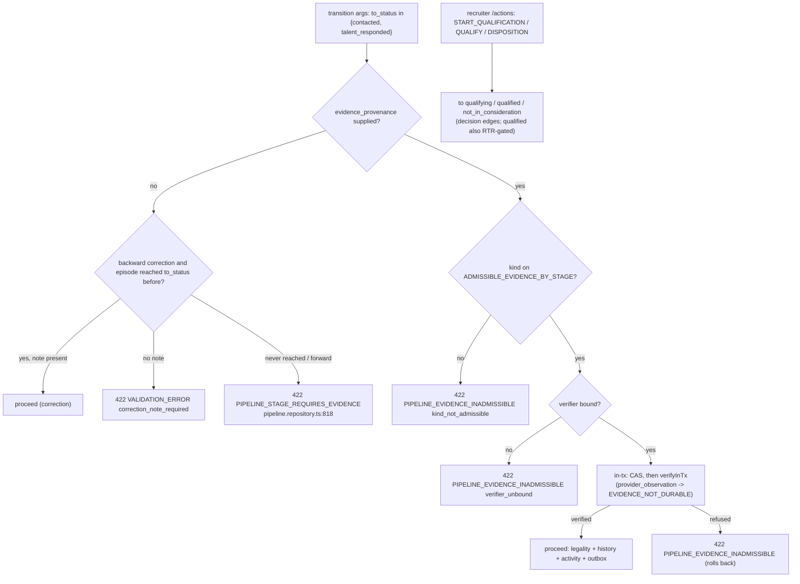

# D09 — Communications, Activity & Recruiting Evidence (AS-BUILT)
> Refreshed from baseline 12330b0f (2026-10-09) to 680907fc (2026-10-24): the evidence gate gained a per-stage admissibility allowlist plus an in-transaction reference verifier, `talent_responded` became recruiter-confirmed only (Zoom and provider observations no longer advance it), and Communications gained Outlook calendar scheduling (M365-SCHED-1) and screening-meeting associations.

> Baseline SHA 680907fc06620845944794e0a529918c980f5124 · category AS-BUILT

## Summary

D09 spans four domain libraries — `communications`, `activity`, `contact`,
`calendar` — plus the apps/api composition-root orchestration that wires durable
communication evidence to the Pipeline recruiting journey, and the apps/api
Microsoft integration that schedules Outlook calendar meetings as
Communications interactions.

The load-bearing workflow is the **Recruiting-Journey Evidence-Governed
Milestones** gate. Two Pipeline stages, `contacted` and `talent_responded`, are
declared EVIDENCE-backed (`libs/pipeline/src/lib/pipeline-state.ts:90`,
`EVIDENCE_BACKED_STAGES`). A forward transition INTO either stage without an
`evidence_provenance` reference is refused in the Pipeline domain authority with
`PIPELINE_STAGE_REQUIRES_EVIDENCE` (HTTP 422)
(`libs/pipeline/src/lib/pipeline.repository.ts:818`). A BACKWARD correction into
an evidence-backed stage is admitted without new evidence only when the episode's
history shows it already reached that stage and a correction note is supplied
(`libs/pipeline/src/lib/pipeline.repository.ts:779-802`). When provenance IS
supplied, two further checks run: the evidence kind must be on the per-stage
allowlist (`libs/pipeline/src/lib/evidence-admissibility.ts:16`,
`ADMISSIBLE_EVIDENCE_BY_STAGE`; else `PIPELINE_EVIDENCE_INADMISSIBLE`,
`libs/pipeline/src/lib/pipeline.repository.ts:840`), and the reference must be
verified inside the transition transaction through the
`EVIDENCE_REFERENCE_VERIFIER` port (`libs/pipeline/src/lib/pipeline.repository.ts:997`).
The verifier is mandatory: an unbound verifier refuses with reason
`verifier_unbound` (`libs/pipeline/src/lib/pipeline.repository.ts:851`). Its
apps/api adapter `CommunicationsEvidenceReferenceVerifier`
(`apps/api/src/pipeline-evidence/evidence-reference-verifier.module.ts:26`) reads
the communications schema by raw SQL on the Pipeline transaction, requires the
interaction to carry a talent/subject and requisition/regarding association to
THIS Talent × Requisition, and refuses every `provider_observation` with
`EVIDENCE_NOT_DURABLE` (`apps/api/src/pipeline-evidence/evidence-reference-verifier.module.ts:28`).

The allowlist is: `contacted` ← `communication_interaction`,
`recruiter_response_confirmation`, `provider_observation`; `talent_responded` ←
`recruiter_response_confirmation` ONLY
(`libs/pipeline/src/lib/evidence-admissibility.ts:16-19`). The milestones are
reachable only through the evidence-bearing commands `recordContactEvidence` →
`contacted` (`libs/pipeline/src/lib/pipeline.repository.ts:1217`),
`recordResponseEvidence` → `talent_responded`
(`libs/pipeline/src/lib/pipeline.repository.ts:1243`), and `reconcileForward`
(`libs/pipeline/src/lib/pipeline.repository.ts:1275`), which runs ALL its
hops in ONE transaction so a later-hop refusal rolls back every hop
(`libs/pipeline/src/lib/pipeline.repository.ts:1292-1295`). The recruiter
DECISION edges `qualifying` / `qualified` remain nakedly invocable
(`libs/pipeline/src/lib/pipeline-state.ts:220`, `RECRUITER_ACTION_TO_STATUS`);
`qualified` is additionally gated on the RTR precondition (owned by D07/D10).

`CommunicationInteraction` is the communication system-of-record
(`libs/communications/prisma/schema.prisma:183`; ADR-0031 §3.1). A stored
`evidence_authority` column
(`libs/communications/prisma/schema.prisma:196`) distinguishes
`provider_verified` from `recruiter_attested`
(`libs/communications/src/lib/domain/communication-enums.ts:43`). A recruiter
response confirmation carries the disposition `response_confirmed`
(`libs/communications/prisma/schema.prisma:153`), which is command-only
(`libs/communications/src/lib/domain/communication-enums.ts:83`,
`COMMAND_ONLY_DISPOSITION_OUTCOMES`), and an optional `source_interaction_id`
pointing at the interaction it confirms
(`libs/communications/prisma/schema.prisma:225`).

Producers at this SHA: (1) the recruiter confirms a substantive response via
`POST /v1/communications/talent-responses`
(`apps/api/src/communications/talent-response.controller.ts:36`) — the only FORWARD path
to `talent_responded` (a backward correction with a note, `qualifying → talent_responded`
via `/transition`, also lands there: `libs/pipeline/src/lib/pipeline.repository.ts:775-802`): it requires a recruiter USER principal
(`apps/api/src/communications/talent-response.service.ts:72`), the literal
attestation `substantive_response_attested: true` (`:99`), and either a verified
source interaction or a note (`:112`); it writes the confirmation durably then
advances via `reconcileForward` with kind `recruiter_response_confirmation`
(`apps/api/src/communications/talent-response.service.ts:258-265`); (2) an
accepted recruiter email advances `no_contact → contacted` as a best-effort side
effect via `recordContactEvidence`
(`apps/api/src/microsoft/microsoft-email.service.ts:278`); (3) an outbound voice
call (COMM-C2A) advances `no_contact → contacted` best-effort via
`recordContactEvidence` (`apps/api/src/communications/communication-call.service.ts:303`).
The Zoom webhook RECORDS a call reaching `connected`/`completed` but never
advances the Pipeline (no Pipeline injection; comment at
`apps/api/src/communications/zoom-webhook.service.ts:30-34`). The provider-
observation orchestrator records every evidence-backed mapping as pending
`EVIDENCE_NOT_DURABLE` and a persisted `RESPONSE_EVIDENCE` mapping as pending
`RESPONSE_EVIDENCE_RETIRED`; it never advances an evidence-backed milestone
(`apps/api/src/pipeline-integration/pipeline-provider-observation.orchestrator.ts:113-116`,
`:142-152`). Outlook scheduling does not advance Pipeline stages (no
`recordContactEvidence` call in `apps/api/src/microsoft/microsoft-scheduling.service.ts`).
The backend-owned `recruiting_available_actions` field
(`apps/api/src/talent-journey/talent-journey-read.service.ts:348`) tells the FE
which single next action is available per milestone; the FE never derives it from
stage equality.

## Modules & Services

| name | role | evidence path:line + symbol |
|------|------|------------------------------|
| `communications` lib | CommunicationInteraction SoR, associations, dispositions, provider-event inbox, email templates, Outlook scheduling ledger + audit | `libs/communications/src/lib/communications.module.ts:18` providers |
| `CommunicationsRepository` | Attested-response write, source-interaction facts, outbound-contact lookup, interaction/association/disposition persistence | `libs/communications/src/lib/communications.repository.ts:152` `recordAttestedResponse` |
| `MeetingSchedulingRepository` (communications) | Claim-based scheduling operation idempotency, CAS mutation fence, reconcile, durable scheduling audit | `libs/communications/src/lib/meeting-scheduling.repository.ts:70`; `:100` `claimSchedulingOperation` |
| `activity` lib | Activity timeline SoR + RN-1 append-only ActivityNoteEvent ledger | `libs/activity/src/lib/activity.module.ts` ; `libs/activity/src/lib/activity.repository.ts:162` `activityNoteEvent.create` |
| `contact` lib | Contact records (party contact points), trigram search | `libs/contact/src/lib/contact.controller.ts:38` `@Controller('v1/contacts')` |
| `calendar` lib | CalendarEvent records (internal CRUD; not the Outlook sync authority) | `libs/calendar/src/lib/calendar.controller.ts:46` `@Controller('v1/calendar-events')` |
| `PipelineRepository` (pipeline lib) | Evidence gate + admissibility + in-tx verification + evidence-bearing commands + single-tx forward reconciler | `libs/pipeline/src/lib/pipeline.repository.ts:818` evidence gate |
| `ADMISSIBLE_EVIDENCE_BY_STAGE` (pipeline lib) | Pure per-stage evidence-kind allowlist | `libs/pipeline/src/lib/evidence-admissibility.ts:16` |
| `EVIDENCE_REFERENCE_VERIFIER` port (pipeline lib) | String-token port; verification runs on the transition transaction | `libs/pipeline/src/lib/evidence-reference-verifier.port.ts:13` |
| `CommunicationsEvidenceReferenceVerifier` (apps/api, @Global) | Verifies interaction exists + bound to Talent × Requisition; refuses `provider_observation` | `apps/api/src/pipeline-evidence/evidence-reference-verifier.module.ts:26` |
| `TalentResponseService` (apps/api) | Recruiter-confirmed response: principal, attestation, source/note, consent-from-no_contact, requisition status, durable write → milestone advance | `apps/api/src/communications/talent-response.service.ts:58` `recordResponse` |
| `maybeAdvanceToContacted` (apps/api microsoft) | Email-accept → `contacted` best-effort orchestration | `apps/api/src/microsoft/microsoft-email.service.ts:259` |
| `ZoomWebhookService` (apps/api) | Signature-verified Zoom ingress; records interaction transitions; no Pipeline advance | comment at `apps/api/src/communications/zoom-webhook.service.ts:30` |
| `CommunicationCallService.maybeAdvanceToContacted` (apps/api) | Outbound voice call (COMM-C2A) → `contacted` best-effort orchestration | `apps/api/src/communications/communication-call.service.ts:294` |
| `PipelineProviderObservationOrchestrator` (apps/api) | Provider observation → decision/disposition actions only; evidence-backed targets stay pending | `apps/api/src/pipeline-integration/pipeline-provider-observation.orchestrator.ts:79` `ingest` |
| `MicrosoftSchedulingService` (apps/api) | Outlook calendar-meeting schedule / reschedule / cancel / reconcile / list-upcoming; consent gate before invitation | `apps/api/src/microsoft/microsoft-scheduling.service.ts:142` |
| `CalendarInviteConsentGate` (apps/api) | Reuses `communication` consent on channel `email` before an invitation | `apps/api/src/microsoft/calendar-invite-consent-gate.adapter.ts:20` |
| `MeetingArtifactsService` (apps/api) | Teams screening-meeting preparation + organizer-scoped transcript refs/content | `apps/api/src/microsoft/meeting-artifacts.service.ts:43` |
| `TalentJourneyReadService` (apps/api) | GET-only journey read-composer; owns `recruiting_available_actions` (withholds `mark_qualified` until RTR-ready) | `apps/api/src/talent-journey/talent-journey-read.service.ts:366` `deriveRecruitingAvailableActions` |

## Data Models

| model | lib | evidence path:line |
|-------|-----|--------------------|
| `CommunicationInteraction` | communications | `libs/communications/prisma/schema.prisma:183` |
| `CommunicationAssociation` | communications | `libs/communications/prisma/schema.prisma:301` |
| `CommunicationDisposition` | communications | `libs/communications/prisma/schema.prisma:322` |
| `CommunicationProviderEvent` | communications | `libs/communications/prisma/schema.prisma:343` |
| `CommunicationProviderIdentity` | communications | `libs/communications/prisma/schema.prisma:374` |
| `EmailTemplate` | communications | `libs/communications/prisma/schema.prisma:425` |
| `MeetingSchedulingOperation` (durable scheduling ledger) | communications | `libs/communications/prisma/schema.prisma:467` |
| `MeetingSchedulingAuditEvent` (`@@schema("audit")`) | communications | `libs/communications/prisma/schema.prisma:508` |
| `Activity` | activity | `libs/activity/prisma/schema.prisma:98` |
| `ActivityNote` | activity | `libs/activity/prisma/schema.prisma:156` |
| `ActivityNoteEvent` (append-only ledger) | activity | `libs/activity/prisma/schema.prisma:183` |
| `Contact` | contact | `libs/contact/prisma/schema.prisma:31` |
| `CalendarEvent` | calendar | `libs/calendar/prisma/schema.prisma:54` |

Key column facts: `evidence_authority` defaults `provider_verified`
(`libs/communications/prisma/schema.prisma:196`); `integration_connection_id` is
NULLABLE (NULL only for recruiter-attested) on the interaction model
(`libs/communications/prisma/schema.prisma:203`); `idempotency_key` is nullable,
with a partial unique (tenant_id, idempotency_key) constraint
(`libs/communications/prisma/schema.prisma:221`); `source_interaction_id` is a
UUID-only self-reference set on a recruiter response confirmation
(`libs/communications/prisma/schema.prisma:225`); `provider_event_id`, `version`,
`mutation_locked_at` and `pending_mutation`/`pending_start`/`pending_end` carry
the Outlook event identity, the reschedule/cancel CAS token, the exclusive
mutation fence, and the durable reconcile intent
(`libs/communications/prisma/schema.prisma:231-258`).
`MeetingSchedulingOperation` is unique on (tenant_id, idempotency_key) and
carries a `request_fingerprint`; `requisition_id` is nullable only for screening
meetings, which carry `screening_session_id`
(`libs/communications/prisma/schema.prisma:467-500`).

Migrations carrying the scheduling, screening-meeting, response-confirmation and ledger-escape substrate:
- `libs/communications/prisma/migrations/20261010120000_m365_sched_1_scheduling_persistence/migration.sql:12` — `scheduled`/`rescheduled`/`cancelled` interaction statuses + `MeetingSchedulingOperation` (`:32`);
- `libs/communications/prisma/migrations/20261011120000_m365_sched_1_mutation_fence_and_fingerprint/migration.sql:9` — mutation fence + request fingerprint;
- `libs/communications/prisma/migrations/20261012120000_m365_sched_1_reconciliation_intent/migration.sql:11` — pending-mutation intent columns;
- `libs/communications/prisma/migrations/20261016140000_inc3_a1_screening_meetings/migration.sql:6` — `screening_session` subject type; nullable `requisition_id` + `screening_session_id` on the operation (`:8`, `:13`);
- `libs/communications/prisma/migrations/20261021100000_s4_disposition_response_confirmed/migration.sql:5` — `response_confirmed` disposition value;
- `libs/communications/prisma/migrations/20261021100100_s4_interaction_source_interaction_id/migration.sql:4` — `source_interaction_id` column;
- `libs/activity/prisma/migrations/20261016170000_s2_activity_note_event_tenant_reset_escape/migration.sql` — DELETE admitted only under the transaction-local tenant-reset marker;
- `libs/activity/prisma/migrations/20261016180100_s2_activity_note_event_erasure_delete/migration.sql:9` — DELETE additionally admitted under the subject-bound erasure authorization for the erased talent's notes; UPDATE stays rejected for every caller.

The original attested-evidence substrate remains migration
`libs/communications/prisma/migrations/20261006160000_recruiting_journey_attested_response_evidence/migration.sql:11`.

## API Endpoints

| method | route | scopes | evidence path:line |
|--------|-------|--------|--------------------|
| POST | `/v1/communications/talent-responses` | `pipeline:change-status` + `@RequireSiteMatch` + capability `ats` | `apps/api/src/communications/talent-response.controller.ts:36` / `:38` |
| GET | `/v1/pipelines/:id/journey` | `pipeline:read` | `apps/api/src/talent-journey/talent-journey.controller.ts:23` / `:25` |
| POST | `/v1/communications/calls` | `communication:voice:call` | `apps/api/src/communications/communications.controller.ts:50` / `:52` |
| GET | `/v1/communications/capabilities` | `communication:read` | `apps/api/src/communications/communications.controller.ts:102` / `:104` |
| GET | `/v1/communications/voice-evidence` | `communication:read` | `apps/api/src/communications/communications.controller.ts:207` / `:209` |
| GET | `/v1/communications/interactions/:interactionId` | `communication:read` | `apps/api/src/communications/communications.controller.ts:225` / `:227` |
| POST | `/v1/communications/interactions/:interactionId/disposition` | `communication:disposition:write` | `apps/api/src/communications/communications.controller.ts:248` / `:250` |
| POST | `/v1/communications/interactions/:interactionId/provider-reference` | `communication:voice:call` | `apps/api/src/communications/communications.controller.ts:264` / `:266` |
| GET | `/v1/talents/:talentId/communications` | `communication:read` | `apps/api/src/communications/talent-communications.controller.ts:24` / `:26` |
| GET/POST/PATCH | `/v1/communications/email-templates` (list/get/create/patch/deactivate/preview) | `communication:template:read` / `:manage` | `apps/api/src/communications/email-template.controller.ts:33` |
| POST | `/v1/communications/email-drafts/general-contact` | `communication:email:send` | `apps/api/src/communications/general-talent-contact-draft.controller.ts:27` / `:29` |
| POST | `/v1/communications/email-drafts/requisition-contact` | `communication:email:send` | `apps/api/src/communications/requisition-contact-draft.controller.ts:27` / `:29` |
| POST | `/v1/webhooks/communications/zoom` | (webhook; signature-verified, no scope guard) | `apps/api/src/communications/zoom-webhook.controller.ts:29` / `:33` |
| POST | `/v1/integrations/microsoft/email` | `communication:email:send` | `apps/api/src/microsoft/microsoft-authorization.controller.ts:156` / `:158` |
| POST | `/v1/integrations/microsoft/meeting` (create-link-only) | `communication:meeting:create` | `apps/api/src/microsoft/microsoft-authorization.controller.ts:193` / `:195` |
| POST | `/v1/integrations/microsoft/calendar-meeting` | `communication:meeting:create` | `apps/api/src/microsoft/microsoft-authorization.controller.ts:224` / `:226` |
| GET | `/v1/integrations/microsoft/calendar-meeting/:id` | `communication:meeting:read` | `apps/api/src/microsoft/microsoft-authorization.controller.ts:254` / `:256` |
| GET | `/v1/integrations/microsoft/calendar-meetings` | `communication:meeting:read` | `apps/api/src/microsoft/microsoft-authorization.controller.ts:274` / `:276` |
| PATCH | `/v1/integrations/microsoft/calendar-meeting/:id` (reschedule) | `communication:meeting:edit` | `apps/api/src/microsoft/microsoft-authorization.controller.ts:303` / `:305` |
| POST | `/v1/integrations/microsoft/calendar-meeting/:id/cancel` | `communication:meeting:cancel` | `apps/api/src/microsoft/microsoft-authorization.controller.ts:330` / `:332` |
| GET/GET/POST/PATCH/DELETE | `/v1/activities` (+ `/:id`, `/:id/pin`, `/:id/unpin`, `/:id/redact`) | `activity:read` / `activity:create` | `libs/activity/src/lib/activity.controller.ts:43` |
| GET/POST/PATCH/DELETE | `/v1/calendar-events` | `calendar:event-edit` / `-create` / `-delete` | `libs/calendar/src/lib/calendar.controller.ts:46` |
| GET/POST/PATCH/DELETE | `/v1/contacts` | `contact:read` / `:create` / `:edit` / `:delete` | `libs/contact/src/lib/contact.controller.ts:38` |

The remaining `/v1/integrations/microsoft` routes (`authorize/start`, `me`,
`status`, `configure`, `callback`) are connection plumbing catalogued by D14.
`POST /v1/screening-sessions/:id/meeting` (technical screening) composes the
scheduling path for screening meetings; its controller is catalogued in D11.

## Screens & FE→BE Wiring (ats-web only)

- `apps/ats-web/src/communications/talent-response-api.ts` — `recordTalentResponse`
  posts to `/v1/communications/talent-responses` with an `Idempotency-Key` header,
  the literal `substantive_response_attested: true` and an optional
  `source_interaction_id` (`talent-response-api.ts:21-22`, `:61-62`); maps the FE
  `phone` channel tile to the backend `voice` channel
  (`apps/ats-web/src/communications/talent-response-api.ts:39` `CHANNEL_TO_BACKEND`).
  The FE never sets Pipeline stage.
- `apps/ats-web/src/communications/RecordTalentResponseModal.tsx:74` — a required
  attestation checkbox. Typed refusals (`PIPELINE_EVIDENCE_INADMISSIBLE`,
  `REQUISITION_NOT_ADVANCEABLE`, `INSUFFICIENT_PERMISSIONS`
  `recruiter_user_required`, `TRANSACTION_CONFLICT_RETRYABLE`) get specific copy
  (`RecordTalentResponseModal.tsx:319` `talentResponseRefusalMessage`); 409 is the
  "journey changed" stale path (`:138`); every other HTTP 400 / 422 is routed to
  an inline message on the `occurred_at` field (`:141-147`, copy from
  `responseTimeErrorMessage` `:343`). The toast reports the reviewer, the recorded
  time, and whether the journey advanced (`:127-132`).
- `apps/ats-web/src/requisitions/talent-requisition-360/TalentRequisition360View.tsx:375`
  — the Talent × Requisition 360 page reads the backend-owned
  `recruiting_available_actions[0]` (never stage equality) and maps it to the
  primary CTA (`:376-386`). It is the only ats-web consumer of the field
  (`git grep -n recruiting_available_actions 680907fc -- apps/ats-web/src`).
- `apps/ats-web/src/pipeline/talent-journey-api.ts:112` — the GET
  `/v1/pipelines/:id/journey` read client; mirrors the apps/api
  `TalentRequisitionJourney` contract and consumes the composed stages as the
  single stage source.
- `apps/ats-web/src/microsoft/microsoft-api.ts:188` — the calendar-meeting client
  (`/v1/integrations/microsoft/calendar-meeting`, list at `:210`), consumed by
  `ScheduleMeetingDialog.tsx` and `UpcomingMeetings.tsx`; the screening tab reads
  the scheduled time and join link from the same read
  (`apps/ats-web/src/requisitions/talent-requisition-360/Tr360TechScreening.tsx:205`).

## Key Flows

Recruiter-confirmed "Talent responded" (the only forward path to `talent_responded`; a noted backward correction from `qualifying` via `/transition` also lands there, `libs/pipeline/src/lib/pipeline.repository.ts:775-802`):

```mermaid
sequenceDiagram
    actor Recruiter
    participant FE as ats-web RecordTalentResponseModal
    participant Ctl as TalentResponseController
    participant Svc as TalentResponseService
    participant Comm as CommunicationsRepository
    participant Req as RequisitionRepository
    participant Pipe as PipelineRepository
    participant Ver as CommunicationsEvidenceReferenceVerifier

    Recruiter->>FE: attest + channel + occurred_at + (source interaction | note)
    FE->>Ctl: POST /v1/communications/talent-responses (Idempotency-Key)
    Ctl->>Ctl: require Idempotency-Key else 422 VALIDATION_ERROR
    Ctl->>Svc: recordResponse(...)
    Svc->>Svc: 403 unless actor_kind=user AND consumer_type=recruiter
    Svc->>Pipe: findByIdForActor (visibility-scoped)
    alt pipeline absent / not visible
        Pipe-->>Svc: null
        Svc-->>Ctl: 404 NOT_FOUND (concealed)
    end
    Svc->>Svc: 422 unless attestation === true; note required without source (or channel=other)
    Svc->>Comm: findFirstOutboundContactInstant -> 422 if occurred_at earlier / future
    opt source_interaction_id supplied
        Svc->>Comm: findSourceInteractionFacts -> 422 PIPELINE_EVIDENCE_INADMISSIBLE if mismatch / non-substantive
    end
    opt pipeline at no_contact
        Svc->>Svc: contact consent check -> 422 consent_required_from_no_contact
    end
    Svc->>Req: findStatusById (+ findClosingInstant when closed/canceled)
    Svc->>Comm: recordAttestedResponse (interaction + associations + response_confirmed disposition + source id, 1 tx)
    alt requisition closed/canceled and occurred_at before closing
        Svc-->>Ctl: advanced=false (historical append only)
    else
        Svc->>Pipe: reconcileForward(target=talent_responded, kind=recruiter_response_confirmation)
        Pipe->>Pipe: ONE tx; per hop: admissibility allowlist + CAS
        Pipe->>Ver: verifyInTx (FOR SHARE; talent + requisition association; response_confirmed)
        Ver-->>Pipe: verified
        Pipe-->>Svc: advanced PipelineView
    end
    Ctl-->>FE: { interaction_id, deduped, pipeline_stage, pipeline_version, advanced, occurred_at, recorded_at, recorded_by_id }
```

Evidence gate on a transition into an evidence-backed stage:



### Outlook calendar scheduling (M365-SCHED-1)

```mermaid
sequenceDiagram
    actor Recruiter
    participant Ctl as MicrosoftAuthorizationController
    participant Svc as MicrosoftSchedulingService
    participant Repo as MeetingSchedulingRepository
    participant Gate as CalendarInviteConsentGate
    participant Graph as Microsoft Graph calendar
    Recruiter->>Ctl: POST /v1/integrations/microsoft/calendar-meeting (Idempotency-Key)
    Ctl->>Svc: scheduleMeeting
    Svc->>Repo: claimSchedulingOperation(key, fingerprint)
    alt replay / in_progress / identity_conflict / needs_reconciliation
        Repo-->>Svc: outcome (replay returns existing view; unresolved never recreated)
    end
    Svc->>Gate: consent check (communication, email) — fail closed
    Svc->>Graph: create event (transactionId = idempotency key)
    alt provider outcome lost
        Svc->>Repo: mark operation unresolved (reconcile before retry)
    else
        Svc->>Repo: createScheduledMeeting (interaction status scheduled) + audit meeting.scheduled
    end
    Note over Svc,Repo: reschedule/cancel: reserveMutationCas (fence + intent) -> Graph -> finalize; reconcileMeeting verifies provider state
```

## Evidence Index (load-bearing path:line citations)

- `libs/pipeline/src/lib/pipeline-state.ts:90` — `EVIDENCE_BACKED_STAGES`
- `libs/pipeline/src/lib/pipeline-state.ts:95` — `isEvidenceBackedStage`
- `libs/pipeline/src/lib/pipeline-state.ts:120` — `contacted` legal transitions
- `libs/pipeline/src/lib/pipeline-state.ts:128` — `talent_responded` legal transitions
- `libs/pipeline/src/lib/pipeline-state.ts:220` — `RECRUITER_ACTION_TO_STATUS` (CONTACT/MARK_RESPONDED retired)
- `libs/pipeline/src/lib/evidence-admissibility.ts:9` — `PIPELINE_EVIDENCE_KINDS`
- `libs/pipeline/src/lib/evidence-admissibility.ts:16` — `ADMISSIBLE_EVIDENCE_BY_STAGE`
- `libs/pipeline/src/lib/evidence-admissibility.ts:22` — `isEvidenceAdmissible`
- `libs/pipeline/src/lib/evidence-reference-verifier.port.ts:13` — `EVIDENCE_REFERENCE_VERIFIER`
- `libs/pipeline/src/lib/pipeline.repository.ts:779` — backward correction into an evidence-backed stage
- `libs/pipeline/src/lib/pipeline.repository.ts:818` — evidence gate throw `PIPELINE_STAGE_REQUIRES_EVIDENCE`
- `libs/pipeline/src/lib/pipeline.repository.ts:840` — admissibility refusal `PIPELINE_EVIDENCE_INADMISSIBLE`
- `libs/pipeline/src/lib/pipeline.repository.ts:851` — `verifier_unbound` refusal
- `libs/pipeline/src/lib/pipeline.repository.ts:997` — `verifyInTx` on the transition transaction
- `libs/pipeline/src/lib/pipeline.repository.ts:1217` — `recordContactEvidence`
- `libs/pipeline/src/lib/pipeline.repository.ts:1243` — `recordResponseEvidence`
- `libs/pipeline/src/lib/pipeline.repository.ts:1275` — `reconcileForward` (all hops one tx, `:1292-1295`)
- `libs/common/src/lib/errors/error-codes.ts:875` — `PIPELINE_STAGE_REQUIRES_EVIDENCE` code registration
- `libs/common/src/lib/errors/aramo-error.ts:284` — `PIPELINE_STAGE_REQUIRES_EVIDENCE: 422` status mapping
- `libs/common/src/lib/errors/error-codes.ts:1040` — `PIPELINE_EVIDENCE_INADMISSIBLE` code registration
- `libs/common/src/lib/errors/aramo-error.ts:342` — `PIPELINE_EVIDENCE_INADMISSIBLE: 422`
- `apps/api/src/pipeline-evidence/evidence-reference-verifier.module.ts:26` — `CommunicationsEvidenceReferenceVerifier`
- `apps/api/src/pipeline-evidence/evidence-reference-verifier.module.ts:28` — `provider_observation` → `EVIDENCE_NOT_DURABLE`
- `apps/api/src/app.module.ts:606` — `EvidenceReferenceVerifierModule` registered
- `apps/api/src/communications/talent-response.controller.ts:36` — `POST talent-responses`
- `apps/api/src/communications/talent-response.controller.ts:38` — `@RequireScopes('pipeline:change-status')`
- `apps/api/src/communications/talent-response.service.ts:72` — recruiter-user principal check
- `apps/api/src/communications/talent-response.service.ts:99` — attestation required
- `apps/api/src/communications/talent-response.service.ts:156` — `findSourceInteractionFacts` (source verification)
- `apps/api/src/communications/talent-response.service.ts:26` — `NON_SUBSTANTIVE_SOURCE_DISPOSITIONS`
- `apps/api/src/communications/talent-response.service.ts:189` — consent check when starting at `no_contact`
- `apps/api/src/communications/talent-response.service.ts:203` — closed/canceled historical-only branch
- `apps/api/src/communications/talent-response.service.ts:220` — `recordAttestedResponse` call
- `apps/api/src/communications/talent-response.service.ts:258` — `reconcileForward` to `talent_responded`
- `libs/communications/src/lib/communications.repository.ts:152` — `recordAttestedResponse`
- `libs/communications/src/lib/communications.repository.ts:169` — dedup lookup on (tenant_id, idempotency_key)
- `libs/communications/src/lib/communications.repository.ts:256` — `findSourceInteractionFacts`
- `libs/communications/src/lib/communications.repository.ts:293` — `findFirstOutboundContactInstant`
- `apps/api/src/microsoft/microsoft-email.service.ts:259` — `maybeAdvanceToContacted`
- `apps/api/src/microsoft/microsoft-email.service.ts:278` — `recordContactEvidence` call on email accept
- `apps/api/src/communications/zoom-webhook.service.ts:30` — comment: ingestion independent of progression (no advance)
- `apps/api/src/communications/communication-call.service.ts:303` — `recordContactEvidence` call on outbound voice call (COMM-C2A)
- `apps/api/src/pipeline-integration/pipeline-provider-mapping-target.ts:36` — `RETIRED_PROVIDER_EVIDENCE_TARGETS`
- `apps/api/src/pipeline-integration/pipeline-provider-observation.orchestrator.ts:142` — evidence-backed target → pending `EVIDENCE_NOT_DURABLE`
- `apps/api/src/communications/zoom-webhook.controller.ts:29` — `POST /v1/webhooks/communications/zoom`
- `apps/api/src/talent-journey/talent-journey-read.service.ts:348` — `recruiting_available_actions` emission
- `apps/api/src/talent-journey/talent-journey-read.service.ts:366` — `deriveRecruitingAvailableActions`
- `apps/api/src/talent-journey/talent-journey.controller.ts:23` — `GET :id/journey`
- `libs/communications/src/lib/domain/communication-enums.ts:43` — `COMMUNICATION_EVIDENCE_AUTHORITIES`
- `libs/communications/src/lib/domain/communication-enums.ts:32` — `recorded` interaction status
- `libs/communications/src/lib/domain/communication-enums.ts:8` — channels incl `other`
- `libs/communications/src/lib/domain/communication-enums.ts:83` — `COMMAND_ONLY_DISPOSITION_OUTCOMES`
- `libs/communications/prisma/schema.prisma:153` — `response_confirmed` disposition value
- `libs/communications/prisma/schema.prisma:196` — `evidence_authority` column
- `libs/communications/prisma/schema.prisma:203` — `integration_connection_id` NULLABLE
- `libs/communications/prisma/schema.prisma:221` — `idempotency_key`
- `libs/communications/prisma/schema.prisma:225` — `source_interaction_id`
- `libs/communications/prisma/schema.prisma:467` — `MeetingSchedulingOperation`
- `libs/communications/prisma/schema.prisma:508` — `MeetingSchedulingAuditEvent`
- `libs/communications/prisma/migrations/20261006160000_recruiting_journey_attested_response_evidence/migration.sql:11` — evidence-authority enum
- `libs/communications/src/lib/meeting-scheduling.repository.ts:100` — `claimSchedulingOperation`
- `libs/communications/src/lib/meeting-scheduling.repository.ts:324` — `reserveMutationCas`
- `apps/api/src/microsoft/microsoft-scheduling.service.ts:154` — `scheduleMeeting`
- `apps/api/src/microsoft/microsoft-scheduling.service.ts:504` — `reconcileMeeting`
- `apps/api/src/microsoft/calendar-invite-consent-gate.adapter.ts:21` — consent check `operation: 'communication', channel: 'email'`
- `apps/api/src/microsoft/microsoft-authorization.controller.ts:224` — `POST calendar-meeting`
- `libs/activity/prisma/schema.prisma:183` — `ActivityNoteEvent`
- `libs/activity/src/lib/activity.repository.ts:162` — `activityNoteEvent.create` (CREATED)
- `libs/activity/src/lib/activity.repository.ts:238` — `activityNoteEvent.create` (PINNED/UNPINNED)
- `libs/activity/src/lib/activity.repository.ts:322` — `activityNoteEvent.create` (REDACTED)
- `libs/activity/prisma/migrations/20261016180100_s2_activity_note_event_erasure_delete/migration.sql:9` — append-only trigger with erasure + tenant-reset DELETE escapes
- `apps/ats-web/src/communications/RecordTalentResponseModal.tsx:141` — 400/422 inline-field routing
- `apps/ats-web/src/communications/RecordTalentResponseModal.tsx:319` — typed refusal copy
- `apps/ats-web/src/requisitions/talent-requisition-360/TalentRequisition360View.tsx:375` — backend-owned recruiting action consumption
- `apps/ats-web/src/microsoft/microsoft-api.ts:188` — calendar-meeting FE client

## NOT VERIFIED (explicit)

- The original LOCKED Evidence-Governed Milestones directive (code-cited as
  "Recruiting-Journey §…") remains absent from the repo and the canonical store;
  the governing text at this SHA is Talent Lifecycle R1–R5 Amendment A1 and
  Implementation Directive v1.2 (see AS-DESIGNED). Remaining "Recruiting-Journey
  §/I" code comments were not each reconciled against A1/v1.2 wording.
- The COMM voice stack (`CallButton`, `CallDrawer`, Zoom provider adapters) is
  catalogued by file presence only; its DORMANT/dark operational posture (per
  MEMORY) was not exercised at runtime in this read-only audit.
- Outlook scheduling was read at service/repository level only; Graph adapter
  behaviour (`apps/api/src/microsoft/microsoft-calendar-http.adapter.ts`) and the
  `Calendars.ReadWrite` opt-in consent flow were not exercised; production
  activation state is not derivable from code.
- Scope-to-role resolution and the actual tenant-50 seed grants for the scopes
  cited above (including `communication:meeting:read|edit|cancel`) were not
  traced; only the route-level `@RequireScopes` declarations were read.
- Pact/OpenAPI conformance for these routes was not cross-checked against the
  controllers in this pass.
