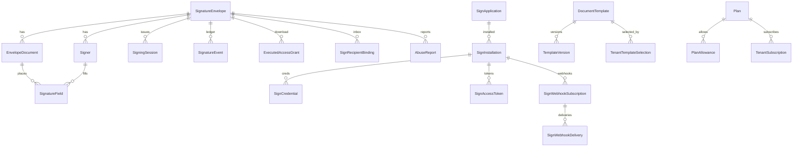
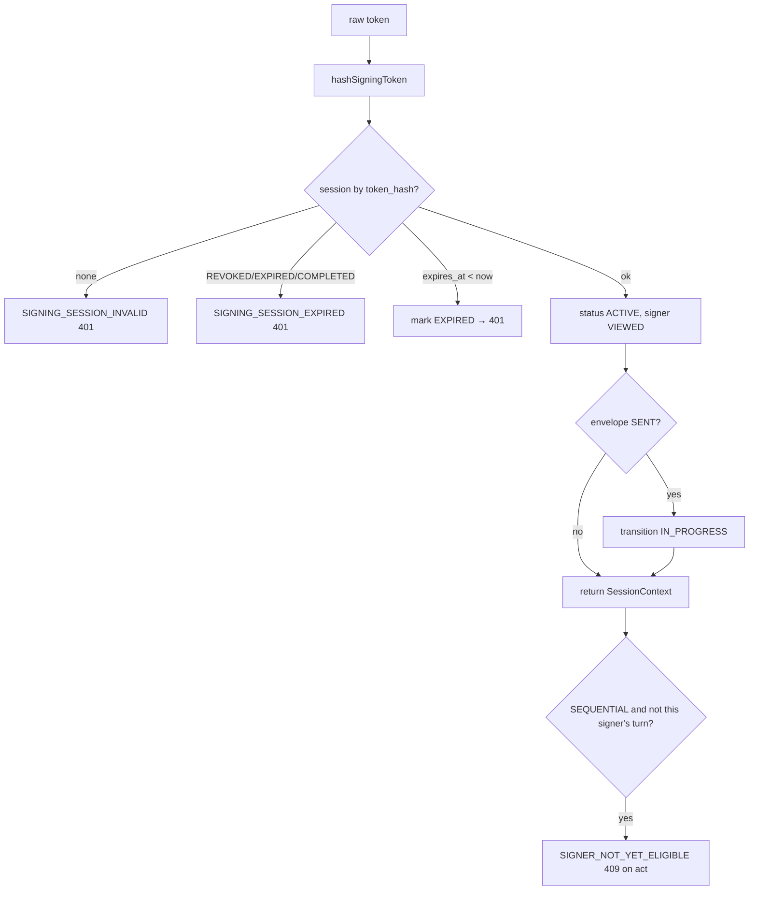
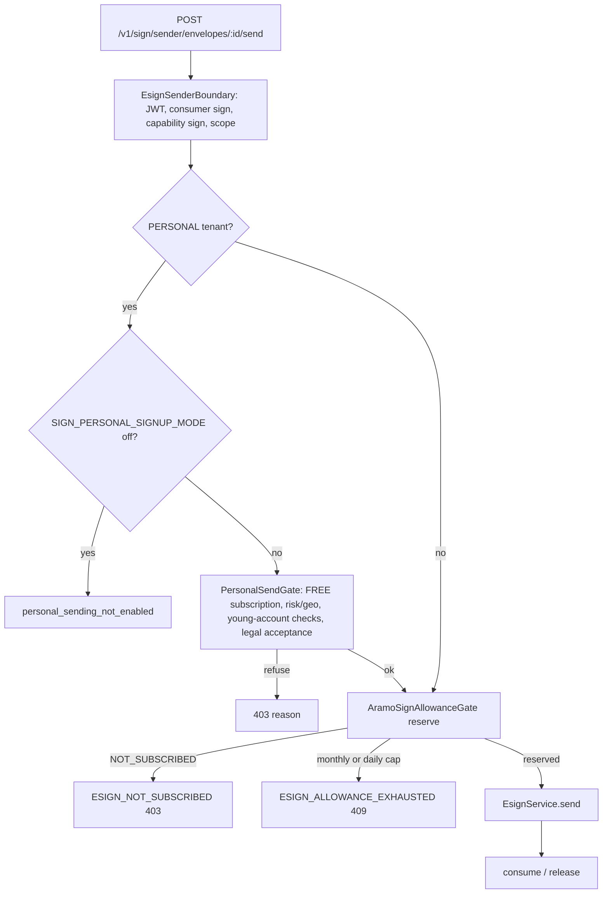

# D10 — Documents & E-Signature (AS-BUILT)
> Refreshed from baseline 12330b0f (2026-10-09) to 680907fc (2026-10-24): the E-Sign service was renamed and expanded into the standalone Aramo Sign product (`apps/sign-service`, `libs/sign`, schema `sign`, `/v1/sign/*`) with a sender workspace, multi-signer routing, an integration platform API, recipient inbox, self-service billing, Personal (Free) sending controls and legal acceptance; multi-provider routing (Aramo Sign, DocuSign, Adobe Acrobat Sign) and a plan/allowance authority (`libs/subscription`, `libs/signature-routing`) were added; Core Documents gained a PLATFORM/TENANT template library with selections, adoption and withdrawal.
> Baseline SHA 680907fc06620845944794e0a529918c980f5124 · category AS-BUILT

## Summary

D10 is the Documents + Native E-Signature program (DOC-1a..6), the Aramo Sign
product built on its signing engine, and the shared document template library.
At 680907fc it is realized as six cooperating surfaces:

1. **Core Documents** (`libs/documents`, schema `documents`) — the canonical,
   workflow-neutral document identity: `DocumentType`, `Document`,
   `DocumentRevision`, `DocumentArtifact`, `DocumentAssociation` (the primary
   polymorphic bridge; `DocumentRequirement` also carries a `resource_type`/
   `resource_id` tuple mirroring the same vocab), requirements, packets, and the
   template library (`DocumentTemplate` with `owner_scope` PLATFORM|TENANT,
   `TemplateVersion`, `TenantTemplateSelection`, `TemplateVariable`). Exposed by
   the ATS API (`apps/api` imports `@aramo/documents`) under tenant JWT + scope
   guards; the PLATFORM template catalog is administered from `apps/api`
   `/platform/document-templates*`.
2. **Aramo Sign service** (`apps/sign-service`, lib `libs/sign`, schema `sign`,
   port 3003) — the signature envelope state machine, capability-token signing
   sessions, the append-only hash-chained `SignatureEvent` ledger, executed-PDF
   production and the evidence manifest / execution certificate; plus the
   authenticated sender workspace (`/v1/sign/sender/*`), the integration platform
   API (`/v1/sign/oauth/token`, `/v1/sign/api/*`, installation administration),
   the recipient inbox, billing, legal acceptance, account close and abuse
   reports. It references Core documents only by opaque UUID.
3. **Sign Web** (`apps/sign-web`) — the one Aramo Sign SPA on the Sign host with
   three zones decided from the URL (`apps/sign-web/src/zones.ts:13`): guest
   signing `/s/:token`, guest signed-copy download `/d/:token`, and the signed-in
   workspace (Business `/sign/*` or Personal `/personal/*`) with the public entry
   pages (login, signup, legal, report).
4. **Commercial authority** (`libs/subscription`, schema `subscription`) — plan
   catalog, allowances (monthly + daily window), tenant subscriptions with a
   Stripe-backed lifecycle, capacity (storage) ledger, feature availability, and
   versioned legal documents with acceptance evidence.
5. **Provider routing** (`libs/signature-routing`, schema `signature_routing`;
   `apps/api/src/document-signing`, `apps/api/src/esignature-providers`) — the
   tenant's active e-signature provider (Aramo Sign, DocuSign, Adobe Acrobat
   Sign), the provider frozen on each request, OAuth connect state, and inbound
   provider webhooks.
6. **Template UI** — `libs/document-templates-web` (shared RTR template editor and
   detail screens), `libs/org-admin-web/src/document-templates` (tenant gallery,
   adopt/create, our templates), `apps/platform-web/src/document-templates`
   (PLATFORM catalog + template variables).

Seams between `apps/api` and `apps/sign-service`:
- ATS → Sign: the provider-neutral `SignatureProviderPort`
  (`libs/documents-contracts/src/lib/signature-provider.port.ts:95`) with two
  adapters selected by `SIGN_ATS_TRANSPORT` (`apps/api/src/sign/esign-service-api.provider.ts:20`):
  `internal` (default; `EsignServiceHttpProvider` → unauthenticated
  `/v1/sign/envelopes/*`, caller-supplied `tenant_id`) or `api`
  (`EsignServiceApiProvider` → the authenticated Sign API through
  `SignApiClient` token exchange / event-bound grant,
  `apps/api/src/sign/sign-api.client.ts:40`).
- Sign → Core: an HMAC-signed lifecycle webhook `POST /v1/integrations/sign/events`
  (`apps/api/src/integrations/sign/esign-events.controller.ts:45`) that drives the
  executed-artifact write-back and (Remediation R2) records DECLINED / EXPIRED /
  VOIDED on the governed Document; and three Sign → api reads/renders over the
  signed service-to-service scheme `aramo-sign-s2s-v1`
  (`libs/documents-contracts/src/lib/esign-service-request-auth.ts:31`), all with
  base URL `DOCUMENTS_API_URL`: revision source bytes
  (`apps/sign-service/src/app/document-source-http.adapter.ts:19`), the template
  library (`apps/sign-service/src/app/document-templates-http.adapter.ts:43`) and
  the legacy lifecycle webhook target (`apps/sign-service/src/app/webhook-event-publisher.ts:57`).

RTR (DOC-5, now template-driven) and Offer letters (DOC-6) are the
recruiter-facing verticals composed on top, in `apps/api/src/rtr` and
`apps/api/src/offer-document`. The external operational event bus stays DARK by
construction (`apps/sign-service/src/app/sns-event-publisher.ts:34` returns a
no-op publisher unless a topic is configured). Deployment state is not derived
from code (NOT VERIFIED here).

## Modules & Services

| name | role | evidence path:line + symbol |
|---|---|---|
| `libs/documents` DocumentTypesController / DocumentsController | Core document + document-type HTTP surface (create/list/get/prepare/associate/events/artifacts) | `libs/documents/src/lib/documents.controller.ts:89` `class DocumentTypesController`; `:123` `class DocumentsController` |
| `libs/documents` DocumentTemplatesController | tenant templates: create/adopt/notices/versions/draft/preview/logo/activate/fields/allowed-bindings | `libs/documents/src/lib/templates.controller.ts:163` `class DocumentTemplatesController` |
| `libs/documents` DocumentTemplateLibraryController | template library + tenant selections (DOC-TEMPLATE-LIB-1) | `libs/documents/src/lib/template-library.controller.ts:98` `class DocumentTemplateLibraryController` |
| `libs/documents` DocumentRequirementsController | requirement bridge: create/check/satisfy/waive | `libs/documents/src/lib/templates.controller.ts:672` `class DocumentRequirementsController` |
| `libs/documents` DocumentPacketsController | packet grouping | `libs/documents/src/lib/templates.controller.ts:763` `class DocumentPacketsController` |
| `libs/documents` DocumentsRepository | transactional writer (state + DocumentEvent + OutboxEvent + Idempotency) | `libs/documents/src/lib/documents.controller.ts:18` import `DocumentsRepository` |
| `libs/documents` TemplatesRepository | owner-aware template/version/selection persistence | `libs/documents/src/lib/templates.repository.ts:142` `class TemplatesRepository` |
| `libs/documents` TemplateResolutionService | generic resolver: client selection → tenant selection (PLATFORM selection honoured only when `legacy_platform`), withdrawal fallback | `libs/documents/src/lib/template-resolution.service.ts:68` `class TemplateResolutionService`; `:91` legacy check |
| `libs/documents` DocumentExecutedWriteBackService | the writer of permanent `EXECUTED` / `EXECUTION_CERTIFICATE` artifacts | `libs/documents/src/lib/executed-write-back.service.ts:71` `class DocumentExecutedWriteBackService` |
| `libs/documents` RevisionSourceService | source-PDF bytes provider for the Sign pull | `libs/documents/src/lib/revision-source.service.ts:12` `class RevisionSourceService` |
| `libs/documents-contracts` SignatureProviderPort | provider-neutral cross-service signing contract (optional `SignatureActor`) | `libs/documents-contracts/src/lib/signature-provider.port.ts:95` `interface SignatureProviderPort`; `:80` `SignatureActor` |
| `libs/documents-contracts` s2s request auth | `aramo-sign-s2s-v1` HMAC sign/verify shared by both sides | `libs/documents-contracts/src/lib/esign-service-request-auth.ts:70` `signEsignServiceRequest`; `:81` `verifyEsignServiceRequest` |
| `libs/documents-rendering` PdfLibDocumentRenderingAdapter | deterministic generated render + stamp-onto-source (bundled signature-script font) | `libs/documents-rendering/src/lib/pdf-lib-document-rendering.adapter.ts:257` `class PdfLibDocumentRenderingAdapter` |
| `libs/sign` EsignService | envelope lifecycle + signing-session orchestration, PARALLEL/SEQUENTIAL routing | `libs/sign/src/lib/esign.service.ts:107` `class EsignService` |
| `libs/sign` envelope lifecycle | single source of allowed transitions (CAS in repository) | `libs/sign/src/lib/domain/envelope-lifecycle.ts:8` `ENVELOPE_TRANSITIONS` |
| `libs/sign` ExecutionService | executed-PDF production + certificate | `libs/sign/src/lib/execution.service.ts:53` `class ExecutionService implements ExecutionProducerPort` |
| `libs/sign` OutboxService | DOC-4 transactional outbox producer + `drain()` via EVENT_PUBLISHER_PORT | `libs/sign/src/lib/outbox.service.ts:24` `class OutboxService`; `:47` `drain` |
| `libs/sign` OutboxDeliveryService | OC v2 canonical outbound webhook drainer (lease + backoff) | `libs/sign/src/lib/outbox-delivery.service.ts:35` `class OutboxDeliveryService` |
| `libs/sign` EnvelopeNotificationService / SigningInvitationService | lifecycle notifications with delivery records; SEQUENTIAL next-signer invitations | `libs/sign/src/lib/envelope-notification.service.ts:35`; `libs/sign/src/lib/signing-invitation.service.ts:42` |
| `libs/sign` AbuseReportService | Personal "Report this email" weighting (severity × independence × credibility) | `libs/sign/src/lib/abuse-report.service.ts:28` `ABUSE_REPORT_REASONS` |
| `libs/sign` hash-chain | tamper-evident `SignatureEvent` chain hash | `libs/sign/src/lib/hash-chain.ts:17` `function computeEventHash` |
| `libs/sign` signing-token | capability-token mint/hash + 7-day TTL | `libs/sign/src/lib/signing-token.ts:10` TTL; `:17` `generateSigningToken` |
| `apps/sign-service` AppModule | composition root (subscription, auth, entitlement, identity resolver, sign module, workers) | `apps/sign-service/src/app/app.module.ts:81` `@Module`; `:155` controllers list |
| `apps/sign-service` EsignProviderController | internal service-to-service `/v1/sign/envelopes/*` seam (no guards) | `apps/sign-service/src/app/esign-http.controller.ts:79` `class EsignProviderController` |
| `apps/sign-service` EsignSignerController | public signer transport `/v1/sign/signing/*` (capability token) | `apps/sign-service/src/app/esign-http.controller.ts:196` `class EsignSignerController` |
| `apps/sign-service` EsignSenderController / SenderEnvelopeService | authenticated sender workspace (drafts, documents, recipients, fields, send/remind/void, contacts, activity) | `apps/sign-service/src/app/sender/esign-sender.controller.ts:43`; `apps/sign-service/src/app/sender/sender-envelope.service.ts:77` |
| `apps/sign-service` EsignSenderTemplatesController / SenderTemplatesService | start an envelope from a Documents template (feature-gated `sign.templates`) | `apps/sign-service/src/app/sender/esign-sender-templates.controller.ts:25`; `apps/sign-service/src/app/sign-feature.gate.ts:20` |
| `apps/sign-service` SignOAuthController / SignApiController / SignTokenService / SignApiGuard | S-4 integration platform: token endpoint (client_credentials, token-exchange, sign-event grant) + Sign API | `apps/sign-service/src/app/integrations/sign-api.controller.ts:33`, `:45`; `apps/sign-service/src/app/integrations/sign-token.service.ts:31`; `apps/sign-service/src/app/integrations/sign-api.guard.ts:38` |
| `apps/sign-service` IntegrationAdminController | installations, credentials, role mappings, webhook subscriptions | `apps/sign-service/src/app/integrations/integration-admin.controller.ts:16` |
| `apps/sign-service` SignWebhookDeliveryService | S-5 per-subscription webhook delivery | `apps/sign-service/src/app/integrations/webhook-delivery.service.ts:65` |
| `apps/sign-service` RecipientInboxController | S-7 recipient inbox (signed-in recipients) | `apps/sign-service/src/app/inbox/recipient-inbox.controller.ts:20`; `apps/sign-service/src/app/inbox/recipient-inbox.service.ts:30` |
| `apps/sign-service` EsignBillingController + workers | plans, account, checkout, portal, Stripe webhook; owner activation; reconciliation sweep | `apps/sign-service/src/app/billing/esign-billing.controller.ts:144`; `apps/sign-service/src/app/billing/esign-billing-reconcile.worker.ts:16` |
| `apps/sign-service` AramoSignAllowanceGate | reserve → send → consume/release at the native send seam | `apps/sign-service/src/app/aramo-sign-allowance.gate.ts:62` |
| `apps/sign-service` PersonalSendGate | Personal (Free) sender gate: FREE subscription, risk/geo, young-account checks, legal acceptance | `apps/sign-service/src/app/personal/personal-send.gate.ts:179` |
| `apps/sign-service` SignReportController / SignLegalController / SignAccountController | abuse report (token), Personal legal status/accept, Personal account close | `apps/sign-service/src/app/personal/sign-report.controller.ts:14`; `apps/sign-service/src/app/legal/sign-legal.controller.ts:31`; `apps/sign-service/src/app/account/sign-account.controller.ts:26` |
| `apps/sign-service` NativeAramoSignatureProvider | native `SignatureProviderPort` impl backed by `libs/sign` | `apps/sign-service/src/app/native-aramo-signature.provider.ts:31` |
| `apps/sign-service` workers | delivery (outbox + subscriptions), expiry sweep, sequential invitation retry | `apps/sign-service/src/app/esign-delivery.worker.ts:17`; `apps/sign-service/src/app/esign-expiry.worker.ts:14`; `apps/sign-service/src/app/signing-invitation.worker.ts:13` |
| `apps/sign-service` SnsEventPublisher / eventPublisherFromEnv | DOC-4 SNS operational publisher; DARK default (no-op) | `apps/sign-service/src/app/sns-event-publisher.ts:34` `function eventPublisherFromEnv` |
| `apps/sign-service` KmsEvidenceManifestSigner | KMS-backed evidence-manifest signer (software fallback) | `apps/sign-service/src/app/kms-evidence-manifest-signer.ts:21`; `:70` env factory |
| `libs/subscription` AllowanceService / SubscriptionLifecycleService / StripeBillingProvider / LegalAcceptanceService / FreePersonalSubscriptionService | commercial authority | `libs/subscription/src/lib/allowance.service.ts:101`; `libs/subscription/src/lib/billing/subscription-lifecycle.service.ts:21` header; `libs/subscription/src/lib/billing/stripe-billing.provider.ts:116`; `libs/subscription/src/lib/legal/legal-acceptance.service.ts:12`; `libs/subscription/src/lib/free-personal-subscription.ts:36` |
| `libs/signature-routing` SignatureRoutingRepository | tenant provider selection, frozen request routes, OAuth state | `libs/signature-routing/src/lib/signature-routing.repository.ts:27` |
| `apps/api` SignatureRoutingService / SignatureAvailabilityService | new send → selected provider after availability; existing request → frozen provider | `apps/api/src/document-signing/signature-routing.service.ts:14` header; `apps/api/src/document-signing/signature-availability.service.ts:52` |
| `apps/api` GovernedDocumentSigningService | shared governed prepare/send/remind/state capability used by RTR/Offer | `apps/api/src/document-signing/governed-document-signing.service.ts:48` |
| `apps/api` ESignatureIntegrationController | tenant provider overview, active provider, connect/callback/disconnect | `apps/api/src/document-signing/esignature-integration.controller.ts:18` |
| `apps/api` DocuSignAdapter / AdobeSignAdapter / ProviderCompletionService | external provider adapters + confirmed completion | `apps/api/src/esignature-providers/docusign/docusign.adapter.ts:53`; `apps/api/src/esignature-providers/adobe-sign/adobe-sign.adapter.ts:58`; `apps/api/src/esignature-providers/provider-completion.service.ts:23` |
| `apps/api` EsignServiceHttpProvider / EsignServiceApiProvider / SignApiClient | ATS adapters to Aramo Sign (internal vs authenticated API transport) | `apps/api/src/sign/esign-service-http.provider.ts:17`; `apps/api/src/sign/esign-service-api.provider.ts:32`; `apps/api/src/sign/sign-api.client.ts:40` |
| `apps/api` DocumentsEsignController | revision-source read for Sign, guarded by `EsignServiceRequestGuard` | `apps/api/src/documents/documents-esign.controller.ts:21`; `:25` guard |
| `apps/api` DocumentsEsignTemplatesController / SignTemplateLibraryService | Sign → Documents template list/preview/render over s2s | `apps/api/src/documents/documents-esign-templates.controller.ts:72`; `apps/api/src/documents/sign-template-library.service.ts:86` |
| `apps/api` EsignServiceRequestGuard | verifies `aramo-sign-s2s-v1` | `apps/api/src/integrations/sign/esign-service-request.guard.ts:47` |
| `apps/api` EsignWriteBackOrchestrator / EsignSigningEndedRecorder | pulls executed bytes → permanent artifacts (idempotent); records signing-ended status | `apps/api/src/documents/esign-writeback.ts:61`; `apps/api/src/documents/esign-signing-ended.ts:28` |
| `apps/api` EsignEventsController | canonical HMAC-authenticated Sign→Core lifecycle webhook | `apps/api/src/integrations/sign/esign-events.controller.ts:38` |
| `apps/api` PlatformDocumentTemplatesController | PLATFORM template catalog + template variables | `apps/api/src/document-templates-platform/platform-document-templates.controller.ts:207` |
| `apps/api` RtrController / RtrOrchestratorService / RTR template services | DOC-5 recruiter RTR vertical (template resolver, binding, capabilities, readiness gate, qualified-transition guard) | `apps/api/src/rtr/rtr.controller.ts:32`; `apps/api/src/rtr/rtr-orchestrator.service.ts:107`; `apps/api/src/rtr/rtr-template-resolver.service.ts:43`; `apps/api/src/rtr/rtr-template-binding.service.ts:50`; `apps/api/src/rtr/document-readiness.gate.ts:39`; `apps/api/src/rtr/rtr-qualified-transition-guard.module.ts:29` |
| `apps/api` OfferDocumentController | DOC-6 recruiter offer-letter vertical | `apps/api/src/offer-document/offer-document.controller.ts:18`; `apps/api/src/offer-document/offer-document-orchestrator.service.ts:34` |
| `apps/platform-admin` sign signup | Business signup (`SIGN_PUBLIC_SIGNUP_ENABLED`) and Personal signup (`SIGN_PERSONAL_SIGNUP_MODE`) public endpoints | `apps/platform-admin/src/app/signup/sign-signup.controller.ts:15`; `apps/platform-admin/src/app/signup/sign-signup.service.ts:89`; `apps/platform-admin/src/app/signup/personal-signup.controller.ts:14` |
| `apps/sign-web` | zone router + guest signer app + workspace app | `apps/sign-web/src/main.tsx:26`; `apps/sign-web/src/guest/App.tsx:415` `function App`; `apps/sign-web/src/workspace/App.tsx:49` `function App` |

## Data Models

Four schemas; no cross-schema FK between them (opaque UUID refs only).

`documents` schema — 17 models (`git show 680907fc:libs/documents/prisma/schema.prisma | grep -c "^model "` = 17):
`DocumentType`, `Document`, `DocumentRevision`, `DocumentArtifact`,
`DocumentAssociation`, `DocumentEvent`, `OutboxEvent`, `IdempotencyKey`,
`DocumentTemplate`, `TemplateVersion`, `TenantTemplateSelection`,
`TemplateVariable`, `TemplateFieldDefinition`, `TemplateAsset`,
`DocumentRequirement`, `DocumentPacket`, `DocumentPacketItem`.

- `Document.status` CHECK vocab `DRAFT|PREPARED|EXECUTION_PENDING|EXECUTED|VOIDED|EXPIRED|DECLINED|ARCHIVED` (`libs/documents/prisma/schema.prisma:59`; DECLINED added by migration `20261021170000_r2_document_status_declined`).
- `DocumentArtifact.artifact_role` CHECK vocab `TEMPLATE_SOURCE|SOURCE_UPLOAD|RENDERED_UNSIGNED|EXECUTED|EXECUTION_CERTIFICATE|PREVIEW|ATTACHMENT|PROVIDER_COMPLETION_EVIDENCE` (`libs/documents/prisma/schema.prisma:116`). The controller's read-filter allow-set (`libs/documents/src/lib/documents.controller.ts:256`) lists the first 7 only.
- `DocumentAssociation` is the primary polymorphic table; controlled `resource_type` (`libs/documents/prisma/schema.prisma:146`) / `relationship` (`:148`) tuple, unique at `:154`. `DocumentRequirement.resource_type` (`:415`, "mirrors DocumentAssociation vocab") with `@@index([tenant_id, resource_type, resource_id])` (`:428`).
- `DocumentEvent` is append-only (DB trigger; comment at `libs/documents/prisma/schema.prisma:160`). Migration `20261016180200_s2_document_event_erasure_delete` admits DELETE only under the subject-bound erasure authorization and only for a document associated with the erased talent alone, not under legal hold / retention, and not attached to an e-signature envelope; UPDATE stays rejected.
- `DocumentTemplate` (`libs/documents/prisma/schema.prisma:229`): `owner_scope` PLATFORM|TENANT; `tenant_id` NULL iff PLATFORM; PLATFORM-only `products`, `withdraw_notice_at`, `withdraw_effective_at`; provenance-only `adopted_from_template_id` / `adopted_from_version_id`. One live PLATFORM default per document type is a partial unique index (migration `20261021160000_doclib_t6_one_live_platform_default`).
- `TemplateVersion` (`:271`): nullable `tenant_id` (PLATFORM), `activated_by`, `content_fingerprint` / `previewed_fingerprint` (preview-before-activate gate), `internal_notes`.
- `TenantTemplateSelection` (`:318`): one selection per (tenant, type, client) — UNIQUE NULLS NOT DISTINCT in migration; `legacy_platform` marks a grandfathered PLATFORM selection.
- `TemplateVariable` (`:347`): platform-maintained catalog (no `tenant_id`), `ats_binding_key`, `products`.

`sign` schema — 22 models (`git show 680907fc:libs/sign/prisma/schema.prisma | grep -c "^model "` = 22):
`SignatureEnvelope`, `EnvelopeDocument`, `Signer`, `SignatureField`,
`SigningSession`, `SignerDisclosureAcceptance`, `SignatureEvent`,
`NotificationDelivery`, `IdempotencyKey`, `OutboxEvent`, `ExecutedDocument`,
`ExecutionCertificate`, `ExecutedAccessGrant`, `SignApplication`,
`SignInstallation`, `SignCredential`, `SignRoleMapping`, `SignAccessToken`,
`SignWebhookSubscription`, `SignWebhookDelivery`, `SignRecipientBinding`,
`AbuseReport`.

- `SignatureEnvelope.status` CHECK vocab `DRAFT|SENT|IN_PROGRESS|COMPLETED|DECLINED|VOIDED|EXPIRED` (`libs/sign/prisma/schema.prisma:27`); `routing_mode` PARALLEL|SEQUENTIAL (`:30`); provenance `source_application`, `installation_id`, `origin_actor_kind` USER|APPLICATION.
- `EnvelopeDocument.source_mode` `CORE_REF` vs `OWNED` (`libs/sign/prisma/schema.prisma:69`).
- `Signer.signing_order` unique per envelope; status `PENDING|VIEWED|SIGNED|DECLINED`.
- `SignatureField.field_type` `SIGNATURE|INITIALS|SIGN_DATE|SIGNER_NAME|TEXT|CHECKBOX|ACKNOWLEDGEMENT`; `signature_method` `TYPED|DRAWN|UPLOADED|DIGITAL_CERTIFICATE`.
- `SignatureEvent` append-only hash chain `previous_event_hash`→`event_hash` (`libs/sign/prisma/schema.prisma:205`–`:206`).
- `SigningSession.token_hash` (`libs/sign/prisma/schema.prisma:153`) unique via `@@unique([token_hash])` (`:166`); raw token never persisted. `ExecutedAccessGrant.token_hash` (`:322`) is the signed-copy download capability.
- `ExecutedDocument` / `ExecutionCertificate` hold executed bytes TRANSIENTLY until write-back (`libs/sign/prisma/schema.prisma:278`, `:299`).
- `OutboxEvent` carries OC-v2 retry/backoff columns `attempt_count`/`next_attempt_at`/`last_error_code` (`libs/sign/prisma/schema.prisma:264`).
- Integration platform (S-4/S-5): `SignApplication` (FIRST_PARTY|THIRD_PARTY), `SignInstallation` (one per tenant × application, `integration_role` sign_admin|sign_sender|sign_viewer), `SignCredential` (secret digest), `SignRoleMapping`, `SignAccessToken` (digest only; `grant_kind` STANDARD|EVENT_ARTIFACT, `libs/sign/prisma/schema.prisma:427`), `SignWebhookSubscription` (ciphertext secret) + `SignWebhookDelivery` (per-subscription retry, `:490`).
- `SignRecipientBinding` binds a verified Aramo user to one envelope recipient (S-7; never tenant membership).
- `AbuseReport` one per recipient per envelope; `reporter_key` is a digest of the address; reason/outcome CHECKs.

`subscription` schema — 14 models (`git show 680907fc:libs/subscription/prisma/schema.prisma | grep -c "^model "` = 14):
`Plan`, `PlanAllowance`, `PlanAllowanceWindow`, `TenantSubscription`,
`AllowanceUsage`, `CheckoutIntent`, `BillingEvent`, `TenantBillingAccount`,
`BillingReconciliationFlag`, `PlanCapacity`, `PlanFeature`, `CapacityUsage`,
`LegalAcceptance`, `LegalAcceptanceOrigin`.

- `Plan` catalog descriptor: `tenant_kind` BUSINESS|PERSONAL, `sales_model` SELF_SERVICE|FREE|CONTACT_SALES|OPERATOR, `status`, prices, `commitment_months`, `eligibility` ATS_SUBSCRIPTION. Plan keys seeded by migrations: `aramo-sign-included-v1`, `aramo-sign-standard-professional-v1`, `aramo-sign-standard-business-v1`, `aramo-sign-business-v1`, `aramo-sign-enterprise-v1`, `aramo-sign-free-personal-v1`.
- `TenantSubscription.source` MANUAL|DEVELOPMENT|SELF_SERVICE|FREE; `status` TRIALING|ACTIVE|PAST_DUE|CANCELED|INCOMPLETE; Stripe linkage fields; commitment and eligibility state.
- `AllowanceUsage` reserve → consume | release keyed by a stable send identity (`aramo-sign:envelope:<id>`).
- `PlanAllowanceWindow` DAY caps (Personal Free).
- `LegalAcceptance.context` SIGNUP|CHECKOUT|IN_APP with `LegalAcceptanceOrigin` (IP, user agent).

`signature_routing` schema — 4 models: `TenantSignatureProvider` (one active provider per tenant; no row = Aramo Sign), `SignatureProviderSelectionEvent` (append-only audit), `SignatureRequestRoute` (provider frozen per request), `ProviderOAuthState` (state digest, single-use).

Migrations on disk (`git ls-tree --name-only 680907fc <dir>/ | grep -c '^[0-9]'` on the basename): `documents` = 17, `sign` = 14, `subscription` = 8, `signature_routing` = 2. Related identifier migrations outside these schemas: entitlement capability rename `libs/entitlement/prisma/migrations/20261020130000_sign_naming_capability`, auth consumer rename `libs/auth-storage/prisma/migrations/20261020130200_sign_naming_consumer`, and identity migrations for Sign roles, signup, Personal Free and template grants (`libs/identity/prisma/migrations/20261019120000_sign_self_service_signup` … `20261024100000_sign_personal_geo_step_up`).



`talent_evidence.TalentDocument` is the Talent-specific projection over
`documents.Document` (DOC-1b). The go-forward writer mints the Document quartet
via `@aramo/documents` then links `TalentDocument.document_id`
(`libs/talent-extraction/src/lib/talent-extraction.service.ts:1285`
`createResumeDocument`). There is no dedicated `documents`-domain lib for DOC-1b;
the reconciliation lives in `libs/talent-evidence` + `libs/talent-extraction`.

## API Endpoints

Core Documents (`libs/documents`, all under `@UseGuards(JwtAuthGuard, EntitlementGuard, RolesGuard)` + `@RequireCapability('core')`):

| method | route | scopes | evidence |
|---|---|---|---|
| POST | /v1/document-types | document:manage | `documents.controller.ts:92` |
| GET | /v1/document-types | document:read | `documents.controller.ts:112` |
| POST | /v1/documents | document:create | `documents.controller.ts:126` |
| GET | /v1/documents | document:read | `documents.controller.ts:166` |
| GET | /v1/documents/:id | document:read | `documents.controller.ts:173` |
| POST | /v1/documents/:id/prepare | document:create | `documents.controller.ts:184` |
| POST | /v1/documents/:id/associations | document:create | `documents.controller.ts:195` |
| GET | /v1/documents/:id/events | document:read | `documents.controller.ts:221` |
| GET | /v1/documents/:id/artifacts | document:read | `documents.controller.ts:232` |
| POST | /v1/document-templates, /adopt | document_template:author | `templates.controller.ts:205`, `:228` |
| GET | /v1/document-templates, /notices, /:id, /:id/versions, /versions/:versionId, /:id/allowed-bindings, /versions/:versionId/logo/content, /versions/:versionId/fields | document_template:read | `templates.controller.ts:265`–`:650` |
| PATCH/POST/DELETE | /:id, /:id/versions, /:id/draft, /versions/:versionId (PATCH, DELETE), /versions/:versionId/preview, /versions/:versionId/logo (POST, DELETE), /versions/:versionId/fields | document_template:author | `templates.controller.ts:315`–`:631` |
| POST | /v1/document-templates/versions/:versionId/activate | document_template:manage | `templates.controller.ts:605` |
| GET | /v1/document-templates/library, /library/:id/preview, /selections | document_template:read | `template-library.controller.ts:107`, `:154`, `:199` |
| PUT/DELETE | /v1/document-templates/selections | document_template:manage | `template-library.controller.ts:206`, `:237` |
| POST/GET | /v1/document-requirements (+/:id/check, /satisfy, /waive) | document_requirement:read/manage | `templates.controller.ts:675`–`:731` |
| POST/GET | /v1/document-packets (+/:id, /items) | document:read/create | `templates.controller.ts:766`–`:793` |

PLATFORM template catalog (`apps/api`, `@UseGuards(JwtAuthGuard, RolesGuard)`, 16 routes under `/platform/document-templates*` and `/platform/template-variables*`, scopes `platform:document_template:read|manage`; `platform-document-templates.controller.ts:223`–`:626`; includes withdraw, withdraw/cancel and versions/:versionId/publish).

Documents↔Sign seam (`apps/api`):

| method | route | auth | evidence |
|---|---|---|---|
| GET | /v1/documents/revisions/:id/source | `EsignServiceRequestGuard` (aramo-sign-s2s-v1; tenant_id bound by the signature) | `documents-esign.controller.ts:24` |
| GET | /v1/documents/esign/templates | `EsignServiceRequestGuard` | `documents-esign-templates.controller.ts:75` |
| POST | /v1/documents/esign/templates/:id/preview, /:id/render | `EsignServiceRequestGuard` (body bound via signed `body_sha256`) | `documents-esign-templates.controller.ts:85`, `:99` |
| POST | /v1/integrations/sign/events | HMAC signature + timestamp window (legacy shared secret or per-subscription secret) | `esign-events.controller.ts:45` |

Provider integration (`apps/api`):

| method | route | auth | evidence |
|---|---|---|---|
| GET | /v1/integrations/esignature/overview | JWT + `ats` + integration:read | `esignature-integration.controller.ts:21` |
| PUT | /v1/integrations/esignature/active-provider | integration:write | `esignature-integration.controller.ts:28` |
| POST/GET/POST | /v1/integrations/esignature/:provider/connect, /callback, /disconnect | integration:write | `esignature-integration.controller.ts:39`, `:56`, `:79` |
| GET | /v1/document-signing/availability | JWT + `ats` + document:read | `signature-availability.controller.ts:20` |
| POST | /v1/webhooks/esignature/docusign | unguarded; HMAC; completion confirmed against provider | `docusign-webhook.controller.ts:34` |
| GET/POST | /v1/webhooks/esignature/adobe-sign | unguarded; client-id echo; completion confirmed against provider | `adobe-sign-webhook.controller.ts:55`, `:61` |

Sign service — internal provider seam (`/v1/sign/envelopes/*`, NO auth guards — trusted service-to-service, `tenant_id` supplied by caller; not proxied by the Sign host, `deploy/nginx/templates/aramo.conf.template:269`):

| method | route | evidence |
|---|---|---|
| POST | /v1/sign/envelopes | `esign-http.controller.ts:82` |
| GET | /v1/sign/envelopes/for-document | `esign-http.controller.ts:99` |
| POST | /v1/sign/envelopes/:id/send | `esign-http.controller.ts:118` |
| POST | /v1/sign/envelopes/:id/remind | `esign-http.controller.ts:130` |
| GET | /v1/sign/envelopes/:id | `esign-http.controller.ts:141` |
| POST | /v1/sign/envelopes/:id/void | `esign-http.controller.ts:152` |
| GET | /v1/sign/envelopes/:id/evidence | `esign-http.controller.ts:164` |
| GET | /v1/sign/envelopes/:id/executed | `esign-http.controller.ts:177` |

Sign service — signer transport (`/v1/sign/signing/*`, token-authorized; tenant resolved server-side from the capability token):

| method | route | evidence |
|---|---|---|
| POST | /v1/sign/signing/disclosure-text | `esign-http.controller.ts:210` |
| POST | /v1/sign/signing/executed (signed-copy grant token) | `esign-http.controller.ts:227` |
| POST | /v1/sign/signing/document | `esign-http.controller.ts:255` |
| POST | /v1/sign/signing/source | `esign-http.controller.ts:271` |
| POST | /v1/sign/signing/exchange | `esign-http.controller.ts:286` |
| POST | /v1/sign/signing/disclosure | `esign-http.controller.ts:298` |
| POST | /v1/sign/signing/fields/:fieldId/fill | `esign-http.controller.ts:323` |
| POST | /v1/sign/signing/complete | `esign-http.controller.ts:341` |
| POST | /v1/sign/signing/decline | `esign-http.controller.ts:367` |
| POST | /v1/sign/report (signing token; "Report this email") | `personal/sign-report.controller.ts:17` |

Sign service — authenticated workspace (`EsignSenderBoundary`: JwtAuthGuard → consumer `sign` → tenant `sign` capability → scope; `libs/identity/src/lib/authorization/esign-sender-boundary.ts:114`):

| method | route | scope | evidence |
|---|---|---|---|
| GET | /v1/sign/sender/context, /summary, /envelopes, /envelopes/:id, /envelopes/:id/events, /documents, /contacts, /activity, /envelopes/:id/documents/:documentId/source, /envelopes/:id/executed, /envelopes/:id/evidence | sign:envelope:read (and per-route variants) | `sender/esign-sender.controller.ts:57`–`:213` |
| POST/PATCH/PUT/DELETE | /v1/sign/sender/envelopes (+ /:id, /:id/documents, /documents/order, /documents/:documentId, /recipients, /fields) | sign:envelope:create | `sender/esign-sender.controller.ts:88`–`:162` |
| POST | /v1/sign/sender/envelopes/:id/send, /remind, /void | sign:envelope:send / manage | `sender/esign-sender.controller.ts:168`, `:175`, `:182` |
| GET/POST | /v1/sign/sender/templates, /templates/:id/preview, /envelopes/from-template | sender boundary + `sign.templates` feature gate | `sender/esign-sender-templates.controller.ts:36`, `:42`, `:49` |
| GET/POST/PATCH/PUT | /v1/sign/sender/integrations (12 routes: installations, credentials, role-mappings, webhooks rotate/disable/enable) | sign:integration:manage | `integrations/integration-admin.controller.ts:27`–`:101` |
| GET/POST/DELETE | /v1/sign/inbox, /claim, /:id/sign, /:id/signed-copy, /:id | JwtAuthGuard + EsignSenderConsumerGuard only (personal right) | `inbox/recipient-inbox.controller.ts:31`–`:58` |
| GET/POST | /v1/sign/billing/plans, /account, /checkout, /portal | JWT + consumer + `sign` capability (+ sign:billing:manage) | `billing/esign-billing.controller.ts:165`, `:180`, `:211`, `:237` |
| POST | /v1/sign/billing/webhook/stripe | provider signature over raw body | `billing/esign-billing.controller.ts:247` |
| GET/POST | /v1/sign/legal/status, /accept | JWT + consumer + `sign` capability | `legal/sign-legal.controller.ts:34`, `:40` |
| GET/POST | /v1/sign/account/status, /close | JWT + consumer + `sign` capability | `account/sign-account.controller.ts:29`, `:35` |

Sign service — integration platform API (S-4; `SignApiBoundary(scope)`, `integrations/sign-api.guard.ts:89`): `POST /v1/sign/oauth/token` (`integrations/sign-api.controller.ts:36`) and 9 `/v1/sign/api/*` routes (availability; envelopes create, for-document, get, evidence, executed, send, remind, void; `:56`–`:117`). The Sign host nginx proxies `/v1/sign/{signing,sender,billing,inbox,legal,account,report}` only (`deploy/nginx/templates/aramo.conf.template:298`–`:336`); `/v1/sign/api/` and `/v1/sign/oauth/` have no public location.

Sign signup (`apps/platform-admin`, session-less): `/v1/signup/sign/{terms,start,preview,complete,address/suggest}` — 404 unless `SIGN_PUBLIC_SIGNUP_ENABLED=1` (`sign-signup.service.ts:89`); `/v1/signup/sign/personal/{terms,start,resend-email,verify-email,phone/send,phone/verify,complete}` — dark unless `SIGN_PERSONAL_SIGNUP_MODE` is `invite` or `open` (`personal-signup.controller.ts:11`).

Recruiter verticals (`apps/api`):

| method | route | scopes | evidence |
|---|---|---|---|
| POST | /v1/rtr | document:create; capability `ats`+`sign` | `rtr.controller.ts:41` |
| POST | /v1/rtr/:documentId/send | document:execute; `ats`+`sign` | `rtr.controller.ts:69` |
| POST | /v1/rtr/:documentId/remind | document:execute; `ats`+`sign` | `rtr.controller.ts:99` |
| GET | /v1/rtr/current | document:read | `rtr.controller.ts:122` |
| GET | /v1/rtr/compose | document:read | `rtr.controller.ts:150` |
| GET | /v1/rtr/:documentId/preview | document:read | `rtr.controller.ts:175` |
| GET | /v1/rtr/:documentId/status | document:read | `rtr.controller.ts:189` |
| POST | /v1/offer-documents | document:create | `offer-document.controller.ts:27` |
| POST | /v1/offer-documents/:documentId/send | document:execute | `offer-document.controller.ts:47` |
| POST | /v1/offer-documents/:documentId/remind | document:execute | `offer-document.controller.ts:75` |
| GET | /v1/offer-documents/:documentId/status | document:read | `offer-document.controller.ts:95` |

`RtrController` is class-guarded `JwtAuthGuard, EntitlementGuard, RolesGuard` + `ats` (`rtr.controller.ts:30`–`:31`); `OfferDocumentController` is `JwtAuthGuard, RolesGuard` only (`offer-document.controller.ts:17`).

Scopes (`libs/identity/src/lib/dto/scope.dto.ts`): ATS `document:read/create/execute/manage` (`:93`–`:96`), `document_template:read/manage/author` (`:98`–`:100`), `document_requirement:read/manage` (`:101`–`:102`); Sign product namespace — 11 `sign:*` scopes (`:106`–`:121`, e.g. `sign:envelope:read/create/send`, `sign:envelope:read:all`, `sign:envelope:manage:all`, `sign:billing:manage`, `sign:integration:manage`); PLATFORM `platform:document_template:read/manage` seeded (`libs/identity/prisma/seed.ts:214`–`:215`). Sign role keys `sign_admin`, `sign_sender`, `sign_viewer` (`libs/identity/src/lib/dto/esign-permissions.ts:39`); `sign_owner` is retired (`libs/identity/src/lib/dto/role.dto.ts:95`).

OpenAPI: `openapi/sign.yaml` (71 paths, 75 operations), `openapi/documents.yaml` (35 paths, 48 operations), RTR / Offer / e-signature integration / availability / provider webhooks in `openapi/ats.yaml`, PLATFORM templates and signup in `openapi/platform.yaml`.

## Screens & FE→BE Wiring (FE domains only)

- **`apps/sign-web` guest zone** (`apps/sign-web/src/guest/*`): screens `loading|landing|disclosure|workspace|review|done|declined|invalid|expired|ended|notyet|network|error` (`apps/sign-web/src/guest/App.tsx:23`). The client (`apps/sign-web/src/guest/sign-api.ts:99`) calls exchange, disclosure-text, disclosure, executed, document, source, fill, complete and decline. The signer views the PDF and positioned fields (`App.tsx:466` `documentView`, `:471` `source`) and may decline (`:578`). `/d/:token` loads `DownloadApp.tsx` (signed copy).
- **`apps/sign-web` workspace zone** (`apps/sign-web/src/workspace/*`): public routes `/login`, `/signed-out`, `/account-closed`, `/signup`, `/signup/verify`, `/signup/personal`, `/report`, `/legal/*`, `/domain-verification`, `/inbox` (`apps/sign-web/src/workspace/App.tsx:54`–`:76`); signed-in `/sign/*` or `/personal/*` (`:156`–`:157`) with dashboard, envelopes (list/new/detail/edit/prepare/sent/activity), documents, activity, settings, inbox, templates, contacts, reports (`:171`–`:189`). Pages under `workspace/pages/` include Billing, PersonalAllowance, AccountClose, PrepareEditor, Templates. Wired to `/v1/sign/sender/*`, `/v1/sign/billing/*`, `/v1/sign/legal/*`, `/v1/sign/account/*`, `/v1/sign/inbox`, `/v1/signup/sign/*`.
- **`apps/ats-web/src/rtr`** (`RtrPanel.tsx`, `SendRtrLauncher.tsx`, `SendRtrModal.tsx`, `rtr-access.tsx`, `rtr-api.ts`, `rtr-binding-messages.ts`) — recruiter RTR wired to `/v1/rtr/*`; `SendRtrModal.tsx:3` renders with `@aramo/document-templates-web`.
- **`apps/ats-web/src/offer-document`** (`offer-document-api.ts`) — wired to `/v1/offer-documents/*`.
- **`apps/ats-web/src/integrations`** (`ESignatureProvidersPanel.tsx`, `esignature-api.ts`) — tenant e-signature provider selection/connect.
- **`libs/org-admin-web/src/document-templates`** — tenant template gallery (Aramo starting points), adopt/create own, our templates, notices; routes RTR templates into `RtrDraftEditor`/`RtrTemplateDetail` from `@aramo/document-templates-web` (`DocumentTemplatesRoutes.tsx:2`).
- **`apps/platform-web/src/document-templates`** — PLATFORM template list/detail and template-variable catalog, wired to `/platform/document-templates*` and `/platform/template-variables*`.

## Key Flows

Envelope lifecycle state machine (`libs/sign/src/lib/domain/envelope-lifecycle.ts:8` `ENVELOPE_TRANSITIONS`; transitions applied as compare-and-set):

```mermaid
stateDiagram-v2
  [*] --> DRAFT
  DRAFT --> SENT: send (PARALLEL: session per signer; SEQUENTIAL: first signer only)
  DRAFT --> VOIDED
  SENT --> IN_PROGRESS: token exchanged (signer VIEWED)
  SENT --> DECLINED
  SENT --> VOIDED
  SENT --> EXPIRED: expiry sweep
  IN_PROGRESS --> COMPLETED: all signers SIGNED
  IN_PROGRESS --> DECLINED
  IN_PROGRESS --> VOIDED
  IN_PROGRESS --> EXPIRED: expiry sweep
  COMPLETED --> [*]
  DECLINED --> [*]
  VOIDED --> [*]
  EXPIRED --> [*]
```



ATS document → signature request → execution → evidence write-back:

```mermaid
sequenceDiagram
  participant R as Recruiter (ats-web)
  participant API as apps/api (RTR/Offer + GovernedDocumentSigningService)
  participant RT as SignatureRoutingService
  participant ES as apps/sign-service
  participant S as Signer (sign-web guest)
  participant CORE as Core Documents

  R->>API: POST /v1/rtr/:id/send
  API->>RT: forNewSend (availability + tenant provider)
  RT-->>API: aramo_sign | docusign | adobe_sign
  API->>ES: POST /v1/sign/envelopes (internal) or /v1/sign/api/envelopes (api transport)
  API->>ES: send
  ES->>ES: AramoSignAllowanceGate reserve → EsignService.send → consume
  API->>RT: recordRoute (frozen provider)
  ES->>S: SIGNATURE_REQUEST email (/s/{raw_token})
  S->>ES: POST /v1/sign/signing/exchange
  S->>ES: POST /v1/sign/signing/document + /source (view PDF + fields)
  ES->>API: GET /v1/documents/revisions/:id/source (aramo-sign-s2s-v1)
  S->>ES: disclosure → fields/:fieldId/fill → complete
  ES->>ES: completeSigner — SEQUENTIAL invites next; all SIGNED → COMPLETED
  ES->>ES: ExecutionService — ExecutedDocument + ExecutionCertificate, OutboxEvent (refs only)
  ES-->>API: POST /v1/integrations/sign/events (HMAC) envelope.executed.v1
  API->>ES: GET executed (internal) or event-bound grant (api)
  API->>CORE: DocumentExecutedWriteBackService (EXECUTED + EXECUTION_CERTIFICATE, idempotent)
```

Declined / expired / voided envelopes are recorded on the governed Document by
`EsignSigningEndedRecorder` (`apps/api/src/integrations/sign/esign-events.controller.ts:90`–`:101`); EXECUTED is never overwritten.

Signer capability-token session resolution (`libs/sign/src/lib/esign.service.ts:171` `exchangeToken`):



Sender-console send (Business or Personal):



Template resolution (`libs/documents/src/lib/template-resolution.service.ts:74` `resolve`): client selection → tenant-wide selection; a PLATFORM-template selection is honoured only with `legacy_platform = true`; a withdrawn Aramo default falls back to the tenant's own most recently approved template (`WITHDRAWAL_FALLBACK`) else `SELECTION_REQUIRED`; no selection → `SELECTION_REQUIRED` (when an Aramo starting point exists) or `NOT_CONFIGURED`.

## Evidence Index

- `libs/documents/prisma/schema.prisma:53` `model Document` + status vocab `:59`.
- `libs/documents/prisma/schema.prisma:111` `model DocumentArtifact` + role vocab `:116`.
- `libs/documents/prisma/schema.prisma:142` `model DocumentAssociation` (`resource_type` `:146`; `DocumentRequirement.resource_type` at `:415`).
- `libs/documents/prisma/schema.prisma:229` `DocumentTemplate`; `:271` `TemplateVersion`; `:318` `TenantTemplateSelection`; `:347` `TemplateVariable`.
- `libs/documents/src/lib/documents.controller.ts:123` `class DocumentsController`; `:256` `DOCUMENT_ARTIFACT_ROLES` allow-set.
- `libs/documents/src/lib/templates.controller.ts:163` templates; `:672` requirements; `:763` packets.
- `libs/documents/src/lib/template-library.controller.ts:98` library + selections.
- `libs/documents/src/lib/template-resolution.service.ts:68` resolver; `:91` legacy PLATFORM guard.
- `libs/documents-contracts/src/lib/signature-provider.port.ts:95` `SignatureProviderPort`; `:42` `CreateEnvelopeRequest`.
- `libs/documents-contracts/src/lib/esign-service-request-auth.ts:31` `ESIGN_S2S_SCHEME`.
- `libs/documents-rendering/src/lib/pdf-lib-document-rendering.adapter.ts:257` rendering adapter.
- `libs/sign/prisma/schema.prisma:23` `SignatureEnvelope` (`routing_mode` `:30`); `:65` `EnvelopeDocument` (`source_mode` `:69`); `:196` `SignatureEvent` (hash-chain `:205`/`:206`).
- `libs/sign/prisma/schema.prisma:278` `ExecutedDocument`; `:299` `ExecutionCertificate`; `:317` `ExecutedAccessGrant`; `:339` `SignApplication`; `:508` `SignRecipientBinding`; `:535` `AbuseReport`.
- `libs/sign/src/lib/domain/envelope-lifecycle.ts:8` `ENVELOPE_TRANSITIONS`.
- `libs/sign/src/lib/esign.service.ts:125` `send`; `:146` SEQUENTIAL first-signer invite; `:171` `exchangeToken`; `:389` `completeSigner`; `:542` `evidenceManifest`.
- `libs/sign/src/lib/execution.service.ts:53` `ExecutionService`; `:215` outbox enqueue (refs only).
- `libs/sign/src/lib/outbox.service.ts:47` `drain` (only callers: `libs/sign/src/tests/esign-flow.integration.spec.ts:193`, `:201`).
- `libs/sign/src/lib/outbox-delivery.service.ts:42` `deliverDueBatch`.
- `libs/sign/src/lib/signing-token.ts:10` 7-day session TTL; `:17` `generateSigningToken`.
- `libs/subscription/prisma/schema.prisma:30` `Plan`; `:105` `TenantSubscription`; `:150` `AllowanceUsage`; `:284` `LegalAcceptance`.
- `libs/subscription/src/lib/feature-availability.ts` `sign.templates: 'NOT_AVAILABLE'`.
- `libs/subscription/src/lib/legal/legal-documents.ts:37` `LEGAL_DOCUMENTS` (Business documents DRAFT; Personal documents v1.0 APPROVED); `:98` `PERSONAL_LEGAL_DOCUMENT_KEYS`.
- `libs/signature-routing/prisma/schema.prisma:20` `TenantSignatureProvider`; `:45` `SignatureRequestRoute`.
- `apps/sign-service/src/main.ts` port 3003, `rawBody`, 36 MB JSON limit.
- `apps/sign-service/src/app/app.module.ts:155` controller list (12 controllers).
- `apps/sign-service/src/app/esign-http.controller.ts:79` provider controller; `:196` signer controller.
- `apps/sign-service/src/app/native-aramo-signature.provider.ts:31` native provider; `:271` executed-artifact pull.
- `apps/sign-service/src/app/aramo-sign-allowance.gate.ts:62` allowance gate.
- `apps/sign-service/src/app/personal/personal-send.gate.ts:179` Personal send gate.
- `apps/sign-service/src/app/sns-event-publisher.ts:34` DARK-by-default SNS factory.
- `apps/sign-service/src/app/esign-delivery.worker.ts:17` delivery worker (drains `OutboxDeliveryService` + `SignWebhookDeliveryService`).
- `apps/sign-service/src/app/kms-evidence-manifest-signer.ts:21` KMS signer; `:70` env factory.
- `apps/sign-web/src/zones.ts:13` zone router; `apps/sign-web/src/guest/sign-api.ts:99` signer client; `apps/sign-web/src/workspace/App.tsx:49` workspace.
- `apps/api/src/sign/esign-service-api.provider.ts:20` `esignAtsTransport` (default `internal`).
- `apps/api/src/documents/documents-esign.controller.ts:24` guarded revision source.
- `apps/api/src/documents/documents-esign-templates.controller.ts:71` guarded template routes.
- `apps/api/src/documents/esign-writeback.ts:61` `EsignWriteBackOrchestrator`.
- `apps/api/src/integrations/sign/esign-events.controller.ts:38` HMAC webhook; `:141` `isCompletionEvent`.
- `apps/api/src/document-signing/signature-routing.service.ts:14` routing; `apps/api/src/document-signing/governed-document-signing.service.ts:48`.
- `apps/api/src/document-templates-platform/platform-document-templates.controller.ts:207` PLATFORM catalog.
- `apps/api/src/rtr/rtr.controller.ts:32` RTR controller; `apps/api/src/rtr/rtr-template-resolver.service.ts:43`.
- `apps/api/src/offer-document/offer-document.controller.ts:18` Offer controller.
- `libs/identity/src/lib/dto/scope.dto.ts:93` document scopes; `:106` sign scopes.
- `openapi/sign.yaml:266`–`:424` signer ops documented: exchange, document, source, disclosure-text, executed.
- `deploy/nginx/templates/aramo.conf.template:259` Sign host server block.
- `libs/talent-extraction/src/lib/talent-extraction.service.ts:1285` `createResumeDocument` (DOC-1b link).

## NOT VERIFIED

- Runtime wiring of `apps/api` modules (`documents-esign.module.ts`,
  `documents-esign-templates.module.ts`, `offer-document.module.ts`,
  `rtr.module.ts`, `signature-routing.module.ts`,
  `external-signature-providers.module.ts`) was not line-audited beyond import
  references; the endpoint tables are derived from the controller decorators.
- `GovernedDocumentSigningService` internals beyond the router calls
  (`governed-document-signing.service.ts:166`, `:194`, `:219`, `:227`, `:255`).
- `SenderEnvelopeService` (707 lines), `SignApiService`, `IntegrationAdminService`,
  `SignTokenService`, `SubscriptionLifecycleService` (822 lines) and
  `AllowanceService` bodies were read only at their headers and exported symbols.
- DocuSign / Adobe adapter request mapping and OAuth flows beyond the webhook
  controllers' header comments.
- The `apps/ats-web`, `libs/org-admin-web`, `apps/platform-web` and
  `libs/document-templates-web` component behavior (beyond file presence and
  imports) was not audited; `apps/sign-web` workspace pages beyond the route table.
- Whether `openapi/sign.yaml` has a redocly `openapi:lint` failure was not run;
  the drift is asserted from path enumeration, not a lint invocation.
- `infrastructure-*` Terraform for the Sign SNS topic / KMS key / resume and Sign
  object storage was not audited in this pass.
- Migration SQL (CHECK constraints, triggers, partial indexes) was read for
  header comments of `20261016180200_s2_document_event_erasure_delete` and the
  three `sign_naming_*` migrations only; other constraints are taken from schema
  comments.
- Pact interaction content: counts only (see coverage fragment).
- Deployment / activation state (live billing, public signup, Personal mode,
  provider credentials) is environment configuration, not observable in code.
