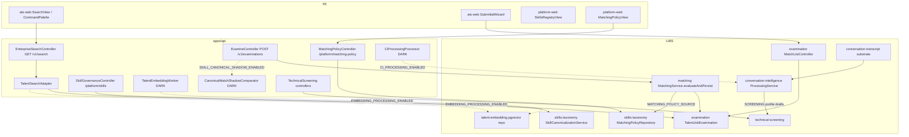

# D11 — Search, Matching, Skills & Intelligence (AS-BUILT)
> Refreshed from baseline 12330b0f (2026-10-09) to 680907fc (2026-10-24): matching now runs under a platform-owned, versioned MatchingPolicy, examine dropped its trust-ledger routing, CI gained a screening analysis profile plus a Teams transcript provider, the TIP-E2E INC-2 read-seam ports landed, and Talent Intelligence was split into an independent service (ADR-0036); search, embedding, examination, reporting and metering code is unchanged.

> Baseline SHA 680907fc06620845944794e0a529918c980f5124 · category AS-BUILT

## Summary

D11 covers the backend intelligence surfaces: enterprise search (lexical +
dark semantic/pgvector), the deterministic entrustability matching engine, its
platform-owned calibration (MatchingPolicy) and immutable examination
snapshots, the canonical skills taxonomy registry + deterministic
canonicalization, Conversation Intelligence (CI, ADR-0031) with its transcript
substrate and its new screening analysis profile, the TIP-E2E INC-2 Talent
Intelligence read-seam ports, the independent Talent Intelligence service
(`apps/talent-intelligence-service`, ADR-0036) and its ATS integration, the
operational reporting/dashboard aggregator, and the usage-metering leaf.

Three capabilities ship DARK (fail-closed behind an env flag that must equal the
exact string `"true"`): semantic embedding search (`EMBEDDING_PROCESSING_ENABLED`,
`apps/api/src/embedding/embedding-processing.config.ts:14`), CI processing
(`CI_PROCESSING_ENABLED`, `apps/api/src/conversation-intelligence/ci-processing.config.ts:46`),
and the canonical-match shadow observer (`SKILL_CANONICAL_SHADOW_ENABLED`,
`apps/api/src/examinations/canonical-match-shadow.config.ts:15`). The ATS ↔ TI
integration is inert unless `INTELLIGENCE_SERVICE_URL` is configured and a
tenant holds the `intelligence` capability
(`libs/intelligence-integration/src/lib/intelligence-config.ts:58`,
`libs/intelligence-integration/src/lib/intelligence-publisher.handler.ts:88`);
cross-tenant TI reads are additionally gated by `TI_CROSS_TENANT_READ_ENABLED`
(default false, `libs/intelligence-core/src/lib/access/profile-read.service.ts:43`).
The matching engine itself is live and synchronous via the examine endpoint; its
BullMQ "match" queue worker exists but has no production enqueue trigger.

All intelligence output is governed by R10 (no portal-forbidden ordinal/match
output reaches a talent-facing surface) and by two walls: the Pipeline-
Intelligence ⊥ ATS wall (ADR-0029) — `libs/examination` reads requisition state
only through the `RequisitionStateReader` port, never importing
`@aramo/job-domain` (`libs/examination/src/lib/examination.module.ts:17-21`) —
and the ATS ⊥ Talent Intelligence wall (ADR-0036): `scope:ats` and `scope:cip`
may never depend on `scope:intelligence`, and `scope:intelligence` may depend
only on `scope:intelligence` + `scope:shared` (`eslint.config.mjs:80`, `:83`,
`:89`).

## Modules & Services

| name | role | evidence path:line + symbol |
|---|---|---|
| `libs/matching` MatchingModule | Entrustability engine + persistence orchestrator; registers BullMQ `match` queue | `libs/matching/src/lib/matching.module.ts:41` `MatchingModule` |
| matching engine | Pure deterministic tier classifier (ENTRUSTABLE / WORTH_CONSIDERING / STRETCH), parameterised by a MatchingPolicy | `libs/matching/src/lib/engine.ts:82` `evaluateEntrustability` |
| MatchingPolicy (matching lib) | Compiled §2.5 defaults + `MATCHING_POLICY_SOURCE` port + threshold parser | `libs/matching/src/lib/matching-policy.ts:117` `MATCHING_POLICY_SOURCE` |
| MatchingService | Resolves the ACTIVE policy, runs engine, derives delta_to_entrustable, persists snapshot | `libs/matching/src/lib/matching.service.ts:124` `evaluateAndPersist`; `:98` `resolvePolicy` |
| MatchingProcessor | BullMQ `match` worker; Redis-gated; no production enqueue trigger | `libs/matching/src/lib/matching.processor.ts:44` `MatchingProcessor` |
| MatchingPolicyRepository (skills-taxonomy lib) | Versioned, append-only platform policy store; exactly one ACTIVE | `libs/skills-taxonomy/src/lib/matching-policy.repository.ts:57` |
| MatchingPolicyModule (apps/api, @Global) | `/platform/matching-policy*` routes + `StoreMatchingPolicySource` binding | `apps/api/src/matching-policy/matching-policy.module.ts:24`; `apps/api/src/matching-policy/matching-policy.source.ts:16` |
| `libs/examination` ExaminationModule | Immutable examination snapshot store + match-list + override HTTP | `libs/examination/src/lib/examination.module.ts:32` `ExaminationModule` |
| MatchListController | `GET /v1/jobs/{job_id}/matches` ranked Live List (Summary-only, recruiter-only) | `libs/examination/src/lib/match-list.controller.ts:80` `MatchListController` |
| OverrideController | `POST /v1/examinations/{examination_id}/overrides` (write-isolated) | `libs/examination/src/lib/override.controller.ts:61` `OverrideController` |
| ExamineController (apps/api) | `POST /v1/examinations` mints a snapshot: visibility-scoped requisition → extract → sync matching | `apps/api/src/controllers/examine.controller.ts:81` `ExamineController` |
| CanonicalMatchShadowComparator | Dark, best-effort canonical-vs-name observer post-mint | `apps/api/src/examinations/canonical-match-shadow.comparator.ts:19` |
| `libs/skills-taxonomy` SkillsTaxonomyModule | Canonical Skill registry, aliases, versions, relationships, governance, canonicalization, MatchingPolicy store | `libs/skills-taxonomy/src/lib/skills-taxonomy.module.ts:104` `SkillsTaxonomyModule` |
| SkillCanonicalizationService | Deterministic, read-only, no-LLM surface-form → canonical resolver | `libs/skills-taxonomy/src/lib/skill-canonicalization.service.ts:61` `resolve` |
| SkillCanonicalizationProcessor | BullMQ worker that RESOLVES only (persists nothing) | `libs/skills-taxonomy/src/lib/skill-canonicalization.processor.ts:70` `process` |
| SkillGovernanceController (apps/api) | `/platform/skill*` admin + AI-proposal ratification console | `apps/api/src/skill-governance/skill-governance.controller.ts:69` `SkillGovernanceController` |
| `libs/talent-embedding` TalentEmbeddingModule | pgvector repository behind two string-token ports (write + semantic read) | `libs/talent-embedding/src/lib/talent-embedding.module.ts:12` `TalentEmbeddingModule` |
| EnterpriseSearchModule (apps/api) | `GET /v1/search` orchestrator over 4 entity adapters | `apps/api/src/search/enterprise-search.module.ts:27` `EnterpriseSearchModule` |
| TalentSearchAdapter | exact-email + name + resume-FTS + dark semantic leg; fail-soft | `apps/api/src/search/adapters/talent-search.adapter.ts:49` `TalentSearchAdapter` |
| `libs/conversation-intelligence` | CI run (REQUISITION or SCREENING profile) + immutable requisition snapshot + claims/citations/draft | `libs/conversation-intelligence/src/lib/conversation-intelligence.module.ts:64` `ConversationIntelligenceModule` |
| ConversationIntelligenceProcessingService | Evidence-grounded, human-in-loop AI run; stops at `completed`; `processScreening` for the screening profile | `libs/conversation-intelligence/src/lib/conversation-intelligence-processing.service.ts:267` `process`; `:121` `processScreening` |
| CiProcessingModule (apps/api) | Binds CI ports (incl. screening context / finding sink / model) to concrete adapters; BullMQ worker; DARK | `apps/api/src/conversation-intelligence/ci-processing.module.ts:200` `CiProcessingModule` |
| `libs/conversation-transcript` | Provider-neutral transcript acquisition + normalization substrate; provider-neutral external-capture contract (no vendor wired) | `libs/conversation-transcript/src/lib/conversation-transcript.module.ts:41`; `libs/conversation-transcript/src/lib/live/external-capture.contract.ts:1` |
| ConversationTranscriptZoomModule (apps/api) | Registers Zoom + Teams providers and WEBVTT + Teams parsers into the registries | `apps/api/src/conversation-transcript/conversation-transcript-zoom.module.ts:71-77` |
| `libs/technical-screening` (scope:ats) | Screening session/findings/questions/notes/suggestions; AI question plan + follow-ups (ai_processing-gated) | `libs/technical-screening/src/lib/technical-screening.service.ts:68`; `libs/technical-screening/src/lib/ai/screening-ai.service.ts:119` |
| `libs/talent-intelligence` (scope:ats) | TIP-E2E INC-2 read-seam contracts: 3 ports + DI tokens + neutral shapes | `libs/talent-intelligence/src/index.ts:1` |
| TalentIntelligenceReadModule (apps/api) | Concrete adapters for the 3 INC-2 ports; consumed by Talent-360 and the screening context reader | `apps/api/src/app.module.ts:273`; `apps/api/src/talent-intelligence/talent-dossier-read.adapter.ts` |
| `apps/talent-intelligence-service` (scope:intelligence) | Independent TI deployable (port 3004), own DB `aramo_intelligence` | `apps/talent-intelligence-service/src/main.ts:15`; `apps/talent-intelligence-service/src/app/app.module.ts:36` |
| `libs/intelligence-core` (scope:intelligence) | Golden identity resolution, assertions, projection/trust, verification, disputes/proposals, outbox | `libs/intelligence-core/src/lib/intelligence-core.module.ts:80` `IntelligenceCoreModule` |
| `libs/intelligence-contracts` (scope:shared) | Event/API DTOs, admission catalogue, ingest validator, webhook auth | `libs/intelligence-contracts/src/lib/events.ts:14` |
| `libs/intelligence-integration` (scope:ats) | ATS-side publisher, inbound sync, entitlement sync, webhook receiver, backfill, worker loops | `libs/intelligence-integration/src/lib/intelligence-integration.module.ts:45`; `libs/intelligence-integration/src/lib/intelligence-publisher.handler.ts:58` |
| `libs/reporting` ReportingModule | ATS-INTERNAL read aggregator (Core/examination/matching seam-excluded) | `libs/reporting/src/lib/reporting.module.ts:65` `ReportingModule` |
| ReportingController | 16 operational report routes under `/v1/reports` | `libs/reporting/src/lib/reporting.controller.ts:62` `ReportingController` |
| DashboardController | `GET /v1/dashboard` composition route | `libs/reporting/src/lib/dashboard.controller.ts:38` `DashboardController` |
| `libs/metering` recordUsage | PrismaPromise INSERT into `metering."UsageEvent"`, composed into caller's tx | `libs/metering/src/lib/record-usage.ts:45` `recordUsage` |

## Data Models

| schema model | evidence path:line | notes |
|---|---|---|
| `examination.TalentJobExamination` | `libs/examination/prisma/schema.prisma:82` | Immutable analytical snapshot; nested analysis as Json; DB immutability trigger; three version pins NOT NULL |
| `examination.ExaminationOverride` | `libs/examination/prisma/schema.prisma:192` | Append-only recruiter annotation; absolute-immutability trigger; never mutates the examination row |
| `examination.CanonicalMatchShadowObservation` | `libs/examination/prisma/schema.prisma:226` | Append-only DARK telemetry; `match_class` closed vocab; never read by matching, never on an API response |
| enums `ExaminationTrigger` / `ExaminationTier` / `ExaminationLifecycleState` / `OverrideType` | `libs/examination/prisma/schema.prisma:41,56,67,169` | Closed enums per Group 2 §2.4 |
| `skills-taxonomy.Skill` (+ `SkillAlias`, `SkillVersion`, `SkillRelationship`, `SkillGovernanceProposal`, `SkillCorrectionTask`, `SkillAuditEvent`) | `libs/skills-taxonomy/prisma/schema.prisma:26,96,121,146,174,208,71` | Platform-global canonical taxonomy; `normalized_name` collision key |
| `skills_taxonomy.MatchingPolicyVersion` + `MatchingPolicyAuditEvent` | `libs/skills-taxonomy/prisma/schema.prisma:242,269` | Platform-global (no tenant_id); DRAFT/ACTIVE/RETIRED; content immutable by trigger; one-ACTIVE partial unique index; version 1 seeded with the compiled defaults (`libs/skills-taxonomy/prisma/migrations/20261023140000_matching_policy/migration.sql:26`, `:48`, `:88`) |
| `talent_embedding.TalentEmbedding` + enum `TalentEmbeddingStatus` | `libs/talent-embedding/prisma/schema.prisma:33,24` | pgvector vector column; lifecycle pending → ready | failed |
| `conversation_intelligence.ConversationIntelligenceRun` (+ `...Claim`, `...Citation`, `...Draft`, `RequisitionAnalysisContextSnapshot`) | `libs/conversation-intelligence/prisma/schema.prisma:139,191,218,240,58` | Immutable run + claims + transcript-span citations + draft carrier; `analysis_profile` (REQUISITION/SCREENING), nullable snapshot id, `screening_session_id`, `screening_context_sha256` (`libs/conversation-intelligence/prisma/migrations/20261016150000_inc3_a1_ci_screening_profile/migration.sql:16`) |
| `conversation_transcript.ConversationTranscript` (+ enums `TranscriptState`/`TranscriptCustodyMode`/`TranscriptSourceType`/`TranscriptRecordingDependency`) | `libs/conversation-transcript/prisma/schema.prisma:112,51,73,88,99` | Metadata + integrity hashes; bodies by reference in object storage |
| `technical_screening.*` — 10 models (`ScreeningSession`, `ScreeningFinding`, `ScreeningFindingCitation`, `ScreeningAiGeneration`, `ScreeningQuestion`, `ScreeningNote`, `ScreeningAssistSuggestion`, `ScreeningTranscriptLink`, `ScreeningEvidencePublication`, `ScreeningEvent`) | `libs/technical-screening/prisma/schema.prisma:33,67,94,111,133,153,167,185,200,222` | Field-level detail NOT read; 2 migrations |
| `intelligence.*` (separate DB `aramo_intelligence`) — 26 models incl. `GoldenTalent`, `SubjectIdentifier`, `ExternalTalentReference`, `Assertion`, `EvidenceArtifact`, `IdentityConflict`, `MergeSplitEvent`, `IntelligenceInbox`, `IntelligenceOutbox`, `ServiceClient`, `VerificationRequest`, `SubjectTrustState`, `EntitledTenant`, `AssertionDispute`, `VerificationProposal` | `libs/intelligence-core/prisma/schema.prisma:49,84,120,150,235,297,319,337,370,401,421,458,483,553,634` | 4 migrations; field-level detail NOT read |
| `talent_record.TalentEventOutbox` / `IntelligenceLink` / `TalentIntelligenceInboundEvent` / `TalentIntelligenceSyncPolicy` (ATS side) | `libs/talent-record/prisma/schema.prisma:229,473,491,514` | ATS outbox + link + inbound inbox + per-tenant sync policy (owned by D05; listed for the integration flow) |
| `metering.UsageEvent` | `libs/metering/prisma/schema.prisma:40` | General usage stream; free-string `event_type` |

Matching (`libs/matching`) and Reporting (`libs/reporting`) own ZERO prisma
schemas (0 migration dirs each); matching persists through
`examination.TalentJobExamination` and reads its calibration through the
`MATCHING_POLICY_SOURCE` port; reporting reads ATS-side domain schemas.
Version pins are greenfield constants, not a DB registry
(`libs/matching/src/lib/dto/version-pins.ts:18`).

## API Endpoints

| method | route | scopes / auth | evidence |
|---|---|---|---|
| GET | `/v1/jobs/{job_id}/matches` | JwtAuthGuard + per-route `consumer_type==='recruiter'`; empty-list (not 404) when no active requisition | `libs/examination/src/lib/match-list.controller.ts:89` |
| POST | `/v1/examinations/{examination_id}/overrides` | recruiter-only; Idempotency-Key required; `examination_mutated:false` literal | `libs/examination/src/lib/override.controller.ts:67` |
| POST | `/v1/examinations` | JwtAuthGuard + EntitlementGuard(`ats`) + RolesGuard; `examination:create` + `@RequireSiteMatch`; recruiter-only; requisition resolved under actor visibility (404 out-of-visibility) + server-side site assertion | `apps/api/src/controllers/examine.controller.ts:94` |
| GET | `/v1/search` | JwtAuthGuard + EntitlementGuard(`ats`) + RolesGuard; per-entity `<domain>:search` scope enforced inside orchestrator | `apps/api/src/search/enterprise-search.controller.ts:29` |
| GET | `/v1/reports/*` (16 routes incl. tenant-counts, pipeline-rollup, fill-performance, margin, fallthrough, recruiting-funnel, hiring-funnel, source-effectiveness) | `report:read` (+ `assignment:commercials:read` compound on `/margin`) + tenant/site/A3 | `libs/reporting/src/lib/reporting.controller.ts:65-487` |
| GET | `/v1/dashboard` | `dashboard:read` + capability `ats` + site match | `libs/reporting/src/lib/dashboard.controller.ts:41` |
| GET/POST/PATCH/DELETE | `/platform/skills*`, `/platform/skill-proposals*`, `/platform/skill-review-queue` (23 handlers) | `platform:skill:read` / `platform:skill:manage` + `consumer_type==='platform'` | `apps/api/src/skill-governance/skill-governance.controller.ts:80-447` |
| GET | `/platform/matching-policy` | `platform:matching_policy:read`; platform tier only | `apps/api/src/matching-policy/matching-policy.controller.ts:47` |
| POST | `/platform/matching-policy/versions` | `platform:matching_policy:write` | `apps/api/src/matching-policy/matching-policy.controller.ts:63` |
| POST | `/platform/matching-policy/versions/:id/activate` | `platform:matching_policy:write` | `apps/api/src/matching-policy/matching-policy.controller.ts:90` |
| POST/GET/PATCH/DELETE | `/v1/talent-records/:talentId/screening-sessions` (2) + `/v1/screening-sessions/:id/*` (18): meeting, capture-modes, transcripts/check, questions(/generate), notes, suggestions, findings(/review), confirm, void, publish, citation excerpt | capability `ats` + `screening:read` / `:edit` / `:confirm` / `:transcript:read` (+ `communication:meeting:create` on `/meeting`) | `apps/api/src/technical-screening/technical-screening.controller.ts:363`, `:434` |
| POST | `/v1/integrations/intelligence/events` | HMAC-signed TI webhook (no JWT); single idempotent inbox insert | `apps/api/src/integrations/intelligence/intelligence-events.controller.ts:21` / `:25` |
| (TI service) 28 handlers: `POST /v1/oauth/token`; `POST /v1/entitlements/sync`; `POST /v1/ingest/talent` + `/erased`; `GET /v1/references/:source_system_id/:source_tenant_id/:external_talent_id/{profile,evidence,artifacts,verifications}` + contradiction resolution; `/v1/verifications` (3); `/v1/disputes` (10); `/v1/proposals/:id/{dismiss,act}`; `/v1/tenants/:source_tenant_id/{disputes,proposals}` (3); `GET /health` | `ServiceTokenGuard` (client-credentials token, per-route intelligence scopes) | `apps/talent-intelligence-service/src/app/ingest/ingest.controller.ts:49`; `apps/talent-intelligence-service/src/app/references/references.controller.ts:50` |

No HTTP route exists for CI runs, transcripts, embeddings, or the matching
queue: CI/embedding are async processors, the transcript substrate exposes no
controller (`libs/conversation-transcript/src/lib/conversation-transcript.module.ts:13-17`),
and matching runs sync through ExamineController. The INC-2 read-seam ports
expose no route of their own (consumed by `GET /v1/talent-360/:talentId`).

## Screens & FE→BE Wiring (FE domains only)

| FE surface | app | calls | evidence |
|---|---|---|---|
| Enterprise search (SearchView + CommandPalette) | ats-web | `GET /v1/search` | `apps/ats-web/src/search/enterprise-search-api.ts`, `SearchView.tsx`, `CommandPalette.tsx` |
| Submittal wizard match lookup | ats-web | `GET /v1/jobs/{id}/matches` (filters by talent_id client-side) | `apps/ats-web/src/submittals/submittals-api.ts:147` `findMatchesForRequisition` |
| Reporting views (counts, fill-performance, margin, fallthrough, guarantee-exposure, assignment-pipeline) | ats-web | `GET /v1/reports/*` | `apps/ats-web/src/reporting/*-api.ts` |
| Dashboard | ats-web | `GET /v1/dashboard` | `apps/ats-web/src/dashboard/` |
| Skills registry/governance console | platform-web | `/platform/skills*` | `apps/platform-web/src/skills/skills-api.ts:128`, `SkillsRegistryView.tsx` |
| Matching policy console | platform-web | `/platform/matching-policy*` | `apps/platform-web/src/matching/matching-policy-api.ts:4`; `apps/platform-web/src/App.tsx:181` route `/matching` |
| Technical screening (Talent 360 + Talent × Requisition 360 tabs) | ats-web | `/v1/talent-records/:id/screening-sessions`, `/v1/screening-sessions/*` | `apps/ats-web/src/technical-screening/technical-screening-api.ts:187`; `apps/ats-web/src/talent-360/t360-screening.tsx` |

No FE app POSTs to `/v1/examinations` (the examine/mint endpoint) or to
`/v1/examinations/{id}/overrides` at this SHA (`git grep -n 'v1/examinations' 680907fc -- apps/ats-web/src apps/platform-web/src apps/home-web/src`
returns zero non-test hits).

## Key Flows

### Component map — search / intelligence pipeline



### Examine → deterministic matching → immutable snapshot (synchronous)

```mermaid
sequenceDiagram
  participant R as Recruiter (JWT)
  participant EXC as ExamineController
  participant TX as TalentExtractionService
  participant MS as MatchingService
  participant PS as MATCHING_POLICY_SOURCE (StoreMatchingPolicySource)
  participant EN as engine.evaluateEntrustability
  participant REPO as ExaminationRepository
  R->>EXC: POST /v1/examinations {talent_id, requisition_id}
  EXC->>EXC: guards: ats capability + examination:create + site; recruiter-only
  EXC->>EXC: resolve requisition under actor visibility (404) + site assertion (403) → golden_profile_id (422 if none)
  EXC->>TX: lazy+idempotent extractDeclaredEvidence (if none)
  EXC->>MS: evaluateAndPersist(buildMatchingInput(...))
  MS->>PS: getActivePolicy() (null → compiled §2.5 defaults)
  MS->>EN: evaluateEntrustability(input, policy)
  EN-->>MS: {tier, hard_failures, soft_failures}
  MS->>REPO: createSnapshot(tier, delta_to_entrustable, pins)
  REPO-->>MS: TalentJobExaminationRow
  MS-->>EXC: row
  EXC->>EXC: CanonicalMatchShadowComparator.observe (DARK, swallowed)
  EXC-->>R: {examination_id, tier, live_list_visible:true}
```

### Talent semantic search leg (dark-gated, fail-soft)

```mermaid
sequenceDiagram
  participant A as TalentSearchAdapter
  participant C as EmbeddingProcessingConfig
  participant E as EMBEDDING_PORT (OpenAiEmbeddingProvider)
  participant V as TALENT_EMBEDDING_SEARCH_PORT (pgvector)
  participant T as TalentRecordRepository
  A->>A: exact-email + name + resume-FTS legs (always)
  A->>C: isEnabled()?
  alt EMBEDDING_PROCESSING_ENABLED=="true"
    A->>E: embed(query)
    E-->>A: vector
    A->>V: searchSemanticForActor(tenant/site co-located)
    V-->>A: matches (id + distance)
    A->>T: findById hydrate (record_status==='live')
    A->>A: merge semantic band (below lexical); any failure swallowed
  else dark / failure
    A->>A: return exact+lexical unchanged
  end
```

### ATS ↔ Talent Intelligence integration (ADR-0036)

```mermaid
sequenceDiagram
  participant ATS as apps/api (ATS write path)
  participant OB as talent_record.TalentEventOutbox
  participant PUB as IntelligencePublisherHandler (worker)
  participant TI as talent-intelligence-service
  participant WH as POST /v1/integrations/intelligence/events
  participant IN as IntelligenceInboundSyncService
  ATS->>OB: talent.created / talent.profile_updated / talent.erased (ids only)
  PUB->>OB: drain (ATS_TALENT_EVENTS_DRAIN_ENABLED=1)
  alt tenant lacks intelligence capability
    PUB->>PUB: outcome NOT_ENTITLED
  else
    PUB->>TI: POST /v1/ingest/talent (service token, allowlisted payload)
  end
  TI-->>WH: golden_talent.profile_updated (HMAC-signed)
  WH->>WH: verify signature → inbox insert (idempotent)
  IN->>TI: GET /v1/references/{sys}/{tenant}/{talent}/profile
  IN->>IN: apply per-tenant sync policy; conflicts → review; record IntelligenceLink
```

## Evidence Index

- `libs/matching/src/lib/engine.ts:52` `EVIDENCE_THRESHOLDS` (= `DEFAULT_EVIDENCE_THRESHOLDS`; architect=3)
- `libs/matching/src/lib/engine.ts:82` `evaluateEntrustability` pure engine (input, policy)
- `libs/matching/src/lib/engine.ts:238` tier classification (hard>0→STRETCH; soft>0→WORTH_CONSIDERING; else ENTRUSTABLE)
- `libs/matching/src/lib/matching-policy.ts:38` `DEFAULT_EVIDENCE_THRESHOLDS` (compiled §2.5 calibration)
- `libs/matching/src/lib/matching-policy.ts:69` `parseEvidenceThresholds`
- `libs/matching/src/lib/matching-policy.ts:117` `MATCHING_POLICY_SOURCE`
- `libs/matching/src/lib/matching.service.ts:98` `resolvePolicy` (ACTIVE version or defaults; store error propagates)
- `libs/matching/src/lib/matching.service.ts:124` `evaluateAndPersist`
- `libs/matching/src/lib/matching.service.ts:57` `buildDeltaToEntrustable`
- `libs/matching/src/lib/matching.processor.ts:71` `onApplicationBootstrap` Redis-gated worker registration
- `libs/matching/src/lib/matching.module.ts:90` `BullModule.registerQueue({ name: MATCH_QUEUE_NAME })`
- `libs/matching/src/lib/dto/version-pins.ts:18` greenfield version-pin constants
- `libs/skills-taxonomy/prisma/schema.prisma:242` `MatchingPolicyVersion`
- `libs/skills-taxonomy/prisma/migrations/20261023140000_matching_policy/migration.sql:48` one-ACTIVE partial unique index
- `libs/skills-taxonomy/src/lib/matching-policy.repository.ts:118` `activateVersion`
- `apps/api/src/matching-policy/matching-policy.controller.ts:40` `@Controller('platform')`
- `apps/api/src/matching-policy/matching-policy.source.ts:19` `getActivePolicy`
- `apps/api/src/app.module.ts:488` `MatchingPolicyModule` imported at composition root
- `libs/examination/prisma/schema.prisma:82` `TalentJobExamination`
- `libs/examination/prisma/schema.prisma:192` `ExaminationOverride`
- `libs/examination/prisma/schema.prisma:226` `CanonicalMatchShadowObservation`
- `libs/examination/src/lib/match-list.controller.ts:89` `GET :job_id/matches` (Summary-only, recruiter-only)
- `libs/examination/src/lib/match-list.controller.ts:115` `requisitionState.isActive` port call
- `libs/examination/src/lib/override.controller.ts:159` `examination_mutated:false` literal
- `libs/examination/src/lib/examination.module.ts:17-21` CIP⊥ATS via RequisitionStateReader port (no `@aramo/job-domain` import)
- `apps/api/src/controllers/examine.controller.ts:94` `@Post()` with `examination:create` + `@RequireSiteMatch`
- `apps/api/src/controllers/examine.controller.ts:247` sync `matchingService.evaluateAndPersist`
- `apps/api/src/controllers/examine.controller.ts:254` `canonicalMatchShadow.observe` post-mint
- `apps/api/src/examinations/canonical-match-shadow.config.ts:15` `SKILL_CANONICAL_SHADOW_ENABLED === 'true'`
- `libs/skills-taxonomy/src/lib/skill-canonicalization.service.ts:61` deterministic `resolve` (EXACT_CANONICAL → ALIAS → VERSION)
- `libs/skills-taxonomy/src/lib/normalize-skill-name.ts:15` `normalizeSkillName` (DO-NOT-TOUCH parity with talent-extraction)
- `libs/skills-taxonomy/src/lib/skill-canonicalization.processor.ts:76` resolve-only, persists nothing
- `libs/skills-taxonomy/src/lib/skills-taxonomy.module.ts:69` `registerQueue(SKILL_CANONICALIZATION_QUEUE_NAME)`
- `apps/api/src/skill-governance/skill-governance.controller.ts:468` `assertPlatform` (consumer_type==='platform')
- `apps/api/src/jobs/registration.ts:89` `skill-canonicalization-daily` 05:00 UTC cron (empty scan until fed)
- `apps/api/src/jobs/registration.ts:119` `talent-embedding-300s` tick (DARK)
- `libs/talent-embedding/src/lib/talent-embedding-search.port.ts:18` `searchSemanticForActor` (visibility co-located in SQL)
- `libs/talent-embedding/src/lib/talent-embedding-status.ts:13` lifecycle statuses
- `libs/talent-embedding/prisma/schema.prisma:33` `TalentEmbedding`
- `apps/api/src/search/adapters/talent-search.adapter.ts:116` `embeddingConfig.isEnabled()` dark gate
- `apps/api/src/search/adapters/talent-search.adapter.ts:152` fail-soft catch (semantic never regresses base search)
- `apps/api/src/search/enterprise-search.controller.ts:29` `GET /v1/search`
- `apps/api/src/embedding/embedding-processing.config.ts:14` `EMBEDDING_PROCESSING_ENABLED === 'true'`
- `apps/api/src/embedding/embedding.module.ts:37` embedding boundary (dark worker + ports)
- `libs/conversation-intelligence/src/lib/conversation-intelligence-processing.service.ts:267` CI `process` (stops at completed)
- `libs/conversation-intelligence/src/lib/conversation-intelligence-processing.service.ts:304` ai_processing authz fail-closed before any model call
- `libs/conversation-intelligence/src/lib/conversation-intelligence-processing.service.ts:121` `processScreening` (fails closed when screening seams unbound, `:128`)
- `libs/conversation-intelligence/src/lib/analysis/screening-analysis.ts:17` `CI_ANALYSIS_PROFILE_SCREENING`
- `libs/conversation-intelligence/prisma/schema.prisma:58` `RequisitionAnalysisContextSnapshot`
- `libs/conversation-intelligence/prisma/schema.prisma:139` `ConversationIntelligenceRun`
- `apps/api/src/conversation-intelligence/ci-processing.config.ts:46` `CI_PROCESSING_ENABLED === 'true'`
- `apps/api/src/conversation-intelligence/ci-processing.module.ts:62` CI composition `@Module` (model provider + screening adapters `:132-138`, DARK)
- `libs/conversation-transcript/prisma/schema.prisma:112` `ConversationTranscript`
- `libs/conversation-transcript/src/lib/conversation-transcript.module.ts:13` provider registry ships EMPTY, no controller
- `apps/api/src/conversation-transcript/conversation-transcript-zoom.module.ts:71` Zoom + Teams providers registered at bootstrap
- `libs/conversation-transcript/src/lib/live/external-capture.contract.ts:6` no capture vendor approved; fake adapter only
- `libs/technical-screening/src/lib/ai/screening-ai.service.ts:256` `assertAiProcessing` (fail closed)
- `apps/api/src/technical-screening/technical-screening.controller.ts:434` `@Controller('v1/screening-sessions')`
- `libs/talent-intelligence/src/lib/ports/talent-dossier-read.port.ts:8` `TALENT_DOSSIER_READ_PORT` (TI-backed, fail-soft)
- `apps/api/src/talent-intelligence/talent-dossier-read.adapter.ts` `TalentDossierReadAdapter` (advisory_pointers always empty)
- `eslint.config.mjs:83` `scope:ats` not-depend-on `scope:intelligence`
- `eslint.config.mjs:89` `scope:intelligence` → `scope:intelligence` + `scope:shared` only
- `apps/talent-intelligence-service/src/main.ts:15` default port 3004
- `libs/intelligence-core/prisma/schema.prisma:49` `GoldenTalent`
- `libs/intelligence-core/prisma/schema.prisma:120` `ExternalTalentReference`
- `libs/intelligence-core/src/lib/access/profile-read.service.ts:43` `TI_CROSS_TENANT_READ_ENABLED` (default false)
- `libs/intelligence-integration/src/lib/intelligence-publisher.handler.ts:88` `NOT_ENTITLED` short-circuit
- `libs/intelligence-integration/src/lib/intelligence-integration.worker.ts:31` loops run only in the worker process
- `libs/intelligence-integration/src/lib/intelligence-inbound-sync.service.ts:70` `drainOnce`
- `apps/api/src/integrations/intelligence/intelligence-events.controller.ts:25` `POST events`
- `libs/reporting/src/lib/reporting.module.ts:50-57` seam-exclusion (zero Core/selection/submittal/examination/matching imports)
- `libs/reporting/src/lib/reporting.controller.ts:62` `ReportingController` (16 routes)
- `libs/reporting/src/lib/dashboard.controller.ts:41` `GET /v1/dashboard`
- `libs/metering/src/lib/record-usage.ts:45` `recordUsage` composed into caller tx
- `libs/metering/prisma/schema.prisma:40` `metering.UsageEvent`
- `apps/ats-web/src/submittals/submittals-api.ts:147` FE `findMatchesForRequisition`
- `apps/platform-web/src/skills/skills-api.ts:128` FE `/platform/skills`
- `apps/platform-web/src/matching/matching-policy-api.ts:4` FE `/platform/matching-policy*`
- `apps/api/src/app.module.ts:229` `MatchingModule` imported at composition root

## NOT VERIFIED

- Whether pgvector / the GS-2A embedding migration is applied in any running
  environment (code is dark-gated; MEMORY notes PROD semantic DARK). Not
  derivable from code at this SHA.
- The `libs/matching` "match" BullMQ queue has a worker
  (`libs/matching/src/lib/matching.processor.ts:44`) but NO production enqueue
  trigger was found (explicitly out of scope per the module header
  `libs/matching/src/lib/matching.module.ts:36-40`); whether any live caller
  enqueues to `MATCH_QUEUE_NAME` is NOT VERIFIED (none found in non-test source).
- Whether CI (`conversation-intelligence`) runs in any environment: the Zoom and
  Teams transcript providers are registered at bootstrap
  (`apps/api/src/conversation-transcript/conversation-transcript-zoom.module.ts:71-77`),
  but acquisition is env/credential/consent-gated and CI processing is dark;
  activation state is NOT VERIFIED from code.
- Talent Intelligence service internals (identity resolution, projection/trust
  derivation, dispute lifecycle, verification OTP) were catalogued by file and
  route only; the 26 `intelligence` models and the 10 `technical_screening`
  models were enumerated at declaration line, not read field-by-field. Whether
  the TI service, its database, or the `intelligence` capability are deployed or
  granted anywhere is NOT derivable from code.
- Exact seeded role→scope membership for `report:read` / `dashboard:read` /
  `platform:skill:*` / `platform:matching_policy:*` / `examination:create` /
  `screening:*` not re-derived here (seed file not opened in this pass).
