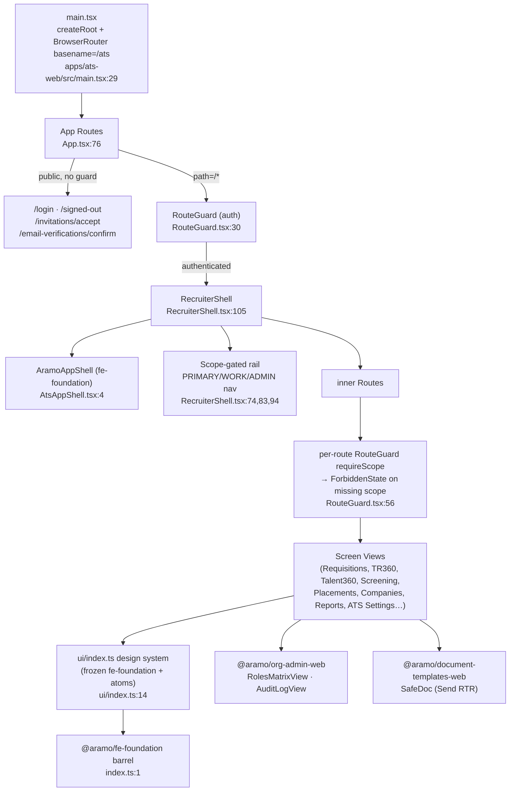
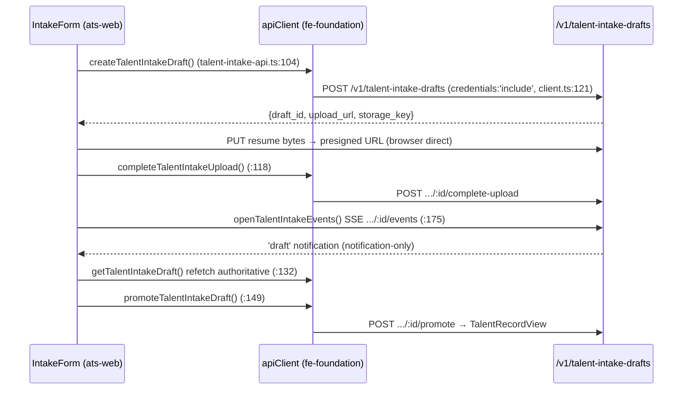
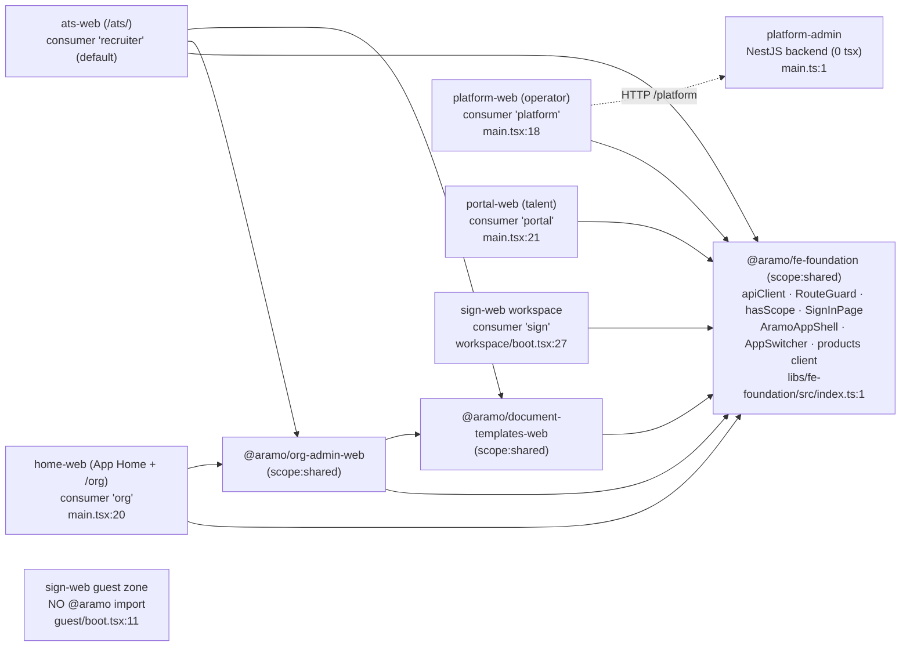
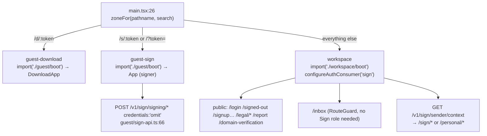

# D13 — Frontend Architecture & Screen Inventory (AS-BUILT)
> Refreshed from baseline 12330b0f (2026-10-09) to 680907fc (2026-10-24): a fifth SPA (`apps/home-web`, App Home + Organization at `/org/*`) and two shared FE libs (`libs/org-admin-web`, `libs/document-templates-web`) were added, ats-web moved to `/ats/` and gave its org-wide settings to `/org/*`, sign-web became the one Aramo Sign app (guest zone + fe-foundation workspace), platform-web gained document-template, matching and Personal-review screens, and fe-foundation gained the shared multi-product shell, sign-in page and product-availability client.

> Baseline SHA 680907fc06620845944794e0a529918c980f5124 · category AS-BUILT · generated by read-only recon

## Summary

At baseline `680907fc` the platform ships **five browser SPAs**, **two shared FE feature libraries**, the shared **`@aramo/fe-foundation`** library, and one app named like a FE that is actually a NestJS backend service:

- **`aramo-home-web`** (`apps/home-web`) — the App Home on the tenant host root (`/`), "My preferences" (`/preferences`) and Organization Administration (`/org/*`, rendered from `libs/org-admin-web`). Authenticates as the `org` consumer (`apps/home-web/src/main.tsx:20`). 13 `.tsx` + 5 `.ts` git-tracked files.
- **`aramo-ats-web`** (`apps/ats-web`) — the recruiter console (recruiter surface + ATS-owned settings), now served under `/ats/` (`apps/ats-web/vite.config.ts:38` `base: '/ats/'`; router `basename` at `apps/ats-web/src/main.tsx:31`). 428 `.tsx` + 263 `.ts` files; still the largest FE by an order of magnitude.
- **`aramo-platform-web`** (`apps/platform-web`) — the platform-operator console (tenant provisioning/lifecycle + Sign panel, skill governance, Aramo default document templates + variable catalog, matching policy, Personal review queue + invites). 42 `.tsx` + 12 `.ts`.
- **`aramo-portal-web`** (`apps/portal-web`) — the talent-facing privacy portal (records, verified identity, disputes, notice, erasure). 21 `.tsx` + 5 `.ts`; HTTP-only against `/v1/portal`. Source unchanged since the old baseline except `vite.config.ts`.
- **`aramo-sign-web`** (`apps/sign-web`) — the one Aramo Sign application on the Sign host, split into **zones** decided from the URL before any other code loads (`apps/sign-web/src/main.tsx:26`, `apps/sign-web/src/zones.ts:15`): the **guest** signing zone (`/s/:token`, `/d/:token`, legacy `/?token=`) that imports no `@aramo/*` library, and the **workspace** zone (sender console, Personal workspace, inbox, signup, legal, report, account close) that boots `@aramo/fe-foundation` as the `sign` consumer (`apps/sign-web/src/workspace/boot.tsx:27`). 49 `.tsx` + 16 `.ts`.
- **`libs/org-admin-web`** (`scope:shared`) — the Organization Administration route tree and pages (Overview, Profile, Users & invitations, Roles & access, Sites, Domain, Settings, Our templates, Template gallery, Audit) mounted by home-web (`libs/org-admin-web/src/OrgAdminRoutes.tsx:36`); also re-exports `RolesMatrixView`/`AuditLogView` consumed by ats-web (`libs/org-admin-web/src/index.ts:28`).
- **`libs/document-templates-web`** (`scope:shared`) — the shared document-template UI (safe HTML renderer, block editor, preview/approve modals, RTR template detail + draft editor, `/v1/document-templates` client), consumed by org-admin-web and by ats-web's Send RTR modal (`libs/document-templates-web/src/index.ts:1`; `apps/ats-web/src/rtr/SendRtrModal.tsx:3`).
- **`platform-admin`** (`apps/platform-admin`) — **NOT a frontend**. A NestJS backend service (`apps/platform-admin/src/main.ts:1`, `apps/platform-admin/src/app/app.module.ts:1`) with 0 `.tsx` files; it holds the `/platform/*` controllers consumed by `platform-web` (now including `platform-sign.controller.ts` and `platform-personal.controller.ts` under `apps/platform-admin/src/app/platform/`). `apps/sign-service` and `apps/talent-intelligence-service` are also backend apps (0 `.tsx`).

Every SPA except the sign-web guest zone shares the same chassis: a Vite entry mounts `createRoot` inside a `<BrowserRouter>` wrapping an `<App>` (`apps/home-web/src/main.tsx:30`; `apps/ats-web/src/main.tsx:29`; `apps/platform-web/src/main.tsx:25`; `apps/portal-web/src/main.tsx:28`; `apps/sign-web/src/workspace/boot.tsx:30`) and consumes **`@aramo/fe-foundation`** (`libs/fe-foundation/src/index.ts:1`) for the API client, session/auth, consumer binding, scope-gating, the shared sign-in page, the multi-product shell (`AramoAppShell`/`AramoRail`/`AppSwitcher`), the product-availability client (`GET /v1/me/products`) and the Radix-based component primitives. The sign-web guest zone is the exception: it boots without a router and without any `@aramo/*` import (`apps/sign-web/src/guest/boot.tsx:11`), enforced by `apps/sign-web/src/zones.spec.ts:27`. `fe-foundation` itself carries **no `@aramo/*` import** (0 matches for `from '@aramo/` under `libs/fe-foundation/src` at 680907fc) and side-effect-imports its own token/font CSS (`libs/fe-foundation/src/index.ts:10`).

**Auth consumer per SPA.** Each SPA binds its auth-service consumer with `configureAuthConsumer` before the first session fetch: home-web `org` (`apps/home-web/src/main.tsx:20`), platform-web `platform` (`apps/platform-web/src/main.tsx:18`), portal-web `portal` (`apps/portal-web/src/main.tsx:21`), sign-web workspace `sign` (`apps/sign-web/src/workspace/boot.tsx:27`). ats-web makes no `configureAuthConsumer` call and runs on the foundation default `'recruiter'` (`libs/fe-foundation/src/auth/consumer.ts:19`). The API client stamps `X-Aramo-Consumer` with the configured consumer on every call (`libs/fe-foundation/src/api/client.ts:116`).

**Authorization is scopes-only at the routing boundary, plus server-side product/org projections.** The session payload carries `Session.scopes: string[]` (`libs/fe-foundation/src/auth/session.ts:23`); the FE mirror is `hasScope(session, scope)` (`libs/fe-foundation/src/auth/scopes.ts:20`) plus a `requireScope` axis on `RouteGuard`. An authenticated session missing a required scope renders `<ForbiddenState>` — never a login redirect (`libs/fe-foundation/src/auth/RouteGuard.tsx:56`). Two newer surfaces gate on server projections rather than scopes: home-web/org-admin-web read `org_access` (`admin`/`templates`/`none`) from `GET /v1/me/products` (`libs/fe-foundation/src/platform/products.ts:23`; `libs/org-admin-web/src/OrgAdminRoutes.tsx:49`), and the sign-web workspace reads `GET /v1/sign/sender/context` (`apps/sign-web/src/workspace/api.ts:378`) and redirects to the backend-chosen workspace (`apps/sign-web/src/workspace/App.tsx:155`).

The ats-web design system layers on top of the frozen `fe-foundation` primitives: `ui/index.ts` re-exports frozen-themed primitives and adds app-layer atoms (`apps/ats-web/src/ui/index.ts:14`; `Card`/`CardHead` now re-exported from the foundation `SurfaceCard` at `:49`); `main.tsx` imports `theme.css` → `ui.css` → `settings.css` **after** the `fe-foundation` barrel so the `:root` token re-map wins on equal specificity (`apps/ats-web/src/main.tsx:11`). home-web follows the same load-order contract (`apps/home-web/src/main.tsx:11`). A lint-enforced **raw-element guard (G1/R2)** bans raw `<button>/<input>/<select>/<textarea>/<dialog>` in `apps/**` non-spec code (`eslint.config.mjs:39`, `:46`, block at `:285`); it does not apply to `libs/**`.

## Modules & Services

| Name | Role | Evidence (path:line · symbol) |
|------|------|-------------------------------|
| `apps/home-web` — App Home + Organization SPA | React/Vite SPA on the tenant host root; `/`, `/preferences`, `/org/*` inside `HomeShell`; any other path forwarded to `/ats<path>`. | `apps/home-web/src/App.tsx:21` `export function App`; `apps/home-web/src/main.tsx:20` `configureAuthConsumer('org')`; `:23` `configureAppBasePath('')` |
| `HomeShell` — home-web chrome | `AramoAppShell` + `AramoRail` + `AppSwitcher`; rail sections from server `org_access`. | `apps/home-web/src/shell/HomeShell.tsx:95` `HomeShell`; `:56` `homeRailSections`; `:125` `buildAppSwitcherItems` |
| `libs/org-admin-web` — Organization Administration lib | Route tree under `/org/*`; one section registry drives nav, breadcrumb and routes; access tier from `useOrgAccess`. | `libs/org-admin-web/src/OrgAdminRoutes.tsx:36` `OrgAdminRoutes`; `libs/org-admin-web/src/sections.ts:65` `ORG_SECTIONS`; `:99` `orgSectionsFor`; `libs/org-admin-web/src/access.ts:20` `useOrgAccess` |
| `libs/document-templates-web` — shared template UI lib | SafeDoc renderer, block editor, modals, `RtrTemplateDetail`/`RtrDraftEditor`, route-map provider. | `libs/document-templates-web/src/index.ts:9` `SafeDoc`; `:31` `RtrTemplateDetail`; `libs/document-templates-web/src/dt-routes.tsx:13` `ORG_DOC_TEMPLATE_ROUTES`; `:21` `DocTemplateRoutesProvider` |
| `apps/ats-web` — recruiter console SPA | React/Vite SPA at `/ats/`; `App` renders the full `<Routes>` tree inside `RecruiterShell`. | `apps/ats-web/src/App.tsx:76` `export function App`; `apps/ats-web/src/main.tsx:27` `configureAppBasePath(APP_BASE)`; `:29` `createRoot(...).render` |
| `RecruiterShell` — ats-web app chrome | Scope-gated rail (PRIMARY/WORK/ADMIN nav arrays) + top bar, composed on the shared `AramoAppShell` (re-exported as `AtsAppShell`). | `apps/ats-web/src/shell/RecruiterShell.tsx:105` `RecruiterShell`; `:74` `PRIMARY_NAV`; `:83` `WORK_NAV`; `:94` `ADMIN_NAV`; `apps/ats-web/src/shell/AtsAppShell.tsx:4` |
| `apps/ats-web/src/ui` — Confident Blue design system | Re-exports frozen `fe-foundation` primitives (themed via token re-map) + app-layer atoms. | `apps/ats-web/src/ui/index.ts:14` frozen re-exports; `:49` `SurfaceCard as Card` |
| `apps/platform-web` — platform-operator console SPA | App-level `platform:tenant:read` gate, then tenant, skill, document-template, matching and Personal routes inside `PlatformShell`. | `apps/platform-web/src/App.tsx:36` `export function App`; `:68` `RouteGuard requireScope="platform:tenant:read"`; `apps/platform-web/src/main.tsx:18` `configureAuthConsumer('platform')` |
| `apps/portal-web` — talent privacy portal SPA | Passwordless portal, records/verifications/disputes/notice/rights inside `PortalShell`; HTTP-only vs `/v1/portal`. | `apps/portal-web/src/App.tsx:26` `export function App`; `apps/portal-web/src/main.tsx:21` `configureAuthConsumer('portal')` |
| `apps/sign-web` — the one Aramo Sign app | URL-decided zone loader; guest bundle and workspace bundle are separate dynamic imports. | `apps/sign-web/src/main.tsx:16` `startWorkspace`; `:21` `startGuest`; `apps/sign-web/src/zones.ts:15` `zoneFor` |
| sign-web guest zone | Signer state machine (landing → disclosure → workspace → review → done, plus decline/invalid/expired/ended/notyet/network/error); signed-copy download app; no `@aramo/*` import; `credentials: 'omit'` on every call. | `apps/sign-web/src/guest/App.tsx:415` `export function App`; `apps/sign-web/src/guest/DownloadApp.tsx:24` `DownloadApp`; `apps/sign-web/src/guest/sign-api.ts:66` `fetch('/v1/sign/signing/…', {credentials:'omit'})` |
| sign-web workspace zone | Public entry routes, `/inbox`, and the BUSINESS `/sign/*` / PERSONAL `/personal/*` workspaces inside `ConsoleShell`. | `apps/sign-web/src/workspace/App.tsx:49` `App`; `:96` `Authenticated`; `:164` `Gate`; `apps/sign-web/src/workspace/shell.tsx:38` `ConsoleShell` |
| `apps/platform-admin` — NestJS backend service (NOT FE) | Platform `/platform/*` controllers + DTOs + sweepers; 0 `.tsx`; consumed by `platform-web`. | `apps/platform-admin/src/main.ts:1`; `apps/platform-admin/src/app/platform/platform.controller.ts:1` |
| `@aramo/fe-foundation` — domain-neutral FE foundation lib | Single barrel: `apiClient`/`ApiError`, session/auth, consumer + base-path binding, `hasScope`, `RouteGuard`, `SignInPage`/`AuthShell`, component primitives, `AppShell` kit, `AramoAppShell`/`AramoRail`/`AppSwitcher`, product availability, return context. No `@aramo/*` import. | `libs/fe-foundation/src/index.ts:1`; `:10` side-effect `tokens.css`; `:36` `SignInPage`; `:43` consumer exports; `:95` `export * from './ui'`; `:106` `AramoAppShell`; `:118` products exports |
| `fe-foundation` `AramoAppShell` / `AramoRail` — shared multi-product shell | Page grid + rail + collapse preference shared by home-web, org-admin-web and ats-web. | `libs/fe-foundation/src/aramo-shell/AramoAppShell.tsx:19` `AramoAppShell`; `libs/fe-foundation/src/aramo-shell/AramoRail.tsx:1` |
| `fe-foundation` `AppShell` — chrome kit | Rail, TopBar, Breadcrumb, CmdKSearch, NotificationButton, UserMenu built above the frozen `Shell`. | `libs/fe-foundation/src/ui/AppShell.tsx:54` `export function AppShell` |
| `fe-foundation` `apiClient` — cookie-bearing fetch wrapper | Sends HttpOnly session cookies (`credentials:'include'`) and `X-Aramo-Consumer`; parses the backend error taxonomy into `ApiError{status,code,details}`. | `libs/fe-foundation/src/api/client.ts:33` `ApiError`; `:61` `ApiClient`; `:116` consumer header; `:121` `credentials:'include'` |
| `fe-foundation` `RouteGuard` / `hasScope` — FE authz boundary | `RouteGuard` loading/unauth/forbidden triage + optional `requireScope`; `hasScope` is the single scope-lookup primitive. | `libs/fe-foundation/src/auth/RouteGuard.tsx:30` `RouteGuard`; `libs/fe-foundation/src/auth/scopes.ts:20` `hasScope` |
| `fe-foundation` `SignInPage` — shared sign-in screen | Rendered by the `LoginPage` of home-web, ats-web, platform-web and the sign-web workspace; `redirectToLogin` sends unauthenticated users to the app's own sign-in page. | `libs/fe-foundation/src/auth/SignInPage.tsx:260` `SignInPage`; `libs/fe-foundation/src/auth/session.ts:130` `redirectToLogin` |
| `fe-foundation` products client | `GET /v1/me/products` availability + `org_access`; `PRODUCT_CONSUMER` maps product → consumer. | `libs/fe-foundation/src/platform/products.ts:13` `MY_PRODUCTS_PATH`; `:92` `PRODUCT_CONSUMER`; `:117` `useMyProducts` |
| `libs/portal` — **backend** portal lib (not FE) | Nest controller/module serving `/v1/portal`; the `portal-web` SPA's server counterpart. Listed only to disambiguate the name. | `libs/portal/src/lib/portal.controller.ts:1`; `libs/portal/src/lib/portal.module.ts:1` |

## Data Models

D13 (frontend) owns **no persisted data model**; all shapes are TS view/DTO interfaces mirroring backend responses. Representative FE-owned view contracts:

| Name | Shape (abbrev.) | Evidence (path:line · symbol) |
|------|-----------------|-------------------------------|
| `TalentIntakeDraftView` | `id`, `source_filename`, `processing_status`, `review_status`, `review_payload`, `promoted_talent_record_id\|null`, `version`, `duplicate\|null`, `required`, `admissible`, `actions[]` | `apps/ats-web/src/talent/talent-intake-api.ts:61` `interface TalentIntakeDraftView` |
| `TalentIntakeField` | `value: string\|boolean\|null`, `origin: 'RESUME_EXTRACTION'\|'RECRUITER'` | `apps/ats-web/src/talent/talent-intake-api.ts:10` `interface TalentIntakeField` |
| `Session` (FE auth payload) | `sub`, `consumer_type: 'recruiter'\|'portal'\|'ingestion'\|'platform'\|'sign'\|'org'`, `tenant_id`, `scopes: string[]`, `iat`, `exp` | `libs/fe-foundation/src/auth/session.ts:16` `interface Session` |
| `ProductAvailabilityView` / `ProductAvailability` | `tenant_id`, `products[]{key: 'ats'\|'sign'\|'org'\|'intelligence', subscribed, authorized, available, entry_path, reason, org_access?}` | `libs/fe-foundation/src/platform/products.ts:25` `ProductAvailability`; `:40` `ProductAvailabilityView`; `:23` `OrgAccess` |
| `OrgSection` | `key`, `label`, `path`, `group: 'organization'\|'shared'`, `iconPath`, `templateAuthor?` | `libs/org-admin-web/src/sections.ts:30` `interface OrgSection` |
| `SenderContext` (sign-web workspace) | `user`, `tenant{id,name,kind}`, `workspace: 'sign'\|'personal'`, `permissions{read,create,send,…,templates?}`, `features?`, `can_send` | `apps/sign-web/src/workspace/api.ts:19` `interface SenderContext` |

## API Endpoints

D13 defines **no HTTP routes** (the FE apps are clients). It wires FE calls to backend `/v1/*` and `/platform/*` endpoints. Distinct path-token counts at 680907fc (non-spec source, `git grep -hoE '/v1/[a-zA-Z0-9_:/-]+' 680907fc -- <path> | sort -u | wc -l`): ats-web **235** (63 `*-api.ts` wiring modules); `libs/org-admin-web` 28; sign-web 26; portal-web 8; home-web 4; `libs/document-templates-web` 2; platform-web 1 (a comment at `apps/platform-web/src/shell/PlatformShell.tsx:26`) plus 10 distinct `'/platform/…` literals. Representative talent-intake wiring (`apps/ats-web/src/talent/talent-intake-api.ts`, base `/v1/talent-intake-drafts` at `:102`):

| Method | Route (client call) | Evidence (path:line · symbol) |
|--------|---------------------|-------------------------------|
| POST | `/v1/talent-intake-drafts` | `apps/ats-web/src/talent/talent-intake-api.ts:104` `createTalentIntakeDraft` |
| POST | `/v1/talent-intake-drafts/manual` | `apps/ats-web/src/talent/talent-intake-api.ts:114` `createManualTalentIntakeDraft` |
| POST | `/v1/talent-intake-drafts/:id/complete-upload` | `apps/ats-web/src/talent/talent-intake-api.ts:118` `completeTalentIntakeUpload` |
| GET | `/v1/talent-intake-drafts` / `/:id` | `apps/ats-web/src/talent/talent-intake-api.ts:128` `listTalentIntakeDrafts`; `:132` `getTalentIntakeDraft` |
| PATCH | `/v1/talent-intake-drafts/:id` | `apps/ats-web/src/talent/talent-intake-api.ts:136` `patchTalentIntakeReview` |
| POST | `/v1/talent-intake-drafts/:id/{retry,promote,replace-resume}` | `apps/ats-web/src/talent/talent-intake-api.ts:145` `retryTalentIntakeExtraction`; `:149` `promoteTalentIntakeDraft`; `:155` `replaceTalentIntakeResume` |
| DELETE | `/v1/talent-intake-drafts/:id` | `apps/ats-web/src/talent/talent-intake-api.ts:167` `discardTalentIntakeDraft` |
| SSE | `/v1/talent-intake-drafts/:id/events` (EventSource, notification-only) | `apps/ats-web/src/talent/talent-intake-api.ts:175` `openTalentIntakeEvents`; `:178` `new EventSource` |

Representative wiring of the new surfaces:

| Method | Route (client call) | Evidence (path:line · symbol) |
|--------|---------------------|-------------------------------|
| GET | `/v1/me/products` (product availability + `org_access`) | `libs/fe-foundation/src/platform/products.ts:13` `MY_PRODUCTS_PATH` |
| GET | `/v1/tenant/users` (App Home org shortcut counts) | `apps/home-web/src/home/org-counts.ts:36` |
| GET | `/v1/sign/sender/context` (sign-web workspace resolution) | `apps/sign-web/src/workspace/api.ts:13` `BASE`; `:378` `context` |
| GET/POST | `/v1/sign/legal/status` · `/v1/sign/legal/accept` | `apps/sign-web/src/workspace/api.ts:356`; `:358` |
| GET/POST | `/v1/sign/account/status` · `/v1/sign/account/close` | `apps/sign-web/src/workspace/api.ts:370`; `:372` |
| GET/POST | `/v1/sign/inbox` · `/v1/sign/inbox/claim` | `apps/sign-web/src/workspace/api.ts:526`; `:527` |
| POST | `/v1/sign/signing/{exchange,disclosure,…,complete,decline}` (guest, `credentials:'omit'`) | `apps/sign-web/src/guest/sign-api.ts:60` `post`; `:100`–`:128` methods |

## Screens & FE→BE Wiring (FE domains only)

### ats-web routing (`apps/ats-web/src/App.tsx`)

The app is served at `/ats/` with router `basename` `APP_BASE` (`apps/ats-web/src/main.tsx:26`, `:31`), so every path below is relative to `/ats`. Four **public, session-less** routes sit OUTSIDE `RouteGuard`: `/login` (`:82`), `/signed-out` (`:88`), `/invitations/accept` (`:93`), `/email-verifications/confirm` (`:101`). Two DEV-only showcase routes (`/ui-gallery` `:108`, `/ui-shell-preview` `:111`) are excluded from production builds. Everything else lives under the authenticated `path="/*"` subtree (`:114`) inside `RecruiterShell`, each route wrapped in `RouteGuard requireScope=...`. 76 `path="..."` attributes (72 distinct path values other than `/*`), plus unattributed `index` routes. Representative authenticated screens:

| Route | Screen component | requireScope | Rail nav | Evidence (App.tsx line) |
|-------|------------------|--------------|----------|--------------------------|
| `index` (`/`) | `IndexRoute` (My Desk) | (rail item `dashboard:read`) | PRIMARY | `:120` |
| `search` | `SearchView` | internal per-section | (⌘K top-bar) | `:124` |
| `requisitions` / `requisitions/new` / `requisitions/:reqId` | `RequisitionsListView` / `RequisitionCreateView` / `RequisitionDetailView` | `requisition:read` / `:create` / `:read` | PRIMARY | `:243` `:254` `:269` |
| `requisitions/:reqId/talent/:talentId` | `TalentRequisition360View` (Talent × Requisition 360) | `requisition:read` AND `talent:read` (nested guards) | — (contextual) | `:282` |
| `placements` | `OfferStartWorklistView` | `pipeline:read` | PRIMARY | `:302` |
| `placements/:placementId` | `PlacementDetailView` | `placement:read` | — | `:313` |
| `onboarding/:placementId` | `PreStartWorkspaceView` | `pre_start_requirement:read` | — | `:327` |
| `offer-start/:pipelineId` | `OfferStartJourneyView` | `pipeline:read` | — (deep-linked) | `:342` |
| `talent` / `talent/new` / `talent/:talentId` / `talent/:talentId/edit` | `TalentListView` / `TalentCreateView` / `Talent360View` / `TalentEditView` | `talent:read` / `:create` / `:read` / `:edit` | PRIMARY | `:353` `:364` `:397` `:408` |
| `talent/drafts` | `DraftsLegacyRedirect` | `talent:read` | — | `:375` |
| `talent/:talentId/screening` | `TechnicalScreeningView` | `screening:read` | — (contextual) | `:386` |
| `sourcing` | `SourcingPoolView` | `talent:source` | WORK | `:422` |
| `talent/:talentId/submittal/:requisitionId` / `.../workspace` | `SubmittalWizard` / `SubmittalWorkspaceView` | `submittal:create` / `talent:read` | — (contextual) | `:475` `:490` |
| `selections/:selectionId` | `SelectionDetailView` | `selection:read` | — | `:501` |
| `companies` / `companies/new` / `companies/:companyId` | `CompaniesListView` / `CompaniesListView` (create) / `CompanyDetailView` | `company:read` / `:create` / `:read` | PRIMARY | `:512` `:527` `:538` |
| `contacts` / `contacts/new` | `ContactsListView` (drawer surfaces) | `contact:read` / `:create` | PRIMARY | `:554` `:572` |
| `tasks` | `MyTasksView` | `task:read` | WORK | `:131` |
| `interviews` / `interviews/:sessionId` | `InterviewsView` / `InterviewDetailView` | `client-selection:read` | — | `:146` `:157` |
| `reports` + 5 report pages | `ReportingLanding` + FillPerformance/Fallthrough/AssignmentPipeline/GuaranteeExposure/Margin views | `report:read` | WORK | `:171` `:182` `:193` `:204` `:217` `:232` |
| `identity/advisories` / `identity/portal-disputes` / `trust/proposals` | `IdentityAdvisoriesView` / `PortalDisputesView` / `TrustProposalsView` | `identity:resolve` / `identity:resolve` / `talent:read` | WORK | `:436` `:449` `:464` |
| `settings/me` | `MySettingsView` (personal; hosts MS-365 connect) | any signed-in | account menu | `:129` |
| `admin/settings/integrations/*` | `IntegrationsSection` | `requisition:import:read` OR `integration:read` | — | `:602` |
| `admin/*` subtree (`AdminGate` + `SettingsShell`) | ATS-owned settings: `org` (hierarchy), teams, roles (read-only), localization, billing, audit, branches, engagement-policy, recruiting, portal, apply, email, import, compliance, fields, tools + per-record deep links; legacy org pages redirect to `/org/*` | `tenant:admin:*` family | ADMIN "Settings" | `:644` |

The `admin/settings/integrations/*` route is deliberately more specific than the `admin/*` splat so a recruiter holding a P3 read scope reaches integrations monitoring WITHOUT any admin scope (`apps/ats-web/src/App.tsx:602`, `:644`). Inside the `admin/*` subtree, the organization-wide pages moved to home-web: `users`, `settings/profile`, `settings/domain` and `settings/security` render `LegacyOrgRedirect` (`:664`–`:667`), and `settings/document-templates/*` renders `DocumentTemplatesMovedSection` linking to `/org/document-templates` (`:704`). `settings/roles` and `settings/audit` render the ATS-owned `AtsRolesSection` / `AtsAuditSection` (`:669`, `:672`), which consume `RolesMatrixView` / `AuditLogView` from `@aramo/org-admin-web`.

### platform-web routing (`apps/platform-web/src/App.tsx`)

`/login` (`:46`) and `/signed-out` (`:58`) short-circuit before the guard. The rest of the app is gated by `platform:tenant:read` at `:68`. Routes: `/` → `DashboardView` (`:74`); `/tenants` → `TenantsListView` (`:75`); `/tenants/new` → `ProvisionTenantView` (`:76`); `/tenants/:id` → `TenantDetailView` (`:78`, hosts `TenantSignPanel`); skill governance `/skills`, `/skills/review-queue`, `/skills/proposals`, `/skills/proposals/:id`, `/skills/:id` each additionally gated on `platform:skill:read` with inline `hasScope`→`ForbiddenState` (`:88`, `:101`, `:111`, `:121`, `:131`); `/document-templates`, `/document-templates/:id`, `/template-variables` gated on `platform:document_template:read` (`:146`, `:156`, `:166`); `/matching` gated on `platform:matching_policy:read` (`:181`); `/personal-review` and `/personal-invites` gated on `platform:tenant:lifecycle:manage` (`:194`, `:204`); `*`→`Navigate to="/"` (`:213`). Wiring via `apps/platform-web/src/platform-api.ts`, `apps/platform-web/src/skills/skills-api.ts`, `apps/platform-web/src/document-templates/document-templates-api.ts` and `apps/platform-web/src/matching/matching-policy-api.ts`, against 10 distinct `/platform/*` paths and no `/v1` call.

### portal-web routing (`apps/portal-web/src/App.tsx`)

Session-less `/signed-out` short-circuit (`:34`); then authenticated routes inside `PortalShell`: `/`→`RecordsListView` (`:62`), `/records/:id`→`RecordDetailView` (`:63`), `/verifications`→`VerificationsView` (`:64`), `/disputes` + `/disputes/:id` (`:65`,`:66`), `/notice`→`NoticeView` (`:67`), `/rights`→`RightsView` (erasure) (`:68`), `*`→`Navigate` (`:69`). Wiring via `apps/portal-web/src/portal-api.ts`.

### sign-web (`apps/sign-web/src/App.tsx`)

At 680907fc the sign-web entry is `apps/sign-web/src/main.tsx`; there is no file at `apps/sign-web/src/App.tsx` — this heading names the app root. `zoneFor` (`apps/sign-web/src/zones.ts:15`) picks the zone: `/d/…` → guest download (`:16`), `/s/…` → guest sign (`:17`), `/` with `?token=` → guest sign (`:18`), anything else → workspace (`:19`).

**Guest zone** (`apps/sign-web/src/guest/`): no router; `App` (`apps/sign-web/src/guest/App.tsx:415`) reads the token from `/s/:token` or `?token=` (`:57`), calls `signApi.exchange` then `signApi.disclosureText` (`:445`–`:446`), renders the server-supplied disclosure text and version (`:710`, `:715`), accepts it with the fetched disclosure (`:499`), lays the signer's fields out on the actual document from `documentView` (`:508`), fills each by its server-supplied `field_id` (`:519`) and completes (`:559`). `DownloadApp` serves the signed copy at `/d/:token` (`apps/sign-web/src/guest/DownloadApp.tsx:24` `DownloadApp`).

**Workspace zone** (`apps/sign-web/src/workspace/App.tsx`): session-less public routes `/login` (`:54`), `/signed-out` (`:55`), `/account-closed` (`:57`), `/signup` + `/signup/verify` (`:59`, `:60`), `/signup/personal` (`:63`), `/report` (`:64`), `/legal/third-party-notices`, `/legal/:slug`, `/legal/:slug/:version`, `/legal/*` (`:66`–`:69`), `/domain-verification` (`:72`); `/inbox` behind `RouteGuard` without a Sign role (`:76`); `*` behind `RouteGuard` (`:84`) → `Authenticated`, which shows not-entitled / setup (owner with `sign:billing:manage`) / no-access / error states (`:98`–`:151`) and otherwise redirects `/` to the backend-chosen `/sign` or `/personal` (`:155`). `Gate` (`:164`) redirects a mismatched prefix and renders `ConsoleShell` with: index `Dashboard`, `envelopes`, `envelopes/new`, `envelopes/:id`, `envelopes/:id/edit`, `envelopes/:id/prepare`, `envelopes/:id/sent`, `envelopes/:id/activity`, `documents`, `activity`, `settings/:section`, `inbox`; plus `templates/*`, `contacts`, `reports` only in the BUSINESS `sign` workspace (`:171`–`:191`). The Personal workspace is wrapped in `LegalAcceptanceGate` (`:169`) and `ClosedAccountGuard` (`:197`).

### home-web routing (`apps/home-web/src/App.tsx`)

`/login` (`:27`) and `/signed-out` (`:30`) are session-less. `/` → `AppHomeView` (`:32`), `/preferences` → `PreferencesView` (`:44`) and `/org/*` → `OrgAdminRoutes` (`:56`) render inside `RouteGuard` + `HomeShell`. Any other path renders `LegacyAtsRedirect` (`:70`), which forwards the pre-`/ats` bookmark to `/ats<path>` before any session probe (`apps/home-web/src/home/LegacyAtsRedirect.tsx:12` `legacyAtsHref`). `AppHomeView` builds the app cards from `GET /v1/me/products` (`apps/home-web/src/home/AppHomeView.tsx:123`).

### org-admin-web routing (`libs/org-admin-web/src/OrgAdminRoutes.tsx`)

Nothing renders until `useOrgAccess` answers (`:38`); `org_access = none` redirects to `/?notice=org-denied` (`:49`). Inside `OrgAdminShell` (`:56`): index → `/org/overview` for admins or `/org/document-templates` for template authors (`:51`, `:57`); `overview`, `profile`, `users`, `roles`, `sites`, `domain`, `settings`, `audit` are admin-only (`:58`–`:66`); `document-templates/*` (`:65`) is open to both tiers and routes index → `OurTemplatesPage`, `gallery`, `new`, `aramo/:templateId`, `:templateId`, `:templateId/draft` (`libs/org-admin-web/src/document-templates/DocumentTemplatesRoutes.tsx:39`–`:45`); `security` → `/org/domain`, `localization` and `billing` → `/org/settings` (`:68`–`:70`). The 10 sections and their groups are listed in `libs/org-admin-web/src/sections.ts:65`–`:76`; a template author sees only Our templates + Template gallery (`:101`).

### Host routing (nginx, `deploy/nginx/templates/aramo.conf.template`)

The nginx image builds all five SPAs and copies them to `/srv/{home,ats,admin,portal,sign}` (`deploy/nginx/Dockerfile:90`–`:94`). Per host block:

| Host (server_name var) | SPA paths | Evidence |
|------------------------|-----------|----------|
| tenant (`NGINX_TENANT_SERVER_NAME`) | `/ats/` → `/srv/ats` (alias, fallback `/ats/index.html`); `/` → `/srv/home` | `aramo.conf.template:27`; `:105`–`:107`; `:114`–`:116` |
| admin (`NGINX_ADMIN_SERVER_NAME`) | `/` → `/srv/admin` (platform-web); `/platform/*` proxied | `aramo.conf.template:123`; `:180`; `:195`–`:196` |
| portal (`NGINX_PORTAL_SERVER_NAME`) | `/` → `/srv/portal`; only `/v1/portal/` proxied | `aramo.conf.template:204`; `:218`; `:236`–`:237` |
| Sign (`NGINX_SIGN_SERVER_NAME`) | `/s/…`, `/d/…` → `/srv/sign/index.html`; `/` → `/srv/sign`; `/v1/sign/*`, `/v1/signup/sign/`, domain-verification paths proxied | `aramo.conf.template:275`; `:298`–`:360`; `:375`–`:380`; `:390`–`:392` |

The template has no server block for a separate e-signature host; the port-80 default server answers `/healthz` and redirects everything else to HTTPS (`aramo.conf.template:400`–`:408`).

## Key Flows

### FE app-shell / routing composition (ats-web)

### FE→BE wiring (talent intake, representative)

### Multi-SPA / shared-foundation topology

### sign-web zone selection

## Evidence Index (load-bearing path:line citations)

- `apps/home-web/src/main.tsx:11` / `:20` / `:23` / `:30` — CSS load order, `configureAuthConsumer('org')`, `configureAppBasePath('')`, `createRoot`
- `apps/home-web/src/App.tsx:21` / `:27` / `:30` / `:32` / `:44` / `:56` / `:70` — home-web routes
- `apps/home-web/src/home/LegacyAtsRedirect.tsx:12` — `legacyAtsHref`
- `apps/home-web/src/home/AppHomeView.tsx:123` — `AppHomeView`
- `apps/home-web/src/home/org-counts.ts:36` — `GET /v1/tenant/users`
- `apps/home-web/src/shell/HomeShell.tsx:56` / `:95` / `:125` — rail sections, `HomeShell`, app switcher
- `libs/org-admin-web/src/OrgAdminRoutes.tsx:36` / `:38` / `:49` / `:51` / `:56`–`:71` — org route tree and access tiers
- `libs/org-admin-web/src/sections.ts:30` / `:65` / `:99` — `OrgSection`, `ORG_SECTIONS`, `orgSectionsFor`
- `libs/org-admin-web/src/access.ts:20` — `useOrgAccess`
- `libs/org-admin-web/src/index.ts:28` — `RolesMatrixView` export for ATS
- `libs/org-admin-web/src/document-templates/DocumentTemplatesRoutes.tsx:39`–`:45` — template routes
- `libs/document-templates-web/src/index.ts:1` / `:9` / `:31`; `libs/document-templates-web/src/dt-routes.tsx:13` / `:21`
- `apps/ats-web/vite.config.ts:38` — `base: '/ats/'`
- `apps/ats-web/src/main.tsx:11` / `:26` / `:27` / `:29` / `:31` — CSS order, base path, `createRoot`, router `basename`
- `apps/ats-web/src/App.tsx:76` — `export function App`
- `apps/ats-web/src/App.tsx:82` / `:88` / `:93` / `:101` — public session-less routes
- `apps/ats-web/src/App.tsx:108` / `:111` — DEV-only showcase routes
- `apps/ats-web/src/App.tsx:114` — authenticated `path="/*"` subtree
- `apps/ats-web/src/App.tsx:120`…`:762` — authenticated route table (see Screens section for per-route lines)
- `apps/ats-web/src/App.tsx:282` / `:375` / `:386` — TR360, drafts redirect, technical screening
- `apps/ats-web/src/App.tsx:602` / `:644` — integrations route out-ranks admin splat; AdminGate subtree
- `apps/ats-web/src/App.tsx:664`–`:667` / `:669` / `:672` / `:704` — legacy org redirects, ATS roles/audit, templates moved
- `apps/ats-web/src/shell/RecruiterShell.tsx:105` — `RecruiterShell`; `:74`/`:83`/`:94` nav arrays
- `apps/ats-web/src/shell/AtsAppShell.tsx:4` — `AramoAppShell as AtsAppShell`
- `apps/ats-web/src/ui/index.ts:14` — frozen primitive re-exports; `:49` `Card`/`CardHead`
- `apps/ats-web/src/rtr/SendRtrModal.tsx:3` — `SafeDoc` from `@aramo/document-templates-web`
- `apps/ats-web/src/talent/talent-intake-api.ts:10` / `:61` / `:102` / `:104` / `:114` / `:118` / `:128` / `:132` / `:136` / `:145` / `:149` / `:155` / `:167` / `:175` / `:178` — intake FE client
- `libs/fe-foundation/src/index.ts:1` / `:10` / `:36` / `:43` / `:95` / `:106` / `:118` — barrel, side-effect CSS, sign-in, consumer, ui, shell, products
- `libs/fe-foundation/src/auth/consumer.ts:19` / `:25` — default `'recruiter'`, `configureAuthConsumer`
- `libs/fe-foundation/src/api/client.ts:33` / `:61` / `:116` / `:121` — `ApiError`, `ApiClient`, consumer header, `credentials:'include'`
- `libs/fe-foundation/src/auth/RouteGuard.tsx:30` / `:56` — `RouteGuard`, ForbiddenState on missing scope
- `libs/fe-foundation/src/auth/scopes.ts:18` / `:20` — `Session` import, `hasScope`
- `libs/fe-foundation/src/auth/session.ts:16` / `:130` — `Session`, `redirectToLogin`
- `libs/fe-foundation/src/auth/SignInPage.tsx:260` — `SignInPage`
- `libs/fe-foundation/src/platform/products.ts:13` / `:23` / `:25` / `:40` / `:92` / `:117` — products client
- `libs/fe-foundation/src/aramo-shell/AramoAppShell.tsx:19` — `AramoAppShell`
- `libs/fe-foundation/src/ui/AppShell.tsx:54` — `AppShell`
- `apps/platform-web/src/App.tsx:36` / `:46` / `:58` / `:68` / `:74`–`:213` — platform-web routes
- `apps/platform-web/src/main.tsx:18` — `configureAuthConsumer('platform')`
- `apps/portal-web/src/App.tsx:26` / `:34` / `:62`–`:69` — portal-web routes
- `apps/portal-web/src/main.tsx:21` — `configureAuthConsumer('portal')`
- `apps/sign-web/src/main.tsx:16` / `:21` / `:26` — zone loaders
- `apps/sign-web/src/zones.ts:15`–`:19` — `zoneFor`
- `apps/sign-web/src/zones.spec.ts:27` — guest imports no `@aramo/*`
- `apps/sign-web/src/guest/boot.tsx:11` — `bootGuest` (no router, no foundation)
- `apps/sign-web/src/guest/App.tsx:57` / `:415` / `:446` / `:499` / `:508` / `:519` / `:559` / `:710` — signer flow
- `apps/sign-web/src/guest/sign-api.ts:60` / `:66` / `:100`–`:128` — guest client, `credentials:'omit'`
- `apps/sign-web/src/workspace/boot.tsx:27` / `:30` — `configureAuthConsumer('sign')`, `createRoot`
- `apps/sign-web/src/workspace/App.tsx:49` / `:54`–`:84` / `:96` / `:155` / `:164` / `:169`–`:197` — workspace routes and gates
- `apps/sign-web/src/workspace/api.ts:13` / `:19` / `:356` / `:370` / `:378` / `:526` — workspace client
- `apps/sign-web/src/workspace/shell.tsx:38` — `ConsoleShell`
- `apps/platform-admin/src/main.ts:1` / `src/app/app.module.ts:1` / `src/app/platform/platform.controller.ts:1` — platform-admin is a NestJS backend
- `libs/portal/src/lib/portal.controller.ts:1` / `portal.module.ts:1` — `libs/portal` is a backend lib
- `deploy/nginx/Dockerfile:90`–`:94` — five SPA dists → `/srv/*`
- `deploy/nginx/templates/aramo.conf.template:27` / `:105` / `:114` / `:123` / `:195` / `:204` / `:236` / `:275` / `:375` / `:390` / `:400` — host blocks and SPA roots
- `eslint.config.mjs:32` / `:39` / `:46` / `:285` — G1/R2 raw-element guard (apps/** only)
- `eslint.config.mjs:57` / `:64` / `:90`–`:97` / `:174`–`:178` — scope-tag riders, platform/portal/sign constraints, untagged composition roots
- `apps/ats-web/src/ui/funnel-css-drift.spec.ts:34` — ui.css class-set exclusivity drift guard

## NOT VERIFIED (explicit)

- **Exact per-SPA screen counts as "screens"**: counted by filename convention — ats-web 45 `*View.tsx` + 13 `*Section.tsx` (58); org-admin-web 11 `*Page.tsx`; sign-web workspace 20 `.tsx` under `pages/` + `routes/`; platform-web 29 non-spec `.tsx`; portal-web 12 non-spec `.tsx`; home-web 8 non-spec `.tsx` — not by route or by a runtime screen registry. Dialogs/drawers (non-routed surfaces) are excluded from the route tables.
- **Deployed `/srv` contents and live nginx state**: the repo template and Dockerfile were read; what is running on any host was not checked (no production contact).
- **Guard decorators on the backend endpoints** the FE calls are documented in backend domains (D03), not re-verified here.
- **Every one of the 235 ats-web `/v1` client strings** (and the 28/26/8/4/2 in the other FE projects): counts are de-duplicated greps; endpoint-by-endpoint FE→BE pairing was spot-checked (talent intake, products, Sign workspace/guest) not exhaustively mapped.
- **Page bodies** of the org-admin-web pages, the sign-web workspace pages (`EnvelopeWizard`, `PrepareEditor`, `Billing`, `Settings`, `Templates`), `TalentRequisition360View`, `TechnicalScreeningView` and the platform-web document-template/matching/Personal views were not opened beyond their route wiring and imports.
