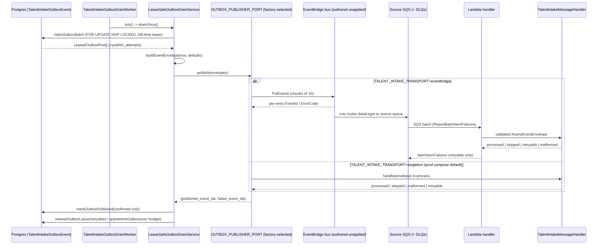
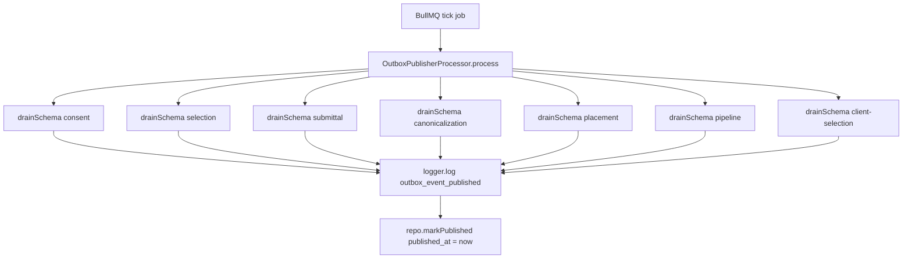
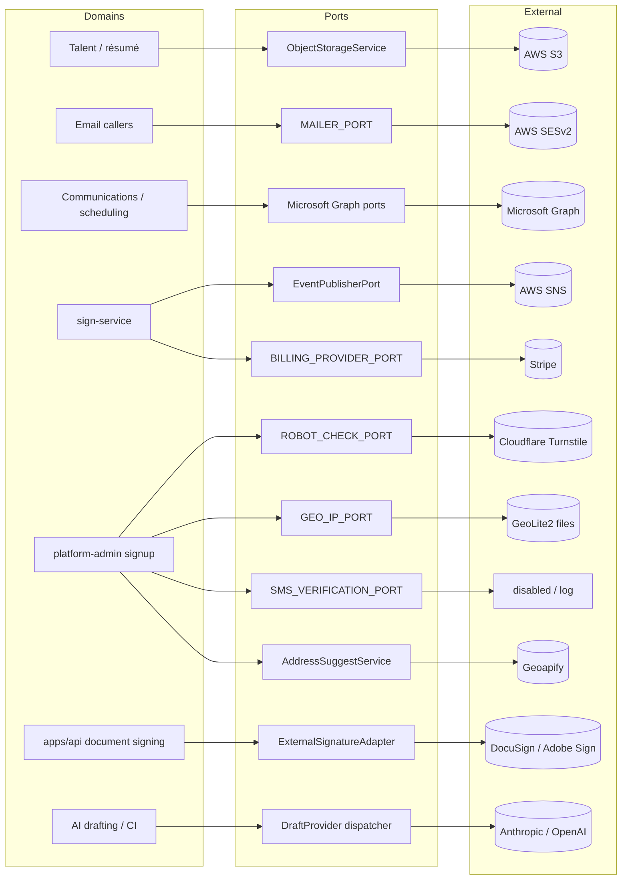

# D14 — Cross-Cutting Platform & External Integrations (AS-BUILT)
> Refreshed from baseline 12330b0f (2026-10-09) to 680907fc (2026-10-24): the Talent Intake outbox gained an explicit `singlebox` in-process transport and a dedicated worker container (the prod compose default), an ATS talent outbox + Talent Intelligence service-to-service channel was added, and new external adapters landed for Stripe billing, DocuSign/Adobe Sign, Cloudflare Turnstile, MaxMind GeoLite2, Geoapify, an SMS port (disabled by default), Microsoft Graph calendar/meeting-artifact ports, and an outbox-file mailer mode.
> Baseline SHA 680907fc06620845944794e0a529918c980f5124 · category AS-BUILT

## Summary

D14 covers the platform substrate that every domain reuses: the durable cross-service
event backbone, the background-job substrate (BullMQ plus Redis-independent interval
workers), and the external-system adapters (SES email, S3 object storage, Microsoft Graph,
EventBridge/SQS/Lambda, SNS, Secrets Manager, KMS, Cognito, Stripe, DocuSign, Adobe Sign,
Anthropic/OpenAI, Cloudflare Turnstile, MaxMind GeoLite2, Geoapify, Google address lookup,
an SMS port).

Three outbox-dispatch mechanisms coexist in `apps/api`:

1. **Legacy structured-log multi-schema drain** (`libs/outbox-publisher`): a BullMQ
   worker that polls 7 domain `OutboxEvent` tables and emits **structured logs only** —
   there is no SNS/SQS/EventBridge dispatch in this path despite its comments referring to
   a future "SNS dispatch" (`libs/outbox-publisher/src/lib/outbox-publisher.processor.ts:189`).
   Imported by `AppModule` (`apps/api/src/app.module.ts:619`).
2. **ADR-0033 lease-safe Talent Intake drain** (`libs/events` + `libs/outbox-publisher` +
   `apps/api/src/talent-intake-consumer`): a Redis-independent interval drain of the Talent
   Intake outbox → canonical envelope → `OutboxPublisherPort`, whose adapter is selected by
   `TALENT_INTAKE_TRANSPORT` in one pure function
   (`apps/api/src/talent-intake-consumer/talent-intake-outbox-publisher.factory.ts:18`):
   `eventbridge` (lazy, fail-closed EventBridge — the default in code,
   `talent-intake-events.config.ts:39`), `singlebox` (in-process delivery to the same
   `TalentIntakeMessageHandler` the Lambda uses, no AWS), or `structured-log` (test only).
   `docker-compose.prod.yml:297` and `:324` default the api and the dedicated
   `talent-intake-worker` container to `singlebox`; the api container sets
   `TALENT_INTAKE_DRAIN_ENABLED=0` (`docker-compose.prod.yml:298`) so only the worker drains.
   ADR-0033's EventBridge/SQS/Lambda Terraform module is authored but not applied
   (`infrastructure/environments/prod/talent-intake.tf:2`).
3. **ATS talent outbox → Talent Intelligence** (`apps/api/src/ats-talent-events` +
   `libs/intelligence-integration`): the same lease-safe drain with an in-process
   `AtsTalentEventDispatcher` port that fans each envelope out to registered handlers
   (`apps/api/src/ats-talent-events/ats-talent-event-dispatcher.ts:38`), one of which
   publishes to the TI service over HTTP with a client-credentials token
   (`libs/intelligence-integration/src/lib/intelligence-publisher.handler.ts:58`). It runs in
   the worker context (`apps/api/src/talent-intake-consumer/talent-intake-worker.module.ts:20`)
   and is OFF in the api process unless `ATS_TALENT_EVENTS_DRAIN_ENABLED=1`
   (`apps/api/src/ats-talent-events/ats-talent-events-drain.worker.ts:18`). The reverse
   direction is an HMAC-signed webhook from TI into apps/api
   (`libs/intelligence-integration/src/lib/intelligence-webhook.receiver.ts:38`).

The ADR-0033 envelope and lease-safe-outbox contracts live in `libs/events`; the
transport adapters (EventBridge, structured-log, fake) and the transport-agnostic drain
orchestration live in `libs/outbox-publisher`. External-system access is uniformly
port/adapter-mediated: `MAILER_PORT` (SES vs stub vs local outbox-file), `ObjectStorageService`
(S3), `MicrosoftGraphPort`/`MicrosoftOAuthPort`/`MicrosoftCalendarPort`/`MicrosoftMeetingArtifactsPort`
(Graph, ports-only lib with HTTP adapters in apps/api), the Sign `EventPublisherPort` (SNS vs
local no-op), `BILLING_PROVIDER_PORT` (Stripe), `ROBOT_CHECK_PORT` (Turnstile),
`GEO_IP_PORT` (MaxMind), `SMS_VERIFICATION_PORT` (log/disabled), and the
`ExternalSignatureAdapter` set (DocuSign, Adobe Sign).

19 BullMQ `@Processor` files exist across the workspace, following the ADR-0018
`libs/matching` pattern (`manualRegistration` + `BullRegistrar.register()` gated on
`RedisConnectionConfig.isConfigured`). Twelve further production files run
Redis-independent `setInterval` workers (sign-service delivery/expiry/invitation/billing
reconcile, platform-admin sweepers, the two outbox drains, TI workers, the intelligence
integration worker).

## Modules & Services

| name | role | evidence path:line + symbol |
| --- | --- | --- |
| `AramoEventEnvelope` | Canonical versioned cross-service event envelope (11 fields) | `libs/events/src/lib/event-envelope.ts:16` `interface AramoEventEnvelope` |
| `buildEventEnvelope` | Pure, deterministic outbox-row→envelope mapper (row id→event_id, created_at→occurred_at) | `libs/events/src/lib/event-envelope.ts:81` `export function buildEventEnvelope` |
| `OutboxPublisherPort` | Reusable dispatch port; string DI token; at-least-once with per-id published/failed split | `libs/events/src/lib/outbox-publisher.port.ts:25` `interface OutboxPublisherPort`; token `:13` `OUTBOX_PUBLISHER_PORT` |
| `LeaseSafeOutboxRepository` | Concurrency-safe claim/lease/mark/release/quarantine contract (FOR UPDATE SKIP LOCKED, DB-time lease) | `libs/events/src/lib/lease-safe-outbox.ts:21` `interface LeaseSafeOutboxRepository` |
| `LeaseSafeOutboxDrainService` | Transport-agnostic per-tick drain orchestration (claim→map→quarantine-unmappable→publish→mark-confirmed→release/quarantine) | `libs/outbox-publisher/src/lib/lease-safe-outbox-drain.service.ts:34` `class LeaseSafeOutboxDrainService` |
| `EventBridgeOutboxPublisher` | EventBridge adapter; PutEvents in chunks of 10, per-entry positional success mapping | `libs/outbox-publisher/src/lib/eventbridge-outbox-publisher.ts:33` `class EventBridgeOutboxPublisher` |
| `StructuredLogOutboxPublisher` | Log-only port adapter (local/test/backward-compat); reports every envelope published | `libs/outbox-publisher/src/lib/structured-log-outbox-publisher.ts:16` `class StructuredLogOutboxPublisher` |
| `OutboxPublisherProcessor` | BullMQ worker draining 7 domain outbox schemas, structured-log emit only | `libs/outbox-publisher/src/lib/outbox-publisher.processor.ts:79` `class OutboxPublisherProcessor` |
| `OutboxPublisherModule` | BullMQ wiring (manualRegistration) for the multi-schema drain | `libs/outbox-publisher/src/lib/outbox-publisher.module.ts:96` `class OutboxPublisherModule` |
| `TalentIntakePublisherModule` | ADR-0033 producer composition (api side): binds config, port (via the transport factory), lease repo, drain, worker | `apps/api/src/talent-intake-consumer/talent-intake-publisher.module.ts:123` `class TalentIntakePublisherModule`; port binding `:69` |
| `selectTalentIntakeOutboxPublisher` | The single transport→adapter switch (eventbridge / singlebox / structured-log) | `apps/api/src/talent-intake-consumer/talent-intake-outbox-publisher.factory.ts:18` |
| `SingleBoxTalentIntakePublisher` | In-process port adapter: delivers each envelope to `TalentIntakeMessageHandler`; retryable/throw → failed, else published | `apps/api/src/talent-intake-consumer/singlebox-talent-intake-publisher.ts:29` |
| `LazyEventBridgeOutboxPublisher` | Lazy fail-closed EventBridge port; throws if bus unset on first publish | `apps/api/src/talent-intake-consumer/lazy-eventbridge-outbox-publisher.ts:20` `class LazyEventBridgeOutboxPublisher` |
| `TalentIntakeOutboxDrainWorker` | Redis-independent `setInterval` drain tick; in-process overlap latch | `apps/api/src/talent-intake-consumer/talent-intake-outbox-drain.worker.ts:23` `class TalentIntakeOutboxDrainWorker` |
| `TalentIntakeWorkerModule` | Dedicated worker application context (no HTTP): Talent Intake drain + ATS talent outbox drain | `apps/api/src/talent-intake-consumer/talent-intake-worker.module.ts:21`; container `docker-compose.prod.yml:314` `talent-intake-worker` |
| `loadTalentIntakeEventsConfig` | Producer transport config; default `eventbridge`; rejects unknown transports | `apps/api/src/talent-intake-consumer/talent-intake-events.config.ts:36` `export function loadTalentIntakeEventsConfig` |
| `TalentIntakeConsumerModule` | ADR-0033 consumer composition (Lambda side and singlebox handler supplier) | `apps/api/src/talent-intake-consumer/talent-intake-consumer.module.ts:43` `class TalentIntakeConsumerModule` |
| `handler` (Lambda entrypoint) | Cold-start-cached Nest context; delegates to SQS batch adapter | `apps/api/src/talent-intake-consumer/talent-intake-consumer.handler.ts:41` `export async function handler` |
| `processTalentIntakeSqsBatch` | SQS record decode, EventBridge unwrap, envelope validate, partial-batch-failure mapping | `apps/api/src/talent-intake-consumer/sqs-lambda.adapter.ts:88` `export async function processTalentIntakeSqsBatch` |
| `AtsTalentEventsModule` / `AtsTalentEventDispatcher` | ATS talent outbox drain + in-process multi-handler port | `apps/api/src/ats-talent-events/ats-talent-events.module.ts:119`; `apps/api/src/ats-talent-events/ats-talent-event-dispatcher.ts:38` |
| `IntelligenceClient` / `IntelligencePublisherHandler` / `IntelligenceWebhookReceiver` | ATS↔TI channel: HTTP client with client-credentials token, outbox handler, HMAC webhook verifier (fail closed) | `libs/intelligence-integration/src/lib/intelligence-client.ts:136`; `libs/intelligence-integration/src/lib/intelligence-publisher.handler.ts:58`; `libs/intelligence-integration/src/lib/intelligence-webhook.receiver.ts:38`; env list `libs/intelligence-integration/src/lib/intelligence-config.ts:10-17` |
| `MailerModule` / `MAILER_PORT` | Transactional email; env-selected SES vs stub vs outbox-file adapter; fixed FROM | `libs/mailer/src/lib/mailer.module.ts:62` `class MailerModule`; selection `:51` useFactory; port token `libs/mailer/src/lib/tokens.ts:8` `MAILER_PORT`; interface `libs/mailer/src/lib/mailer.port.ts:31` `interface MailerPort`; provider union `libs/mailer/src/lib/mailer.config.ts:33` |
| `SesMailerAdapter` | SESv2 `SendEmailCommand` adapter; FROM pinned to `SES_FROM_ADDRESS` | `libs/mailer/src/lib/ses-mailer.adapter.ts:24` `class SesMailerAdapter` |
| `OutboxMailerAdapter` | Local-development mailer: writes each email as JSON into `MAILER_OUTBOX_DIR`; optional real SES send for an allow-list | `libs/mailer/src/lib/outbox-mailer.adapter.ts:30`; allow-list `:20` `outboxDeliverList` |
| `ObjectStorageModule` / `ObjectStorageService` | Presigned PUT/GET + server-side PUT/GET/HEAD/DELETE/all-version purge over S3; expiry-capped; PII-floor logging | `libs/object-storage/src/lib/object-storage.module.ts:32` `class ObjectStorageModule`; service `libs/object-storage/src/lib/object-storage.service.ts:55` `class ObjectStorageService`; purge `:379` `purgeObjectAllVersions` |
| `S3ClientFactory` | Lazy S3 client; SDK default cred chain; checksum pinned WHEN_REQUIRED for presigned URLs | `libs/object-storage/src/lib/s3-client.factory.ts:19` `class S3ClientFactory` |
| `DelegatedAuthorizationService` | Microsoft Graph delegated OAuth: authorize/callback/usable-token/revoke; ports-only, token-free views | `libs/microsoft-graph/src/lib/delegated-authorization.service.ts:110` `class DelegatedAuthorizationService` |
| Microsoft Graph scope sets | Baseline delegated scopes, opt-in scheduling set (`Calendars.ReadWrite`), meeting-artifact set; least-privilege assertion | `libs/microsoft-graph/src/lib/domain/graph-scopes.ts:45` `MICROSOFT_DELEGATED_SCOPES`; `:60` `MICROSOFT_SCHEDULING_SCOPES`; `:72` `MICROSOFT_MEETING_ARTIFACT_SCOPES`; `:148` `assertLeastPrivilegeScopes` |
| Microsoft Graph HTTP adapters (apps/api) | Graph v1.0 calls for mail/meetings, calendar events, meeting artifacts, OAuth token exchange | `apps/api/src/microsoft/microsoft-graph-http.adapter.ts:19`; `apps/api/src/microsoft/microsoft-calendar-http.adapter.ts:96`; `apps/api/src/microsoft/microsoft-meeting-artifacts-http.adapter.ts:47`; `apps/api/src/microsoft/microsoft-oauth-http.adapter.ts:46` |
| `MicrosoftSchedulingService` | Outlook calendar meeting create/update/cancel orchestration (consent-gated, idempotent operations) | `apps/api/src/microsoft/microsoft-scheduling.service.ts:142`; consent gate `apps/api/src/microsoft/calendar-invite-consent-gate.adapter.ts:16` |
| `DelegatedTokenSecretStoreAdapter` | Graph delegated tokens held in Secrets Manager | `apps/api/src/microsoft/delegated-token-secret-store.adapter.ts:36` |
| `SnsEventPublisher` / `eventPublisherFromEnv` | Sign SNS publisher (refs-only); SNS when `SIGN_EVENT_BUS_TOPIC_ARN` is set, local no-op otherwise (DARK) | `apps/sign-service/src/app/sns-event-publisher.ts:11` `class SnsEventPublisher`; factory `:34` `eventPublisherFromEnv`; bound `apps/sign-service/src/app/app.module.ts:127` |
| `HttpWebhookEventPublisher` / `SignWebhookDeliveryService` | Sign → ATS lifecycle webhook (HMAC over `${timestamp}.${rawBody}`) and per-installation outbound webhooks | `apps/sign-service/src/app/webhook-event-publisher.ts:29`; HMAC `:15`; `apps/sign-service/src/app/integrations/webhook-delivery.service.ts:65` |
| `KmsEvidenceManifestSigner` | KMS-backed evidence-manifest signature (software signer fallback) | `apps/sign-service/src/app/kms-evidence-manifest-signer.ts:21`; selection `apps/sign-service/src/app/app.module.ts:117` |
| `AwsSecretsManagerAdapter` | Secrets Manager read/write port adapter | `libs/integration/src/lib/secrets/aws-secrets-manager.adapter.ts:23` `class AwsSecretsManagerAdapter` |
| `TaskModule` / `TaskController` | Recruiter Task entity CRUD (not a BullMQ job); forRoot binds assignee + requisition-context validators | `libs/task/src/lib/task.module.ts:89` `class TaskModule`; controller `libs/task/src/lib/task.controller.ts:68` `class TaskController` |
| `AuditModule` | Empty `@Module({})` shell; exported but referenced by no app/lib | `libs/audit/src/lib/audit.module.ts:4` `export class AuditModule` |
| `ExportModule` / `SavedListModule` / `EntitlementModule` / `SettingsModule` / `CanonicalReconcileModule` / `PlatformTrustModule` | Other cross-cutting leaf modules (domain-adjacent; detailed in their own domains) | `libs/export/src/lib/export.controller.ts:54` `@Controller('v1/exports')`; `libs/saved-list/src/lib/saved-list.controller.ts:58` `@Controller('v1/saved-lists')` |

### Billing, signup-risk and provider integrations

| name | role | evidence path:line + symbol |
| --- | --- | --- |
| `BILLING_PROVIDER_PORT` / `StripeBillingProvider` | Stripe REST over `fetch` (`STRIPE_API_BASE` default `https://api.stripe.com`, pinned `stripe-version`); test vs live inferred from key prefix; configured only when both `STRIPE_SECRET_KEY` and `STRIPE_WEBHOOK_SECRET` are set | `libs/subscription/src/lib/billing/billing-provider.port.ts:5`, `:77`; `libs/subscription/src/lib/billing/stripe-billing.provider.ts:116`, `:124-135`; bound `libs/subscription/src/lib/subscription.module.ts:21` |
| `verifyStripeSignature` | Webhook signature check over the raw body with a 300 s tolerance | `libs/subscription/src/lib/billing/stripe-billing.provider.ts:92`; `:37` `STRIPE_WEBHOOK_TOLERANCE_SEC` |
| Stripe wire mapping | The only file allowed to carry provider vocabulary; maps provider objects to Aramo `account_ref` fields | `libs/subscription/src/lib/billing/stripe-wire.ts:11` `wireAccountRef` |
| `SubscriptionLifecycleService` | Checkout/portal/event application; past-due grace; US-only billing country; domain-authority refusal | `libs/subscription/src/lib/billing/subscription-lifecycle.service.ts:224`; `:89` `billingCountrySupported`; `:83` `DOMAIN_NOT_AUTHORITATIVE` |
| Sign billing webhook | `POST /v1/sign/billing/webhook/stripe`: raw body (sign-service `rawBody: true`), signature verified, 401 on failure, 5xx propagates for redelivery | `apps/sign-service/src/app/billing/esign-billing.controller.ts:247`; `apps/sign-service/src/main.ts:13` |
| `EsignBillingReconcileWorker` | Opt-in periodic provider reconciliation (`SIGN_BILLING_RECONCILE_ENABLED=1`, default 1 h, floor 60 s) | `apps/sign-service/src/app/billing/esign-billing-reconcile.worker.ts:16`; `:27-30` |
| `ROBOT_CHECK_PORT` / `TurnstileRobotCheckAdapter` | Cloudflare Turnstile siteverify (5 s timeout); misconfiguration → `unavailable`; env selects test / Turnstile / disabled | `libs/identity/src/lib/personal/robot-check.port.ts:17` `TURNSTILE_SITEVERIFY_URL`; `:33` adapter; `:71` `robotCheckAdapterFromEnv`; bound `libs/identity/src/lib/identity-core.module.ts:106` |
| `GEO_IP_PORT` / `MaxmindGeoIpAdapter` | Offline GeoLite2 Country + ASN lookups from `SIGN_GEOIP_DB_PATH` / `SIGN_GEOIP_ASN_DB_PATH`, file re-check every 60 s; updater container `ghcr.io/maxmind/geoipupdate:v7.1.0` | `libs/identity/src/lib/personal/geo-ip.port.ts:132`; `:112` `GEOIP_RECHECK_MS`; bound `libs/identity/src/lib/identity-core.module.ts:104`; `deploy/geoip/docker-compose.geoip.yml:16` |
| `SMS_VERIFICATION_PORT` | Phone-code delivery port: `log` adapter (dev) or `disabled` (production default, `configured=false`) | `libs/identity/src/lib/personal/sms-verification.port.ts:11`; `:18` `DisabledSmsAdapter`; `:42` `smsVerificationAdapterFromEnv`; bound `libs/identity/src/lib/identity-core.module.ts:105` |
| `AddressSuggestService` (Geoapify) | Server-side address autocomplete for Sign signup (`SIGN_ADDRESS_PROVIDER=geoapify`); fails open; US-only | `apps/platform-admin/src/app/signup/address-suggest.service.ts:44`; header `:6-18`; base URL `:31` |
| `GoogleAddressLookupProvider` | Address lookup provider for the company/requisition work-location surface | `libs/company/src/lib/providers/google-address-lookup.provider.ts:52` |
| `DocuSignAdapter` / `AdobeSignAdapter` | External e-signature providers behind `ExternalSignatureAdapter`; env-gated config (null when unset); webhook HMAC (DocuSign) / client-id header (Adobe) | `apps/api/src/esignature-providers/docusign/docusign.adapter.ts:53`; `apps/api/src/esignature-providers/docusign/docusign.config.ts:21`; `apps/api/src/esignature-providers/docusign/docusign-connect.ts:13` `verifyDocuSignHmac`; `apps/api/src/esignature-providers/adobe-sign/adobe-sign.adapter.ts:58`; `apps/api/src/esignature-providers/adobe-sign/adobe-sign.config.ts:14`; `apps/api/src/esignature-providers/external-signature-adapter.ts:19` |
| `ProviderCredentialStore` | Per-tenant provider OAuth tokens | `apps/api/src/esignature-providers/provider-credential-store.ts:25` |
| Tenant LLM providers | Wired providers `anthropic` + `openai` (official SDK clients, per-tenant key), dispatcher, Settings-driven resolver, key custody via Secrets Manager | `libs/ai-draft/src/lib/providers/llm-provider.ts:17` `WIRED_LLM_PROVIDERS`; `libs/ai-draft/src/lib/providers/anthropic.provider.ts:36`; `libs/ai-draft/src/lib/providers/openai.provider.ts:30`; `libs/ai-draft/src/lib/providers/provider-draft-dispatcher.ts:28`; `apps/api/src/tenant-llm/settings-active-provider.resolver.ts:15`; `apps/api/src/tenant-llm/tenant-llm-key.service.ts:45` |
| Embedding / CI model providers | OpenAI embedding provider; Anthropic conversation-intelligence adapter | `libs/ai-draft/src/lib/embedding/openai-embedding.provider.ts:34`; `apps/api/src/conversation-intelligence/anthropic-ci-model-provider.adapter.ts:35` |
| Cognito | Token verification (auth-core), admin user creation (platform-admin), tenant user admin (api) | `libs/auth-core/src/lib/cognito-verifier.service.ts:73`; `apps/platform-admin/src/app/platform/cognito/cognito-admin.service.ts:34`; `apps/api/src/cognito/tenant-cognito.adapter.ts:33` |
| Federated sign-in hint | Cognito Hosted UI `identity_provider` hint (Google / Microsoft) set from the host's tenant pin or a chosen provider | `libs/auth-core/src/lib/auth.controller.ts:175`; `:280-284` |

## Data Models

The ADR-0033 envelope is a TypeScript contract, not a single physical table.
`CanonicalOutboxRow` (`libs/events/src/lib/event-envelope.ts:47`) is the durable-row shape
a publisher maps to an envelope; envelope columns (`source`, `subject_type`, `subject_id`,
`event_version`, `causation_id`, `correlation_id`) are nullable so a not-yet-migrated row
still maps via `EnvelopeDefaults` fallbacks (`libs/events/src/lib/event-envelope.ts:62`).
Domain-local physical outbox tables are retained per domain (ADR-0033 Decision 4); the
multi-schema BullMQ processor drains 7 of them (consent, selection, submittal,
canonicalization, placement, pipeline, client_selection) via a shared `OutboxRepositoryShape`
(`libs/outbox-publisher/src/lib/outbox-publisher.processor.ts:59`). The ATS talent outbox
rows are written with explicit envelope columns
(`apps/api/src/ats-talent-events/ats-talent-events.module.ts:33-34`). Billing state is
persisted by `libs/subscription` (migrations
`libs/subscription/prisma/migrations/20261019100000_subscription_lifecycle_billing/migration.sql`,
`libs/subscription/prisma/migrations/20261022100100_billing_account_country_guard/migration.sql`);
geo-IP step-up evidence by `libs/identity/prisma/migrations/20261024100000_sign_personal_geo_step_up/migration.sql`;
external-provider routing and OAuth state by
`libs/signature-routing/prisma/migrations/20261018130000_init_signature_routing/migration.sql`
and `libs/signature-routing/prisma/migrations/20261018140500_provider_oauth_state/migration.sql`.
Column-level detail of those tables belongs to D02 / D10 and was not read here.

## API Endpoints

| method | route | scopes | evidence |
| --- | --- | --- | --- |
| GET | /v1/tasks | task:read | `libs/task/src/lib/task.controller.ts:86` `@Get()` + `:88` `@RequireScopes('task:read')` |
| GET | /v1/tasks/:id | task:read | `libs/task/src/lib/task.controller.ts:141` `@Get(':id')` + `:143` `@RequireScopes('task:read')` |
| POST | /v1/tasks | task:write | `libs/task/src/lib/task.controller.ts:168` `@Post()` + `:170` `@RequireScopes('task:write')` |
| PATCH | /v1/tasks/:id | task:write | `libs/task/src/lib/task.controller.ts:258` `@Patch(':id')` + `:260` `@RequireScopes('task:write')` |
| DELETE | /v1/tasks/:id | task:write | `libs/task/src/lib/task.controller.ts:311` `@Delete(':id')` + `:313` `@RequireScopes('task:write')` |
| POST | /v1/sign/billing/webhook/stripe | none (provider signature) | `apps/sign-service/src/app/billing/esign-billing.controller.ts:247` |
| POST | /v1/webhooks/esignature/docusign | none (HMAC) | `apps/api/src/esignature-providers/docusign/docusign-connect.ts:10` `DOCUSIGN_WEBHOOK_ROUTE`; controller `apps/api/src/esignature-providers/docusign/docusign-webhook.controller.ts:27` |
| POST | /v1/webhooks/esignature/* (Adobe Sign, 2 handlers) | none (client-id header) | `apps/api/src/esignature-providers/adobe-sign/adobe-sign-webhook.controller.ts:29` |
| POST | /v1/integrations/intelligence/events | none (HMAC) | `apps/api/src/integrations/intelligence/intelligence-events.controller.ts:21` |
| POST | /v1/signup/sign/address/suggest | none (signup token; 404 while signup off) | `apps/platform-admin/src/app/signup/sign-signup.controller.ts:63` |
| GET/POST/PATCH | /v1/integrations/microsoft/* (12 handlers incl. calendar-meeting CRUD) | per-route | `apps/api/src/microsoft/microsoft-authorization.controller.ts:73-330`; callback `apps/api/src/microsoft/microsoft-callback.controller.ts:15` |

The ADR-0033 Talent Intake transport exposes NO synchronous HTTP endpoint of its own — it
is driven by an outbox row + a scheduled drain (producer) and either an SQS event source
(Lambda consumer) or in-process delivery (singlebox). The Sign SNS publisher and the
mailer/object-storage adapters are likewise consumed by other domains, not surfaced
directly as D14 HTTP routes. The full HTTP surface of the provider integrations is in D03.

## Screens & FE->BE Wiring

D14 is a backend/integrations domain; it owns no dedicated front-end domain. The S3 presigned
PUT/GET surface is consumed by the ats-web résumé upload path (referenced in
`libs/object-storage/src/lib/s3-client.factory.ts:33` comment naming the ats-web browser PUT
in `talent-api.ts putResumeToStorage`). The Turnstile widget and Geoapify attribution are
rendered by the Sign signup pages (owned by D13); the Turnstile site key is a build-time
input to the nginx image (`deploy/build-images.sh:55`). FE wiring for those flows is owned by the Talent and Sign domains,
not D14.

## Key Flows

### ADR-0033 producer → EventBridge → SQS → Lambda consumer



### Legacy multi-schema BullMQ outbox drain (structured-log only)



### ATS ↔ Talent Intelligence service channel

```mermaid
sequenceDiagram
    participant ATS as apps/api write
    participant OB as ATS talent outbox
    participant WK as talent-intake-worker (AtsTalentEventsDrainWorker)
    participant DP as AtsTalentEventDispatcher
    participant PUB as IntelligencePublisherHandler
    participant TI as talent-intelligence-service :3004
    participant RX as IntelligenceWebhookReceiver (apps/api)

    ATS->>OB: commit row (explicit envelope columns)
    WK->>DP: drain -> publish(envelopes)
    DP->>PUB: handler fan-out (in order)
    PUB->>TI: POST /v1/oauth/token (client credentials)
    PUB->>TI: POST /v1/ingest/talent (service token)
    TI-->>RX: HMAC-signed webhook POST /v1/integrations/intelligence/events
    RX->>ATS: idempotent inbox insert; inbound sync reads TI references API
```

### External integration adapters (ports → AWS/Microsoft)

The heading keeps its original wording; the diagram also covers the Stripe, Cloudflare, MaxMind, Geoapify, DocuSign/Adobe and Anthropic/OpenAI adapters.



## Evidence Index

- `libs/events/src/lib/event-envelope.ts:16` — `AramoEventEnvelope` (11-field canonical envelope)
- `libs/events/src/lib/event-envelope.ts:47` — `CanonicalOutboxRow` durable-row shape
- `libs/events/src/lib/event-envelope.ts:62` — `EnvelopeDefaults` fallbacks
- `libs/events/src/lib/event-envelope.ts:81` — `buildEventEnvelope` pure mapper
- `libs/events/src/lib/outbox-publisher.port.ts:13` — `OUTBOX_PUBLISHER_PORT` string token
- `libs/events/src/lib/outbox-publisher.port.ts:25` — `OutboxPublisherPort` interface
- `libs/events/src/lib/lease-safe-outbox.ts:21` — `LeaseSafeOutboxRepository` interface
- `libs/events/src/lib/events.module.ts:4` — empty `EventsModule`
- `libs/outbox-publisher/src/lib/lease-safe-outbox-drain.service.ts:34` — `LeaseSafeOutboxDrainService`
- `libs/outbox-publisher/src/lib/lease-safe-outbox-drain.service.ts:46` — `drainOnce()` orchestration
- `libs/outbox-publisher/src/lib/eventbridge-outbox-publisher.ts:33` — `EventBridgeOutboxPublisher`
- `libs/outbox-publisher/src/lib/eventbridge-outbox-publisher.ts:46` — chunking at MAX_ENTRIES_PER_PUT=10
- `libs/outbox-publisher/src/lib/structured-log-outbox-publisher.ts:16` — `StructuredLogOutboxPublisher`
- `libs/outbox-publisher/src/lib/outbox-publisher.processor.ts:79` — `OutboxPublisherProcessor`
- `libs/outbox-publisher/src/lib/outbox-publisher.processor.ts:59` — `OutboxRepositoryShape`
- `libs/outbox-publisher/src/lib/outbox-publisher.processor.ts:189` — "structured log only; SNS dispatch is M7" comment
- `libs/outbox-publisher/src/lib/outbox-publisher.module.ts:96` — `OutboxPublisherModule` (7-schema imports)
- `libs/outbox-publisher/src/lib/outbox-publisher.queue.constants.ts:10` — `OUTBOX_PUBLISHER_QUEUE_NAME`
- `apps/api/src/app.module.ts:341` — `TalentIntakePublisherModule` import
- `apps/api/src/app.module.ts:619` — `OutboxPublisherModule` import
- `apps/api/src/app.module.ts:251` — `MailerModule` import
- `apps/api/src/app.module.ts:587` — `ObjectStorageModule` import
- `apps/api/src/talent-intake-consumer/talent-intake-publisher.module.ts:123` — `TalentIntakePublisherModule`
- `apps/api/src/talent-intake-consumer/talent-intake-publisher.module.ts:69` — `OUTBOX_PUBLISHER_PORT` useFactory (delegates to the transport factory)
- `apps/api/src/talent-intake-consumer/talent-intake-outbox-publisher.factory.ts:18` — `selectTalentIntakeOutboxPublisher`
- `apps/api/src/talent-intake-consumer/singlebox-talent-intake-publisher.ts:29` — `SingleBoxTalentIntakePublisher`
- `apps/api/src/talent-intake-consumer/lazy-eventbridge-outbox-publisher.ts:20` — `LazyEventBridgeOutboxPublisher`
- `apps/api/src/talent-intake-consumer/lazy-eventbridge-outbox-publisher.ts:30` — fail-closed check on null busName
- `apps/api/src/talent-intake-consumer/talent-intake-outbox-drain.worker.ts:23` — `TalentIntakeOutboxDrainWorker`
- `apps/api/src/talent-intake-consumer/talent-intake-outbox-drain.worker.ts:37` — `TALENT_INTAKE_DRAIN_ENABLED` disable switch
- `apps/api/src/talent-intake-consumer/talent-intake-worker.module.ts:20` — worker context imports (publisher + ATS talent events)
- `apps/api/src/talent-intake-consumer/talent-intake-events.config.ts:18` — `TalentIntakeTransport` union (eventbridge / structured-log / singlebox)
- `apps/api/src/talent-intake-consumer/talent-intake-events.config.ts:36` — `loadTalentIntakeEventsConfig`
- `apps/api/src/talent-intake-consumer/talent-intake-events.config.ts:39` — transport default `eventbridge`
- `apps/api/src/talent-intake-consumer/talent-intake-consumer.module.ts:43` — `TalentIntakeConsumerModule`
- `apps/api/src/talent-intake-consumer/talent-intake-consumer.handler.ts:41` — Lambda `handler`
- `apps/api/src/talent-intake-consumer/sqs-lambda.adapter.ts:48` — `validateEnvelope`
- `apps/api/src/talent-intake-consumer/sqs-lambda.adapter.ts:88` — `processTalentIntakeSqsBatch`
- `apps/api/src/ats-talent-events/ats-talent-event-dispatcher.ts:38` — `AtsTalentEventDispatcher`
- `apps/api/src/ats-talent-events/ats-talent-events-drain.worker.ts:23` — `AtsTalentEventsDrainWorker`
- `libs/intelligence-integration/src/lib/intelligence-client.ts:136` — `IntelligenceClient`
- `libs/intelligence-integration/src/lib/intelligence-webhook.receiver.ts:38` — `IntelligenceWebhookReceiver`
- `docker-compose.prod.yml:297` — api `TALENT_INTAKE_TRANSPORT=${TALENT_INTAKE_TRANSPORT:-singlebox}`
- `docker-compose.prod.yml:314` — `talent-intake-worker` service
- `libs/mailer/src/lib/mailer.module.ts:62` — `MailerModule`
- `libs/mailer/src/lib/mailer.config.ts:33` — `MailerProvider = 'ses' | 'stub' | 'outbox'`
- `libs/mailer/src/lib/tokens.ts:8` — `MAILER_PORT` DI string token
- `libs/mailer/src/lib/mailer.port.ts:31` — `MailerPort` interface
- `libs/mailer/src/lib/ses-mailer.adapter.ts:24` — `SesMailerAdapter`
- `libs/mailer/src/lib/outbox-mailer.adapter.ts:30` — `OutboxMailerAdapter`
- `libs/object-storage/src/lib/object-storage.module.ts:32` — `ObjectStorageModule`
- `libs/object-storage/src/lib/object-storage.service.ts:55` — `ObjectStorageService`
- `libs/object-storage/src/lib/object-storage.service.ts:145` — `putIngestionObject` (server-side PUT)
- `libs/object-storage/src/lib/object-storage.service.ts:379` — `purgeObjectAllVersions`
- `libs/object-storage/src/lib/s3-client.factory.ts:19` — `S3ClientFactory`
- `libs/object-storage/src/lib/s3-client.factory.ts:40` — checksum pinned `WHEN_REQUIRED`
- `libs/microsoft-graph/src/lib/delegated-authorization.service.ts:110` — `DelegatedAuthorizationService`
- `libs/microsoft-graph/src/lib/delegated-authorization.service.ts:199` — `getUsableAccessToken` refresh/rotate
- `libs/microsoft-graph/src/lib/domain/graph-scopes.ts:60` — `MICROSOFT_SCHEDULING_SCOPES`
- `libs/microsoft-graph/src/lib/ports/microsoft-calendar.port.ts:94` — `MicrosoftCalendarPort`
- `apps/api/src/microsoft/microsoft-calendar-http.adapter.ts:96` — `MicrosoftCalendarHttpAdapter`
- `apps/api/src/microsoft/microsoft-scheduling.service.ts:142` — `MicrosoftSchedulingService`
- `apps/sign-service/src/app/sns-event-publisher.ts:11` — `SnsEventPublisher`
- `apps/sign-service/src/app/sns-event-publisher.ts:34` — `eventPublisherFromEnv` env-gated factory
- `apps/sign-service/src/app/webhook-event-publisher.ts:29` — `HttpWebhookEventPublisher`
- `apps/sign-service/src/app/kms-evidence-manifest-signer.ts:21` — `KmsEvidenceManifestSigner`
- `libs/integration/src/lib/secrets/aws-secrets-manager.adapter.ts:23` — `AwsSecretsManagerAdapter`
- `libs/subscription/src/lib/billing/stripe-billing.provider.ts:92` — `verifyStripeSignature`
- `libs/subscription/src/lib/billing/stripe-billing.provider.ts:116` — `StripeBillingProvider`
- `apps/sign-service/src/app/billing/esign-billing.controller.ts:247` — Stripe webhook route
- `apps/sign-service/src/app/billing/esign-billing-reconcile.worker.ts:16` — `EsignBillingReconcileWorker`
- `libs/identity/src/lib/personal/robot-check.port.ts:33` — `TurnstileRobotCheckAdapter`
- `libs/identity/src/lib/personal/robot-check.port.ts:71` — `robotCheckAdapterFromEnv`
- `libs/identity/src/lib/personal/geo-ip.port.ts:132` — `MaxmindGeoIpAdapter`
- `libs/identity/src/lib/personal/sms-verification.port.ts:42` — `smsVerificationAdapterFromEnv`
- `libs/identity/src/lib/identity-core.module.ts:104` — `GEO_IP_PORT` / `SMS_VERIFICATION_PORT` / `ROBOT_CHECK_PORT` bindings (:104-106)
- `apps/platform-admin/src/app/signup/address-suggest.service.ts:44` — `AddressSuggestService`
- `apps/api/src/esignature-providers/docusign/docusign.adapter.ts:53` — `DocuSignAdapter`
- `apps/api/src/esignature-providers/adobe-sign/adobe-sign.adapter.ts:58` — `AdobeSignAdapter`
- `libs/ai-draft/src/lib/providers/llm-provider.ts:17` — `WIRED_LLM_PROVIDERS`
- `libs/auth-core/src/lib/cognito-verifier.service.ts:73` — `CognitoVerifierService`
- `apps/platform-admin/src/app/platform/cognito/cognito-admin.service.ts:34` — `CognitoAdminService`
- `libs/task/src/lib/task.module.ts:89` — `TaskModule`
- `libs/task/src/lib/task.controller.ts:68` — `TaskController` (`@Controller('v1/tasks')` at :65)
- `libs/audit/src/lib/audit.module.ts:4` — empty `AuditModule`
- `deploy/geoip/docker-compose.geoip.yml:16` — MaxMind updater image
- `infrastructure/modules/talent-intake-events/main.tf:31` — `aws_cloudwatch_event_bus`
- `infrastructure/modules/talent-intake-events/main.tf:246` — `aws_lambda_function` consumer
- `infrastructure/modules/talent-intake-events/main.tf:274` — `aws_lambda_event_source_mapping` (ReportBatchItemFailures)
- `infrastructure/environments/prod/talent-intake.tf:2` — "AUTHORED, NOT APPLIED" comment

## NOT VERIFIED (explicit)

- **Prod runtime transport selection.** The code default is `transport=eventbridge`
  (`talent-intake-events.config.ts:39`) and the prod compose default is `singlebox`
  (`docker-compose.prod.yml:297`); which value the running Lightsail box's `.env` actually
  holds is a deploy-env fact not derivable from the repo at this SHA.
- **Whether the EventBridge/SQS/Lambda Terraform has ever been applied.** The prod root
  comment states it has not (`talent-intake.tf:2`); I did not inspect remote Terraform state.
- **19 BullMQ processors** is a `@Processor(` file count over `libs/` + `apps/` excluding
  tests/spec; it includes processors owned by other domains and is listed as substrate
  context, not a D14-exclusive inventory. The 7 processor files present at the prior baseline are absent; they
  correspond to the talent-identity / talent-reconcile / match-sweep processors no longer present in
  `apps/api` and `libs/talent-reconcile`; where that work now runs (presumably the TI
  service workers) was not traced.
- **Which provider env values are set in production** (Stripe keys/mode, Turnstile secret,
  GeoLite2 files, Geoapify key, SMS provider, DocuSign/Adobe credentials, SNS topic, KMS key)
  — deploy-env facts, not derivable from the repo.
- **Stripe, DocuSign, Adobe Sign, Geoapify, Turnstile network behaviour** — adapters read
  statically; no call against a live or sandbox endpoint was made.
- **Full endpoint surface of the other cross-cutting leaf libs** (export, saved-list,
  entitlement, settings, canonical-reconcile, platform-trust) was not enumerated — those
  surfaces belong to their own domains; only module/controller anchors are cited here.
- **Talent Intelligence service internals** (its own database, workers, outbox) — only the
  ATS-side channel and the TI controller/worker anchors were read; TI domain detail is out
  of D14 scope.
