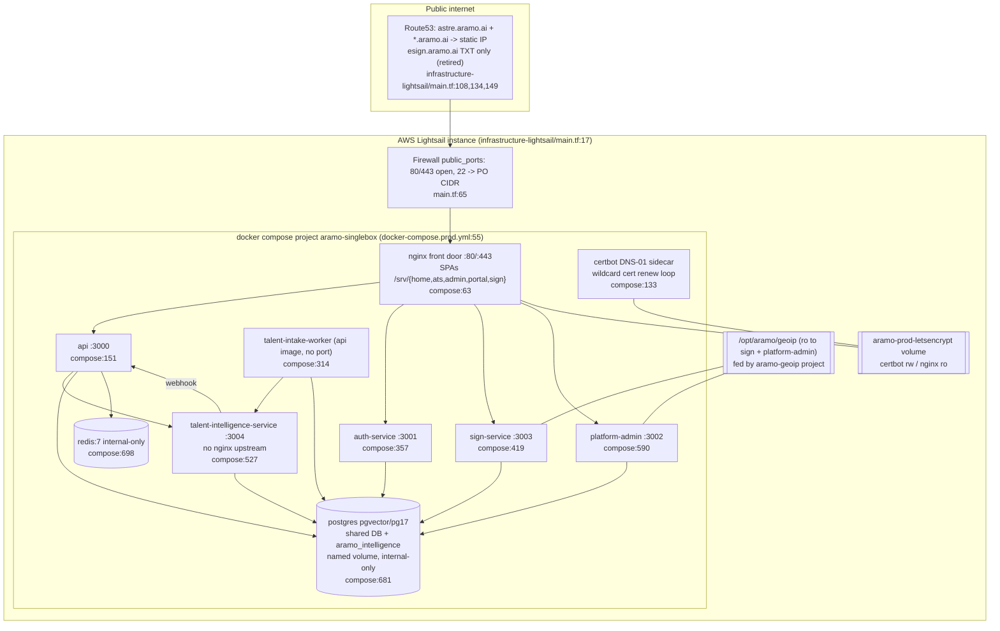
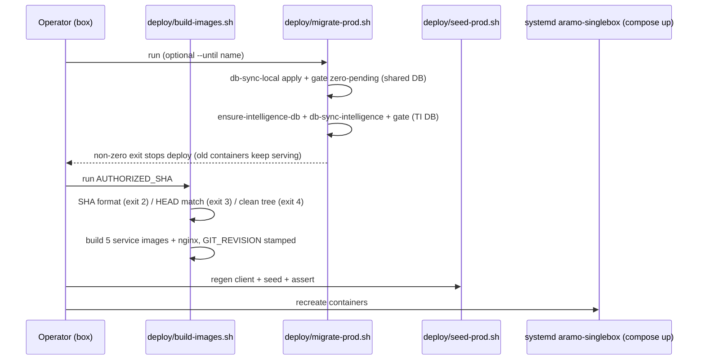
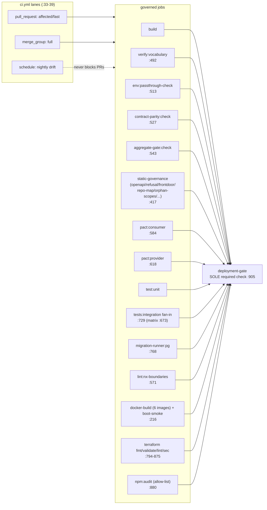
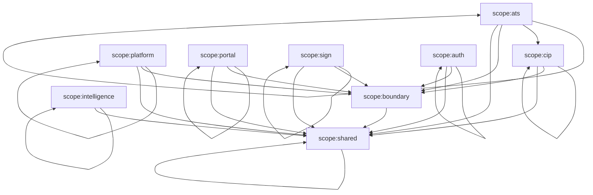

# D15 — Infrastructure, Deployment, Persistence Ops & Quality/Contract Enforcement (AS-BUILT)
> Baseline SHA 680907fc06620845944794e0a529918c980f5124 · category AS-BUILT
> Refreshed from baseline 12330b0f (2026-10-09) to 680907fc (2026-10-24): the prod compose stack grew from 8 to 10 services (talent-intake-worker, talent-intelligence-service with its own database, esign-service renamed sign-service), the nginx sign host became the one Aramo Sign application with rate limits and a named api exception, the tenant host now serves App Home at `/` and ATS at `/ats/`, `deploy/build-images.sh` stamps 6 images, `deploy/migrate-prod.sh` gained `--until` and a second (TI) migration ledger, CI swapped the retired identity-index privacy wall for `migration-runner:pg`, and Pact grew to 13 consumer projects verified by 4 provider specs.

## Summary

Aramo runs as a **single-box Docker-Compose stack on AWS Lightsail** (the live
prod substrate) with a **parallel, authored-but-largely-unapplied AWS
ECS/Fargate IaC track** under `infrastructure/`. The two deployment topologies
coexist in-tree: `infrastructure-lightsail/` is the box that is actually
reconciled and applied; `infrastructure/environments/{dev,staging,prod}/` is the
account-independent Fargate composition that validates in CI but whose
`talent-intake.tf` is explicitly annotated AUTHORED / NOT-APPLIED, and whose
Lightsail-side Sign KMS/SNS file (`infrastructure-lightsail/doc4-sign.tf`) carries
the same annotation.

The runnable prod stack is `docker-compose.prod.yml` (project name
`aramo-singlebox`, `docker-compose.prod.yml:55`): an **nginx** front door
(the only service publishing ports 80/443) baking five SPAs and reverse-proxying
the container-internal backends (api, auth-service, sign-service,
platform-admin), plus a no-port **talent-intake-worker** (api image), a
container-internal **talent-intelligence-service** with no nginx upstream,
Postgres (pgvector/pg17) and Redis, with a **certbot DNS-01 sidecar** owning
the `*.aramo.ai` wildcard cert — 10 services in all. A separate compose project
(`deploy/geoip/docker-compose.geoip.yml`) runs the GeoLite2 updater.

Quality/contract enforcement is concentrated in **one GitHub Actions workflow**
(`.github/workflows/ci.yml`) with three lanes (pull_request fast / merge_group
full / nightly schedule) converging on a single required check,
**`deployment-gate`** (`.github/workflows/ci.yml:905`, 18 `needs`). Governance
walls include: an nx module-boundary wall (now with a `scope:intelligence`
wall), a two-tier vocabulary gate, OpenAPI validate/lint/drift, route↔OpenAPI
contract parity, env-passthrough parity (with a TI-optional guard), front-door
conf check, repo-map check, Pact consumer/provider (13 consumer projects + 1
provider project with 4 verifier specs), a dynamic integration matrix driven by
a canonical registry (`ci/integration-roots.json`, 49 roots), a real-PostgreSQL
migration-runner job, Terraform fmt/validate/lint/sec, and npm-audit with an
allow-list. Persistence ops (build/migrate/seed) are gated shell scripts under
`deploy/`.

## Modules & Services (role | evidence path:line+symbol)

| name | role | evidence path:line+symbol |
| --- | --- | --- |
| `aramo-singlebox` compose stack | the runnable prod stack (single box) | `docker-compose.prod.yml:55` `name: aramo-singlebox` |
| nginx front door | sole public ingress on 80/443; TLS term + static SPA + path routing; build arg for the public Sign Turnstile site key | `docker-compose.prod.yml:63` `nginx:`; build args `:64`–`69`; ports `:88`–`90` |
| certbot DNS-01 sidecar | owns `*.aramo.ai` wildcard cert (renew loop; Route53) | `docker-compose.prod.yml:133` `certbot:` image `certbot/dns-route53:v3.1.0` (`:134`) |
| api | apps/api backend, container-internal; writes but does not drain the intake and talent outboxes | `docker-compose.prod.yml:151` `api:`; `:297`–`298` `TALENT_INTAKE_TRANSPORT=…singlebox`, `TALENT_INTAKE_DRAIN_ENABLED=0` |
| talent-intake-worker | api image, worker entrypoint; single-box intake drain + ATS talent outbox drain + Intelligence publisher/inbound sync; no HTTP port | `docker-compose.prod.yml:314`; `:318` command; `:324` `TALENT_INTAKE_TRANSPORT`; `:329` `ATS_TALENT_EVENTS_DRAIN_ENABLED=1` |
| auth-service | apps/auth-service backend, container-internal | `docker-compose.prod.yml:357` `auth-service:` PORT 3001 |
| sign-service | Aramo Sign backend, container-internal; required before nginx (upstream resolved at config load) | `docker-compose.prod.yml:419` `sign-service:` PORT 3003; geoip mount `:522` |
| talent-intelligence-service | TI backend (ADR-0036), own DB `aramo_intelligence`, HTTP healthcheck on `/health`, no nginx upstream | `docker-compose.prod.yml:527`; `:547` `INTELLIGENCE_DATABASE_URL`; healthcheck `:579` |
| platform-admin | platform-console backend, container-internal; also owns Sign self-service signup | `docker-compose.prod.yml:590` `platform-admin:` PORT 3002; geoip mount `:671` |
| postgres | persisted named-volume DB, pgvector-capable PG17, never port-published | `docker-compose.prod.yml:681` `image: pgvector/pgvector:pg17` |
| redis | BullMQ substrate, never port-published | `docker-compose.prod.yml:698` `image: redis:7` |
| geoipupdate (separate project) | keeps GeoLite2 Country + ASN current in `/opt/aramo/geoip` | `deploy/geoip/docker-compose.geoip.yml:15`; `:22` `GEOIPUPDATE_EDITION_IDS` |
| Lightsail instance (live prod) | the box: instance + static IP + firewall + Route53 | `infrastructure-lightsail/main.tf:17` `aws_lightsail_instance.this` |
| Lightsail firewall | full public-port set 80/443 + SSH restricted to PO CIDR | `infrastructure-lightsail/main.tf:65` `aws_lightsail_instance_public_ports.this` |
| Route53 wildcard A record | `*.aramo.ai` → static IP (tenant onboarding = data op) | `infrastructure-lightsail/main.tf:134` `aws_route53_record.wildcard` |
| Route53 retired-host TXT | `esign.aramo.ai` owns a TXT record so it no longer resolves via the wildcard | `infrastructure-lightsail/main.tf:149` `aws_route53_record.esign_retired` |
| certbot DNS-01 IAM principal | least-privilege ACME-challenge IAM (no key in state) | `infrastructure-lightsail/main.tf:238` `module "certbot_dns"` |
| api Secrets Manager policy | scoped RW to connector/msgraph-delegated/tenant-llm secret namespaces | `infrastructure-lightsail/main.tf:204` `aws_iam_user_policy.api_secrets` |
| Fargate prod composition (IaC) | account-independent ECS/ALB/RDS/ECR/Secrets wiring (validates; apply gated) | `infrastructure/environments/prod/compute.tf:124` `module "ecs_service_api"` |
| talent-intake events (IaC) | EventBridge→SQS→Lambda durable foundation, AUTHORED-NOT-APPLIED | `infrastructure/environments/prod/talent-intake.tf:9` `module "talent_intake_events"` |
| Sign KMS+SNS (IaC) | asymmetric sign/verify key + executed-envelope topic, AUTHORED-NOT-APPLIED | `infrastructure-lightsail/doc4-sign.tf:15` `aws_kms_key.sign_evidence`; `:31` `aws_sns_topic.sign_executed` |
| Cognito trigger sources | version-controlled copies of the deployed PreSignUp / PreTokenGeneration functions + a v2 PreSignUp; not wired to Terraform | `infrastructure/cognito-triggers/README.md:1`; `pre-signup/v2/index.mjs` |
| CI workflow | single workflow, 3 lanes, converging on deployment-gate | `.github/workflows/ci.yml:31` `name: ci` |
| deployment-gate | the SOLE branch-protection required check | `.github/workflows/ci.yml:905` `deployment-gate:` |
| static-governance | consolidated cheap governance walls (one npm ci, named steps) | `.github/workflows/ci.yml:417` `static-governance:` |
| migration-runner:pg | real-PostgreSQL proof of the bounded shared-DB runner and the TI-DB runner | `.github/workflows/ci.yml:768` `migration-runner-pg:` |
| integration matrix | dynamic per-root matrix, max-parallel 8, serial per leg | `.github/workflows/ci.yml:673` `integration:`; `:687` `max-parallel: 8` |
| vocabulary gate | two-tier locked-vocab + R7 + retired-front-door scan | `scripts/verify-vocabulary.sh:500` `TIER2_TERMS_REGEX` |
| nx module-boundary wall | scope-tag dep constraints (cip/ats/intelligence/platform/portal/sign/auth) | `eslint.config.mjs:79` `SCOPE_DEP_CONSTRAINTS` |
| integration-root registry + guard | canonical root list + default-deny coverage proof | `ci/integration-roots.json:3` `"roots"`; guard `ci/scripts/check-integration-roots.ts:1` |
| persistence ops — image build gate | authorized-SHA + clean-tree check, stamps 6 images | `deploy/build-images.sh:49` loop; `:77` "6 images stamped" |
| persistence ops — migrate gate | apply pending migrations (optionally `--until`) + gate zero-pending, then TI DB ensure + migrate + gate, before recreate | `deploy/migrate-prod.sh:56` `set -euo pipefail`; `:194` `migrate_intelligence()`; `:224` `main()` |
| persistence ops — seed gate | regen host Prisma client + seed + assert before recreate | `deploy/seed-prod.sh:264` `main()` |

## Data Models

D15 owns **no application Prisma models**; its substrate is infra config, CI
registries, and operational scripts. The persistence-ops data structures are two
box-local migration ledgers: `public._local_migrations` in the shared DB,
written by `tools/db-sync-local.sh` from `deploy/migrate-prod.sh` (header,
`:26`–`28`), and `public._intelligence_migrations` in the `aramo_intelligence`
database, written by `tools/db-sync-intelligence.sh` (`:42` `TI_LEDGER`).
The scheduled box backup `deploy/backup/pg-backup.sh` dumps one database,
`POSTGRES_DB` (default `aramo`, `:27`), via `pg_dump -d "$POSTGRES_DB" -Fc`
(`:40`); no line in `deploy/backup/` names `aramo_intelligence`.
Repository-wide tracked persistence footprint (re-derived, see coverage): 54
tracked `schema.prisma` files, 283 `model` declarations, 314 tracked
`migrations/*/migration.sql` directories.

## API Endpoints

D15 defines no HTTP endpoints of its own. It **routes and gates** endpoints
owned by other domains at the nginx edge
(`deploy/nginx/templates/aramo.conf.template`):

| method | route | host block | evidence |
| --- | --- | --- | --- |
| (edge route) | `/v1/` → `api:3000` | tenant/wildcard | `aramo.conf.template:78` |
| (edge route) | `/auth/` → `auth-service:3001` (enlarged header buffers) | tenant/admin/portal/sign | `aramo.conf.template:81`, `:134`, `:221`, `:365` |
| (edge route) | `= /.well-known/jwks.json` → `auth-service:3001` | tenant/admin/portal | `aramo.conf.template:93`, `:183`, `:232` |
| (edge route) | `= /v1/webhooks/indeed/apply` → `api:3000` (3m body cap) | tenant | `aramo.conf.template:53` |
| (edge route) | `~ ^/v1/talent-intake-drafts/[^/]+/events$` → `api:3000` (SSE, buffering off) | tenant | `aramo.conf.template:66` |
| (edge route) | `/ats/` → `alias /srv/ats/`; `= /ats` → `301 /ats/`; `/` → `/srv/home` | tenant | `aramo.conf.template:105`, `:110`, `:114` |
| (edge route) | `/platform/skills`, `/platform/skill-review-queue`, `/platform/skill-proposals` → `api:3000` | admin | `aramo.conf.template:154` |
| (edge route) | `/platform/document-templates`, `/platform/template-variables` → `api:3000` | admin | `aramo.conf.template:168` |
| (edge route) | `/platform/matching-policy` → `api:3000` | admin | `aramo.conf.template:177` |
| (edge route) | `/platform/` → `platform-admin:3002` | admin | `aramo.conf.template:180` |
| (edge route) | `/v1/portal/` → `api:3000` (ONLY /v1 surface on portal host) | portal | `aramo.conf.template:218` |
| (edge route) | `/v1/sign/{signing,sender,billing,inbox,legal,account,report}` → `sign-service:3003` (per-location body caps; guest + report rate-limited) | sign | `aramo.conf.template:298`–`339` |
| (edge route) | `/v1/signup/sign/` → `platform-admin:3002` (zone `sign_signup`) | sign | `aramo.conf.template:343` |
| (edge route) | `/v1/tenant/domain-verification`, `/v1/domain-verification/delegate` → `api:3000` (named exception; zone `domain_delegate`) | sign | `aramo.conf.template:356`, `:360` |
| (edge route) | `= /healthz` → `return 200`; `/` → `301 https` | port-80 | `aramo.conf.template:403` |

Rate-limit zones are declared at http context (`aramo.conf.template:247`–`257`:
`sign_guest` 10r/s, `sign_signup` 10r/m, `sign_report` 10r/m,
`domain_delegate` 30r/m, status 429).

## Screens & FE->BE Wiring (FE domains only)

D15 is backend/infra; it hosts no React screens. It **serves** the five built
SPAs as static roots baked into the nginx image and routes their API traffic:
`/srv/home` (tenant host `/`, `aramo.conf.template:115`), `/srv/ats` (tenant
host `/ats/`, `:106`), `/srv/admin` (admin host, `:196`), `/srv/portal` (portal
host, `:237`), `/srv/sign` (sign host, `:376` guest `/s/`,`/d/` shell and `:391`
workspace). Each uses a `try_files … index.html` SPA fallback. The admin host
carries **no `/v1` proxy** by deliberate negative control
(`aramo.conf.template:187`–`193`), so the tenant API surface is unreachable from
the console host. The sign host sets host-wide security headers and repeats
them in the guest locations (`aramo.conf.template:286`–`295`, `:387`).

## Key Flows

### Single-box Lightsail deployment topology

### Deploy sequence (persistence-ops gates)

Evidence: `deploy/migrate-prod.sh:12`–`21` (position comment), `:46`–`54`
(`--until`), `:194`; `deploy/build-images.sh:23`–`37`, `:49`, `:72`–`77`;
`deploy/seed-prod.sh:264`. The step order in `migrate-prod.sh:12`–`17` lists
migrate before build; NOT VERIFIED whether the runbook orders seed before or
after build at this SHA.

### CI gate topology (merge-blocking members of deployment-gate)

### nx module-boundary scope wall

Source: `eslint.config.mjs:79` `SCOPE_DEP_CONSTRAINTS`, enforced via
`@nx/enforce-module-boundaries` (`eslint.config.mjs:164`). ATS may reach CIP;
neither ATS nor CIP may reach `scope:intelligence` (`:80`, `:83`), and the
untagged apps are barred from it by the override at `:174`–`191`;
platform/portal/sign/auth are each walled from ATS and CIP (ADR-0029 I15 wall).
The wall is exercised by the negative-control fixtures under
`tools/intelligence-boundary-probes/` (ignored by the main lint run,
`eslint.config.mjs:155`).

## Evidence Index (load-bearing path:line citations)

- `.github/workflows/ci.yml:31` — `name: ci` (single workflow)
- `.github/workflows/ci.yml:34` — `push:` trigger (branches main, `:35`)
- `.github/workflows/ci.yml:36` — `pull_request:` trigger
- `.github/workflows/ci.yml:37` — `merge_group:` trigger (full gate)
- `.github/workflows/ci.yml:39` — `cron: '0 7 * * *'` nightly drift
- `.github/workflows/ci.yml:216` — `docker-build:` matrix (api/auth-service/platform-admin/sign-service/talent-intelligence-service/nginx) + boot-smoke (`:241`, `:305`, `:320`)
- `.github/workflows/ci.yml:333` — `release-manifest:` (main-only, immutable digests)
- `.github/workflows/ci.yml:417` — `static-governance:` consolidated walls
- `.github/workflows/ci.yml:492` — `verify-vocabulary:`
- `.github/workflows/ci.yml:513` — `env-passthrough-check:`
- `.github/workflows/ci.yml:527` — `contract-parity-check:`
- `.github/workflows/ci.yml:543` — `aggregate-gate-check:`
- `.github/workflows/ci.yml:558` — `placement-sql-check:` (NOT a deployment-gate member)
- `.github/workflows/ci.yml:571` — `lint-nx-boundaries:`
- `.github/workflows/ci.yml:584` / `:618` — `pact-consumer:` / `pact-provider:`
- `.github/workflows/ci.yml:648` — `integration-discovery:` (matrix from registry)
- `.github/workflows/ci.yml:673` — `integration:` matrix; `:687` `max-parallel: 8`
- `.github/workflows/ci.yml:729` — `tests-integration:` stable fan-in
- `.github/workflows/ci.yml:768` — `migration-runner-pg:` (`:784` shared runner, `:792` TI runner)
- `.github/workflows/ci.yml:851` — `terraform-sec:`; `:863` `TFSEC_VERSION=v1.28.14`; `:875` `--minimum-severity=HIGH`
- `.github/workflows/ci.yml:794` / `:810` / `:832` — terraform fmt / validate / lint
- `.github/workflows/ci.yml:880` — `npm-audit:`; `:890` `bash scripts/audit-check.sh`
- `.github/workflows/ci.yml:905` — `deployment-gate:`; needs list `:909-927`
- `.github/workflows/ci.yml:968` — final grep fails on any `failure|cancelled|skipped`
- `docker-compose.prod.yml:55` — `name: aramo-singlebox`
- `docker-compose.prod.yml:63` / `:89`–`90` — nginx service / ports 80:80,443:443
- `docker-compose.prod.yml:133` — certbot service; `:134` `certbot/dns-route53:v3.1.0`
- `docker-compose.prod.yml:151` / `:314` / `:357` / `:419` / `:527` / `:590` — api / talent-intake-worker / auth / sign / TI / platform-admin
- `docker-compose.prod.yml:186` — `CI_PROCESSING_ENABLED` default false (dark)
- `docker-compose.prod.yml:194` — `EMBEDDING_PROCESSING_ENABLED` default false (dark)
- `docker-compose.prod.yml:265` — `&identity_pepper ARAMO_IDENTITY_PEPPER` YAML anchor (reused `:350`, `:405`)
- `docker-compose.prod.yml:297` — api `TALENT_INTAKE_TRANSPORT` default `singlebox`
- `docker-compose.prod.yml:547` — TI `INTELLIGENCE_DATABASE_URL` (own DB)
- `docker-compose.prod.yml:681` — `image: pgvector/pgvector:pg17`
- `docker-compose.prod.yml:698` — `image: redis:7`
- `deploy/geoip/docker-compose.geoip.yml:16` — `ghcr.io/maxmind/geoipupdate:v7.1.0`
- `deploy/nginx/templates/aramo.conf.template:25` / `:121` / `:202` / `:273` / `:399` — tenant / admin / portal / sign / port-80 blocks
- `deploy/nginx/templates/aramo.conf.template:154` — `/platform/skills` → api (edge provider map)
- `deploy/nginx/templates/aramo.conf.template:187` — admin host negative control (no `/v1`)
- `deploy/nginx/templates/aramo.conf.template:247` — `limit_req_zone … sign_guest`
- `deploy/nginx/templates/aramo.conf.template:348` — sign-host named exception comment (Domain-Enforcement P3 §4)
- `deploy/nginx/Dockerfile:34` / `:45` — `nx build aramo-home-web` / `aramo-sign-web`
- `deploy/build-images.sh:49` — 5-service build loop (+ nginx `:72`)
- `infrastructure-lightsail/main.tf:11` — `aws_lightsail_key_pair.this`
- `infrastructure-lightsail/main.tf:17` — `aws_lightsail_instance.this` (ignore_changes user_data+key_pair_name)
- `infrastructure-lightsail/main.tf:49` — `aws_lightsail_static_ip.this`
- `infrastructure-lightsail/main.tf:65` — `aws_lightsail_instance_public_ports.this` (22 → `var.ssh_source_cidr`)
- `infrastructure-lightsail/main.tf:108` / `:134` — Route53 `app` + `wildcard` A records
- `infrastructure-lightsail/main.tf:149` — `aws_route53_record.esign_retired` (TXT)
- `infrastructure-lightsail/main.tf:204` — `aws_iam_user_policy.api_secrets` (connector/msgraph-delegated/tenant-llm scope)
- `infrastructure-lightsail/main.tf:238` — `module "certbot_dns"` (no access key in state)
- `infrastructure-lightsail/doc4-sign.tf:15` — `aws_kms_key.sign_evidence` key-spec attribute `RSA_2048` (`:20`, the field-scoped vocabulary exemption; AUTHORED-NOT-APPLIED `:1`–`5`)
- `infrastructure-lightsail/doc4-sign.tf:31` — `aws_sns_topic.sign_executed` (no subscription)
- `infrastructure/environments/prod/compute.tf:19` / `:32` / `:124` / `:162` — ECR / Secrets / api+auth ECS services
- `infrastructure/environments/prod/talent-intake.tf:9` — `module "talent_intake_events"` AUTHORED-NOT-APPLIED; `:33` api publish policy attach
- `infrastructure/cognito-triggers/README.md:7` — "Nothing in this folder changes production by itself."
- `ci/integration-roots.json:3` — `"roots"` canonical registry (49 roots; 1 coverageAlias; 0 exemptions)
- `ci/scripts/check-integration-roots.ts:1` — default-deny coverage proof
- `ci/scripts/ci-integration.sh:8` — every run SERIAL (`--no-file-parallelism`)
- `ci/scripts/verify-env-passthrough.ts:42` — `REQUIRED_PASSTHROUGH` manifest; `:75` `REQUIRED_GUARDED`; `:84` `REQUIRED_LITERAL`; `:270` `TI_VAR` (TI vars must stay optional)
- `ci/scripts/verify-api-contract-parity.ts:36` — `MANIFEST_PATH` = `ci/config/api-surface-manifest.json`
- `ci/scripts/verify-frontdoor-conf.ts:134` — requires tenant/admin/portal/sign blocks; `:148` `SIGN_V1` exact sign-host `/v1` map
- `eslint.config.mjs:79` — `SCOPE_DEP_CONSTRAINTS`; `:164` `@nx/enforce-module-boundaries`
- `scripts/verify-vocabulary.sh:36` — `R7_ALLOWLIST` (Tier-1); `:77` `FRONTDOOR_LEGACY_ALLOWLIST`; `:500` `TIER2_TERMS_REGEX`
- `scripts/audit-check.sh:1` — allow-list-aware `npm audit` wrapper (ADR-0014)
- `pact/provider/src/verify.ts:138` / `verify-api.ts:1474` / `verify-sign.ts:149` / `verify-ti.ts:70` — the 4 provider verifier suites (auth-service / api / sign-service / talent-intelligence-service)
- `deploy/migrate-prod.sh:56` — migrate-then-gate before recreate; `:194` `migrate_intelligence()`
- `deploy/seed-prod.sh:264` — regen client + seed + assert before recreate
- `tools/db-sync-intelligence.sh:42` — `TI_LEDGER="public._intelligence_migrations"`

## NOT VERIFIED (explicit)

- **Live-box reconciliation state** (what is actually running on the Lightsail
  instance, `ARAMO_RELEASE_REVISION`, applied-vs-declared Terraform drift,
  whether the `aramo-geoip` project or the TI container is running) is a
  runtime fact NOT observable from the repo at this SHA; only the declared
  desired-state (`infrastructure-lightsail/*.tf`, `docker-compose.prod.yml`) was
  read.
- **Apply status of `infrastructure/environments/{prod,staging}/`** beyond the
  in-file annotations (`talent-intake.tf:1-7`, `infrastructure-lightsail/doc4-sign.tf:1-5`
  say AUTHORED-NOT-APPLIED) was not independently verified against any state bucket.
- **Cognito trigger deployment state** — `infrastructure/cognito-triggers/README.md`
  records a read-only capture of 2026-10-20; whether v2 is attached is NOT VERIFIED.
- `.env.prod.example` env surface and the full `REQUIRED_PASSTHROUGH` contents
  were referenced by file but not enumerated line-by-line.
- The exact count of individual Terraform resources per environment was not
  re-derived; only the `*.tf` file inventory (70 tracked) was counted.
- Whether every one of the 13 pact consumer projects currently has green
  provider verification is a run-time result, NOT verified here (only the
  `pact:consumer` / `pact:provider` wiring in `package.json` and the 4 verifier
  suite headers were read).
- Whether the e-signature provider credentials that local dev keeps in LocalStack
  Secrets Manager (`docker-compose.yml:58`–`61` comment) map onto a namespace
  covered by `aws_iam_user_policy.api_secrets` in prod is NOT VERIFIED.
- The `deploy-public-staging.yml` workflow was inventoried (2 workflow files
  total) but its internals were not deeply read for this fragment.
